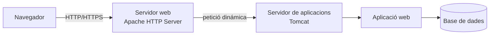
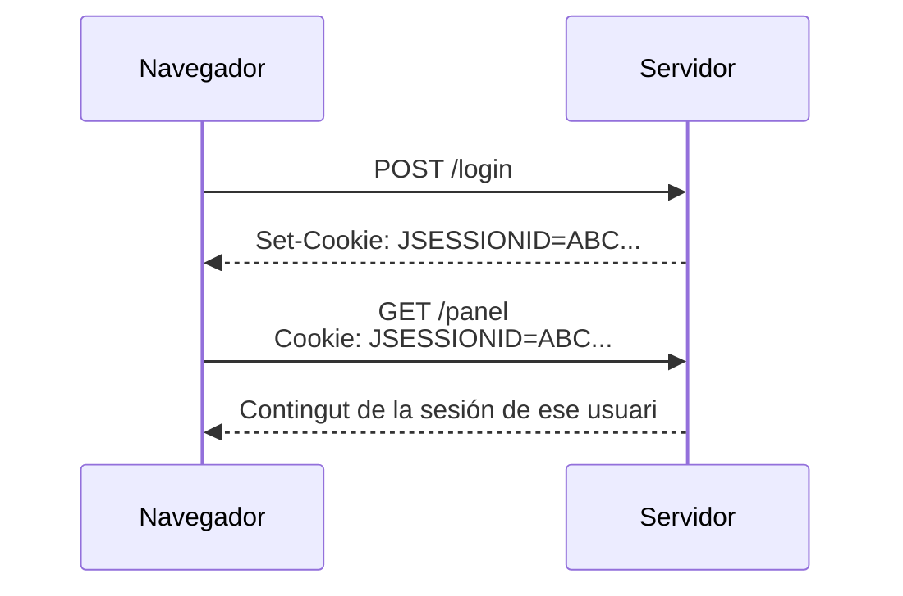
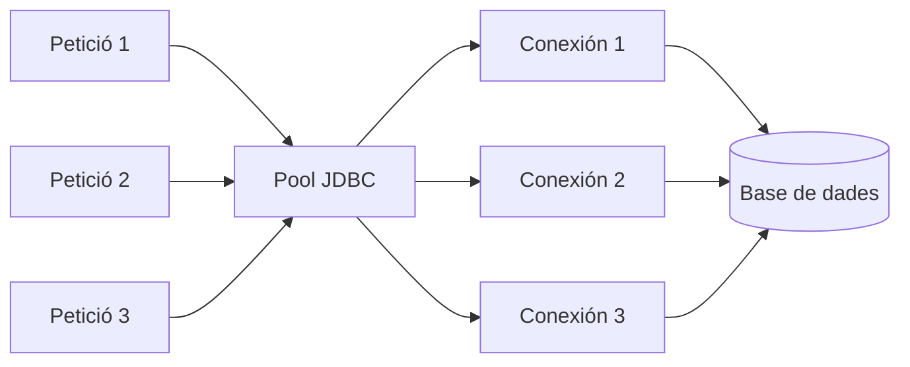
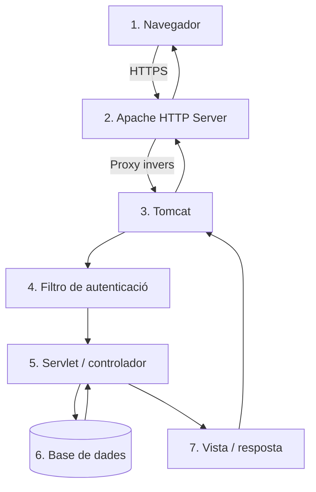

---
hide:
  - navigation
title: "UP3.1. El servidor d'aplicacions"
description: "Components, serveis i funcionament d'un servidor d'aplicacions amb Apache Tomcat."
---

# UP3.1. El servidor d'aplicacions

> **RA3.a:** s'han descrit els components i el funcionament dels serveis proporcionats pel servidor d'aplicacions.

## Què aprendràs

En aquest bloc aprendràs:

- Què és un servidor d'aplicacions;
- Quina diferència existeix entre un servidor web i un servidor d'aplicacions;
- Quins components formen part d'un servidor d'aplicacions;
- Quins serveis proporciona;
- com es processa una petició des que ix del navegador fins a què es genera la Resposta;
- Què paper exerceix Apache Tomcat dins d'una arquitectura web.

---

## 1. ¿per què necessitem un servidor d'aplicacions?

Una pàgina HTML guardada en un servidor Pot enviar-se al navegador sense necessitat de Executar cap programa. El Servidor simplement localitzal fitxer i ho retorna al Client.

Una aplicació web real sol necessitar molt més:

- identificar Usuaris;
- mantindre una Sessió iniciada;
- consultar una base de dades;
- Executar Codi;
- aplicar permisos;
- processar formularis;
- gestionar errors;
- connectar-se amb altres Serveis;
- registrar Què està ocorrent;
- atendre a diversos Usuaris simultàniament.

El programari que proporciona l'entorn necessari per a Executar aquest tipus d'aplicacions és el **Servidor d'aplicacions** o, segons de la tecnologia Utilitzada, el **Contenidor d'aplicacions web**.

!!! info "idea fonamental"
    Un Servidor d'aplicacions no conté únicament els fitxers d'una web.  
    proporciona un **entorn de execució** en què l'aplicació Pot rebre Peticions, Executar lògica i Utilitzar Serveis comuns proporcionats pel propi Servidor.

---

## 2. Servidor web i Servidor d'aplicacions

els conceptes **Servidor web** i **Servidor d'aplicacions** estan relacionats, però no són exactament el mateix.

### Servidor web

Un Servidor web està especialitzat en rebre Peticions HTTP o HTTPS i retornar recursos al Client.

alguns exemples són:

- Apache HTTP Server;
- Nginx;
- Caddy;
- Microsoft IIS.

Pot servir directament:

```text
index.html
styles.css
app.js
logo.png
manual.pdf
```

també Pot realitzar tasques com:

- redireccions;
- allotjament de diversos llocs mitjançant virtual hosts;
- terminació TLS;
- compressió;
- caché;
- proxy invers.

### Servidor d'aplicacions

Un Servidor d'aplicacions executa Codi de Servidor i proporciona Serveis a Les aplicacions desplegades.

en el ecosistema Java podem trobar:

- Apache Tomcat;
- WildFly;
- Payara;
- GlassFish;
- Open Liberty;
- WebLogic;
- WebSphere.



!!! note "Tomcat i el terme «Servidor d'aplicacions»"
    Apache Tomcat és tècnicament un **Contenidor web de Jakarta Servlet i Jakarta Pages**, no un servidor Jakarta EE complet com WildFly o Payara.

    en aquesta unitat Utilitzarem Tomcat com plataforma de desplegament d'aplicacions web Java perquè permet estudiar de manera clarals elements que ens interessen: connectors HTTP, aplicacions, servlets, Sessions, Seguretat, desplegament i Cooperació amb Apache HTTP Server.

---

## 3. El model client-Servidor

Una aplicació web funciona seguint un model client-Servidor.

El **Client**, normalment un navegador, envia una petició:

```http
GET /tienda/productos HTTP/1.1
Host: ejemplo.com
```

El Servidor processa eixa petició i retorna una Resposta:

```http
HTTP/1.1 200 OK
Content-Type: text/html
```

La petició Pot provocar que l'aplicació:

1. comprove si existeix una Sessió;
2. execute un servlet;
3. consulte una base de dades;
4. aplique regles de negoci;
5. genere una vista;
6. retorne la Resposta.


---

## 4. components d'un servidor d'aplicacions

### 4.1. connector HTTP

El connector és el component encarregat de escoltar Peticions de xarxa.

en Tomcat és habitual trobar un connector HTTP en el Port `8080`:

```text
http://servidor:8080/
```

El connector:

- obre un port;
- accepta connexions;
- interpreta HTTP;
- entrega cada petició al Contenidor;
- retorna la Resposta al Client.

---

### 4.2. Contenidor web

és el element que gestionals components de l'aplicació web.

entre altres tasques:

- càrrega l'aplicació;
- creals objetos necessaris;
- administral cicle de vida de servlets i Filtres;
- asigna URL a components;
- manté Sessions;
- processa errors;
- gestiona recursos interns.

en Tomcat, aquest Contenidor implementa Les especificaciones de **Jakarta Servlet**.

---

### 4.3. Gestor de Sessions

HTTP és un protocoho esseèncialment **sense estat**.

açò significa que, de manera predeterminada, dos Peticions independents no contenen cap informació que indique que pertanyen a la mateixa persona.

Una botiga online necessita recordar, per exemple:

```text
Usuario autenticado: ana
Carrito:
  - teclado
  - ratón
```

per alho s'utilitzen Sessions.

normalment el servidor crea un identificador de Sessió i el navegador ho conserva mitjançant una cookie com:

```text
JSESSIONID=...
```



---

### 4.4. Gestió de connexions a bases de dades

obrir una connexió nova amb una base de dades per a cada petició Pot resultar costós.

per això és freqüent Utilitzar un **pool de connexions**.

Un pool manté diverses connexions preparades:



en lloc de:

```text
abrir conexión → consultar → cerrar conexión
```

se realitza:

```text
pedir conexión al pool → consultar → devolver conexión al pool
```

açò reduce el coste de establecer connexions repetidamente.

---

### 4.5. Seguretat

Un Servidor d'aplicacions Pot colaborar en:

- autenticació;
- autorització;
- definición de rols;
- protecció de zonas d'administració;
- TLS/HTTPS;
- protecció de Sessions;
- restricciones de accés.

aquests conceptes es desenvolupen en la **UP3.4**.

---

### 4.6. registre de Esdeveniments

els **logs** permeten conéixer Què està ocorrent.

poden registrar:

- Inici i parada del servidor;
- errors;
- aplicacions desplegades;
- excepciones;
- accéss;
- problemes de configuració.

Un administrador no hauria de diagnosticar un servidor únicament observando ho que apareix en el navegador.

!!! tip "Regla de diagnòstic"
    Si una aplicació no arranca o retorna un error inesperado, una de les primeras acciones ha de ser revisar els **logs del servidor**.

---

### 4.7. Administració del desplegament

El Servidor ha de poder:

- carregar una aplicació;
- iniciarla;
- detindrela;
- volver a desplegarla;
- eliminarla;
- informar de errors durante el desplegament.

Tomcat Pot desplegar aplicacions mitjançant:

- directoris dins de `webapps`;
- Fitxers `.war`;
- Tomcat Manager;
- configuració de contextos;
- eines automatizadas.

---

## 5. Serveis proporcionats pel servidor

podem resumir els principals Serveis de la següent forma:

| Servei | funció |
|---|---|
| HTTP/HTTPS | rebre Peticions de Clients |
| Contenidor web | Executar components web |
| Sessions | mantindre estat entre Peticions |
| Seguretat | Autenticar i autorizar |
| recursos | Acceder a bases de dades i altres Serveis |
| Desplegament | instal·lar i Executar aplicacions |
| Logging | Registrar Esdeveniments i errors |
| Gestió | Administrar l'entorn |
| Rendiment | Gestionar concurrèència, connexions i recursos |

---

## 6. flux complet d'una petició

Supongamos que un Usuari accede a:

```text
https://tienda.example.com/productos/15
```

en una arquitectura amb Apache i Tomcat podria ocurrir ho següent:



Cadalement té una responsabilitat distinta.

aquesta separació permet:

- entendre mejor l'arquitectura;
- sustituir components;
- aplicar Seguretat per capes;
- escalar diferents parts;
- localitzar fallos amb més facilidad.

---

## 7. exemples de plataformes

### Apache Tomcat

especialitzat en aplicacions web Java.

Soporta tecnologies com:

- Jakarta Servlet;
- Jakarta Pages;
- WebSocket;
- Expression Language.

és el servidor principal que Utilitzarem en aquesta unitat.

### WildFly / Payara

són servidors Jakarta EE més complets.

a més del contenidor web poden proporcionar de manera integrada:

- mensajería;
- persisteència;
- transacciones empresariales;
- CDI;
- Serveis Jakarta EE adicionales.

### Jetty

Contenidor web ligero que Pot integrarse fàcilment dins de altres aplicacions.

---

## 8. Què has de retenir

!!! summary "resum"
    - El Servidor web i el servidor d'aplicacions cumplen funcions relacionades però diferents.
    - Tomcat proporciona un entorn de execució per a aplicacions web Java.
    - El Contenidor rep Peticions i les asigna a components de l'aplicació.
    - El Servidor ofereix Serveis com Sessions, Seguretat, connexions, logging i desplegament.
    - Una petició web Pot atravesar diverses capes abans de generar la Resposta.

---

## 9. glossari

**Contenidor web**  
entorn responsable de Executar components d'una aplicació web.

**connector**  
component que rep connexions mitjançant un protocolo, per exemple HTTP.

**Sessió**  
mecanisme que permet mantindre informació asociada a un Usuari entre diverses Peticions.

**Pool de connexions**  
conjunt de connexions reutilitzables, normalment a una base de dades.

**Desplegament**  
procés de instal·lar i poner en funcionament una aplicació.

**Log**  
registre de Esdeveniments producido per un sistema o aplicació.

---
