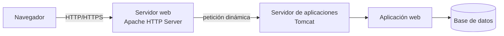
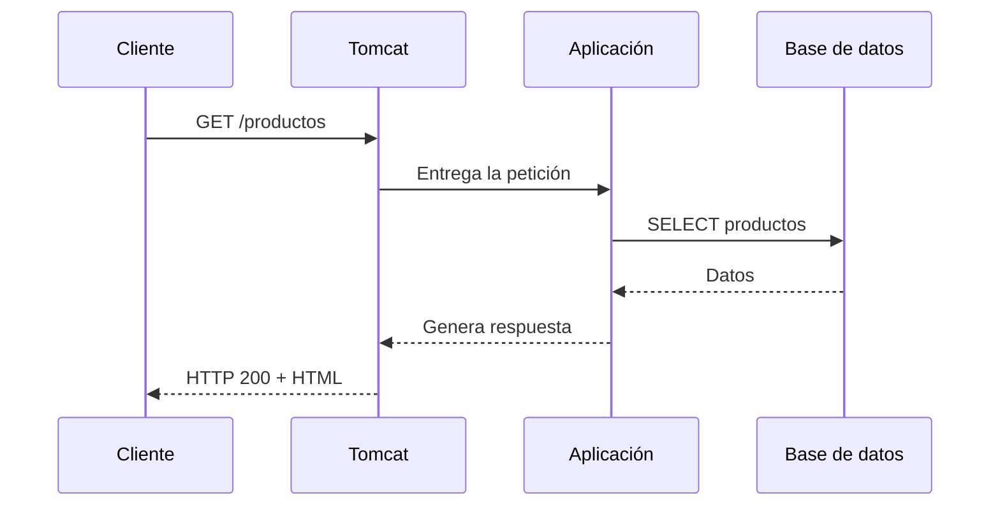
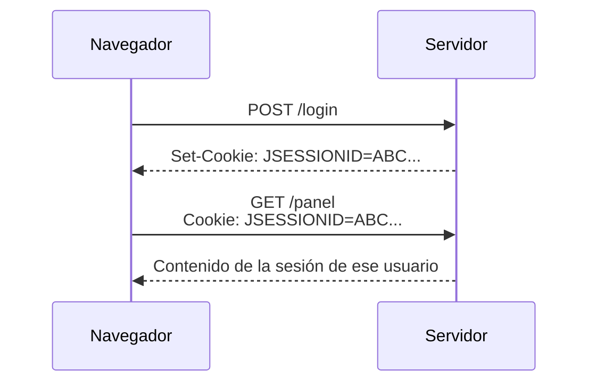
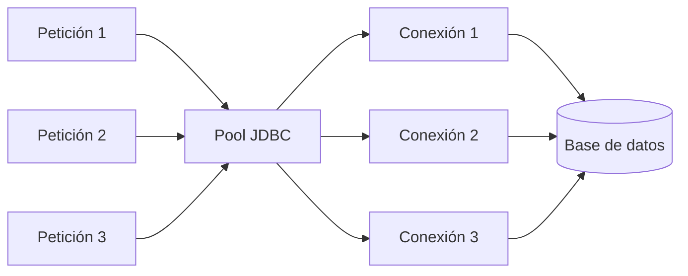
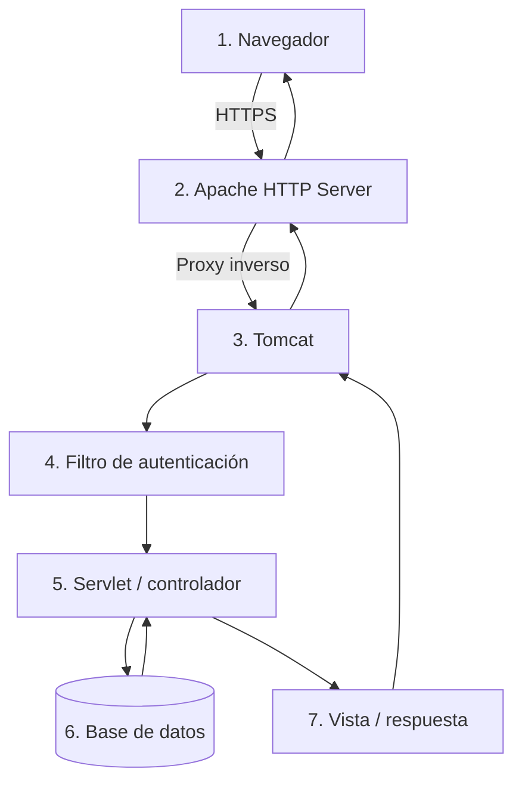

---
hide:
  - navigation
title: "UP3.1. El servidor de aplicaciones"
description: "Componentes, servicios y funcionamiento de un servidor de aplicaciones con Apache Tomcat."
---

# UP3.1. El servidor de aplicaciones

> **RA3.a:** Se han descrito los componentes y el funcionamiento de los servicios proporcionados por el servidor de aplicaciones.

## Qué vas a aprender

En este bloque aprenderás:

- qué es un servidor de aplicaciones;
- qué diferencia existe entre un servidor web y un servidor de aplicaciones;
- qué componentes forman parte de un servidor de aplicaciones;
- qué servicios proporciona;
- cómo se procesa una petición desde que sale del navegador hasta que se genera la respuesta;
- qué papel desempeña Apache Tomcat dentro de una arquitectura web.

---

## 1. ¿Por qué necesitamos un servidor de aplicaciones?

Una página HTML guardada en un servidor puede enviarse al navegador sin necesidad de ejecutar ningún programa. El servidor simplemente localiza el archivo y lo devuelve al cliente.

Una aplicación web real suele necesitar mucho más:

- identificar usuarios;
- mantener una sesión iniciada;
- consultar una base de datos;
- ejecutar código;
- aplicar permisos;
- procesar formularios;
- gestionar errores;
- conectarse con otros servicios;
- registrar qué está ocurriendo;
- atender a varios usuarios simultáneamente.

El software que proporciona el entorno necesario para ejecutar este tipo de aplicaciones es el **servidor de aplicaciones** o, dependiendo de la tecnología utilizada, el **contenedor de aplicaciones web**.

!!! info "Idea fundamental"
    Un servidor de aplicaciones no contiene únicamente los archivos de una web.  
    Proporciona un **entorno de ejecución** en el que la aplicación puede recibir peticiones, ejecutar lógica y utilizar servicios comunes proporcionados por el propio servidor.

---

## 2. Servidor web y servidor de aplicaciones

Los conceptos **servidor web** y **servidor de aplicaciones** están relacionados, pero no son exactamente lo mismo.

### Servidor web

Un servidor web está especializado en recibir peticiones HTTP o HTTPS y devolver recursos al cliente.

Algunos ejemplos son:

- Apache HTTP Server;
- Nginx;
- Caddy;
- Microsoft IIS.

Puede servir directamente:

```text
index.html
styles.css
app.js
logo.png
manual.pdf
```

También puede realizar tareas como:

- redirecciones;
- alojamiento de varios sitios mediante virtual hosts;
- terminación TLS;
- compresión;
- caché;
- proxy inverso.

### Servidor de aplicaciones

Un servidor de aplicaciones ejecuta código de servidor y proporciona servicios a las aplicaciones desplegadas.

En el ecosistema Java podemos encontrar:

- Apache Tomcat;
- WildFly;
- Payara;
- GlassFish;
- Open Liberty;
- WebLogic;
- WebSphere.



!!! note "Tomcat y el término «servidor de aplicaciones»"
    Apache Tomcat es técnicamente un **contenedor web de Jakarta Servlet y Jakarta Pages**, no un servidor Jakarta EE completo como WildFly o Payara.

    En esta unidad utilizaremos Tomcat como plataforma de despliegue de aplicaciones web Java porque permite estudiar de manera clara los elementos que nos interesan: conectores HTTP, aplicaciones, servlets, sesiones, seguridad, despliegue y cooperación con Apache HTTP Server.

---

## 3. El modelo cliente-servidor

Una aplicación web funciona siguiendo un modelo cliente-servidor.

El **cliente**, normalmente un navegador, envía una petición:

```http
GET /tienda/productos HTTP/1.1
Host: ejemplo.com
```

El servidor procesa esa petición y devuelve una respuesta:

```http
HTTP/1.1 200 OK
Content-Type: text/html
```

La petición puede provocar que la aplicación:

1. compruebe si existe una sesión;
2. ejecute un servlet;
3. consulte una base de datos;
4. aplique reglas de negocio;
5. genere una vista;
6. devuelva la respuesta.



---

## 4. Componentes de un servidor de aplicaciones

### 4.1. Conector HTTP

El conector es el componente encargado de escuchar peticiones de red.

En Tomcat es habitual encontrar un conector HTTP en el puerto `8080`:

```text
http://servidor:8080/
```

El conector:

- abre un puerto;
- acepta conexiones;
- interpreta HTTP;
- entrega cada petición al contenedor;
- devuelve la respuesta al cliente.

---

### 4.2. Contenedor web

Es el elemento que gestiona los componentes de la aplicación web.

Entre otras tareas:

- carga la aplicación;
- crea los objetos necesarios;
- administra el ciclo de vida de servlets y filtros;
- asigna URL a componentes;
- mantiene sesiones;
- procesa errores;
- gestiona recursos internos.

En Tomcat, este contenedor implementa las especificaciones de **Jakarta Servlet**.

---

### 4.3. Gestor de sesiones

HTTP es un protocolo esencialmente **sin estado**.

Esto significa que, de manera predeterminada, dos peticiones independientes no contienen ninguna información que indique que pertenecen a la misma persona.

Una tienda online necesita recordar, por ejemplo:

```text
Usuario autenticado: ana
Carrito:
  - teclado
  - ratón
```

Para ello se utilizan sesiones.

Normalmente el servidor crea un identificador de sesión y el navegador lo conserva mediante una cookie como:

```text
JSESSIONID=...
```



---

### 4.4. Gestión de conexiones a bases de datos

Abrir una conexión nueva con una base de datos para cada petición puede resultar costoso.

Por ello es frecuente utilizar un **pool de conexiones**.

Un pool mantiene varias conexiones preparadas:



En lugar de:

```text
abrir conexión → consultar → cerrar conexión
```

se realiza:

```text
pedir conexión al pool → consultar → devolver conexión al pool
```

Esto reduce el coste de establecer conexiones repetidamente.

---

### 4.5. Seguridad

Un servidor de aplicaciones puede colaborar en:

- autenticación;
- autorización;
- definición de roles;
- protección de zonas de administración;
- TLS/HTTPS;
- protección de sesiones;
- restricciones de acceso.

Estos conceptos se desarrollan en la **UP3.4**.

---

### 4.6. Registro de eventos

Los **logs** permiten conocer qué está ocurriendo.

Pueden registrar:

- inicio y parada del servidor;
- errores;
- aplicaciones desplegadas;
- excepciones;
- accesos;
- problemas de configuración.

Un administrador no debería diagnosticar un servidor únicamente observando lo que aparece en el navegador.

!!! tip "Regla de diagnóstico"
    Si una aplicación no arranca o devuelve un error inesperado, una de las primeras acciones debe ser revisar los **logs del servidor**.

---

### 4.7. Administración del despliegue

El servidor debe poder:

- cargar una aplicación;
- iniciarla;
- detenerla;
- volver a desplegarla;
- eliminarla;
- informar de errores durante el despliegue.

Tomcat puede desplegar aplicaciones mediante:

- directorios dentro de `webapps`;
- archivos `.war`;
- Tomcat Manager;
- configuración de contextos;
- herramientas automatizadas.

---

## 5. Servicios proporcionados por el servidor

Podemos resumir los principales servicios de la siguiente forma:

| Servicio | Función |
|---|---|
| HTTP/HTTPS | Recibir peticiones de clientes |
| Contenedor web | Ejecutar componentes web |
| Sesiones | Mantener estado entre peticiones |
| Seguridad | Autenticar y autorizar |
| Recursos | Acceder a bases de datos y otros servicios |
| Despliegue | Instalar y ejecutar aplicaciones |
| Logging | Registrar eventos y errores |
| Gestión | Administrar el entorno |
| Rendimiento | Gestionar concurrencia, conexiones y recursos |

---

## 6. Flujo completo de una petición

Supongamos que un usuario accede a:

```text
https://tienda.example.com/productos/15
```

En una arquitectura con Apache y Tomcat podría ocurrir lo siguiente:



Cada elemento tiene una responsabilidad distinta.

Esta separación permite:

- entender mejor la arquitectura;
- sustituir componentes;
- aplicar seguridad por capas;
- escalar diferentes partes;
- localizar fallos con más facilidad.

---

## 7. Ejemplos de plataformas

### Apache Tomcat

Especializado en aplicaciones web Java.

Soporta tecnologías como:

- Jakarta Servlet;
- Jakarta Pages;
- WebSocket;
- Expression Language.

Es el servidor principal que utilizaremos en esta unidad.

### WildFly / Payara

Son servidores Jakarta EE más completos.

Además del contenedor web pueden proporcionar de forma integrada:

- mensajería;
- persistencia;
- transacciones empresariales;
- CDI;
- servicios Jakarta EE adicionales.

### Jetty

Contenedor web ligero que puede integrarse fácilmente dentro de otras aplicaciones.

---

## 8. Qué debes retener

!!! summary "Resumen"
    - El servidor web y el servidor de aplicaciones cumplen funciones relacionadas pero diferentes.
    - Tomcat proporciona un entorno de ejecución para aplicaciones web Java.
    - El contenedor recibe peticiones y las asigna a componentes de la aplicación.
    - El servidor ofrece servicios como sesiones, seguridad, conexiones, logging y despliegue.
    - Una petición web puede atravesar varias capas antes de generar la respuesta.

---

## 9. Glosario

**Contenedor web**  
Entorno responsable de ejecutar componentes de una aplicación web.

**Conector**  
Componente que recibe conexiones mediante un protocolo, por ejemplo HTTP.

**Sesión**  
Mecanismo que permite mantener información asociada a un usuario entre varias peticiones.

**Pool de conexiones**  
Conjunto de conexiones reutilizables, normalmente a una base de datos.

**Despliegue**  
Proceso de instalar y poner en funcionamiento una aplicación.

**Log**  
Registro de eventos producido por un sistema o aplicación.

---
