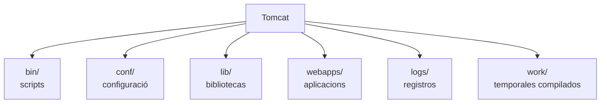
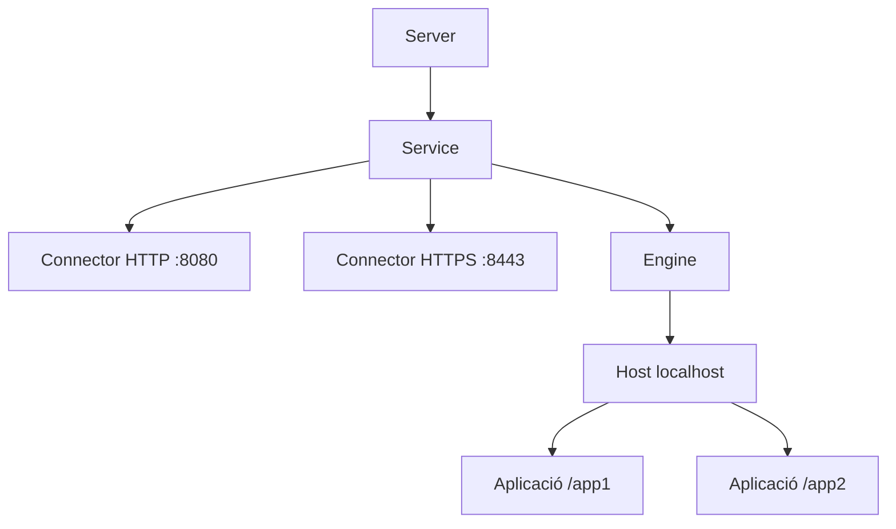
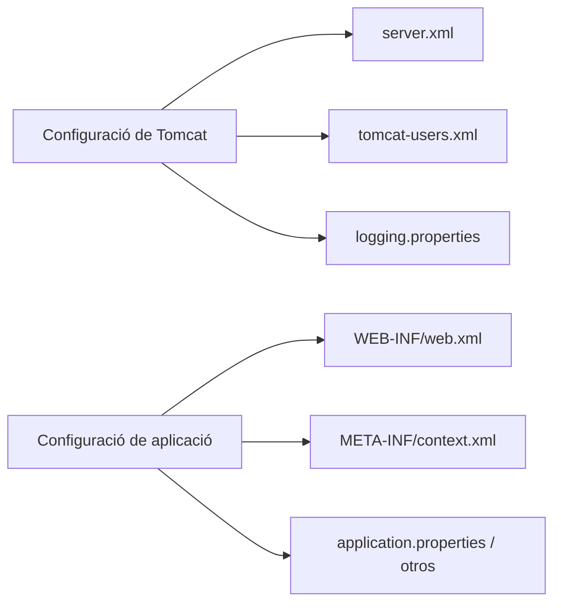
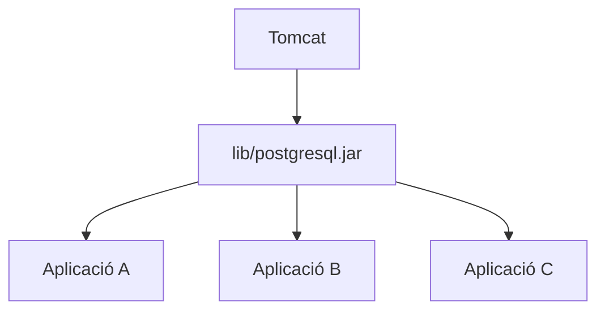
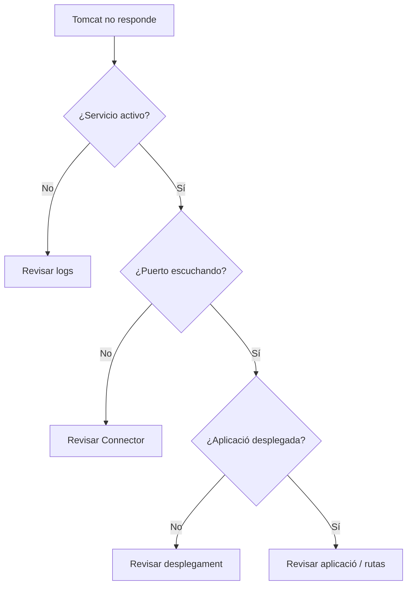

---
hide:
  - navigation
title: "UP3.2. Fitxers de configuració i biblioteques compartides"
description: "Fitxers de configuració, directoris i biblioteques compartides de Apache Tomcat."
---

# UP3.2. Fitxers de configuració i biblioteques compartides

> **RA3.b:** S'han identificat els principals fitxers de configuració i les biblioteques compartides.

## Què aprendràs

en finalitzar aquest bloc podràs identificar:

- la diferència entre configuració del servidor i configuració d'una aplicació;
- els principals directoris de Tomcat;
- la funció de `server.xml`;
- la funció de `web.xml`;
- la funció de `context.xml`;
- la funció de `tomcat-users.xml`;
- on és troben Les Biblioteques;
- la diferèència entre una biblioteca privada i una biblioteca compartida;
- com afecta la configuració al desplegament.

---

## 1. Configuració davant de Codi

El Codi d'una aplicació indica **Què fa** l'aplicació.

La configuració determina **com és executa en un entorn concreto**.

per exemple, no sería convenient programar directament en Java:

```java
String database = "192.168.1.20";
String password = "123456";
```

El Servidor de producció i el servidor de Proves podrian Utilitzar configuraciones diferents.

per això convé separar:

```text
Código
Configuración
Credenciales
Infraestructura
```

!!! info "principi important"
    Una mateixa aplicació hauria de poder desplegarse en diferents entorns cambiando principalment el seu **configuració**, no modificando el seu Codi font.

---

## 2. `CATALINA_HOME` i `CATALINA_BASE`

en Tomcat apareixen habitualment aquests conceptes:

### `CATALINA_HOME`

directori on és troba instal·lat Tomcat.

inclou els binarios i Biblioteques de la instal·lació.

### `CATALINA_BASE`

directori que conté la configuració i Dades d'una instaència concreta.

en instalaciones sencillas ambos poden apuntar al mateix lloc.

Una estructura típica Pot ser:

```text
apache-tomcat/
├── bin/
├── conf/
├── lib/
├── logs/
├── temp/
├── webapps/
└── work/
```

---

## 3. directoris importants

| directori | ús |
|---|---|
| `bin/` | Scripts de Inici i parada |
| `conf/` | Configuració |
| `lib/` | Biblioteques disponibles per a Tomcat i aplicacions |
| `logs/` | Logs |
| `webapps/` | Aplicacions desplegades |
| `temp/` | Fitxers temporales |
| `work/` | Fitxers generados per Tomcat |



---

## 4. `server.xml`

`server.xml` define la estructura principal d'una instaència de Tomcat.

és troba normalment en:

```text
$CATALINA_BASE/conf/server.xml
```

en aquest fitxer apareixen elements com:

- connectors;
- Serveis;
- engines;
- hosts;
- Ports;
- configuració TLS.

Un connector HTTP típico Pot tindre aquesta forma:

```xml
<Connector
    port="8080"
    protocol="HTTP/1.1"
    connectionTimeout="20000"
    redirectPort="8443" />
```

### Interpretació

`port="8080"`

:   Tomcat escucha connexions HTTP en el Port 8080.

`protocol="HTTP/1.1"`

:   sutilitza un connector HTTP.

`connectionTimeout="20000"`

:   Establece un temps de espera expresado en milisegundos.

`redirectPort="8443"`

:   Indical Port segur al que Pot redirigirse una petició quan una restricción de Seguretat requereix transporte confideèncial.

!!! warning "Modificar `server.xml`"
    Un error de sintaxis Pot impedir que Tomcat arrancada.  
    abans de modificarho convé mantindre una còpia de Seguretat i revisar el log després del reinici.

---

## 5. Jerarquia simplificada de `server.xml`

Tomcat organiza internament sus components mitjançant una Jerarquia.



No és necessari memorizar tota la estructura XML, però sí comprendre la relació:

```text
conector → servicio → host → aplicacions
```

---

## 6. `web.xml`

`web.xml` és el **descriptor de desplegament** d'una aplicació web Java.

dins d'una aplicació sol estar ubicado en:

```text
WEB-INF/web.xml
```

Pot definir:

- servlets;
- mapatges;
- Filtres;
- listindres;
- pàgines de error;
- parámetros;
- configuració de Sessió;
- restricciones de Seguretat.

exemple:

```xml
<servlet>
    <servlet-name>HolaServlet</servlet-name>
    <servlet-class>com.ejemplo.HolaServlet</servlet-class>
</servlet>

<servlet-mapping>
    <servlet-name>HolaServlet</servlet-name>
    <url-pattern>/hola</url-pattern>
</servlet-mapping>
```

en aquest cas:

```text
/hola
   ↓
HolaServlet
   ↓
com.ejemplo.HolaServlet
```

---

## 7. ¿sempre hi ha que Utilitzar `web.xml`?

No.

Les versions modernas de la especificación Servlet permeten Utilitzar **Anotacions**.

per exemple:

```java
@WebServlet("/hola")
public class HolaServlet extends HttpServlet {
}
```

aquesta anotación Pot sustituir la declaración equivalnt en `web.xml`.

!!! note "Configuració declarativa i Anotacions"
    és habitual trobar ambdues estratègies:

    - Anotacions dins del codi;
    - configuració centralizada en `web.xml`.

    comprendre `web.xml` segueix siendo important perquè permet entendre com és es construeix una aplicació web Java i perquè determinadas configuraciones siguen siendo més claras o centralizadas mitjançant el descriptor.

---

## 8. `context.xml`

Un **Context** representa una aplicació web.

`context.xml` permet definir parámetros o recursos relacionats amb eixe contexto.

Pot utilizarse per a:

- configurar un `DataSource`;
- parámetros de contexto;
- comportament de cookies;
- recursos JNDI;
- opcions específicas d'una aplicació.

exemple conceptual:

```xml
<Context>
    <Resource
        name="jdbc/tienda"
        auth="Container"
        type="javax.sql.DataSource"
        maxTotal="20"
        username="usuario"
        password="secreto"
        driverClassName="org.postgresql.Driver"
        url="jdbc:postgresql://db:5432/tienda"/>
</Context>
```

La aplicació Pot sol·licitar el recurs mitjançant JNDI sense conéixer tots els detalles de connexió.

---

## 9. `tomcat-users.xml`

sutilitza per a configurar Usuaris i rols del mecanisme de Seguretat intern de Tomcat.

exemple:

```xml
<role rolename="manager-gui"/>

<user
    username="manager"
    password="una-clave-segura"
    roles="manager-gui"/>
```

!!! danger "No és una configuració per a copiar sense pensar a producció"
    els usuaris dl'entorn d'administració han de protegerse cuidadosamente.

    Nunca han de utilizarse Contrasenyes triviales i el accés a Les aplicacions d'administració hauria de estar restringido.

---

## 10. altres Fitxers rellevants

### `catalina.properties`

conté propietats relacionades amb el càrregador de clases i altres elements interns de Tomcat.

### `logging.properties`

permet configurar el sistema de logging.

### Fitxers de configuració de les aplicacions

Una aplicació pot utilitzar:

```text
.properties
.yml
.yaml
.json
.xml
```

per exemple:

```properties
db.host=localhost
db.port=5432
db.name=tienda
```

---

## 11. Configuració global i configuració d'aplicació



Conviene distinguir clarament Què configuració pertenece al **Servidor** i cuál pertenece a una **aplicació concreta**.

---

# 12. Biblioteques Java

en Java, una biblioteca es distribuye habitualment com fitxer `.jar`.

Un JAR Pot contindre:

- clases Java;
- recursos;
- metadatos.

exemples habituals:

- driver JDBC de PostgreSQL;
- driver JDBC de MySQL;
- librerías de logging;
- Clients HTTP;
- Biblioteques de serialización JSON.

---

## 13. biblioteca privada d'una aplicació

Una aplicació web Pot incluir Biblioteques en:

```text
WEB-INF/lib/
```

exemple:

```text
miapp/
└── WEB-INF/
    ├── classes/
    ├── lib/
    │   ├── postgresql.jar
    │   └── otra-libreria.jar
    └── web.xml
```

aquestes Biblioteques formen part de la pròpia aplicació.

### avantatges

- l'aplicació és més autocontenida;
- pot utilitzar el seu pròpia versió;
- es reducen dependències externes del servidor.

---

## 14. biblioteques compartides

Tomcat dispone també de:

```text
$CATALINA_BASE/lib/
```

Les Biblioteques col·locadas ací poden estar disponibles per al Servidor i per a Les aplicacions segons el model de Càrrega de classes.

Un exemple típico Pot ser un driver JDBC utilitzat com recurs gestionado per Tomcat.



### avantatge

Evita duplicar una biblioteca quan diverses aplicacions necessiten exactament el mateix component.

### risc

Una actualització Pot afectar simultàniament a diverses aplicacions.

!!! warning "versions incompatibles"
    compartir Biblioteques no sempre és mejor.

    Si l'aplicació A necessita la versió 1 i l'aplicació B necessita la versió 2 d'una mateixa biblioteca, col·locar una única versió global Pot provocar conflictos.

---

## 15. Càrrega de classes

Java Utilitza **class loaders** per a localitzar Les clases que necessita.

des del punto de vista del desplegament, és important comprendre aquesta idea:

```text
Aplicación
 ├─ clases propias
 ├─ WEB-INF/lib
 └─ bibliotecas visibles desde el servidor
```

Un error del tipus:

```text
ClassNotFoundException
```

o:

```text
NoClassDefFoundError
```

sol indicar que existeix un problema de disponibilitat o compatibilidad de clases.

---

## 16. Què ocorre al modificar la configuració

Una modificación no sempre entra en vigor automàticament.

segons del fitxer i del tipus de Canvi Pot ser necessari:

```bash
sudo systemctl restart tomcat
```

o reiniciar manualment la instaència.

després de qualsevol Canvi important:

1. comprovar que el Servei arranca;
2. revisar logs;
3. probar l'aplicació;
4. verificar la configuració afectada.

---

## 17. diagnòstic bàsic

Supongamos que tras modificar `server.xml` Tomcat no respon.

El razonamiento hauria de ser:



---

## 18. Què has de retenir

!!! summary "resum"
    - `server.xml` configura la instaència i sus connectors.
    - `web.xml` describe elements d'una aplicació.
    - `context.xml` Pot definir recursos i opcions del contexto.
    - `tomcat-users.xml` gestiona Usuaris i rols interns.
    - `WEB-INF/lib` conté dependències privades d'una aplicació.
    - `lib/` Pot contindre biblioteques compartides.
    - Un Canvi de configuració ha de verificarse mitjançant estat, logs i Proves.

---

## 19. glossari

**Descriptor de desplegament**  
fitxer que describe com ha de desplegarse o comportarse una aplicació.

**JAR**  
fitxer que empaqueta clases i recursos Java.

**JNDI**  
API de Java Utilitzada per a localitzar recursos mitjançant noms.

**Context**  
representació d'una aplicació web dins de Tomcat.

**Class loader**  
component encarregat de carregar clases Java.

---
