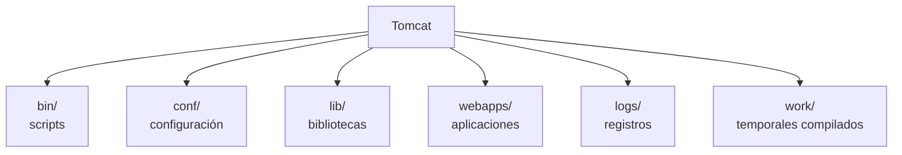
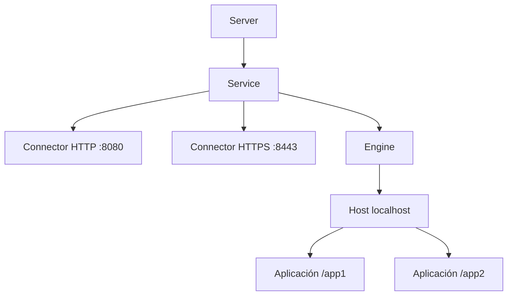
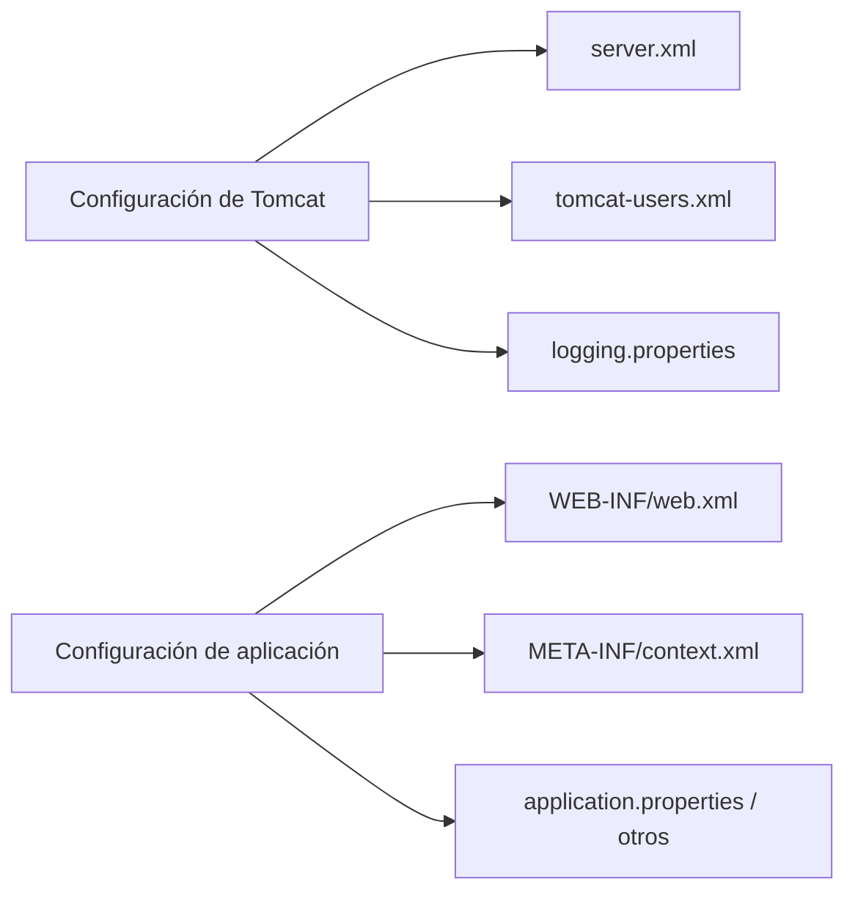
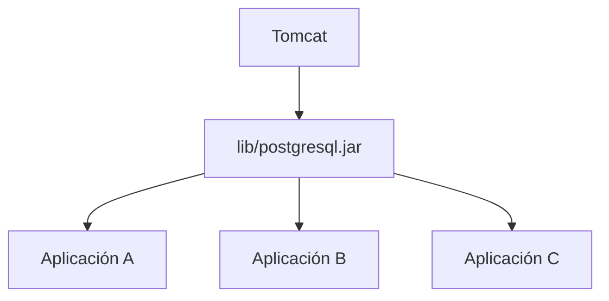
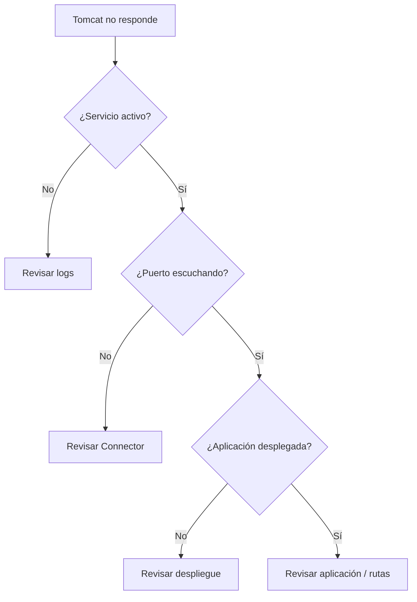

---
hide:
  - navigation
title: "UP3.2. Archivos de configuración y bibliotecas compartidas"
description: "Ficheros de configuración, directorios y bibliotecas compartidas de Apache Tomcat."
---

# UP3.2. Archivos de configuración y bibliotecas compartidas

> **RA3.b:** Se han identificado los principales ficheros de configuración y de bibliotecas compartidas.

## Qué vas a aprender

Al finalizar este bloque podrás identificar:

- la diferencia entre configuración del servidor y configuración de una aplicación;
- los principales directorios de Tomcat;
- la función de `server.xml`;
- la función de `web.xml`;
- la función de `context.xml`;
- la función de `tomcat-users.xml`;
- dónde se encuentran las bibliotecas;
- la diferencia entre una biblioteca privada y una biblioteca compartida;
- cómo afecta la configuración al despliegue.

---

## 1. Configuración frente a código

El código de una aplicación indica **qué hace** la aplicación.

La configuración determina **cómo se ejecuta en un entorno concreto**.

Por ejemplo, no sería conveniente programar directamente en Java:

```java
String database = "192.168.1.20";
String password = "123456";
```

El servidor de producción y el servidor de pruebas podrían utilizar configuraciones diferentes.

Por eso conviene separar:

```text
Código
Configuración
Credenciales
Infraestructura
```

!!! info "Principio importante"
    Una misma aplicación debería poder desplegarse en distintos entornos cambiando principalmente su **configuración**, no modificando su código fuente.

---

## 2. `CATALINA_HOME` y `CATALINA_BASE`

En Tomcat aparecen habitualmente estos conceptos:

### `CATALINA_HOME`

Directorio donde se encuentra instalado Tomcat.

Incluye los binarios y bibliotecas de la instalación.

### `CATALINA_BASE`

Directorio que contiene la configuración y datos de una instancia concreta.

En instalaciones sencillas ambos pueden apuntar al mismo lugar.

Una estructura típica puede ser:

```text
apache-tomcat/
├── bin/
├── conf/
├── lib/
├── logs/
├── temp/
├── webapps/
└── work/
```

---

## 3. Directorios importantes

| Directorio | Uso |
|---|---|
| `bin/` | Scripts de inicio y parada |
| `conf/` | Configuración |
| `lib/` | Bibliotecas disponibles para Tomcat y aplicaciones |
| `logs/` | Logs |
| `webapps/` | Aplicaciones desplegadas |
| `temp/` | Archivos temporales |
| `work/` | Archivos generados por Tomcat |



---

## 4. `server.xml`

`server.xml` define la estructura principal de una instancia de Tomcat.

Se encuentra normalmente en:

```text
$CATALINA_BASE/conf/server.xml
```

En este fichero aparecen elementos como:

- conectores;
- servicios;
- engines;
- hosts;
- puertos;
- configuración TLS.

Un conector HTTP típico puede tener esta forma:

```xml
<Connector
    port="8080"
    protocol="HTTP/1.1"
    connectionTimeout="20000"
    redirectPort="8443" />
```

### Interpretación

`port="8080"`

:   Tomcat escucha conexiones HTTP en el puerto 8080.

`protocol="HTTP/1.1"`

:   Se utiliza un conector HTTP.

`connectionTimeout="20000"`

:   Establece un tiempo de espera expresado en milisegundos.

`redirectPort="8443"`

:   Indica el puerto seguro al que puede redirigirse una petición cuando una restricción de seguridad requiere transporte confidencial.

!!! warning "Modificar `server.xml`"
    Un error de sintaxis puede impedir que Tomcat arranque.  
    Antes de modificarlo conviene mantener una copia de seguridad y revisar el log después del reinicio.

---

## 5. Jerarquía simplificada de `server.xml`

Tomcat organiza internamente sus componentes mediante una jerarquía.



No es necesario memorizar toda la estructura XML, pero sí comprender la relación:

```text
conector → servicio → host → aplicaciones
```

---

## 6. `web.xml`

`web.xml` es el **descriptor de despliegue** de una aplicación web Java.

Dentro de una aplicación suele estar ubicado en:

```text
WEB-INF/web.xml
```

Puede definir:

- servlets;
- mapeos;
- filtros;
- listeners;
- páginas de error;
- parámetros;
- configuración de sesión;
- restricciones de seguridad.

Ejemplo:

```xml
<servlet>
    <servlet-name>HolaServlet</servlet-name>
    <servlet-class>com.ejemplo.HolaServlet</servlet-class>
</servlet>

<servlet-mapping>
    <servlet-name>HolaServlet</servlet-name>
    <url-pattern>/hola</url-pattern>
</servlet-mapping>
```

En este caso:

```text
/hola
   ↓
HolaServlet
   ↓
com.ejemplo.HolaServlet
```

---

## 7. ¿Siempre hay que utilizar `web.xml`?

No.

Las versiones modernas de la especificación Servlet permiten utilizar **anotaciones**.

Por ejemplo:

```java
@WebServlet("/hola")
public class HolaServlet extends HttpServlet {
}
```

Esta anotación puede sustituir la declaración equivalente en `web.xml`.

!!! note "Configuración declarativa y anotaciones"
    Es habitual encontrar ambas estrategias:

    - anotaciones dentro del código;
    - configuración centralizada en `web.xml`.

    Comprender `web.xml` sigue siendo importante porque permite entender cómo se construye una aplicación web Java y porque determinadas configuraciones siguen siendo más claras o centralizadas mediante el descriptor.

---

## 8. `context.xml`

Un **Context** representa una aplicación web.

`context.xml` permite definir parámetros o recursos relacionados con ese contexto.

Puede utilizarse para:

- configurar un `DataSource`;
- parámetros de contexto;
- comportamiento de cookies;
- recursos JNDI;
- opciones específicas de una aplicación.

Ejemplo conceptual:

```xml
<Context>
    <Resource
        name="jdbc/tienda"
        auth="Container"
        type="javax.sql.DataSource"
        maxTotal="20"
        username="usuario"
        password="secreto"
        driverClassName="org.postgresql.Driver"
        url="jdbc:postgresql://db:5432/tienda"/>
</Context>
```

La aplicación puede solicitar el recurso mediante JNDI sin conocer todos los detalles de conexión.

---

## 9. `tomcat-users.xml`

Se utiliza para configurar usuarios y roles del mecanismo de seguridad interno de Tomcat.

Ejemplo:

```xml
<role rolename="manager-gui"/>

<user
    username="manager"
    password="una-clave-segura"
    roles="manager-gui"/>
```

!!! danger "No es una configuración para copiar sin pensar a producción"
    Los usuarios del entorno de administración deben protegerse cuidadosamente.

    Nunca deben utilizarse contraseñas triviales y el acceso a las aplicaciones de administración debería estar restringido.

---

## 10. Otros archivos relevantes

### `catalina.properties`

Contiene propiedades relacionadas con el cargador de clases y otros elementos internos de Tomcat.

### `logging.properties`

Permite configurar el sistema de logging.

### Ficheros de configuración de las aplicaciones

Una aplicación puede utilizar:

```text
.properties
.yml
.yaml
.json
.xml
```

Por ejemplo:

```properties
db.host=localhost
db.port=5432
db.name=tienda
```

---

## 11. Configuración global y configuración de aplicación



Conviene distinguir claramente qué configuración pertenece al **servidor** y cuál pertenece a una **aplicación concreta**.

---

# 12. Bibliotecas Java

En Java, una biblioteca se distribuye habitualmente como archivo `.jar`.

Un JAR puede contener:

- clases Java;
- recursos;
- metadatos.

Ejemplos habituales:

- driver JDBC de PostgreSQL;
- driver JDBC de MySQL;
- librerías de logging;
- clientes HTTP;
- bibliotecas de serialización JSON.

---

## 13. Biblioteca privada de una aplicación

Una aplicación web puede incluir bibliotecas en:

```text
WEB-INF/lib/
```

Ejemplo:

```text
miapp/
└── WEB-INF/
    ├── classes/
    ├── lib/
    │   ├── postgresql.jar
    │   └── otra-libreria.jar
    └── web.xml
```

Estas bibliotecas forman parte de la propia aplicación.

### Ventajas

- la aplicación es más autocontenida;
- puede utilizar su propia versión;
- se reducen dependencias externas del servidor.

---

## 14. Bibliotecas compartidas

Tomcat dispone también de:

```text
$CATALINA_BASE/lib/
```

Las bibliotecas colocadas aquí pueden estar disponibles para el servidor y para las aplicaciones según el modelo de carga de clases.

Un ejemplo típico puede ser un driver JDBC utilizado como recurso gestionado por Tomcat.



### Ventaja

Evita duplicar una biblioteca cuando varias aplicaciones necesitan exactamente el mismo componente.

### Riesgo

Una actualización puede afectar simultáneamente a varias aplicaciones.

!!! warning "Versiones incompatibles"
    Compartir bibliotecas no siempre es mejor.

    Si la aplicación A necesita la versión 1 y la aplicación B necesita la versión 2 de una misma biblioteca, colocar una única versión global puede provocar conflictos.

---

## 15. Carga de clases

Java utiliza **class loaders** para localizar las clases que necesita.

Desde el punto de vista del despliegue, es importante comprender esta idea:

```text
Aplicación
 ├─ clases propias
 ├─ WEB-INF/lib
 └─ bibliotecas visibles desde el servidor
```

Un error del tipo:

```text
ClassNotFoundException
```

o:

```text
NoClassDefFoundError
```

suele indicar que existe un problema de disponibilidad o compatibilidad de clases.

---

## 16. Qué ocurre al modificar la configuración

Una modificación no siempre entra en vigor automáticamente.

Dependiendo del fichero y del tipo de cambio puede ser necesario:

```bash
sudo systemctl restart tomcat
```

o reiniciar manualmente la instancia.

Después de cualquier cambio importante:

1. comprobar que el servicio arranca;
2. revisar logs;
3. probar la aplicación;
4. verificar la configuración afectada.

---

## 17. Diagnóstico básico

Supongamos que tras modificar `server.xml` Tomcat no responde.

El razonamiento debería ser:



---

## 18. Qué debes retener

!!! summary "Resumen"
    - `server.xml` configura la instancia y sus conectores.
    - `web.xml` describe elementos de una aplicación.
    - `context.xml` puede definir recursos y opciones del contexto.
    - `tomcat-users.xml` gestiona usuarios y roles internos.
    - `WEB-INF/lib` contiene dependencias privadas de una aplicación.
    - `lib/` puede contener bibliotecas compartidas.
    - Un cambio de configuración debe verificarse mediante estado, logs y pruebas.

---

## 19. Glosario

**Descriptor de despliegue**  
Fichero que describe cómo debe desplegarse o comportarse una aplicación.

**JAR**  
Archivo que empaqueta clases y recursos Java.

**JNDI**  
API de Java utilizada para localizar recursos mediante nombres.

**Context**  
Representación de una aplicación web dentro de Tomcat.

**Class loader**  
Componente encargado de cargar clases Java.

---
