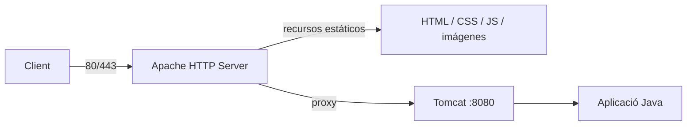
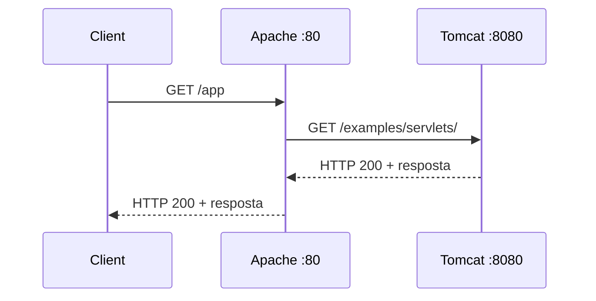
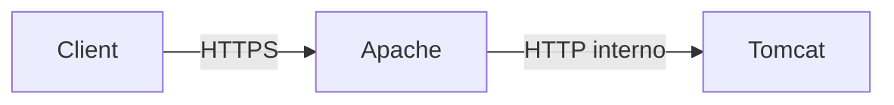
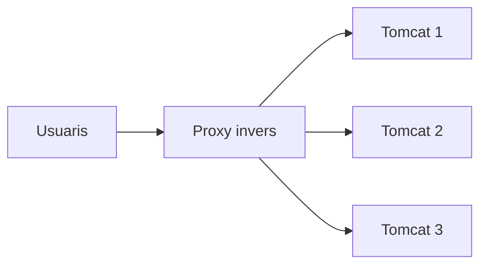
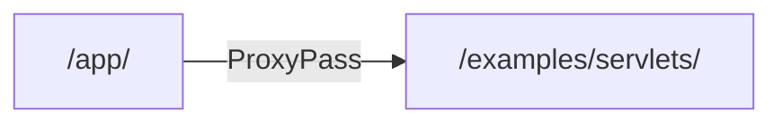
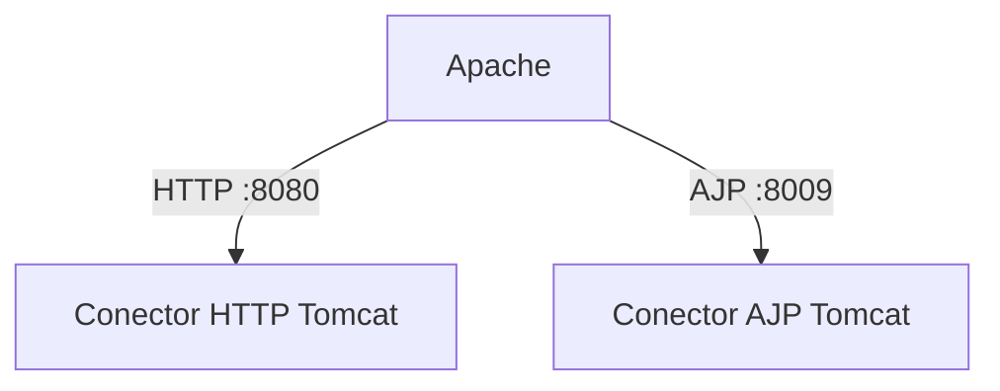
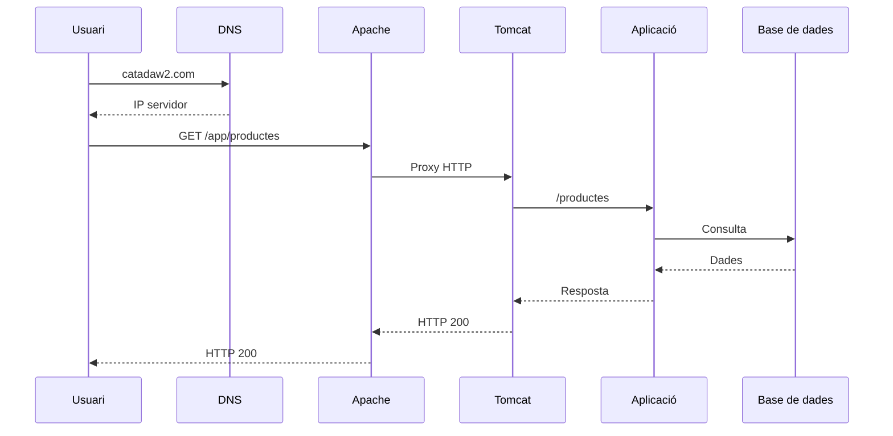
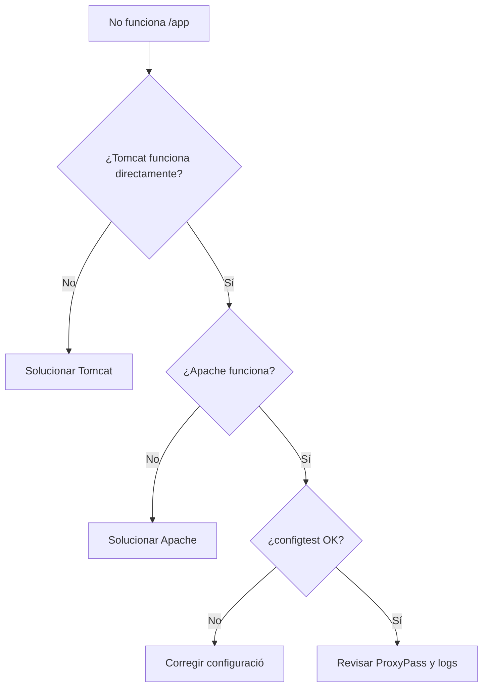

---
hide:
  - navigation
title: "UP3.3. Cooperació entre Apache HTTP Server i Tomcat"
description: "Integració del servidor web Apache amb Apache Tomcat mitjançant un proxy invers."
---

# UP3.3. Cooperació entre Apache HTTP Server i Tomcat

> **RA3.c:** S'ha configurat el servidor d'aplicacions perquè coopere amb el servidor web.

## Què aprendràs

En aquest bloc estudiaràs:

- per què s'utilitzen conjuntament Apache HTTP Server i Tomcat;
- Què és un proxy;
- Què és un proxy invers;
- com es distribueixen les responsabilitats;
- com es reenvien peticions des d'Apache a Tomcat;
- Què són `mod_proxy`, `proxy_http` i AJP;
- Què problemes poden aparéixer durante la integració.

---

# 1. Arquitectura amb dos servidors

Tomcat Pot rebre directament Peticions HTTP:

```text
http://servidor:8080/app
```

Tanmateix, en molts desplegaments es col·loca un servidor web davant:

```text
Cliente
   ↓
Apache HTTP Server
   ↓
Tomcat
```

El Client Pot acceder simplement a:

```text
https://www.ejemplo.com/app
```

sense necessitar conéixer:

```text
localhost:8080
```

---

## 2. separació de responsabilitats

Apache HTTP Server Pot encàrregarse de:

- Ports públics 80 i 443;
- HTTPS;
- virtual hosts;
- redireccions;
- contingut estàtic;
- proxy invers;
- restricciones de accés.

Tomcat Pot encàrregarse de:

- Executar servlets;
- processar JSP;
- gestionar Sessions;
- Executar lògica de l'aplicació;
- Utilitzar recursos Java.



---

# 3. ¿Què és un proxy?

Un proxy és un intermediario.

en un **proxy directo**, el intermediario representa al Client.

```text
Cliente → Proxy → Internet
```

en un **proxy invers**, el intermediario representa als servidors.

```text
Internet → Proxy inverso → Servidor interno
```

La arquitectura que ens interessa és la segona.

---

# 4. Proxy invers

Supongamos que Apache rep:

```text
http://catadaw2.com/app
```

Apache Pot reenviarla internament a:

```text
http://127.0.0.1:8080/examples/servlets/
```

El navegador no necessita conéixer eixa adreça interna.



---

# 5. avantatges del proxy invers

## 5.1. ocultar la infraestructura interna

Tomcat no necessita exposar-se directament a Internet.

El Usuari ve:

```text
https://www.ejemplo.com
```

en lloc de:

```text
http://192.168.1.20:8080
```

---

## 5.2. centralitzar HTTPS

Apache Pot gestionar els certificats i reenviar després el trànsit al backend.



en infraestructuras més exigentes també Pot cifrarse el tramo intern.

---

## 5.3. Servir contingut estàtic

Apache Pot servir directament:

```text
/css/
/js/
/imagenes/
```

i enviar a Tomcat únicament Les Peticions que necesiten aplicació.

---

## 5.4. facilitar escalabilitat

Un proxy Pot distribuir trànsit entre diversos backends.



aquest concepto es denomina **balanceo de càrrega**.

---

# 6. mòduls de Apache

Apache HTTP Server Utilitza mòduls per a ampliar el seu funcionalitat.

per a treballar com proxy són especialment rellevants:

```text
proxy
proxy_http
```

en Ubuntu poden habilitarse mitjançant:

```bash
sudo a2enmod proxy
sudo a2enmod proxy_http
```

després:

```bash
sudo apache2ctl configtest
sudo systemctl reload apache2
```

!!! tip "primer validar, després recarregar"
    és una buena costumbre Executar:

    ```bash
    sudo apache2ctl configtest
    ```

    abans de aplicar canvis de configuració.

---

# 7. `ProxyPass`

Un exemple sencillo:

```apache
<VirtualHost *:80>
    ServerName catadaw2.com

    ProxyPass        /app/ http://127.0.0.1:8080/examples/servlets/
    ProxyPassReverse /app/ http://127.0.0.1:8080/examples/servlets/
</VirtualHost>
```

### `ProxyPass`

Indica on ha de enviar-se una petició.

### `ProxyPassReverse`

permet que Apache adapte determinadas cabeceras de Resposta del backend per a mantindre la URL pública correcta.

---

# 8. Ruta pública i ruta interna

és important distinguirlas.

```text
Ruta pública:
http://catadaw2.com/app/

Ruta interna:
http://127.0.0.1:8080/examples/servlets/
```



Un error freqüent consiste en pensar que ambdues rutas han de ser idèntiques.

No és obligatori.

---

# 9. `ProxyPreserveHost`

algunes aplicacions necessiten conéixer el host sol·licitado originalment pel Usuari.

Apache Pot conservarho mitjançant:

```apache
ProxyPreserveHost On
```

açò Pot ser relevante quan l'aplicació:

- genera enlaces absolutos;
- diferèència dominios;
- realitza redireccions;
- validal host.

---

# 10. AJP

**AJP (Apache JServ Protocol)** és un protocoho diseñado per a comunicar un servidor web amb un contenidor Java.

Tradicionalmente es ha utilitzat amb Tomcat mitjançant el Port:

```text
8009
```

és important difereènciar:

```text
proxy_http → Apache habla HTTP con Tomcat
proxy_ajp  → Apache habla AJP con Tomcat
```



!!! warning "AJP no ha de exposar-se innecessàriament"
    Si sutilitza AJP, ha de quedar restringido a la comunicació necessària entre servidors.

    per a una arquitectura docente sencilla, `mod_proxy_http` sol ser més fàcil de comprendre i diagnosticar.

---

# 11. ¿com sap Tomcat Què petició ha de processar?

Tomcat rep la petició reenviada per Apache i la asigna a una aplicació segons el seu **context path**.

exemple:

```text
http://localhost:8080/tienda/productos
                       └────┘
                       contexto
```

dins de l'aplicació, el contenidor buscará Què servlet, filtre o recurs correspon a:

```text
/productos
```

---

# 12. flux complet



---

# 13. diagnòstic de errors

## `404 Not Found`

Pot significar:

- ruta incorrecta en Apache;
- contexto incorrecte en Tomcat;
- aplicació no desplegada;
- URL interna inexistente.

## `502 Bad Gateway`

sol indicar que Apache no aconsegueix comunicarse correctament amb el backend.

comprovar:

```bash
curl http://127.0.0.1:8080/
```

Si tampoc funciona directament, el problema està probablement en Tomcat o en la conectividad.

## `503 Service Unavailable`

Pot aparéixer quan el backend no està disponible o el proxy no aconsegueix utilitzar-lo.

---

# 14. ordre lògic per a diagnosticar



!!! tip "Diagnosticar de dins cap a fora"
    abans de probar el proxy, comprova sempre que Tomcat respon directament.

    primer:

    ```bash
    curl http://localhost:8080/
    ```

    després Prova Apache.

---

# 15. Què has de retenir

!!! summary "resum"
    - Un proxy invers rep Peticions públiques i les envia a servidors interns.
    - Apache Pot funcionar com puerta de entrada i Tomcat com backend.
    - `mod_proxy` i `proxy_http` permeten realitzar proxy HTTP.
    - `ProxyPass` define el destinació de les Peticions.
    - `ProxyPassReverse` ajuda a adaptar Respostes del backend.
    - HTTP i AJP són alternativas diferents per a comunicar Apache amb Tomcat.
    - La integració ha de probarse primer per components i després de extrem a extrem.

---

# 16. glossari

**Backend**  
Servidor intern que processa una petició rebuda a través d'un altre component.

**Proxy invers**  
Intermediario situado davant de uno o diversos servidors.

**AJP**  
Protocoho de comunicació utilitzat históricamente entre servidors web i Contenidors Java.

**VirtualHost**  
Configuració que permet a Apache allotjar diferents llocs o dominios.

**Balanceo de càrrega**  
Distribución de Peticions entre diverses instancies.

---
