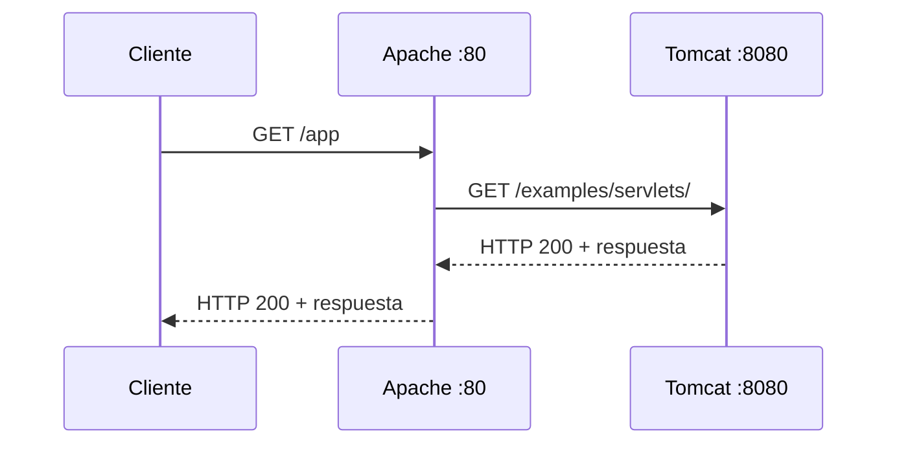
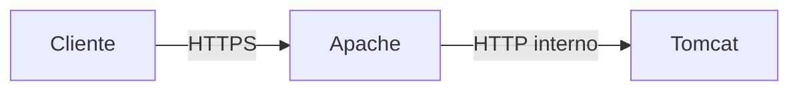
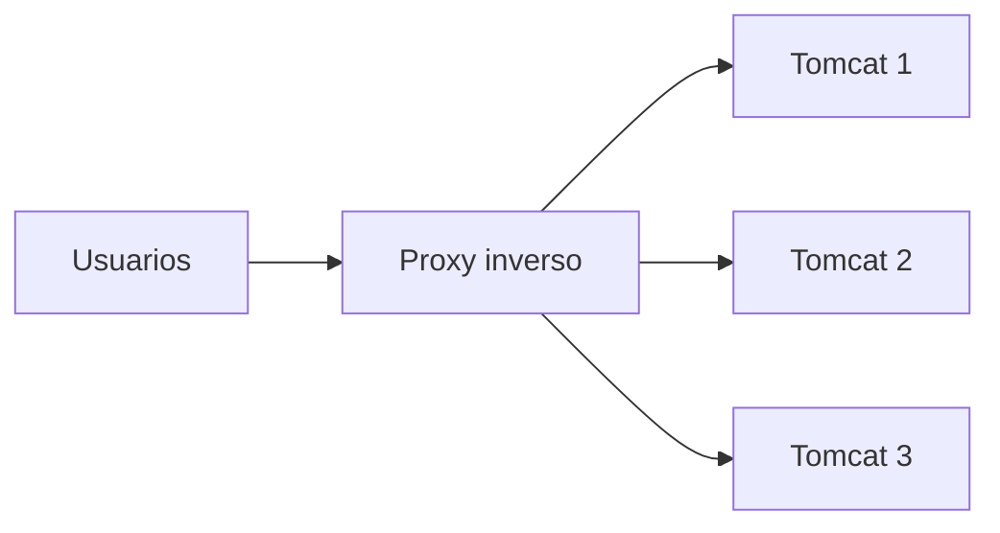
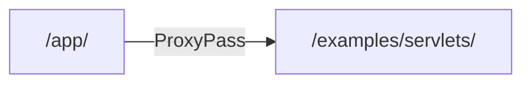
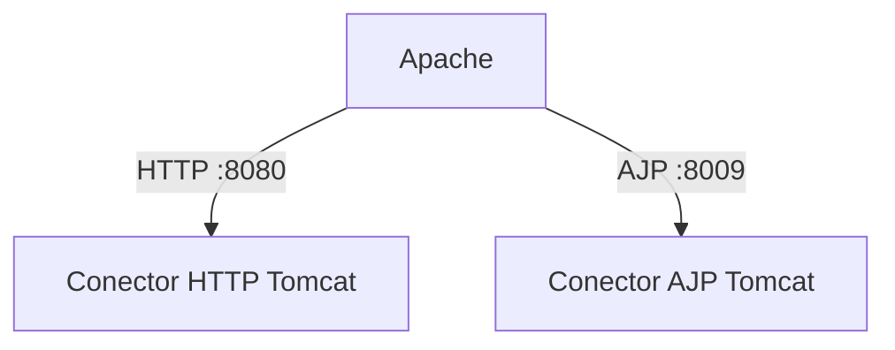
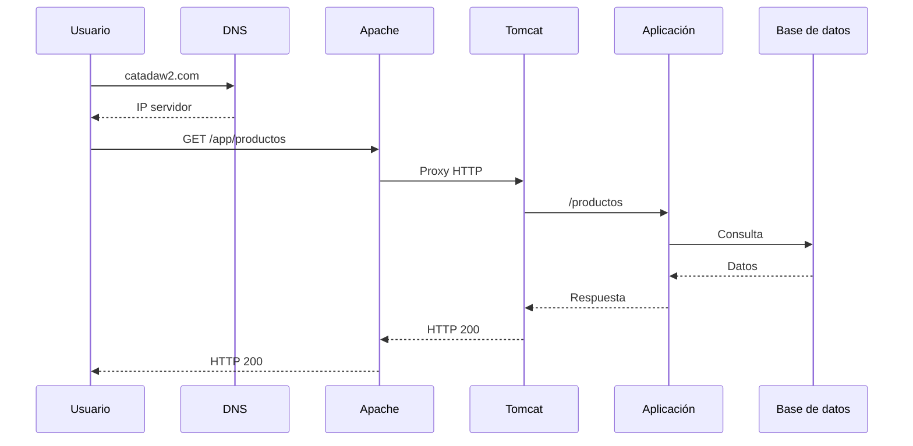
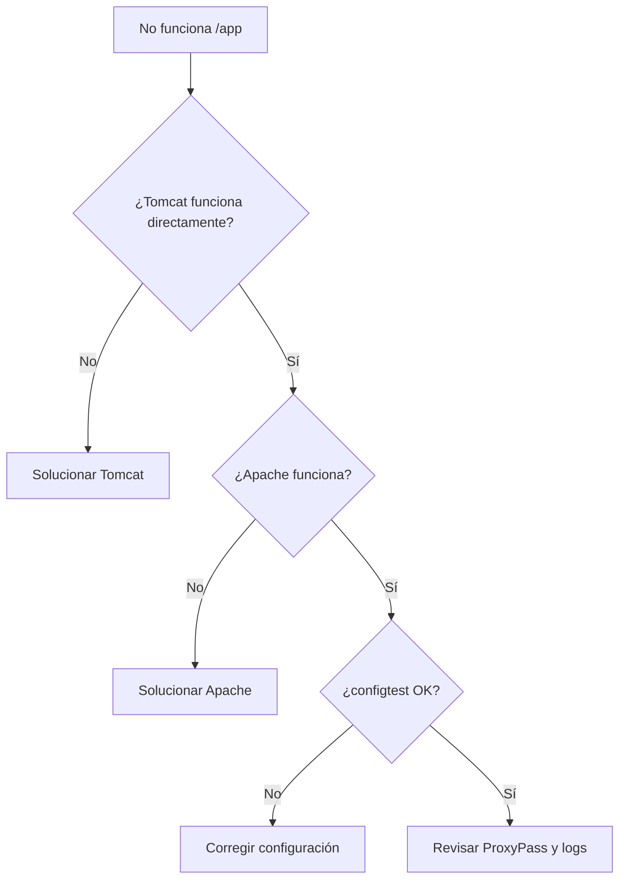

---
hide:
  - navigation
title: "UP3.3. Cooperación entre Apache HTTP Server y Tomcat"
description: "Integración del servidor web Apache con Apache Tomcat mediante proxy inverso."
---

# UP3.3. Cooperación entre Apache HTTP Server y Tomcat

> **RA3.c:** Se ha configurado el servidor de aplicaciones para que coopere con el servidor web.

## Qué vas a aprender

En este bloque estudiarás:

- por qué se utilizan conjuntamente Apache HTTP Server y Tomcat;
- qué es un proxy;
- qué es un proxy inverso;
- cómo se distribuyen las responsabilidades;
- cómo se reenvían peticiones desde Apache a Tomcat;
- qué son `mod_proxy`, `proxy_http` y AJP;
- qué problemas pueden aparecer durante la integración.

---

# 1. Arquitectura con dos servidores

Tomcat puede recibir directamente peticiones HTTP:

```text
http://servidor:8080/app
```

Sin embargo, en muchos despliegues se coloca un servidor web delante:

```text
Cliente
   ↓
Apache HTTP Server
   ↓
Tomcat
```

El cliente puede acceder simplemente a:

```text
https://www.ejemplo.com/app
```

sin necesitar conocer:

```text
localhost:8080
```

---

## 2. Separación de responsabilidades

Apache HTTP Server puede encargarse de:

- puertos públicos 80 y 443;
- HTTPS;
- virtual hosts;
- redirecciones;
- contenido estático;
- proxy inverso;
- restricciones de acceso.

Tomcat puede encargarse de:

- ejecutar servlets;
- procesar JSP;
- gestionar sesiones;
- ejecutar lógica de la aplicación;
- utilizar recursos Java.


---

# 3. ¿Qué es un proxy?

Un proxy es un intermediario.

En un **proxy directo**, el intermediario representa al cliente.

```text
Cliente → Proxy → Internet
```

En un **proxy inverso**, el intermediario representa a los servidores.

```text
Internet → Proxy inverso → Servidor interno
```

La arquitectura que nos interesa es la segunda.

---

# 4. Proxy inverso

Supongamos que Apache recibe:

```text
http://catadaw2.com/app
```

Apache puede reenviarla internamente a:

```text
http://127.0.0.1:8080/examples/servlets/
```

El navegador no necesita conocer esa dirección interna.



---

# 5. Ventajas del proxy inverso

## 5.1. Ocultar la infraestructura interna

Tomcat no necesita exponerse directamente a Internet.

El usuario ve:

```text
https://www.ejemplo.com
```

en lugar de:

```text
http://192.168.1.20:8080
```

---

## 5.2. Centralizar HTTPS

Apache puede gestionar los certificados y reenviar después el tráfico al backend.



En infraestructuras más exigentes también puede cifrarse el tramo interno.

---

## 5.3. Servir contenido estático

Apache puede servir directamente:

```text
/css/
/js/
/imagenes/
```

y enviar a Tomcat únicamente las peticiones que necesiten aplicación.

---

## 5.4. Facilitar escalabilidad

Un proxy puede distribuir tráfico entre varios backends.



Este concepto se denomina **balanceo de carga**.

---

# 6. Módulos de Apache

Apache HTTP Server utiliza módulos para ampliar su funcionalidad.

Para trabajar como proxy son especialmente relevantes:

```text
proxy
proxy_http
```

En Ubuntu pueden habilitarse mediante:

```bash
sudo a2enmod proxy
sudo a2enmod proxy_http
```

Después:

```bash
sudo apache2ctl configtest
sudo systemctl reload apache2
```

!!! tip "Primero validar, después recargar"
    Es una buena costumbre ejecutar:

    ```bash
    sudo apache2ctl configtest
    ```

    antes de aplicar cambios de configuración.

---

# 7. `ProxyPass`

Un ejemplo sencillo:

```apache
<VirtualHost *:80>
    ServerName catadaw2.com

    ProxyPass        /app/ http://127.0.0.1:8080/examples/servlets/
    ProxyPassReverse /app/ http://127.0.0.1:8080/examples/servlets/
</VirtualHost>
```

### `ProxyPass`

Indica dónde debe enviarse una petición.

### `ProxyPassReverse`

Permite que Apache adapte determinadas cabeceras de respuesta del backend para mantener la URL pública correcta.

---

# 8. Ruta pública y ruta interna

Es importante distinguirlas.

```text
Ruta pública:
http://catadaw2.com/app/

Ruta interna:
http://127.0.0.1:8080/examples/servlets/
```



Un error frecuente consiste en pensar que ambas rutas deben ser idénticas.

No es obligatorio.

---

# 9. `ProxyPreserveHost`

Algunas aplicaciones necesitan conocer el host solicitado originalmente por el usuario.

Apache puede conservarlo mediante:

```apache
ProxyPreserveHost On
```

Esto puede ser relevante cuando la aplicación:

- genera enlaces absolutos;
- diferencia dominios;
- realiza redirecciones;
- valida el host.

---

# 10. AJP

**AJP (Apache JServ Protocol)** es un protocolo diseñado para comunicar un servidor web con un contenedor Java.

Tradicionalmente se ha utilizado con Tomcat mediante el puerto:

```text
8009
```

Es importante diferenciar:

```text
proxy_http → Apache habla HTTP con Tomcat
proxy_ajp  → Apache habla AJP con Tomcat
```



!!! warning "AJP no debe exponerse innecesariamente"
    Si se utiliza AJP, debe quedar restringido a la comunicación necesaria entre servidores.

    Para una arquitectura docente sencilla, `mod_proxy_http` suele ser más fácil de comprender y diagnosticar.

---

# 11. ¿Cómo sabe Tomcat qué petición debe procesar?

Tomcat recibe la petición reenviada por Apache y la asigna a una aplicación según su **context path**.

Ejemplo:

```text
http://localhost:8080/tienda/productos
                       └────┘
                       contexto
```

Dentro de la aplicación, el contenedor buscará qué servlet, filtro o recurso corresponde a:

```text
/productos
```

---

# 12. Flujo completo



---

# 13. Diagnóstico de errores

## `404 Not Found`

Puede significar:

- ruta incorrecta en Apache;
- contexto incorrecto en Tomcat;
- aplicación no desplegada;
- URL interna inexistente.

## `502 Bad Gateway`

Suele indicar que Apache no consigue comunicarse correctamente con el backend.

Comprobar:

```bash
curl http://127.0.0.1:8080/
```

Si tampoco funciona directamente, el problema está probablemente en Tomcat o en la conectividad.

## `503 Service Unavailable`

Puede aparecer cuando el backend no está disponible o el proxy no consigue utilizarlo.

---

# 14. Orden lógico para diagnosticar



!!! tip "Diagnosticar de dentro hacia fuera"
    Antes de probar el proxy, comprueba siempre que Tomcat responde directamente.

    Primero:

    ```bash
    curl http://localhost:8080/
    ```

    Después prueba Apache.

---

# 15. Qué debes retener

!!! summary "Resumen"
    - Un proxy inverso recibe peticiones públicas y las envía a servidores internos.
    - Apache puede funcionar como puerta de entrada y Tomcat como backend.
    - `mod_proxy` y `proxy_http` permiten realizar proxy HTTP.
    - `ProxyPass` define el destino de las peticiones.
    - `ProxyPassReverse` ayuda a adaptar respuestas del backend.
    - HTTP y AJP son alternativas diferentes para comunicar Apache con Tomcat.
    - La integración debe probarse primero por componentes y después de extremo a extremo.

---

# 16. Glosario

**Backend**  
Servidor interno que procesa una petición recibida a través de otro componente.

**Proxy inverso**  
Intermediario situado delante de uno o varios servidores.

**AJP**  
Protocolo de comunicación utilizado históricamente entre servidores web y contenedores Java.

**VirtualHost**  
Configuración que permite a Apache alojar diferentes sitios o dominios.

**Balanceo de carga**  
Distribución de peticiones entre varias instancias.

---
