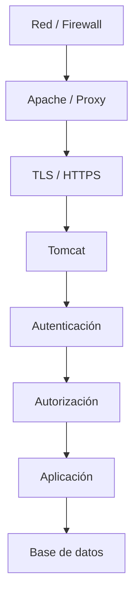
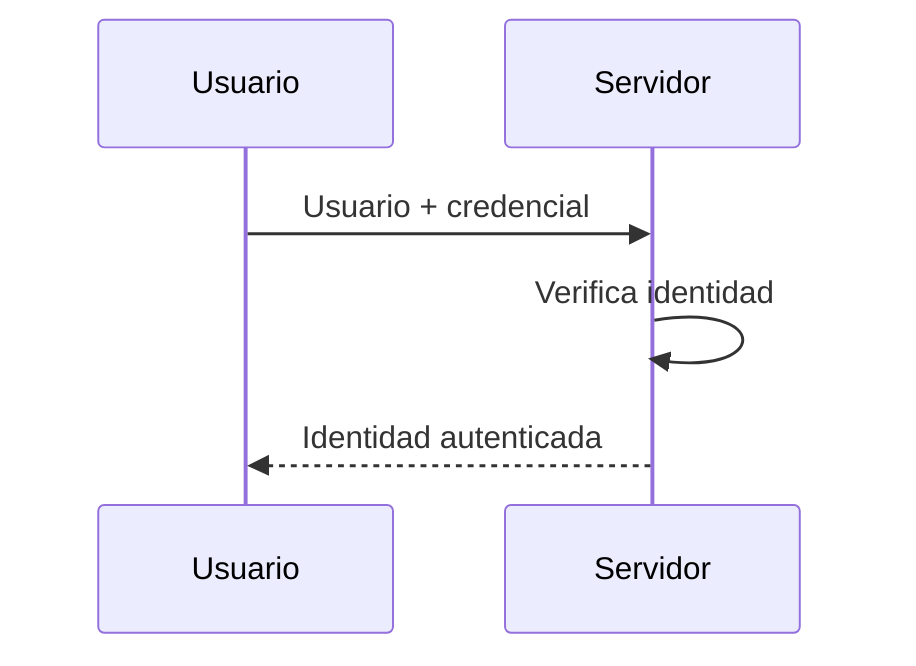
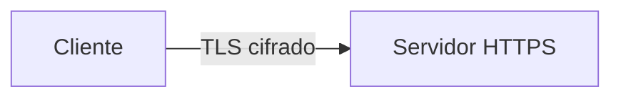
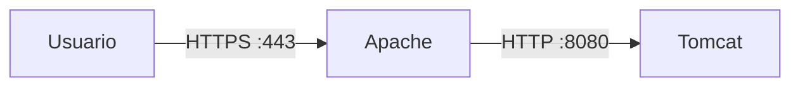
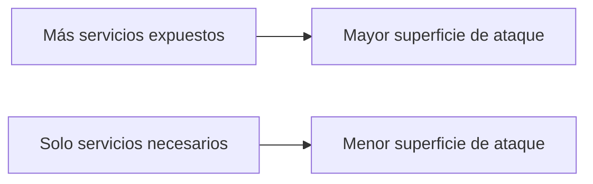
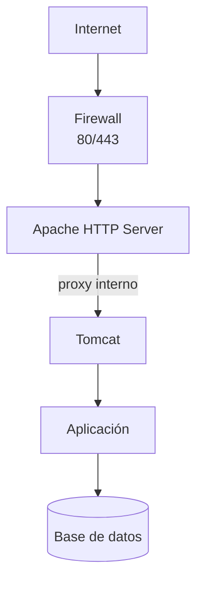

---
hide:
  - navigation
title: "UP3.4. Seguridad del servidor de aplicaciones"
description: "Usuarios, permisos, sesiones, TLS, actualizaciones y medidas de seguridad para Tomcat."
---

# UP3.4. Seguridad del servidor de aplicaciones

> **RA3.d:** Se han configurado y activado los mecanismos de seguridad del servidor de aplicaciones.

## Qué vas a aprender

Estudiarás:

- qué riesgos presenta un servidor de aplicaciones;
- diferencia entre autenticación y autorización;
- usuarios y roles;
- acceso a Tomcat Manager;
- HTTPS y TLS;
- certificados;
- sesiones y cookies;
- principio de mínimo privilegio;
- medidas básicas de endurecimiento o *hardening*.

---

# 1. Seguridad por capas

No existe una única opción que convierta un servidor en “seguro”.

La seguridad se construye mediante varias capas:



Un fallo en una capa no debería implicar automáticamente acceso completo al sistema.

---

# 2. Principios básicos

## Confidencialidad

La información solo puede ser leída por quien tenga autorización.

## Integridad

Los datos no deben poder modificarse sin autorización.

## Disponibilidad

Los servicios deben estar disponibles cuando se necesitan.

A estos principios se añaden otros conceptos como:

- autenticidad;
- trazabilidad;
- mínimo privilegio;
- defensa en profundidad.

---

# 3. Autenticación

La autenticación responde a:

> **¿Quién eres?**

Ejemplos:

- usuario + contraseña;
- certificado;
- token;
- sistema externo de identidad.



---

# 4. Autorización

La autorización responde a:

> **Ahora que sé quién eres, ¿qué puedes hacer?**

Ejemplo:

```text
ana    → rol usuario
jordi  → rol manager
```

Permisos:

```text
usuario → /perfil
manager → /perfil + /administracion
```

!!! info "No son sinónimos"
    **Autenticar** identifica a una persona o sistema.

    **Autorizar** decide qué recursos puede utilizar esa identidad.

---

# 5. Roles en Tomcat

Tomcat puede definir roles como:

```xml
<role rolename="manager-gui"/>
```

y asignarlos a usuarios:

```xml
<user
    username="manager"
    password="CLAVE_SEGURA"
    roles="manager-gui"/>
```

El rol `manager-gui` permite utilizar la interfaz web de Tomcat Manager.

!!! danger "Cuenta administrativa"
    Una cuenta con acceso a Manager puede permitir operaciones muy sensibles, entre ellas desplegar aplicaciones.

    Debe utilizarse únicamente cuando sea necesaria y con credenciales robustas.

---

# 6. Tomcat Manager

Tomcat Manager permite realizar operaciones como:

- listar aplicaciones;
- iniciar o detener contextos;
- desplegar;
- volver a desplegar;
- consultar sesiones.

Por ello, no debería considerarse una página web cualquiera.

Medidas recomendadas:

- restringir acceso;
- utilizar HTTPS;
- contraseñas robustas;
- evitar exponerlo a Internet si no es necesario;
- conceder únicamente roles imprescindibles.

---

# 7. HTTP frente a HTTPS

HTTP transmite información sin proporcionar por sí mismo cifrado de transporte.

HTTPS añade TLS:

```text
HTTP + TLS = HTTPS
```

TLS permite principalmente:

- cifrar la comunicación;
- proteger la integridad;
- autenticar al servidor mediante certificados.



---

# 8. Certificados digitales

Un certificado relaciona una identidad con una clave pública.

De forma simplificada:

```text
Certificado
├── identidad
├── clave pública
├── emisor
├── periodo de validez
└── firma
```

El navegador confía en un certificado cuando puede construir una cadena de confianza hasta una autoridad certificadora reconocida.

---

# 9. Certificado autofirmado

En un laboratorio podemos generar un certificado autofirmado mediante `keytool`.

Ejemplo:

```bash
keytool -genkeypair \
  -alias tomcat \
  -keyalg RSA \
  -keystore tomcat.keystore
```

Un certificado autofirmado permite **cifrar** la comunicación, pero el navegador no puede verificar su identidad mediante una autoridad de confianza.

!!! warning "Autofirmado no significa certificado de confianza"
    Es normal que el navegador muestre una advertencia cuando el certificado es autofirmado.

    El tráfico puede estar cifrado y, aun así, el certificado no ser considerado confiable por el navegador.

---

# 10. HTTPS en Tomcat

Una configuración conceptual puede tener esta forma:

```xml
<Connector
    port="8443"
    protocol="org.apache.coyote.http11.Http11NioProtocol"
    SSLEnabled="true"
    maxThreads="150">

    <SSLHostConfig>
        <Certificate
            certificateKeystoreFile="conf/tomcat.keystore"
            certificateKeystorePassword="CLAVE_KEYSTORE"
            type="RSA" />
    </SSLHostConfig>
</Connector>
```

El acceso sería:

```text
https://localhost:8443/
```

---

# 11. Terminación TLS en Apache

En una arquitectura con proxy inverso, también puede ser Apache quien gestione HTTPS:



Ventajas:

- centraliza certificados;
- Tomcat puede permanecer en red interna;
- simplifica la gestión de varios backends.

---

# 12. Sesiones

Una vez autenticado un usuario, la aplicación suele utilizar una sesión.

El identificador de sesión es sensible:

```text
JSESSIONID=...
```

Si un atacante consigue utilizar el identificador de otra persona, podría intentar suplantar su sesión.

---

# 13. Cookies de sesión

Dos atributos importantes son:

### `Secure`

La cookie solo debe enviarse mediante HTTPS.

### `HttpOnly`

Impide que JavaScript del navegador acceda directamente a la cookie.

Una configuración de aplicación puede declarar:

```xml
<session-config>
    <cookie-config>
        <http-only>true</http-only>
        <secure>true</secure>
    </cookie-config>
</session-config>
```

!!! note "Dónde se configura"
    Las propiedades de seguridad de la cookie de sesión pertenecen al mecanismo de sesión/contexto de la aplicación.

    No deben confundirse con las propiedades del conector de red de Tomcat.

---

# 14. Expiración de sesión

Una sesión no debería permanecer activa indefinidamente.

Ejemplo:

```xml
<session-config>
    <session-timeout>30</session-timeout>
</session-config>
```

Una política razonable depende del tipo de aplicación.

Una banca online y una aplicación interna de consulta pueden necesitar tiempos diferentes.

---

# 15. Mínimo privilegio

Cada usuario, proceso o servicio debería disponer únicamente de los permisos que necesita.

Ejemplos:

```text
mal:
usuario de aplicación = administrador de la base de datos

mejor:
usuario de aplicación = SELECT/INSERT/UPDATE sobre las tablas necesarias
```

También se aplica a:

- roles de Tomcat;
- permisos de archivos;
- usuarios Linux;
- contenedores;
- puertos;
- credenciales.

---

# 16. Protección de secretos

No deberían publicarse en un repositorio:

```text
contraseñas
tokens
claves privadas
secretos API
```

Evitar:

```properties
database.password=123456
```

en archivos versionados.

En entornos profesionales pueden utilizarse:

- variables de entorno;
- almacenes de secretos;
- servicios específicos de gestión de secretos;
- ficheros protegidos fuera del repositorio.

---

# 17. Actualizaciones

Un servidor sin actualizar acumula vulnerabilidades conocidas.

La estrategia de seguridad debe incluir:

```text
inventario
   ↓
actualización
   ↓
prueba
   ↓
despliegue
   ↓
monitorización
```

Nunca debería asumirse que “funciona” significa “es seguro”.

---

# 18. Reducir superficie de ataque

Conviene deshabilitar o eliminar componentes que no sean necesarios.

Ejemplos:

- aplicaciones de ejemplo;
- interfaces de administración no utilizadas;
- conectores no necesarios;
- puertos abiertos innecesariamente;
- servicios del sistema sin uso.



---

# 19. Logs y auditoría

Los registros pueden ayudar a detectar:

- intentos de acceso;
- errores repetidos;
- fallos de autenticación;
- despliegues inesperados;
- excepciones;
- comportamiento anómalo.

Pero un log solo es útil si:

- se conserva;
- puede consultarse;
- tiene una hora correcta;
- no contiene secretos innecesarios;
- se revisa cuando existe una incidencia.

---

# 20. Seguridad en una arquitectura Apache + Tomcat



Una configuración razonable podría exponer públicamente:

```text
80
443
```

pero no necesariamente:

```text
8080
8009
5432
3306
```

---

# 21. Qué debes retener

!!! summary "Resumen"
    - Autenticación identifica; autorización concede permisos.
    - Tomcat puede utilizar usuarios y roles.
    - Tomcat Manager debe considerarse un recurso administrativo sensible.
    - HTTPS protege el tráfico mediante TLS.
    - Un certificado autofirmado cifra, pero no aporta confianza pública.
    - Las sesiones deben protegerse mediante cookies y expiración adecuadas.
    - Debe aplicarse el principio de mínimo privilegio.
    - Reducir servicios y puertos expuestos disminuye la superficie de ataque.

---

# 22. Glosario

**TLS**  
Protocolo criptográfico utilizado para proteger comunicaciones.

**Certificado digital**  
Documento firmado que vincula una identidad con una clave pública.

**Autenticación**  
Proceso de verificar una identidad.

**Autorización**  
Proceso de decidir qué acciones puede realizar una identidad.

**Hardening**  
Proceso de reducir riesgos y endurecer la configuración de un sistema.

**Superficie de ataque**  
Conjunto de puntos que un atacante podría intentar explotar.

---
