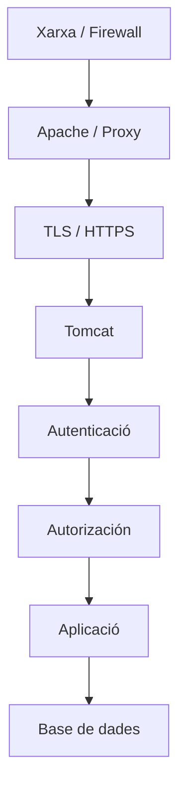
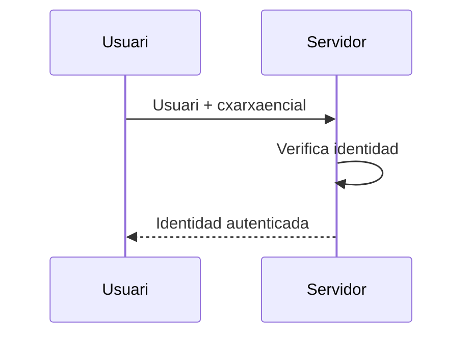
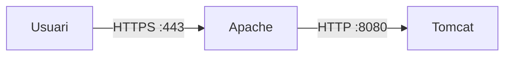
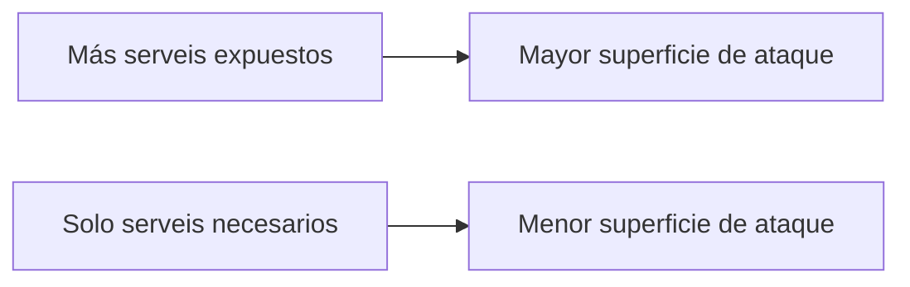
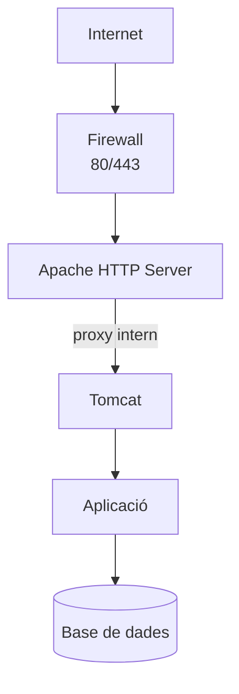

---
hide:
  - navigation
title: "UP3.4. Seguretat del servidor d'aplicacions"
description: "Usuaris, permisos, sessions, TLS, actualitzacions i mesures de seguretat per a Tomcat."
---

# UP3.4. Seguretat del servidor d'aplicacions

> **RA3.d:** s'han configurat i activats els mecanismes de Seguretat del servidor d'aplicacions.

## Què aprendràs

En aquest bloc estudiaràs:

- Quins riscos presenta un servidor d'aplicacions;
- diferència entre autenticació i autorització;
- Usuaris i rols;
- accés a Tomcat Manager;
- HTTPS i TLS;
- certificats;
- Sessions i cookies;
- principi de Mínim privilegi;
- mesures bàsiques de endurecimiento o *hardening*.

---

# 1. Seguretat per capes

No existeix una única opció que convierta un servidor en “segur”.

La Seguretat es es construeix mitjançant diverses capes:



Un falho en una capa no hauria de implicar automàticament accés complet al sistema.

---

# 2. principis bàsics

## confideèncialitat

La informació només Pot ser leída per qui tinga autorització.

## integritat

les dades no han de poder modificarse sense autorització.

## disponibilitat

els serveis han de estar disponibles quan es necessiten.

A aquests principis es s'afegeixen altres conceptes com:

- autenticidad;
- trazabilidad;
- Mínim privilegi;
- defensa en profundidad.

---

# 3. autenticació

La autenticació respon a:

> **¿Quién eres?**

exemples:

- Usuari + Contrasenya;
- certificat;
- token;
- sistema extern de identitat.



---

# 4. autorització

La autorització respon a:

> **ara que sé qui eres, ¿Què pots fer?**

exemple:

```text
ana    → rol usuario
jordi  → rol manager
```

permisos:

```text
usuario → /perfil
manager → /perfil + /administracion
```

!!! info "No són sinònims"
    **Autenticar** identifica a una persona o sistema.

    **Autorizar** decide Què recursos pot utilitzar eixa identitat.

---

# 5. Rols en Tomcat

Tomcat Pot definir rols com:

```xml
<role rolename="manager-gui"/>
```

i asignarlos a Usuaris:

```xml
<user
    username="manager"
    password="CLAVE_SEGURA"
    roles="manager-gui"/>
```

El rol `manager-gui` permet Utilitzar la interfaz web de Tomcat Manager.

!!! danger "compte administrativa"
    Una compte amb accés a Manager Pot permetre operacions molt sensibles, entre elles desplegar aplicacions.

    ha de utilizarse únicament quan sea necessària i amb credeèncials robustas.

---

# 6. Tomcat Manager

Tomcat Manager permet realitzar operacions com:

- listar aplicacions;
- iniciar o detindre contextos;
- desplegar;
- volver a desplegar;
- consultar Sessions.

pello, no hauria de considerar-se una pàgina web qualsevol.

mesures recomendadas:

- restringir accés;
- Utilitzar HTTPS;
- Contrasenyes robustas;
- evitar exposarho a Internet si no és necessari;
- conceder únicament rols imprescindibles.

---

# 7. HTTP davant de HTTPS

HTTP transmite informació sense proporcionar per sí mateix xifrat de transporte.

HTTPS añade TLS:

```text
HTTP + TLS = HTTPS
```

TLS permet principalment:

- xifrar la comunicació;
- protegir la integritat;
- autenticar al Servidor mitjançant certificats.


---

# 8. certificats digitales

Un certificat relaciona una identitat amb una clau pública.

de manera simplificada:

```text
Certificado
├── identidad
├── clave pública
├── emisor
├── periodo de validez
└── firma
```

El navegador confia en un certificat quan Pot construir una cadena de confiança fins a una autoritat certificadora reconeguda.

---

# 9. certificat autofirmado

en un laboratorio podem generar un certificat autofirmado mitjançant `keytool`.

exemple:

```bash
keytool -genkeypair \
  -alias tomcat \
  -keyalg RSA \
  -keystore tomcat.keystore
```

Un certificat autofirmado permet **xifrar** la comunicació, però el navegador no Pot verificar el seu identitat mitjançant una autoritat de confiança.

!!! warning "Autofirmado no significa certificat de confiança"
    és normal que el navegador muestre una adverteència quan el certificat és autofirmado.

    El trànsit pot estar xifrat i, encara així, el certificat no ser considerat fiable pel navegador.

---

# 10. HTTPS en Tomcat

Una configuració conceptual Pot tindre aquesta forma:

```xml
<Connector
    port="8443"
    protocol="org.apache.coyote.http11.Http11NioProtocol"
    SSLEnabled="true"
    maxThreads="150">

    <SSLHostConfig>
        <Certificate
            certificateKeystoreFile="conf/tomcat.keystore"
            certificateKeystorePassword="CLAVE_KEYSTORE"
            type="RSA" />
    </SSLHostConfig>
</Connector>
```

El accés sería:

```text
https://localhost:8443/
```

---

# 11. terminació TLS en Apache

en una arquitectura amb proxy invers, també Pot ser Apache qui gestione HTTPS:



avantatges:

- centraliza certificats;
- Tomcat Pot permanecer en xarxa interna;
- simplifica la Gestió de diversos backends.

---

# 12. Sessions

Una vez autenticat un Usuari, l'aplicació sol Utilitzar una Sessió.

El identificador de Sessió és sensible:

```text
JSESSIONID=...
```

Si un atacant aconsegueix Utilitzar el identificador d'una altra persona, podria intentar suplantar el seu Sessió.

---

# 13. Cookies de Sessió

Dos atributos importants són:

### `Secure`

La cookie només ha de enviar-se mitjançant HTTPS.

### `HttpOnly`

Impide que JavaScript del navegador acceda directament a la cookie.

Una configuració d'aplicació Pot declarar:

```xml
<session-config>
    <cookie-config>
        <http-only>true</http-only>
        <secure>true</secure>
    </cookie-config>
</session-config>
```

!!! note "on és configura"
    Les propietats de Seguretat de la cookie de Sessió pertanyen al mecanisme de Sessió/contexto de l'aplicació.

    No han de confundirse amb Les propietats del connector de xarxa de Tomcat.

---

# 14. Expiració de Sessió

Una Sessió no hauria de permanecer activa indefinidamente.

exemple:

```xml
<session-config>
    <session-timeout>30</session-timeout>
</session-config>
```

Una política razonable depende del tipus d'aplicació.

Una banca online i una aplicació interna de consulta poden necessitar tiempos diferents.

---

# 15. Mínim privilegi

Cada Usuari, procés o Servei hauria de disponer únicament dels permisos que necessita.

exemples:

```text
mal:
usuario de aplicació = administrador de la base de datos

mejor:
usuario de aplicació = SELECT/INSERT/UPDATE sobre las tablas necesarias
```

també es aplica a:

- rols de Tomcat;
- permisos de Fitxers;
- Usuaris Linux;
- Contenidors;
- Ports;
- credeèncials.

---

# 16. protecció de secrets

No haurien de publicarse en un repositorio:

```text
contraseñas
tokens
claves privadas
secretos API
```

Evitar:

```properties
database.password=123456
```

en Fitxers versionados.

en entorns professionals poden utilizarse:

- variables de entorn;
- almacenes de secrets;
- Serveis específicos de Gestió de secrets;
- Fitxers protegits fora del repositorio.

---

# 17. actualitzacions

Un Servidor sense actualitzar acumula vulnerabilitats conocidas.

La estratègia de Seguretat ha de incluir:

```text
inventario
   ↓
actualización
   ↓
prueba
   ↓
desplegament
   ↓
monitorización
```

Nunca hauria de asumirse que “funciona” significa “és segur”.

---

# 18. Reduir superfície de atac

Conviene deshabilitar o eliminar components que no sean necessaris.

exemples:

- aplicacions de exemple;
- interfaces d'administració no utilizadas;
- connectors no necessaris;
- Ports abiertos innecessàriament;
- Serveis del sistema sense ús.



---

# 19. Logs i auditoria

els registres poden ajudar a detectar:

- intentos de accés;
- errors repetidos;
- fallos de autenticació;
- desplegaments inesperados;
- excepciones;
- comportament anómalo.

però un log només és útil si:

- es conserva;
- Pot consultarse;
- té una hora correcta;
- no conté secrets innecesarios;
- es revisa quan existeix una incidèència.

---

# 20. Seguretat en una arquitectura Apache + Tomcat



Una configuració razonable podria exposar públicamente:

```text
80
443
```

però no necessàriament:

```text
8080
8009
5432
3306
```

---

# 21. Què has de retenir

!!! summary "resum"
    - autenticació identifica; autorització concede permisos.
    - Tomcat pot utilitzar Usuaris i rols.
    - Tomcat Manager ha de considerar-se un recurs administrativo sensible.
    - HTTPS protegeix el trànsit mitjançant TLS.
    - Un certificat autofirmado cifra, però no aporta confiança pública.
    - Les Sessions han de protegerse mitjançant cookies i Expiració adecuadas.
    - ha de aplicarse el principi de Mínim privilegi.
    - Reduir Serveis i Ports expuestos disminuye la superfície de atac.

---

# 22. glossari

**TLS**  
Protocoho criptográfico utilitzat per a protegir comunicacions.

**certificat digital**  
Document firmado que vincula una identitat amb una clau pública.

**autenticació**  
procés de verificar una identitat.

**autorització**  
procés de decidir Què acciones Pot realitzar una identitat.

**Hardening**  
procés de Reduir riscos i endurecer la configuració d'un sistema.

**superfície de atac**  
conjunt de puntos que un atacant podria intentar explotar.

---
