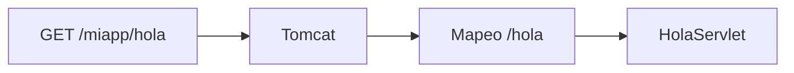
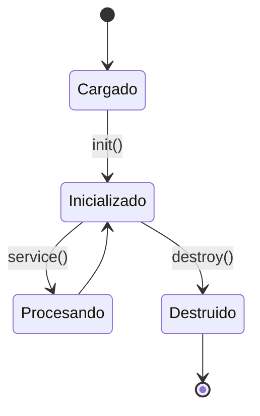
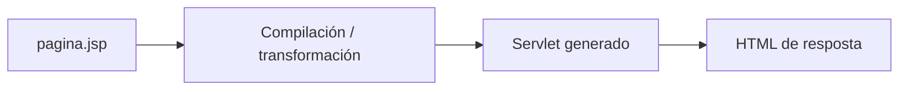
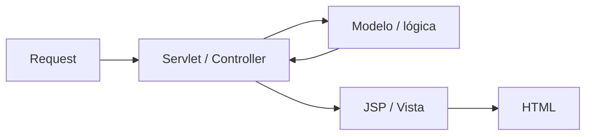
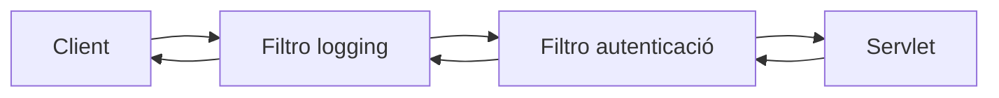
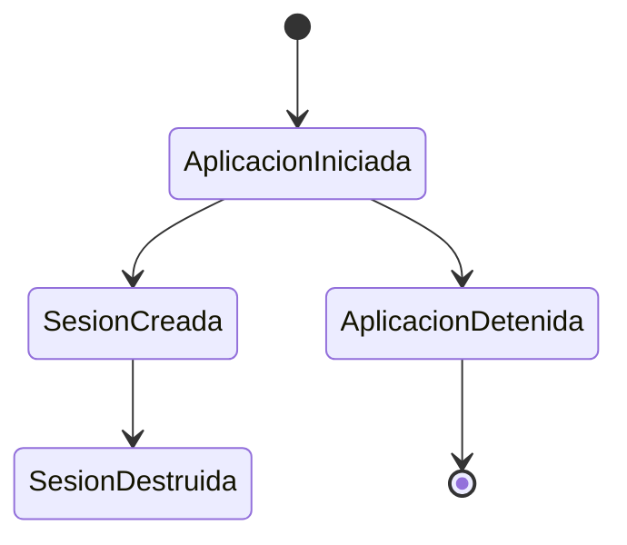
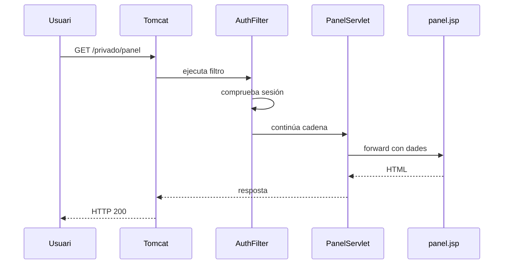
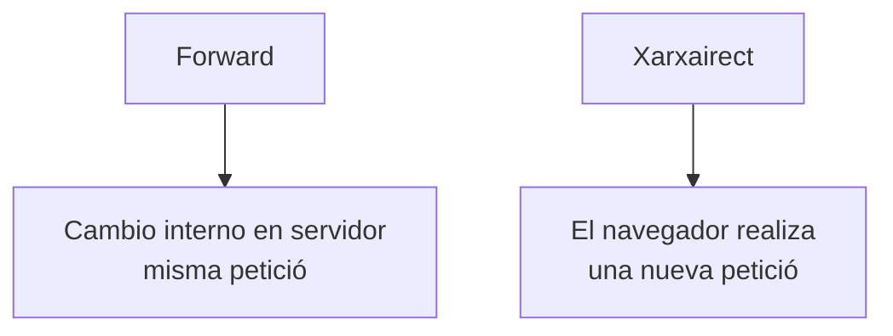

---
hide:
  - navigation
title: "UP3.5. Components web del servidor d'aplicacions"
description: "Servlets, filtres, listeners, sessions i altres components d'una aplicació web Java."
---

# UP3.5. Components web del servidor d'aplicacions

> **RA3.e:** S'han configurat i utilitzat els components web del servidor d'aplicacions.

## Què aprendràs

En aquest bloc estudiaràs:

- estructura d'una aplicació web Java;
- servlets;
- cicle de vida d'un servlet;
- mapatges de URL;
- JSP;
- Filtres;
- listindres;
- recursos estàtics;
- relació entre els diferents components.

---

# 1. Estructura d'una aplicació web

Una aplicació web desplegada Pot tindre una estructura parecida a:

```text
miapp/
├── index.html
├── css/
│   └── styles.css
├── js/
│   └── app.js
└── WEB-INF/
    ├── web.xml
    ├── classes/
    │   └── com/
    │       └── ejemplo/
    │           └── HolaServlet.class
    └── lib/
        └── biblioteca.jar
```

El directori `WEB-INF` té un significado especial.

el seu contingut no hauria de servirse directament com un recurs públic.

---

# 2. Servlet

Un **servlet** és una clase Java que Pot processar Peticions i generar Respostes.

en Tomcat 10+, la API Utilitzal espacio de noms:

```java
jakarta.servlet.*
```

exemple simplificado:

```java
import jakarta.servlet.http.*;
import jakarta.servlet.annotation.*;
import java.io.IOException;

@WebServlet("/hola")
public class HolaServlet extends HttpServlet {

    @Override
    protected void doGet(
            HttpServletRequest request,
            HttpServletResponse response)
            throws IOException {

        response.setContentType("text/plain");
        response.getWriter().println("Hola desde Tomcat");
    }
}
```

Al acceder a:

```text
http://localhost:8080/miapp/hola
```

Tomcat ejecutará el servlet asociado.

---

# 3. Mapatge de URL

El Mapatge relaciona una URL amb un component.

mitjançant anotación:

```java
@WebServlet("/hola")
```

mitjançant `web.xml`:

```xml
<servlet>
    <servlet-name>HolaServlet</servlet-name>
    <servlet-class>com.ejemplo.HolaServlet</servlet-class>
</servlet>

<servlet-mapping>
    <servlet-name>HolaServlet</servlet-name>
    <url-pattern>/hola</url-pattern>
</servlet-mapping>
```



---

# 4. cicle de vida d'un servlet

El Contenidor gestional cicle de vida.

de manera simplificada:

```text
cargar clase
   ↓
crear instancia
   ↓
init()
   ↓
service()
   ↓
doGet() / doPost() / ...
   ↓
destroy()
```



!!! info "El Contenidor controlal cicle de vida"
    normalment no creamos manualment un objeto servlet amb `new`.

    Tomcat instaència i administral component.

---

# 5. petició i Resposta

El servlet rep objetos que representan:

```text
HttpServletRequest
HttpServletResponse
```

### Request

permet consultar:

- parámetros;
- cabeceras;
- mètode HTTP;
- cookies;
- Sessió;
- atributos.

### Response

permet definir:

- Codi de estat;
- cabeceras;
- tipus MIME;
- cuerpo de la Resposta;
- redireccions.

---

# 6. mètodes HTTP

Un servlet Pot reaccionar a diferents mètodes.

```java
doGet()
doPost()
doPut()
doDelete()
```

exemple conceptual:

```text
GET    /productos      → consultar
POST   /productos      → crear
PUT    /productos/15   → modificar
DELETE /productos/15   → eliminar
```

---

# 7. JSP

**Jakarta Server Pages (JSP)** permet crear vistas dinàmiques.

Una JSP Pot combinar HTML amb expresiones o etiquetas de Servidor.

exemple conceptual:

```jsp
<h1>Bienvenido ${usuario.nombre}</h1>
```

Tomcat transforma internament la JSP en Codi que pot executar el contenidor.



---

# 8. separar lògica i presentació

encara que JSP permet incluir lògica, no és recomendable convertir la vista en el lloc principal de la lògica de negoci.

Una arquitectura més clara:



El servlet:

- processa la petició;
- obtiene Dades;
- selecciona la vista.

La JSP:

- presentals Dades.

---

# 9. Filtres

Un filtre Pot interceptar una petició abans que llegue al servlet.

exemples d'ús:

- autenticació;
- logging;
- CORS;
- codificación;
- compressió;
- mesures de Seguretat.



exemple:

```java
@WebFilter("/privado/*")
public class AuthFilter implements Filter {
    // ...
}
```

---

# 10. Cadena de Filtres

Pot existir més d'un filtre.

```text
Request
 ↓
Filtro A
 ↓
Filtro B
 ↓
Servlet
 ↑
Filtro B
 ↑
Filtro A
 ↑
Response
```

açò resulta útil per a implementar funcionalitats transversales sense repetir Codi en cada servlet.

---

# 11. Listindres

Un listindre escucha Esdeveniments del contenidor.

Pot reaccionar, per exemple, a:

- Inici de l'aplicació;
- parada;
- creación d'una Sessió;
- destrucción d'una Sessió;
- canvis en determinados atributos.

exemple conceptual:

```java
@WebListener
public class AppListener implements ServletContextListener {
}
```

---

# 12. Esdeveniments d'aplicació



Un listindre Pot utilizarse per a:

- inicializar recursos;
- registrar informació;
- liberar recursos;
- mantindre métricas.

---

# 13. recursos estàtics

Una aplicació també Pot incluir:

```text
HTML
CSS
JavaScript
imágenes
fuentes
documentos
```

aquests recursos no necessiten Executar un servlet específico per a cada petició.

exemple:

```text
/miapp/css/styles.css
/miapp/img/logo.png
```

---

# 14. flux complet d'una petició

Supongamos:

```text
GET /miapp/privado/panel
```

El flux podria ser:



Si no existeix una Sessió válida:

```text
Filtro → redirección a /login
```

---

# 15. `forward` i `redirect`

No són exactament el mateix.

## Forward

El Servidor entrega internament la petició a un altre recurs.

```java
request.getRequestDispatcher("/WEB-INF/panel.jsp")
       .forward(request, response);
```

El navegador no realitza una petició nova.

## Redirect

Es retorna una Resposta al navegador perquè solicite una altra URL.

```java
response.sendRedirect("login");
```



---

# 16. `WEB-INF`

`WEB-INF` protegeix recursos interns.

per exemple:

```text
WEB-INF/web.xml
WEB-INF/classes/
WEB-INF/lib/
WEB-INF/vistas/
```

Una JSP interna Pot almacenarse dins de `WEB-INF` per a impedir que el client la solicite directament.

El servlet Pot fer un `forward` cap alla.

---

# 17. Anotacions i `web.xml`

actualment és habitual Utilitzar:

```java
@WebServlet
@WebFilter
@WebListener
```

però `web.xml` segueix siendo útil per a:

- configuració centralizada;
- restricciones de Seguretat;
- parámetros;
- Sessions;
- pàgines de error;
- desplegaments que requereixen configuració independiente del codi.

---

# 18. Què has de retenir

!!! summary "resum"
    - els servlets procesan Peticions.
    - Les JSP s'utilitzen principalment com vistas.
    - els Filtres interceptan Peticions i Respostes.
    - els listindres responn a Esdeveniments.
    - `WEB-INF` conté elements interns de l'aplicació.
    - Tomcat gestional cicle de vida dels components.
    - Una aplicació bien organizada separa procesamiento, lògica i presentació.

---

# 19. glossari

**Servlet**  
component Java que processa Peticions en un contenidor web.

**JSP**  
tecnologia de vistas dinàmiques per a aplicacions Java web.

**filtre**  
component que intercepta Peticions i Respostes.

**Listindre**  
component que reacciona a Esdeveniments del contenidor.

**Forward**  
Transfereència interna d'una petició a un altre recurs.

**Redirect**  
Resposta que indica al Client que solicite una altra URL.

---
