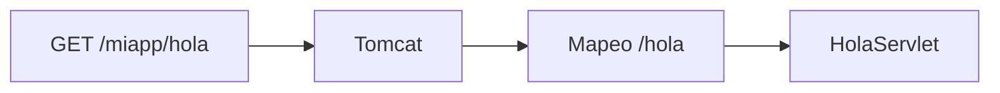
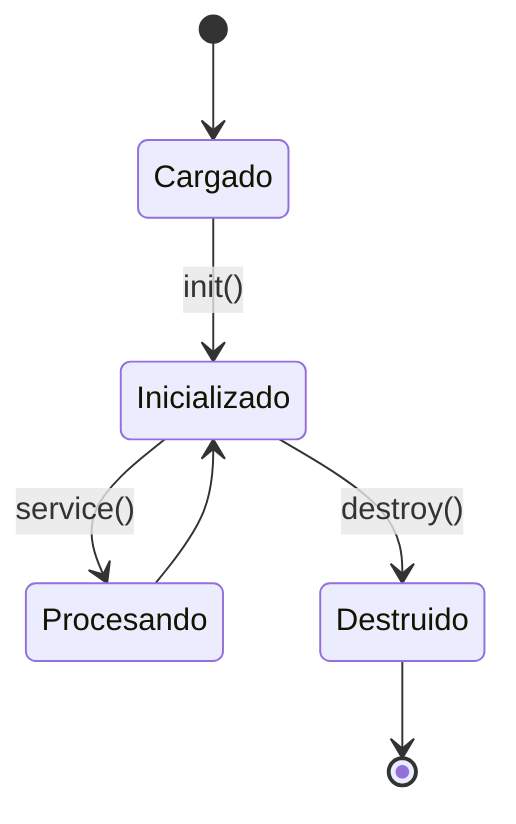
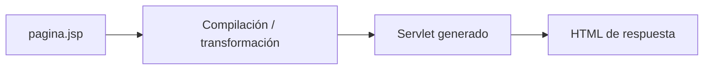
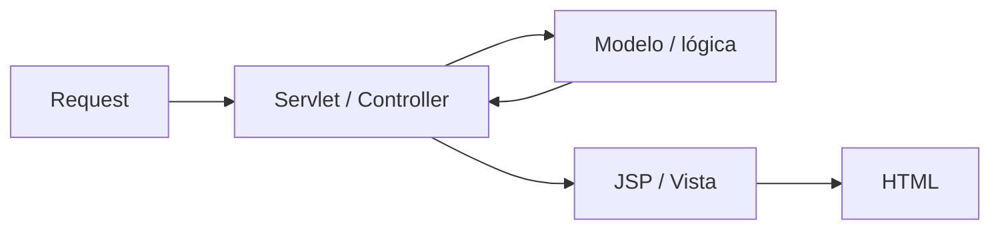
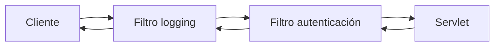
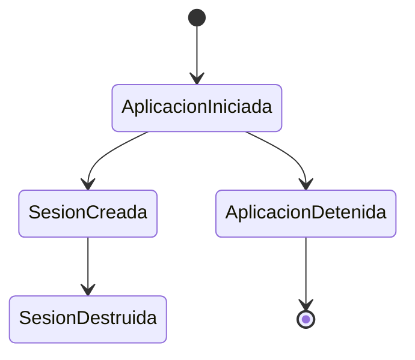
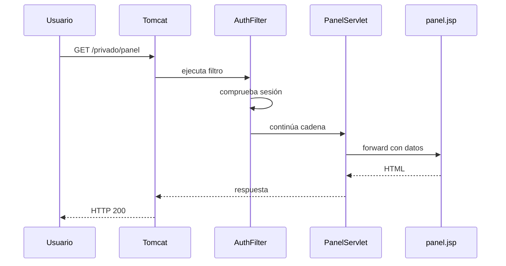
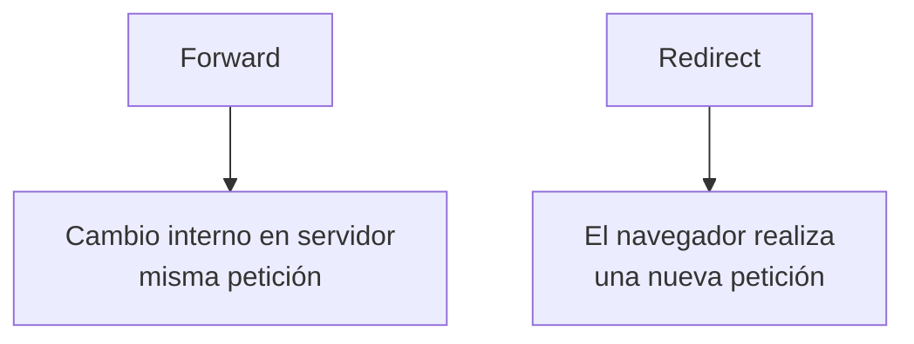

---
hide:
  - navigation
title: "UP3.5. Componentes web del servidor de aplicaciones"
description: "Servlets, filtros, listeners, sesiones y otros componentes de una aplicación web Java."
---

# UP3.5. Componentes web del servidor de aplicaciones

> **RA3.e:** Se han configurado y utilizado los componentes web del servidor de aplicaciones.

## Qué vas a aprender

Este bloque explica:

- estructura de una aplicación web Java;
- servlets;
- ciclo de vida de un servlet;
- mapeos de URL;
- JSP;
- filtros;
- listeners;
- recursos estáticos;
- relación entre los distintos componentes.

---

# 1. Estructura de una aplicación web

Una aplicación web desplegada puede tener una estructura parecida a:

```text
miapp/
├── index.html
├── css/
│   └── styles.css
├── js/
│   └── app.js
└── WEB-INF/
    ├── web.xml
    ├── classes/
    │   └── com/
    │       └── ejemplo/
    │           └── HolaServlet.class
    └── lib/
        └── biblioteca.jar
```

El directorio `WEB-INF` tiene un significado especial.

Su contenido no debería servirse directamente como un recurso público.

---

# 2. Servlet

Un **servlet** es una clase Java que puede procesar peticiones y generar respuestas.

En Tomcat 10+, la API utiliza el espacio de nombres:

```java
jakarta.servlet.*
```

Ejemplo simplificado:

```java
import jakarta.servlet.http.*;
import jakarta.servlet.annotation.*;
import java.io.IOException;

@WebServlet("/hola")
public class HolaServlet extends HttpServlet {

    @Override
    protected void doGet(
            HttpServletRequest request,
            HttpServletResponse response)
            throws IOException {

        response.setContentType("text/plain");
        response.getWriter().println("Hola desde Tomcat");
    }
}
```

Al acceder a:

```text
http://localhost:8080/miapp/hola
```

Tomcat ejecutará el servlet asociado.

---

# 3. Mapeo de URL

El mapeo relaciona una URL con un componente.

Mediante anotación:

```java
@WebServlet("/hola")
```

Mediante `web.xml`:

```xml
<servlet>
    <servlet-name>HolaServlet</servlet-name>
    <servlet-class>com.ejemplo.HolaServlet</servlet-class>
</servlet>

<servlet-mapping>
    <servlet-name>HolaServlet</servlet-name>
    <url-pattern>/hola</url-pattern>
</servlet-mapping>
```



---

# 4. Ciclo de vida de un servlet

El contenedor gestiona el ciclo de vida.

De forma simplificada:

```text
cargar clase
   ↓
crear instancia
   ↓
init()
   ↓
service()
   ↓
doGet() / doPost() / ...
   ↓
destroy()
```



!!! info "El contenedor controla el ciclo de vida"
    Normalmente no creamos manualmente un objeto servlet con `new`.

    Tomcat instancia y administra el componente.

---

# 5. Petición y respuesta

El servlet recibe objetos que representan:

```text
HttpServletRequest
HttpServletResponse
```

### Request

Permite consultar:

- parámetros;
- cabeceras;
- método HTTP;
- cookies;
- sesión;
- atributos.

### Response

Permite definir:

- código de estado;
- cabeceras;
- tipo MIME;
- cuerpo de la respuesta;
- redirecciones.

---

# 6. Métodos HTTP

Un servlet puede reaccionar a distintos métodos.

```java
doGet()
doPost()
doPut()
doDelete()
```

Ejemplo conceptual:

```text
GET    /productos      → consultar
POST   /productos      → crear
PUT    /productos/15   → modificar
DELETE /productos/15   → eliminar
```

---

# 7. JSP

**Jakarta Server Pages (JSP)** permite crear vistas dinámicas.

Una JSP puede combinar HTML con expresiones o etiquetas de servidor.

Ejemplo conceptual:

```jsp
<h1>Bienvenido ${usuario.nombre}</h1>
```

Tomcat transforma internamente la JSP en código que puede ejecutar el contenedor.



---

# 8. Separar lógica y presentación

Aunque JSP permite incluir lógica, no es recomendable convertir la vista en el lugar principal de la lógica de negocio.

Una arquitectura más clara:



El servlet:

- procesa la petición;
- obtiene datos;
- selecciona la vista.

La JSP:

- presenta los datos.

---

# 9. Filtros

Un filtro puede interceptar una petición antes de que llegue al servlet.

Ejemplos de uso:

- autenticación;
- logging;
- CORS;
- codificación;
- compresión;
- medidas de seguridad.



Ejemplo:

```java
@WebFilter("/privado/*")
public class AuthFilter implements Filter {
    // ...
}
```

---

# 10. Cadena de filtros

Puede existir más de un filtro.

```text
Request
 ↓
Filtro A
 ↓
Filtro B
 ↓
Servlet
 ↑
Filtro B
 ↑
Filtro A
 ↑
Response
```

Esto resulta útil para implementar funcionalidades transversales sin repetir código en cada servlet.

---

# 11. Listeners

Un listener escucha eventos del contenedor.

Puede reaccionar, por ejemplo, a:

- inicio de la aplicación;
- parada;
- creación de una sesión;
- destrucción de una sesión;
- cambios en determinados atributos.

Ejemplo conceptual:

```java
@WebListener
public class AppListener implements ServletContextListener {
}
```

---

# 12. Eventos de aplicación



Un listener puede utilizarse para:

- inicializar recursos;
- registrar información;
- liberar recursos;
- mantener métricas.

---

# 13. Recursos estáticos

Una aplicación también puede incluir:

```text
HTML
CSS
JavaScript
imágenes
fuentes
documentos
```

Estos recursos no necesitan ejecutar un servlet específico para cada petición.

Ejemplo:

```text
/miapp/css/styles.css
/miapp/img/logo.png
```

---

# 14. Flujo completo de una petición

Supongamos:

```text
GET /miapp/privado/panel
```

El flujo podría ser:



Si no existe una sesión válida:

```text
Filtro → redirección a /login
```

---

# 15. `forward` y `redirect`

No son exactamente lo mismo.

## Forward

El servidor entrega internamente la petición a otro recurso.

```java
request.getRequestDispatcher("/WEB-INF/panel.jsp")
       .forward(request, response);
```

El navegador no realiza una petición nueva.

## Redirect

Se devuelve una respuesta al navegador para que solicite otra URL.

```java
response.sendRedirect("login");
```



---

# 16. `WEB-INF`

`WEB-INF` protege recursos internos.

Por ejemplo:

```text
WEB-INF/web.xml
WEB-INF/classes/
WEB-INF/lib/
WEB-INF/vistas/
```

Una JSP interna puede almacenarse dentro de `WEB-INF` para impedir que el cliente la solicite directamente.

El servlet puede hacer un `forward` hacia ella.

---

# 17. Anotaciones y `web.xml`

Actualmente es habitual utilizar:

```java
@WebServlet
@WebFilter
@WebListener
```

Pero `web.xml` sigue siendo útil para:

- configuración centralizada;
- restricciones de seguridad;
- parámetros;
- sesiones;
- páginas de error;
- despliegues que requieren configuración independiente del código.

---

# 18. Qué debes retener

!!! summary "Resumen"
    - Los servlets procesan peticiones.
    - Las JSP se utilizan principalmente como vistas.
    - Los filtros interceptan peticiones y respuestas.
    - Los listeners responden a eventos.
    - `WEB-INF` contiene elementos internos de la aplicación.
    - Tomcat gestiona el ciclo de vida de los componentes.
    - Una aplicación bien organizada separa procesamiento, lógica y presentación.

---

# 19. Glosario

**Servlet**  
Componente Java que procesa peticiones en un contenedor web.

**JSP**  
Tecnología de vistas dinámicas para aplicaciones Java web.

**Filtro**  
Componente que intercepta peticiones y respuestas.

**Listener**  
Componente que reacciona a eventos del contenedor.

**Forward**  
Transferencia interna de una petición a otro recurso.

**Redirect**  
Respuesta que indica al cliente que solicite otra URL.

---
