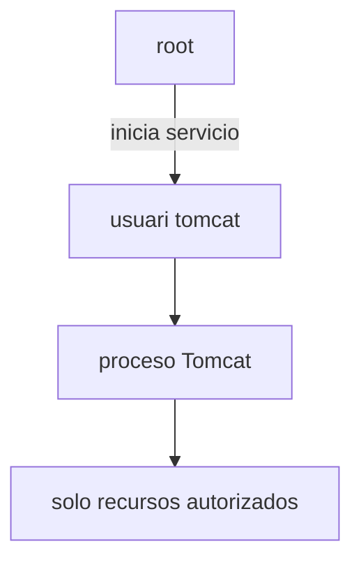
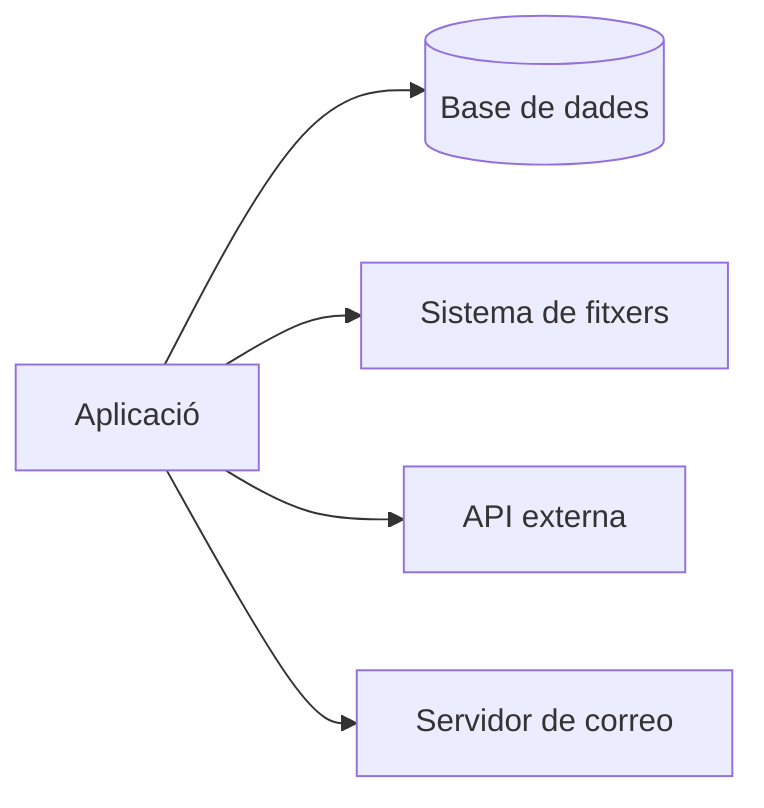
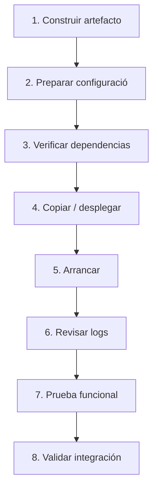

---
hide:
  - navigation
title: "UP3.6. Ajustos necessaris per al desplegament"
description: "Configuració de recursos, memòria, ports, sessions i estratègies de desplegament."
---

# UP3.6. Ajustos necessaris per al desplegament

> **RA3.f:** S'han realitzat els ajustos necessaris per al desplegament d'aplicacions sobre el servidor.

## Què aprendràs

En aquest bloc aprendràs què significa preparar una aplicació perquè funcione correctament fora de l'entorn de desenvolupament.

S'estudiaran:

- artefactes de desplegament;
- WAR;
- contexto d'aplicació;
- configuració per entorns;
- permisos;
- dependències;
- Ports;
- recursos;
- variables de entorn;
- JVM;
- logs;
- procediments de desplegament i rollback.

---

# 1. Executar no és el mateix que desplegar

Durante el desenvolupament és freqüent Executar l'aplicació des d'un IDE.

en producció necessitem un procés reproducible:

```text
código
  ↓
compilación
  ↓
artefacto
  ↓
configuració
  ↓
desplegament
  ↓
verificación
```

El objectiu és que el resultat no dependa de acciones manuales improvisadas.

---

# 2. artefacte WAR

Una aplicació web Java Pot empaquetarse com:

```text
aplicacion.war
```

WAR significa:

> **Web Application Archive**

és un fitxer que conté la estructura de l'aplicació.

```text
aplicacion.war
├── recursos públicos
└── WEB-INF/
    ├── classes/
    ├── lib/
    └── web.xml
```

Tomcat Pot desplegarho dins de `webapps`.

---

# 3. Context path

El nom del desplegament sol relacionarse amb la ruta pública.

exemple:

```text
tienda.war
```

Pot desplegarse com:

```text
http://localhost:8080/tienda/
```

El contexto raíz Pot desplegarse utilitzant la configuració correspondiente o un artefacte denominado `ROOT`.

!!! info "Contexto"
    El **context path** identifica l'aplicació dins del servidor.

    No ha de confundirse amb una ruta interna d'un servlet.

---

# 4. Desplegament expandit

Tomcat també Pot treballar amb una aplicació expandida:

```text
webapps/
└── tienda/
    ├── index.html
    └── WEB-INF/
```

açò resulta útil per a comprendre la estructura, encara que en processos automatizados és habitual treballar amb artefactes construidos de manera reproducible.

---

# 5. dependències

abans de desplegar debemos saber:

```text
¿Qué necesita la aplicació?
```

per exemple:

- versió de Java;
- biblioteca JDBC;
- base de dades;
- variables;
- Fitxers;
- Serveis externs;
- Ports;
- certificats.

Una aplicació Pot compilar correctament i fallar al arrancar perquè falta una dependèència dl'entorn.

---

# 6. Configuració per entorns

podem tindre:

```text
desarrollo
pruebas
producción
```

Cada entorn Pot necessitar valores diferents.

| Parámetro | desenvolupament | producció |
|---|---|---|
| DB | localhost | db-interna |
| logging | DEBUG | INFO |
| HTTPS | opcional | obligatori |
| credeèncials | locales | secretas |

ho recomendable és externalizar aquests valores quan sea posible.

---

# 7. Variables de entorn

Una estratègia freqüent consiste en Utilitzar variables:

```bash
export DB_HOST=db
export DB_PORT=5432
export DB_NAME=tienda
```

La aplicació recupera la configuració en temps de execució.

avantatges:

- evita recompilar;
- facilita Contenidors;
- permet separar configuració i Codi.

---

# 8. Ports

abans del desplegament hi ha que determinar:

```text
Apache → 80 / 443
Tomcat → 8080
AJP → 8009 si se usa
Base de datos → puerto interno
```

Un Servei no podrà obrir un port que ja esté ocupado.

ordres útiles:

```bash
ss -lntp
```

o:

```bash
sudo lsof -i :8080
```

---

# 9. permisos

El Usuari que executa Tomcat ha de disponer dels permisos necessaris, però no més.

per exemple, una aplicació Pot necessitar escribir en:

```text
/var/lib/miapp/uploads/
```

No és una buena solució donar permisos globales:

```bash
chmod 777 ...
```

El enfocament correcto consiste en:

- Propietari adecuado;
- grupo adecuado;
- permisos mínims necessaris.

---

# 10. Propietari del procés

El Servidor hauria de ejecutarse amb un Usuari específico i no com `root` quan no sea necessari.



---

# 11. Configuració de la JVM

Una aplicació Java Pot requerir ajustos en la màquina virtual.

exemples:

```text
-Xms
-Xmx
-Dpropiedad=valor
```

Conceptualmente:

- `Xms`: memòria inicial;
- `Xmx`: límit máximo del heap.

!!! warning "més memòria no sempre arreglal problema"
    Aumentar `-Xmx` sense investigar la causa Pot ocultar temporalmente un problema de consumo, però no necessàriament solucionarlo.

---

# 12. Logging

El desplegament ha de definir:

- on es escriben els logs;
- Què nivell sutilitza;
- com és rotan;
- cuánto temps es conservan.

nivells habituals:

```text
ERROR
WARN
INFO
DEBUG
TRACE
```

producció no hauria de generar sense control enormes quantitats de informació de depuración.

---

# 13. recursos externs

Una aplicació Pot depender de:



abans de declarar un desplegament com correcto debemos comprovar cada dependèència.

---

# 14. Desplegament pas a pas

Un procediment razonable:



---

# 15. Rollback

Un desplegament Pot fallar.

ha de existir una forma de volver a la versió anterior.

exemple:

```text
tienda-1.4.war ← versión estable
tienda-1.5.war ← nueva versión
```

Si `1.5` falla:

```text
retirar 1.5
desplegar 1.4
verificar
```

!!! info "Un desplegament professional inclou marxa arrere"
    Poder desplegar no és suficient.

    també és necessari poder **desfer el desplegament** de manera controlada.

---

# 16. integració amb Apache

després de desplegar l'aplicació en Tomcat debemos comprovar:

```text
Tomcat directo
   ↓
Apache como proxy
   ↓
URL pública
```

No convé depurar tots els nivells simultàniament.

---

# 17. ajustos en Contenidors

quan l'aplicació es executa amb Docker apareixen nous elements:

- imatge;
- Contenidor;
- Ports publicados;
- volums;
- variables de entorn;
- xarxes;
- ordre de arrancada.

exemple conceptual:

```yaml
services:
  tomcat:
    image: tomcat:10
    ports:
      - "8080:8080"

  apache:
    image: httpd:2.4
    ports:
      - "80:80"
```

La configuració real deberá incluir els fitxers i xarxes necessàries.

---

# 18. Checklist de desplegament

!!! note "abans de considerar finalitzat el desplegament"
    comprova:

    - [ ] versió de Java compatible;
    - [ ] Tomcat arranca;
    - [ ] artefacte desplegat;
    - [ ] contexto correcto;
    - [ ] base de dades accesible;
    - [ ] dependències disponibles;
    - [ ] permisos correctos;
    - [ ] configuració dl'entorn;
    - [ ] logs sense errors críticos;
    - [ ] URL local funciona;
    - [ ] proxy funciona;
    - [ ] HTTPS funciona si correspon;
    - [ ] existeix procediment de rollback.

---

# 19. Què has de retenir

!!! summary "resum"
    - El desplegament és un procés, no la simple còpia d'un fitxer.
    - WAR és un formato habitual per a aplicacions web Java.
    - han de prepararse dependències i configuració.
    - és important separar configuració de Codi.
    - permisos, Ports i recursos formen part del desplegament.
    - els logs han de revisarse sempre.
    - ha de existir un procediment de vuelta atrás.

---

# 20. glossari

**WAR**  
fitxer empaquetado per a una aplicació web Java.

**Context path**  
Ruta base que identifica una aplicació dins del servidor.

**Rollback**  
procediment per a volver a una versió anterior.

**artefacte**  
resultat construido i preparado per a desplegar.

**Variable de entorn**  
Valor proporcionat al procés des dl'entorn de execució.

---
