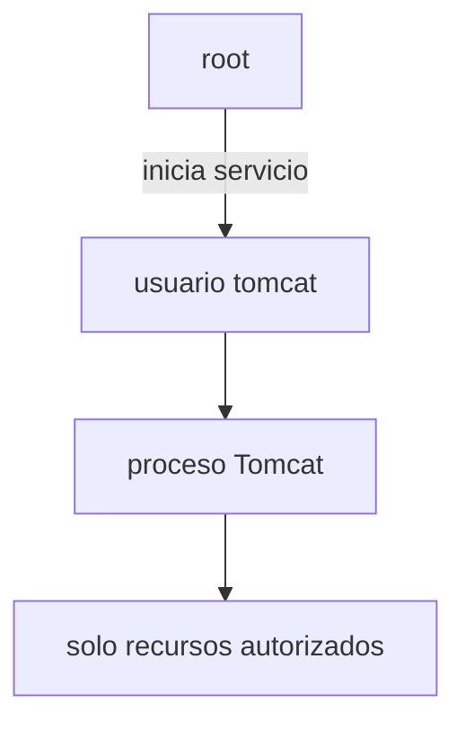
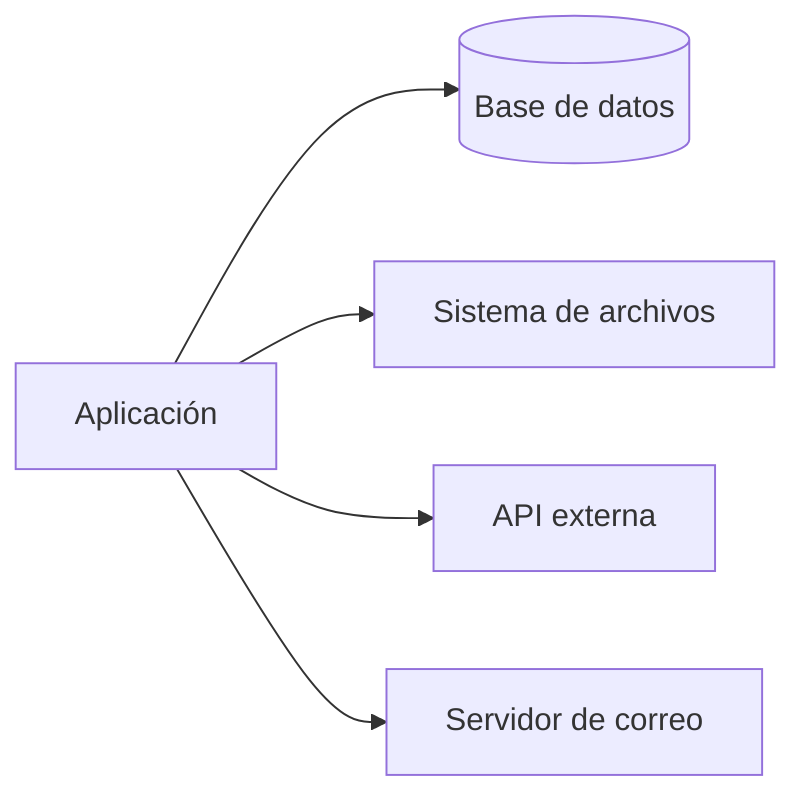
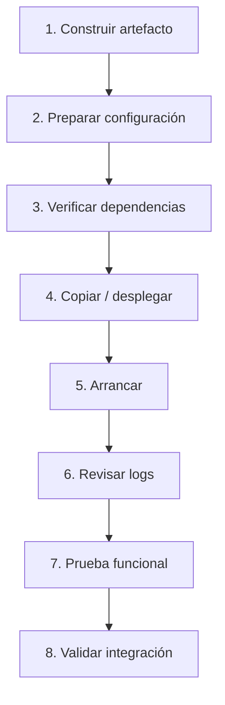

---
hide:
  - navigation
title: "UP3.6. Ajustes necesarios para el despliegue"
description: "Configuración de recursos, memoria, puertos, sesiones y estrategias de despliegue."
---

# UP3.6. Ajustes necesarios para el despliegue

> **RA3.f:** Se han realizado los ajustes necesarios para el despliegue de aplicaciones sobre el servidor.

## Qué vas a aprender

En este bloque aprenderás qué significa preparar una aplicación para que funcione correctamente fuera del entorno de desarrollo.

Se estudiarán:

- artefactos de despliegue;
- WAR;
- contexto de aplicación;
- configuración por entornos;
- permisos;
- dependencias;
- puertos;
- recursos;
- variables de entorno;
- JVM;
- logs;
- procedimientos de despliegue y rollback.

---

# 1. Ejecutar no es lo mismo que desplegar

Durante el desarrollo es frecuente ejecutar la aplicación desde un IDE.

En producción necesitamos un proceso reproducible:

```text
código
  ↓
compilación
  ↓
artefacto
  ↓
configuración
  ↓
despliegue
  ↓
verificación
```

El objetivo es que el resultado no dependa de acciones manuales improvisadas.

---

# 2. Artefacto WAR

Una aplicación web Java puede empaquetarse como:

```text
aplicacion.war
```

WAR significa:

> **Web Application Archive**

Es un archivo que contiene la estructura de la aplicación.

```text
aplicacion.war
├── recursos públicos
└── WEB-INF/
    ├── classes/
    ├── lib/
    └── web.xml
```

Tomcat puede desplegarlo dentro de `webapps`.

---

# 3. Context path

El nombre del despliegue suele relacionarse con la ruta pública.

Ejemplo:

```text
tienda.war
```

puede desplegarse como:

```text
http://localhost:8080/tienda/
```

El contexto raíz puede desplegarse utilizando la configuración correspondiente o un artefacto denominado `ROOT`.

!!! info "Contexto"
    El **context path** identifica la aplicación dentro del servidor.

    No debe confundirse con una ruta interna de un servlet.

---

# 4. Despliegue expandido

Tomcat también puede trabajar con una aplicación expandida:

```text
webapps/
└── tienda/
    ├── index.html
    └── WEB-INF/
```

Esto resulta útil para comprender la estructura, aunque en procesos automatizados es habitual trabajar con artefactos construidos de forma reproducible.

---

# 5. Dependencias

Antes de desplegar debemos saber:

```text
¿Qué necesita la aplicación?
```

Por ejemplo:

- versión de Java;
- biblioteca JDBC;
- base de datos;
- variables;
- archivos;
- servicios externos;
- puertos;
- certificados.

Una aplicación puede compilar correctamente y fallar al arrancar porque falta una dependencia del entorno.

---

# 6. Configuración por entornos

Podemos tener:

```text
desarrollo
pruebas
producción
```

Cada entorno puede necesitar valores distintos.

| Parámetro | Desarrollo | Producción |
|---|---|---|
| DB | localhost | db-interna |
| logging | DEBUG | INFO |
| HTTPS | opcional | obligatorio |
| credenciales | locales | secretas |

Lo recomendable es externalizar estos valores cuando sea posible.

---

# 7. Variables de entorno

Una estrategia frecuente consiste en utilizar variables:

```bash
export DB_HOST=db
export DB_PORT=5432
export DB_NAME=tienda
```

La aplicación recupera la configuración en tiempo de ejecución.

Ventajas:

- evita recompilar;
- facilita contenedores;
- permite separar configuración y código.

---

# 8. Puertos

Antes del despliegue hay que determinar:

```text
Apache → 80 / 443
Tomcat → 8080
AJP → 8009 si se usa
Base de datos → puerto interno
```

Un servicio no podrá abrir un puerto que ya esté ocupado.

Comandos útiles:

```bash
ss -lntp
```

o:

```bash
sudo lsof -i :8080
```

---

# 9. Permisos

El usuario que ejecuta Tomcat debe disponer de los permisos necesarios, pero no más.

Por ejemplo, una aplicación puede necesitar escribir en:

```text
/var/lib/miapp/uploads/
```

No es una buena solución dar permisos globales:

```bash
chmod 777 ...
```

El enfoque correcto consiste en:

- propietario adecuado;
- grupo adecuado;
- permisos mínimos necesarios.

---

# 10. Propietario del proceso

El servidor debería ejecutarse con un usuario específico y no como `root` cuando no sea necesario.



---

# 11. Configuración de la JVM

Una aplicación Java puede requerir ajustes en la máquina virtual.

Ejemplos:

```text
-Xms
-Xmx
-Dpropiedad=valor
```

Conceptualmente:

- `Xms`: memoria inicial;
- `Xmx`: límite máximo del heap.

!!! warning "Más memoria no siempre arregla el problema"
    Aumentar `-Xmx` sin investigar la causa puede ocultar temporalmente un problema de consumo, pero no necesariamente solucionarlo.

---

# 12. Logging

El despliegue debe definir:

- dónde se escriben los logs;
- qué nivel se utiliza;
- cómo se rotan;
- cuánto tiempo se conservan.

Niveles habituales:

```text
ERROR
WARN
INFO
DEBUG
TRACE
```

Producción no debería generar sin control enormes cantidades de información de depuración.

---

# 13. Recursos externos

Una aplicación puede depender de:



Antes de declarar un despliegue como correcto debemos comprobar cada dependencia.

---

# 14. Despliegue paso a paso

Un procedimiento razonable:



---

# 15. Rollback

Un despliegue puede fallar.

Debe existir una forma de volver a la versión anterior.

Ejemplo:

```text
tienda-1.4.war ← versión estable
tienda-1.5.war ← nueva versión
```

Si `1.5` falla:

```text
retirar 1.5
desplegar 1.4
verificar
```

!!! info "Un despliegue profesional incluye marcha atrás"
    Poder desplegar no es suficiente.

    También es necesario poder **deshacer el despliegue** de forma controlada.

---

# 16. Integración con Apache

Después de desplegar la aplicación en Tomcat debemos comprobar:

```text
Tomcat directo
   ↓
Apache como proxy
   ↓
URL pública
```

No conviene depurar todos los niveles simultáneamente.

---

# 17. Ajustes en contenedores

Cuando la aplicación se ejecuta con Docker aparecen nuevos elementos:

- imagen;
- contenedor;
- puertos publicados;
- volúmenes;
- variables de entorno;
- redes;
- orden de arranque.

Ejemplo conceptual:

```yaml
services:
  tomcat:
    image: tomcat:10
    ports:
      - "8080:8080"

  apache:
    image: httpd:2.4
    ports:
      - "80:80"
```

La configuración real deberá incluir los archivos y redes necesarias.

---

# 18. Checklist de despliegue

!!! note "Antes de considerar finalizado el despliegue"
    Comprueba:

    - [ ] versión de Java compatible;
    - [ ] Tomcat arranca;
    - [ ] artefacto desplegado;
    - [ ] contexto correcto;
    - [ ] base de datos accesible;
    - [ ] dependencias disponibles;
    - [ ] permisos correctos;
    - [ ] configuración del entorno;
    - [ ] logs sin errores críticos;
    - [ ] URL local funciona;
    - [ ] proxy funciona;
    - [ ] HTTPS funciona si corresponde;
    - [ ] existe procedimiento de rollback.

---

# 19. Qué debes retener

!!! summary "Resumen"
    - El despliegue es un proceso, no la simple copia de un fichero.
    - WAR es un formato habitual para aplicaciones web Java.
    - Deben prepararse dependencias y configuración.
    - Es importante separar configuración de código.
    - Permisos, puertos y recursos forman parte del despliegue.
    - Los logs deben revisarse siempre.
    - Debe existir un procedimiento de vuelta atrás.

---

# 20. Glosario

**WAR**  
Archivo empaquetado para una aplicación web Java.

**Context path**  
Ruta base que identifica una aplicación dentro del servidor.

**Rollback**  
Procedimiento para volver a una versión anterior.

**Artefacto**  
Resultado construido y preparado para desplegar.

**Variable de entorno**  
Valor proporcionado al proceso desde el entorno de ejecución.

---
