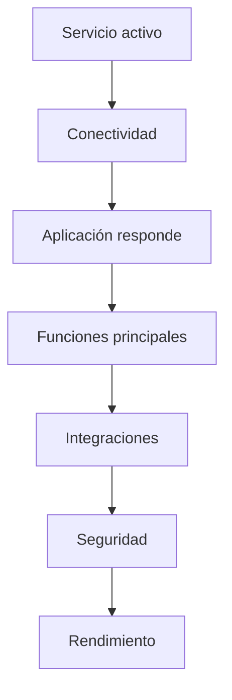
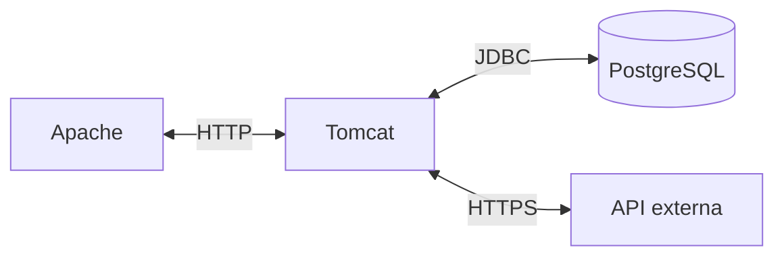
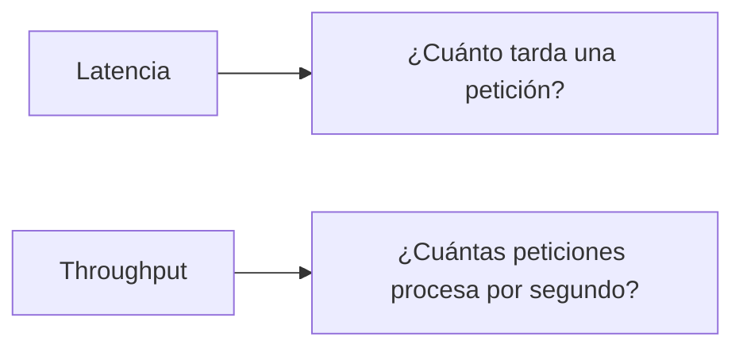
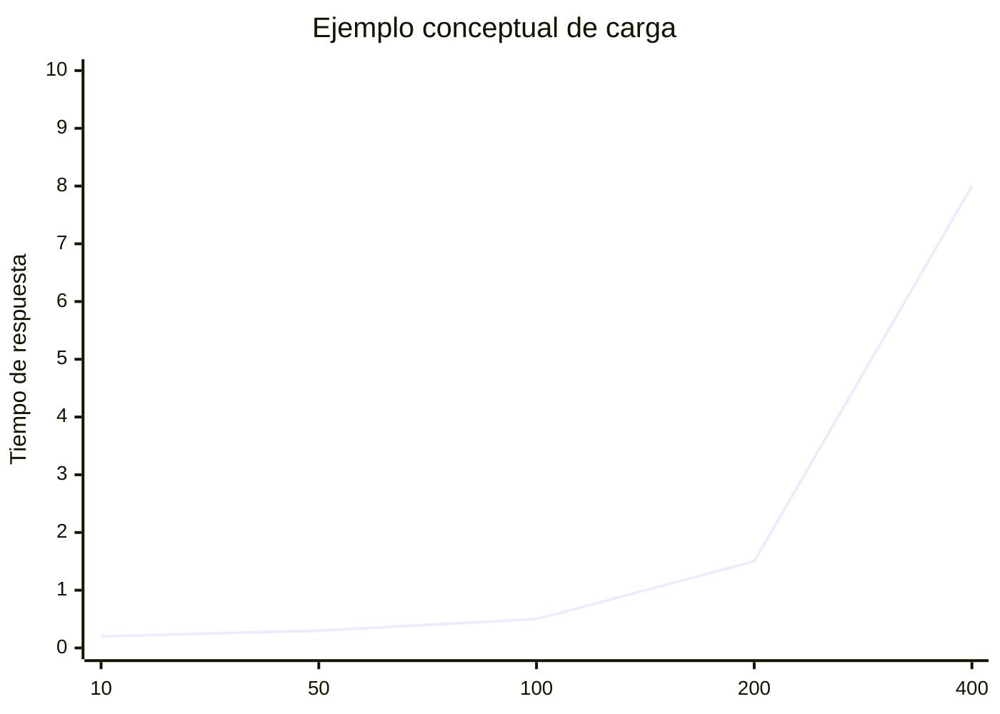
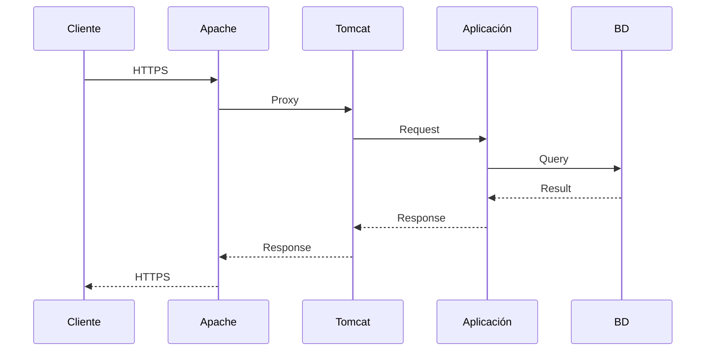

---
hide:
  - navigation
title: "UP3.7. Pruebas de funcionamiento y rendimiento"
description: "Pruebas funcionales, de integración, seguridad, carga y rendimiento del despliegue."
---

# UP3.7. Pruebas de funcionamiento y rendimiento

> **RA3.g:** Se han realizado pruebas de funcionamiento y rendimiento de la aplicación web desplegada.

## Qué vas a aprender

Una aplicación desplegada no debe considerarse correcta únicamente porque aparece su página principal.

En este bloque aprenderás:

- qué comprobar después de un despliegue;
- diferencia entre disponibilidad y funcionamiento;
- pruebas funcionales;
- pruebas de integración;
- pruebas de carga;
- pruebas de estrés;
- métricas básicas;
- herramientas de diagnóstico.

---

# 1. ¿Qué significa “funciona”?

Considera estas situaciones:

```text
La portada carga.
El login falla.
La base de datos no responde.
HTTPS funciona, pero el proxy no.
Un usuario funciona; 100 usuarios bloquean el servidor.
```

En todos estos casos podríamos afirmar que “el servidor responde”, pero no que el sistema funciona correctamente.

Debemos comprobar varias capas.

---

# 2. Niveles de prueba



---

# 3. Comprobar el servicio

En un sistema gestionado por `systemd`:

```bash
systemctl status tomcat
```

También podemos revisar procesos:

```bash
ps aux | grep tomcat
```

y puertos:

```bash
ss -lntp
```

---

# 4. Pruebas con `curl`

`curl` permite realizar peticiones sin depender de la interfaz gráfica del navegador.

Ejemplo:

```bash
curl -I http://localhost:8080/
```

Puede mostrar:

```text
HTTP/1.1 200
Content-Type: text/html
```

Otra petición:

```bash
curl -v http://localhost:8080/miapp/
```

La opción `-v` aporta información útil para diagnóstico.

---

# 5. Códigos de estado

Algunos códigos importantes:

| Código | Significado general |
|---:|---|
| 200 | Correcto |
| 301/302 | Redirección |
| 400 | Petición incorrecta |
| 401 | No autenticado |
| 403 | Prohibido |
| 404 | No encontrado |
| 500 | Error interno |
| 502 | Error de gateway/proxy |
| 503 | Servicio no disponible |

El código ayuda a localizar la capa donde se produce el problema.

---

# 6. Prueba funcional

Comprueba funcionalidades reales.

Por ejemplo, para una tienda:

```text
abrir catálogo
   ↓
ver producto
   ↓
iniciar sesión
   ↓
añadir al carrito
   ↓
confirmar operación
```

No basta con realizar:

```text
GET /
```

---

# 7. Prueba de integración

Comprueba la comunicación entre componentes.

Ejemplos:

```text
Apache ↔ Tomcat
Tomcat ↔ PostgreSQL
Aplicación ↔ API externa
Aplicación ↔ sistema de correo
```



---

# 8. Prueba de seguridad básica

Después de un despliegue también se debe comprobar:

- redirección a HTTPS;
- zonas privadas;
- cierre de sesión;
- roles;
- cookies;
- acceso a interfaces administrativas;
- puertos expuestos.

Una configuración puede “funcionar” y ser insegura.

---

# 9. Rendimiento

El rendimiento estudia cómo responde el sistema bajo determinadas condiciones.

Algunas métricas:

### Tiempo de respuesta

Tiempo entre petición y respuesta.

### Throughput

Número de peticiones procesadas por unidad de tiempo.

### Concurrencia

Número de clientes o peticiones simultáneas.

### Tasa de errores

Porcentaje de peticiones que producen fallo.

### Recursos

- CPU;
- memoria;
- disco;
- red;
- conexiones.

---

# 10. Latencia frente a throughput

No son lo mismo.

Un sistema puede procesar muchas peticiones por segundo pero tener tiempos individuales altos.



---

# 11. Prueba de carga

Una prueba de carga simula un nivel previsto de uso.

Ejemplo:

```text
100 usuarios concurrentes
durante 10 minutos
```

El objetivo es comprobar si el sistema cumple los requisitos esperados.

---

# 12. Prueba de estrés

La prueba de estrés aumenta la carga hasta superar la capacidad prevista.

Objetivos:

- conocer el límite;
- observar cómo falla;
- comprobar si se recupera;
- detectar cuellos de botella.



---

# 13. Herramientas

## ApacheBench

Para pruebas sencillas:

```bash
ab -n 1000 -c 20 http://localhost:8080/miapp/
```

Conceptualmente:

```text
-n 1000 → número total de peticiones
-c 20   → concurrencia
```

No sustituye una prueba de rendimiento completa, pero permite realizar comprobaciones básicas.

---

## JMeter

Apache JMeter permite definir escenarios más complejos:

- varios usuarios;
- diferentes rutas;
- formularios;
- autenticación;
- tiempos de espera;
- informes.

Es más adecuado cuando necesitamos simular un comportamiento realista.

---

# 14. Monitorización del servidor

Mientras realizamos una prueba es necesario observar también el servidor.

Herramientas:

```bash
top
```

```bash
htop
```

```bash
free -h
```

```bash
df -h
```

```bash
ss -s
```

Una prueba que solo observa el navegador ofrece información incompleta.

---

# 15. Cuellos de botella

El problema puede encontrarse en:


Antes de optimizar debemos medir.

!!! tip "Primero medir"
    No debe suponerse automáticamente que Tomcat es el problema.

    Una consulta SQL lenta o una API externa pueden dominar por completo el tiempo de respuesta.

---

# 16. Comparar resultados

Una prueba es especialmente útil cuando existe una referencia.

Ejemplo:

| Escenario | Antes | Después |
|---|---:|---:|
| Respuesta media | 850 ms | 320 ms |
| Errores | 4 % | 0 % |
| Peticiones/s | 25 | 63 |

Esto permite justificar una mejora.

---

# 17. Prueba de extremo a extremo

La verificación final debería utilizar la misma ruta que utilizaría un usuario:

```text
Cliente
  ↓
DNS
  ↓
HTTPS
  ↓
Apache
  ↓
Tomcat
  ↓
Aplicación
  ↓
Base de datos
```



---

# 18. Qué registrar en una prueba

Aunque las actividades de evaluación se definan por separado, una prueba técnica debería dejar constancia de:

```text
fecha
versión
entorno
configuración
herramienta
carga
resultado
errores
conclusión
```

Sin estos datos resulta difícil repetir la prueba.

---

# 19. Qué debes retener

!!! summary "Resumen"
    - Servicio activo no equivale a aplicación correcta.
    - `curl` permite realizar comprobaciones rápidas.
    - Las pruebas funcionales verifican comportamiento.
    - Las pruebas de integración comprueban conexiones entre componentes.
    - Las pruebas de carga miden comportamiento bajo uso previsto.
    - Las pruebas de estrés permiten localizar límites.
    - El rendimiento debe analizarse conjuntamente con CPU, RAM, red, base de datos y logs.
    - Toda prueba debe ser reproducible.

---

# 20. Glosario

**Latencia**  
Tiempo que tarda una operación.

**Throughput**  
Cantidad de trabajo completado por unidad de tiempo.

**Concurrencia**  
Operaciones o usuarios activos simultáneamente.

**Prueba de carga**  
Prueba bajo una carga prevista.

**Prueba de estrés**  
Prueba que lleva el sistema más allá de sus condiciones normales.

**Cuello de botella**  
Componente que limita el rendimiento global.

---
