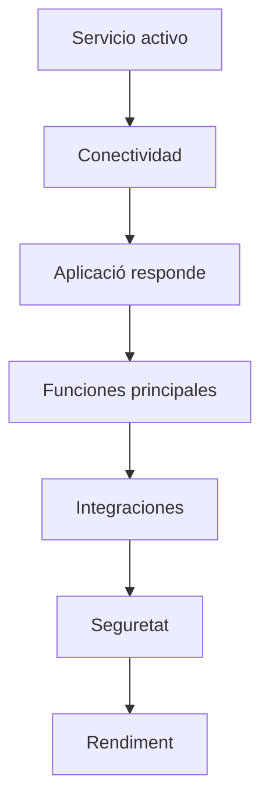
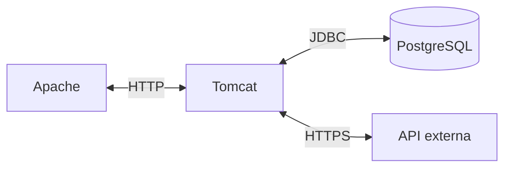
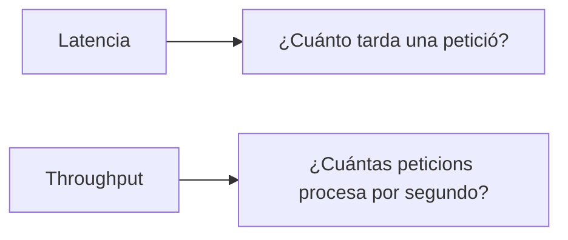
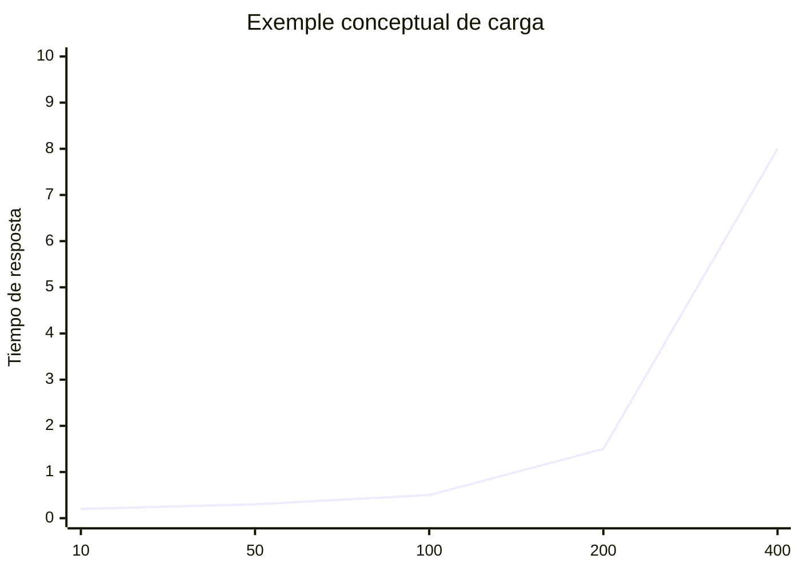
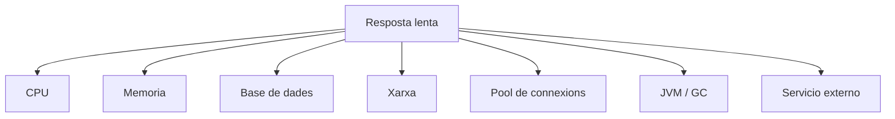
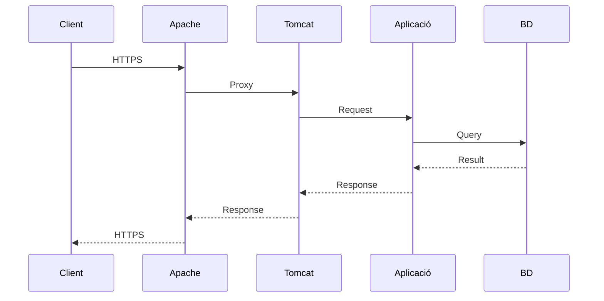

---
hide:
  - navigation
title: "UP3.7. Proves de funcionament i Rendiment"
description: "Proves funcionals, d'integració, seguretat, càrrega i rendiment del desplegament."
---

# UP3.7. Proves de funcionament i Rendiment

> **RA3.g:** S'han realitzat proves de funcionament i rendiment de l'aplicació web desplegada.

## Què aprendràs

Una aplicació desplegada no s'ha de considerar correcta únicament perquè apareix la seua pàgina principal.

En aquest bloc aprendràs:

- Què comprovar després d'un desplegament;
- diferència entre disponibilitat i funcionament;
- Proves funcionals;
- Proves de integració;
- Proves de càrrega;
- Proves de estrès;
- métricas bàsiques;
- eines de diagnòstic.

---

# 1. ¿Què significa “funciona”?

Considera aquestes situaciones:

```text
La portada carga.
El login falla.
La base de datos no responde.
HTTPS funciona, pero el proxy no.
Un usuario funciona; 100 usuarios bloquean el servidor.
```

en tots aquests casos podriamos afirmar que “el servidor respon”, però no que el sistema funciona correctament.

Debemos comprovar diverses capes.

---

# 2. nivells de Prova



---

# 3. comprovar el Servei

en un sistema gestionado per `systemd`:

```bash
systemctl status tomcat
```

també podem revisar processos:

```bash
ps aux | grep tomcat
```

i Ports:

```bash
ss -lntp
```

---

# 4. Proves amb `curl`

`curl` permet realitzar Peticions sense depender de la interfaz gráfica del navegador.

exemple:

```bash
curl -I http://localhost:8080/
```

Pot mostrar:

```text
HTTP/1.1 200
Content-Type: text/html
```

una altra petició:

```bash
curl -v http://localhost:8080/miapp/
```

La opció `-v` aporta informació útil per a diagnòstic.

---

# 5. codis de estat

alguns codis importants:

| Codi | significat general |
|---:|---|
| 200 | Correcto |
| 301/302 | Redirección |
| 400 | petició incorrecta |
| 401 | No autenticat |
| 403 | Prohibido |
| 404 | No encontrado |
| 500 | Error intern |
| 502 | Error de gateway/proxy |
| 503 | Servei no disponible |

El Codi ajuda a localitzar la capa on es produeix el problema.

---

# 6. Prova funcional

comprova funcionalitats reals.

per exemple, per a una botiga:

```text
abrir catálogo
   ↓
ver producto
   ↓
iniciar sesión
   ↓
añadir al carrito
   ↓
confirmar operación
```

No basta amb realitzar:

```text
GET /
```

---

# 7. Prova de integració

comprova la comunicació entre components.

exemples:

```text
Apache ↔ Tomcat
Tomcat ↔ PostgreSQL
Aplicación ↔ API externa
Aplicación ↔ sistema de correo
```



---

# 8. Prova de Seguretat bàsica

després d'un desplegament també es ha de comprovar:

- redirección a HTTPS;
- zonas privades;
- tancament de Sessió;
- rols;
- cookies;
- accés a interfaces administrativas;
- Ports expuestos.

Una configuració Pot “funcionar” i ser insegura.

---

# 9. Rendiment

El Rendiment estudia com responl sistema sota determinadas condiciones.

algunes métricas:

### temps de Resposta

temps entre petició i Resposta.

### Throughput

Número de Peticions procesadas per unitat de temps.

### concurrèència

Número de Clients o Peticions simultáneas.

### taxa de errors

Porcentaje de Peticions que producen fallo.

### recursos

- CPU;
- memòria;
- disco;
- xarxa;
- connexions.

---

# 10. latèència davant de throughput

No són el mateix.

Un sistema Pot processar moltes Peticions per segon però tindre tiempos individuales altos.



---

# 11. Prova de càrrega

Una Prova de càrrega simula un nivell previsto d'ús.

exemple:

```text
100 usuarios concurrentes
durante 10 minutos
```

El objectiu és comprovar si el sistema cumple els requisitos esperados.

---

# 12. Prova de estrès

La Prova de estrès aumenta la càrrega fins a superar la capacidad prevista.

objectius:

- conéixer el límit;
- observar com falla;
- comprovar si es recupera;
- detectar colls de botella.



---

# 13. eines

## ApacheBench

per a Proves sencillas:

```bash
ab -n 1000 -c 20 http://localhost:8080/miapp/
```

Conceptualmente:

```text
-n 1000 → número total de peticiones
-c 20   → concurrencia
```

No substitueix una Prova de Rendiment completa, però permet realitzar comprovacions bàsiques.

---

## JMeter

Apache JMeter permet definir escenarios més complejos:

- diversos Usuaris;
- diferents rutas;
- formularis;
- autenticació;
- tiempos de espera;
- informes.

és més adecuado quan necessitem simular un comportament realista.

---

# 14. monitorització del servidor

mentre realizamos una Prova és necessari observar també el servidor.

eines:

```bash
top
```

```bash
htop
```

```bash
free -h
```

```bash
df -h
```

```bash
ss -s
```

Una Prova que només observal navegador ofereix informació incompleta.

---

# 15. colls de botella

El problema Pot trobarse en:



abans de optimizar debemos medir.

!!! tip "primer medir"
    No ha de suponerse automàticament que Tomcat és el problema.

    Una consulta SQL lenta o una API externa poden dominar per complet el temps de Resposta.

---

# 16. comparar resultats

Una Prova és especialment útil quan existeix una referèència.

exemple:

| escenari | abans | després |
|---|---:|---:|
| Resposta media | 850 ms | 320 ms |
| errors | 4 % | 0 % |
| Peticions/s | 25 | 63 |

açò permet justificar una mejora.

---

# 17. Prova de extrem a extrem

La Verificació final hauria de Utilitzar la mateixa ruta que utilizaría un Usuari:

```text
Cliente
  ↓
DNS
  ↓
HTTPS
  ↓
Apache
  ↓
Tomcat
  ↓
Aplicación
  ↓
Base de datos
```



---

# 18. Què registrar en una Prova

encara que Les activitats de avaluació es definan per separado, una Prova tècnica hauria de deixar constàència de:

```text
fecha
versión
entorno
configuració
herramienta
carga
resultado
errores
conclusión
```

sense aquests Dades resulta difícil repetir la Prova.

---

# 19. Què has de retenir

!!! summary "resum"
    - Servei actiu no equival a aplicació correcta.
    - `curl` permet realitzar comprovacions rápidas.
    - les proves funcionals verifican comportament.
    - les proves de integració comprueban connexions entre components.
    - les proves de càrrega miden comportament sota ús previsto.
    - les proves de estrès permeten localitzar límits.
    - El Rendiment ha de analizarse conjuntament amb CPU, RAM, xarxa, base de dades i logs.
    - tota Prova ha de ser reproducible.

---

# 20. glossari

**latèència**  
temps que tarda una operació.

**Throughput**  
quantitat de trabajo completado per unitat de temps.

**concurrèència**  
Operaciones o Usuaris actius simultàniament.

**Prova de càrrega**  
Prova sota una càrrega prevista.

**Prova de estrès**  
Prova que lleval sistema més allá de sus condiciones normales.

**Cuelho de botella**  
component que limital Rendiment global.

---
