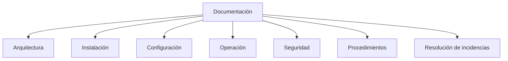
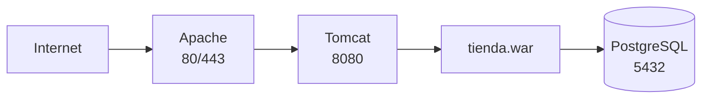
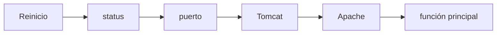
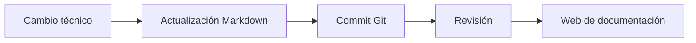

---
hide:
  - navigation
title: "UP3.8. Administración y documentación del servidor de aplicaciones"
description: "Runbooks, inventario, despliegues, rollback, copias, logs y documentación operativa."
---

# UP3.8. Administración y documentación del servidor de aplicaciones

> **RA3.h:** Se ha elaborado documentación relativa a la administración y recomendaciones de uso del servidor de aplicaciones.

## Qué vas a aprender

Un despliegue no está terminado hasta que otra persona puede comprender cómo se administra.

En este bloque aprenderás:

- qué documentación necesita un servidor;
- qué es un runbook;
- cómo documentar arquitectura;
- inventario de configuración;
- procedimientos de operación;
- logs;
- copias de seguridad;
- incidencias;
- cambios;
- recomendaciones de seguridad y mantenimiento.

---

# 1. ¿Por qué documentar?

Imagina que una persona configura un servidor y seis meses después abandona el equipo.

Nadie sabe:

```text
qué versión se instaló
dónde están los logs
cómo reiniciarlo
qué puerto utiliza
qué usuario administra Tomcat
dónde se encuentra el certificado
cómo desplegar una nueva versión
```

El servidor puede estar funcionando, pero no es mantenible.

!!! info "La documentación forma parte del sistema"
    Una infraestructura que depende únicamente de la memoria de quien la creó tiene un riesgo operativo elevado.

---

# 2. Tipos de documentación

Podemos separar:



---

# 3. Documento de arquitectura

Debe explicar los componentes y sus relaciones.

Ejemplo:



Debe indicar:

- propósito de cada componente;
- conexiones;
- puertos;
- dependencias;
- límites del sistema.

---

# 4. Inventario técnico

Ejemplo:

| Elemento | Valor |
|---|---|
| SO | Ubuntu Server |
| Apache | 2.4.x |
| Java | 17/21 según proyecto |
| Tomcat | 10.1.x |
| Aplicación | tienda |
| Puerto Apache HTTP | 80 |
| Puerto Apache HTTPS | 443 |
| Puerto Tomcat | 8080 |
| Ruta Tomcat | `/opt/tomcat/...` |

El objetivo no es llenar páginas, sino poder identificar exactamente el entorno.

---

# 5. Configuración

Deben registrarse los elementos relevantes:

```text
/etc/apache2/sites-available/...
$CATALINA_BASE/conf/server.xml
$CATALINA_BASE/conf/context.xml
$CATALINA_BASE/conf/tomcat-users.xml
```

No es necesario copiar contraseñas dentro de la documentación.

!!! danger "Documentar no significa publicar secretos"
    La documentación puede indicar **dónde** se gestiona un secreto sin incluir su valor.

---

# 6. Runbook

Un **runbook** es un conjunto de procedimientos operativos.

Puede responder a preguntas como:

```text
¿Cómo arranco el servicio?
¿Cómo lo detengo?
¿Cómo compruebo su estado?
¿Cómo despliego?
¿Cómo vuelvo a la versión anterior?
¿Cómo reviso un error?
```

---

# 7. Inicio, parada y reinicio

Ejemplo:

```bash
sudo systemctl start tomcat
sudo systemctl stop tomcat
sudo systemctl restart tomcat
sudo systemctl status tomcat
```

La documentación debe indicar qué comando corresponde al entorno real.

---

# 8. Verificación posterior

Después de un reinicio:

```text
1. servicio activo
2. puerto abierto
3. Tomcat responde
4. aplicación responde
5. Apache responde
6. prueba de función crítica
```



---

# 9. Logs

La documentación debe explicar:

- ubicación;
- finalidad;
- rotación;
- comandos de consulta.

Ejemplos:

```bash
journalctl -u tomcat
```

```bash
tail -f /ruta/al/log
```

```bash
journalctl -u apache2
```

---

# 10. Procedimiento de despliegue

Debe poder repetirse.

Ejemplo:

```text
1. obtener artefacto validado
2. realizar copia de la versión actual
3. desplegar nueva versión
4. reiniciar si corresponde
5. revisar logs
6. ejecutar prueba rápida
7. confirmar versión
```

---

# 11. Procedimiento de rollback

También debe documentarse.

```text
si la nueva versión falla:
  1. retirar nueva versión
  2. restaurar artefacto anterior
  3. reiniciar
  4. validar
  5. registrar la incidencia
```

---

# 12. Copias de seguridad

No todo lo que existe en el servidor necesita el mismo tipo de copia.

Posibles elementos:

- configuración;
- certificados;
- base de datos;
- archivos subidos;
- scripts;
- documentación.

El artefacto de una aplicación quizá pueda reconstruirse desde CI/CD, mientras que una base de datos no.

---

# 13. Gestión de cambios

Un cambio debería responder:

```text
¿Qué se cambió?
¿Por qué?
¿Quién?
¿Cuándo?
¿Qué impacto tiene?
¿Cómo se revierte?
```

Ejemplo:

```text
2026-10-20
Cambio: activado HTTPS en Apache
Motivo: cifrar acceso público
Rollback: restaurar vhost anterior
```

---

# 14. Incidencias

Una buena documentación de incidencia registra:

```text
síntoma
hora
impacto
causa
diagnóstico
solución
prevención
```

Ejemplo conceptual:

```text
Síntoma: 502 desde Apache
Causa: Tomcat detenido
Solución: reinicio del servicio
Prevención: monitorización del proceso
```

---

# 15. Recomendaciones de mantenimiento

## Actualizaciones

Revisar periódicamente:

- sistema operativo;
- Java;
- Tomcat;
- Apache;
- dependencias.

## Logs

Comprobar:

- errores;
- espacio en disco;
- rotación.

## Certificados

Registrar fechas de caducidad.

## Copias

Verificar que pueden restaurarse.

## Usuarios

Eliminar cuentas que ya no sean necesarias.

---

# 16. Seguridad de la documentación

La documentación puede contener información sensible:

```text
arquitectura
nombres internos
direcciones IP
rutas
usuarios
```

Debe almacenarse en un lugar con control de acceso.

No debería mezclarse documentación pública con secretos operativos.

---

# 17. Documentación como código

Una estrategia útil consiste en guardar documentación en Markdown y controlarla con Git.

Ventajas:

- historial;
- revisión;
- cambios comparables;
- colaboración;
- documentación cercana al proyecto.



---

# 18. Estructura recomendada

Un documento de administración podría contener:

```text
1. Objetivo
2. Arquitectura
3. Inventario
4. Puertos
5. Directorios
6. Configuración
7. Arranque/parada
8. Despliegue
9. Rollback
10. Logs
11. Copias
12. Seguridad
13. Resolución de problemas
14. Historial de cambios
```

---

# 19. Qué debes retener

!!! summary "Resumen"
    - La documentación reduce dependencia de personas concretas.
    - La arquitectura debe representarse visualmente.
    - Un runbook documenta procedimientos repetibles.
    - Deben existir procedimientos de despliegue y rollback.
    - Los logs y copias deben estar documentados.
    - La documentación no debe contener secretos innecesarios.
    - Markdown + Git es una buena estrategia para mantener documentación técnica.

---

# 20. Glosario

**Runbook**  
Documento con procedimientos operativos.

**Rollback**  
Vuelta controlada a una versión anterior.

**Inventario**  
Relación de componentes y versiones de un sistema.

**Documentación como código**  
Gestión de documentación mediante formatos de texto, control de versiones y procesos similares a los utilizados para código.

---
