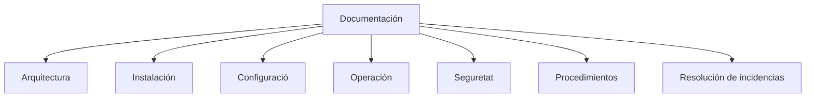
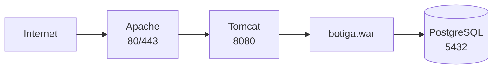
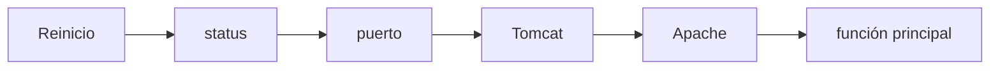
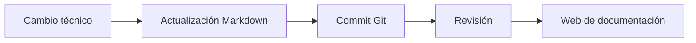

---
hide:
  - navigation
title: "UP3.8. Administració i documentació del servidor d'aplicacions"
description: "Runbooks, inventari, desplegaments, rollback, còpies, logs i documentació operativa."
---

# UP3.8. Administració i Documentació del servidor d'aplicacions

> **RA3.h:** S'ha elaborat documentació relativa a l'administració i a les recomanacions d'ús del servidor d'aplicacions.

## Què aprendràs

Un desplegament no està acabat fins que una altra persona pot comprendre com s'administra.

En aquest bloc aprendràs:

- Quina documentació necessita un servidor;
- Què és un runbook;
- com documentar arquitectura;
- Inventari de configuració;
- procediments de operació;
- logs;
- còpies de Seguretat;
- incidències;
- canvis;
- recomanacions de Seguretat i manteniment.

---

# 1. ¿per què documentar?

Imagina que una persona configura un servidor i seis mesos després abandona l' equip.

Nadie sap:

```text
qué versión se instaló
dónde están los logs
cómo reiniciarlo
qué puerto utiliza
qué usuario administra Tomcat
dónde se encuentra el certificado
cómo desplegar una nueva versión
```

El Servidor pot estar funcionant, però no és mantenible.

!!! info "La Documentació forma part del sistema"
    Una infraestructura que depende únicament de la memòria de qui la creó té un risc operativo elevado.

---

# 2. Tipus de documentació

podem separar:



---

# 3. Document de arquitectura

ha de explicar els components i sus relacions.

exemple:



ha de indicar:

- propósito de cada component;
- connexions;
- Ports;
- dependències;
- límits del sistema.

---

# 4. Inventari tècnic

exemple:

| element | Valor |
|---|---|
| SO | Ubuntu Server |
| Apache | 2.4.x |
| Java | 17/21 segons proyecto |
| Tomcat | 10.1.x |
| Aplicació | botiga |
| Port Apache HTTP | 80 |
| Port Apache HTTPS | 443 |
| Port Tomcat | 8080 |
| Ruta Tomcat | `/opt/tomcat/...` |

El objectiu no és llenar pàgines, sinó poder identificar exactament l'entorn.

---

# 5. Configuració

han de registrarse els elements rellevants:

```text
/etc/apache2/sites-available/...
$CATALINA_BASE/conf/server.xml
$CATALINA_BASE/conf/context.xml
$CATALINA_BASE/conf/tomcat-users.xml
```

No és necessari copiar Contrasenyes dins de la documentació.

!!! danger "Documentar no significa publicar secrets"
    La Documentació Pot indicar **on** es gestiona un secret sense incluir el seu valor.

---

# 6. Runbook

Un **runbook** és un conjunt de procediments operatius.

Pot responr a preguntes com:

```text
¿Cómo arranco el servicio?
¿Cómo lo detengo?
¿Cómo compruebo su estado?
¿Cómo despliego?
¿Cómo vuelvo a la versión anterior?
¿Cómo reviso un error?
```

---

# 7. Inici, parada i reinici

exemple:

```bash
sudo systemctl start tomcat
sudo systemctl stop tomcat
sudo systemctl restart tomcat
sudo systemctl status tomcat
```

La Documentació ha de indicar Què ordre correspon al entorn real.

---

# 8. Verificació posterior

després d'un reinici:

```text
1. servicio activo
2. puerto abierto
3. Tomcat responde
4. aplicació responde
5. Apache responde
6. prueba de función crítica
```



---

# 9. Logs

La Documentació ha de explicar:

- ubicación;
- finalitat;
- rotación;
- ordres de consulta.

exemples:

```bash
journalctl -u tomcat
```

```bash
tail -f /ruta/al/log
```

```bash
journalctl -u apache2
```

---

# 10. procediment de desplegament

ha de poder repetirse.

exemple:

```text
1. obtener artefacto validado
2. realizar copia de la versión actual
3. desplegar nueva versión
4. reiniciar si corresponde
5. revisar logs
6. ejecutar prueba rápida
7. confirmar versión
```

---

# 11. procediment de rollback

també ha de documentarse.

```text
si la nueva versión falla:
  1. retirar nueva versión
  2. restaurar artefacto anterior
  3. reiniciar
  4. validar
  5. registrar la incidencia
```

---

# 12. còpies de Seguretat

No tot ho que existeix en el servidor necessital mateix tipus de còpia.

Posibles elements:

- configuració;
- certificats;
- base de dades;
- Fitxers subidos;
- scripts;
- Documentació.

El artefacte d'una aplicació potser puga reconstruir-se des de CI/CD, mentre que una base de dades no.

---

# 13. Gestió de canvis

Un Canvi hauria de responr:

```text
¿Qué se cambió?
¿Por qué?
¿Quién?
¿Cuándo?
¿Qué impacto tiene?
¿Cómo se revierte?
```

exemple:

```text
2026-10-20
Cambio: activado HTTPS en Apache
Motivo: cifrar acceso público
Rollback: restaurar vhost anterior
```

---

# 14. incidències

Una buena Documentació de incidèència registra:

```text
síntoma
hora
impacto
causa
diagnóstico
solución
prevención
```

exemple conceptual:

```text
Síntoma: 502 desde Apache
Causa: Tomcat detenido
Solución: reinicio del servicio
Prevención: monitorización del proceso
```

---

# 15. recomanacions de manteniment

## actualitzacions

revisar periódicamente:

- sistema operativo;
- Java;
- Tomcat;
- Apache;
- dependències.

## Logs

comprovar:

- errors;
- espacio en disco;
- rotación.

## certificats

Registrar fechas de caducidad.

## còpies

Verificar que poden restaurarse.

## Usuaris

Eliminar comptes que ja no sean necessàries.

---

# 16. Seguretat de la documentació

La Documentació Pot contindre informació sensible:

```text
arquitectura
nombres internos
direcciones IP
rutas
usuarios
```

ha de almacenarse en un lloc amb control de accés.

No hauria de mezclarse Documentació pública amb secrets operatius.

---

# 17. Documentació com Codi

Una estratègia útil consiste en guardar Documentació en Markdown i controlar-la amb Git.

avantatges:

- historial;
- revisión;
- canvis comparables;
- colaboración;
- Documentació cercana al proyecto.



---

# 18. Estructura recomanada

Un Document d'administració podria contindre:

```text
1. Objetivo
2. Arquitectura
3. Inventario
4. Puertos
5. Directorios
6. Configuración
7. Arranque/parada
8. Despliegue
9. Rollback
10. Logs
11. Copias
12. Seguridad
13. Resolución de problemas
14. Historial de cambios
```

---

# 19. Què has de retenir

!!! summary "resum"
    - La Documentació reduce dependèència de persones concretes.
    - La arquitectura ha de representarse visualmente.
    - Un runbook documenta procediments repetibles.
    - han de existir procediments de desplegament i rollback.
    - els logs i còpies han de estar documentados.
    - La Documentació no ha de contindre secrets innecesarios.
    - Markdown + Git és una buena estratègia per a mantindre Documentació tècnica.

---

# 20. glossari

**Runbook**  
Document amb procediments operatius.

**Rollback**  
Vuelta controlada a una versió anterior.

**Inventari**  
relació de components i versions d'un sistema.

**Documentació com Codi**  
Gestió de documentació mitjançant formats de texto, control de versions i processos similares als Utilitzats per a Codi.

---
