---
hide:
  - navigation
title: "UP3.9. Virtualización, contenedores y nube"
description: "Máquinas virtuales, Docker, Compose, contenedores y servicios de nube aplicados al despliegue."
---

# UP3.9. Virtualización, contenedores y nube

> **RA3.i:** Se han utilizado tecnologías de virtualización en el despliegue de servidores de aplicaciones en la nube y en contenedores.

## Qué vas a aprender

En este bloque estudiarás:

- virtualización;
- máquinas virtuales;
- contenedores;
- Docker;
- imágenes;
- redes;
- volúmenes;
- Docker Compose;
- integración Apache + Tomcat en contenedores;
- conceptos básicos de despliegue en la nube.

---

# 1. El problema de los entornos

Una aplicación puede funcionar en el equipo del desarrollador y fallar en otro sistema porque cambian:

```text
sistema operativo
versión de Java
bibliotecas
configuración
puertos
dependencias
```

Las tecnologías de virtualización y contenedores ayudan a crear entornos más reproducibles.

---

# 2. Máquina física

En un servidor tradicional:

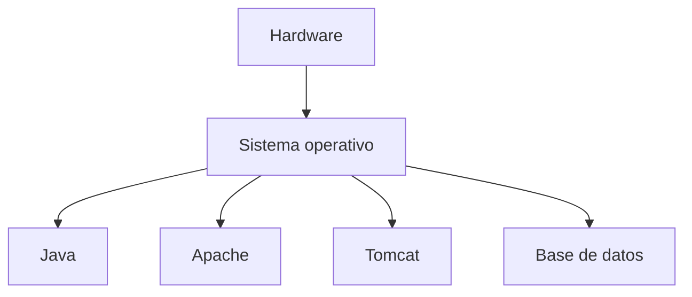

Todos los servicios comparten el mismo sistema operativo.

---

# 3. Virtualización

Un hipervisor permite ejecutar varias máquinas virtuales.

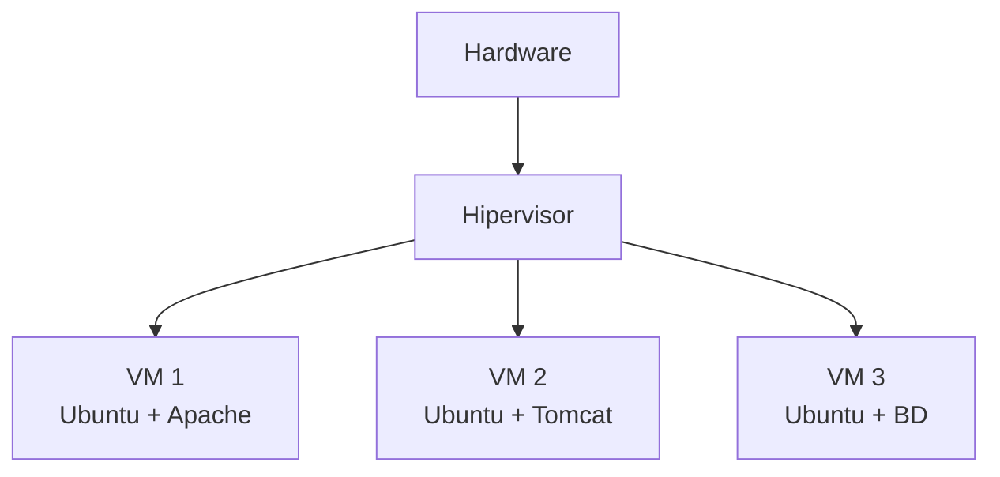

Cada VM incluye:

- sistema operativo;
- procesos;
- disco virtual;
- memoria asignada;
- red virtual.

---

# 4. Ventajas de las máquinas virtuales

- aislamiento fuerte;
- sistemas operativos diferentes;
- snapshots;
- laboratorios reproducibles;
- separación entre servicios.

Inconvenientes:

- mayor consumo de RAM;
- más espacio;
- arranque más lento;
- administración de varios sistemas operativos.

---

# 5. Contenedores

Un contenedor aísla procesos sin incluir necesariamente un sistema operativo completo independiente.

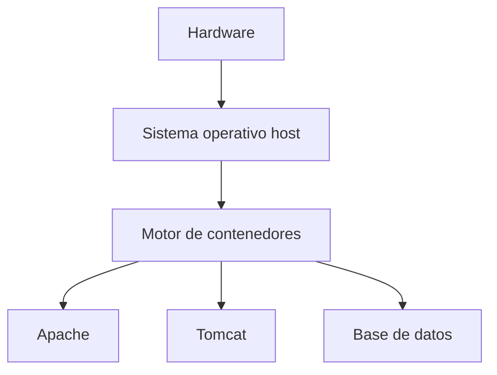

Los contenedores comparten el kernel del host.

---

# 6. VM frente a contenedor

| Característica | VM | Contenedor |
|---|---|---|
| SO completo | Sí | No |
| Aislamiento | Alto | A nivel de proceso |
| Tamaño | Mayor | Menor |
| Arranque | Más lento | Rápido |
| Portabilidad | Buena | Muy buena |
| Densidad | Menor | Mayor |

!!! info "No son tecnologías enemigas"
    Es habitual ejecutar Docker **dentro de una máquina virtual**.

    Por ejemplo, una VM en un proveedor cloud puede ejecutar varios contenedores.

---

# 7. Docker

Docker utiliza varios conceptos fundamentales.

```text
Dockerfile → imagen → contenedor
```

### Dockerfile

Describe cómo construir una imagen.

### Imagen

Plantilla inmutable utilizada para crear contenedores.

### Contenedor

Instancia en ejecución de una imagen.

---

# 8. Ejemplo de Dockerfile

Ejemplo conceptual para desplegar un WAR:

```dockerfile
FROM tomcat:10.1-jdk21

COPY tienda.war /usr/local/tomcat/webapps/tienda.war
```

Construcción:

```bash
docker build -t tienda-tomcat .
```

Ejecución:

```bash
docker run -p 8080:8080 tienda-tomcat
```

---

# 9. Publicación de puertos

Si Tomcat escucha dentro del contenedor en:

```text
8080
```

podemos publicar:

```bash
-p 8080:8080
```

Formato:

```text
puerto_host:puerto_contenedor
```

Ejemplo:

```bash
-p 9090:8080
```

significa:

```text
host:9090 → contenedor:8080
```

---

# 10. Red entre contenedores

Los contenedores de una misma red pueden comunicarse utilizando nombres de servicio.

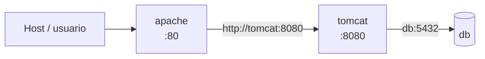

Esto evita depender de direcciones IP que pueden cambiar.

---

# 11. Docker Compose

Docker Compose permite describir varios servicios.

Ejemplo conceptual:

```yaml
services:

  apache:
    image: httpd:2.4
    ports:
      - "80:80"
    depends_on:
      - tomcat

  tomcat:
    image: tomcat:10.1-jdk21
```

Dentro de la red de Compose, Apache podría utilizar:

```text
http://tomcat:8080
```

como destino del proxy.

---

# 12. Proxy inverso entre contenedores

Configuración conceptual de Apache:

```apache
ProxyPass        /app/ http://tomcat:8080/miapp/
ProxyPassReverse /app/ http://tomcat:8080/miapp/
```

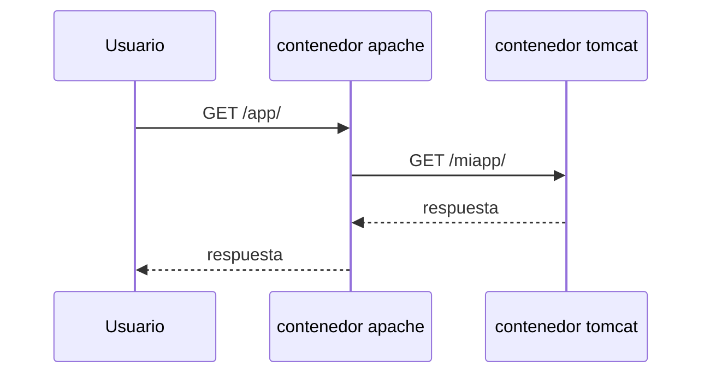

---

# 13. No publicar todos los puertos

Si únicamente Apache debe recibir tráfico público, no siempre es necesario publicar Tomcat.

En Compose:

```yaml
tomcat:
  expose:
    - "8080"
```

conceptualmente permite que otros servicios de la red lo utilicen sin exponer necesariamente ese puerto al exterior.

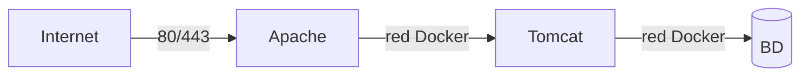

Esta arquitectura reduce superficie expuesta.

---

# 14. Volúmenes

Los contenedores son desechables.

Los datos que deben sobrevivir necesitan persistencia.

Ejemplos:

```text
base de datos
archivos subidos
certificados
configuración externa
```

Un volumen permite almacenar datos fuera de la capa efímera del contenedor.

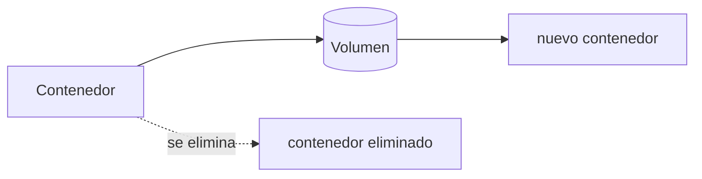

---

# 15. Configuración

En contenedores debemos evitar construir una imagen diferente para cada pequeño cambio de configuración si puede externalizarse.

Opciones:

- variables de entorno;
- volúmenes;
- archivos montados;
- secretos.

---

# 16. Seguridad en Docker

Buenas prácticas:

- utilizar imágenes mantenidas;
- evitar etiquetas ambiguas cuando se necesite reproducibilidad;
- ejecutar con mínimos privilegios;
- no introducir contraseñas en el Dockerfile;
- publicar solo los puertos necesarios;
- actualizar imágenes;
- reducir componentes;
- separar redes cuando corresponda.

!!! danger "Imagen no equivale a entorno seguro"
    Un contenedor no elimina la necesidad de aplicar actualizaciones, restringir permisos o proteger credenciales.

---

# 17. `latest`

Utilizar:

```yaml
image: tomcat:latest
```

puede provocar que dos despliegues realizados en momentos distintos utilicen versiones diferentes.

Para entornos reproducibles suele ser preferible fijar una versión suficientemente concreta:

```yaml
image: tomcat:10.1-jdk21
```

La estrategia exacta dependerá del proyecto y de su política de actualización.

---

# 18. Logs de contenedores

Docker permite consultar la salida de un contenedor:

```bash
docker logs nombre_contenedor
```

seguimiento:

```bash
docker logs -f nombre_contenedor
```

Con Compose:

```bash
docker compose logs
```

---

# 19. Estado de los contenedores

Comandos habituales:

```bash
docker ps
```

```bash
docker compose ps
```

```bash
docker inspect nombre
```

El diagnóstico sigue el mismo principio estudiado anteriormente:

```text
estado
  ↓
red
  ↓
puerto
  ↓
logs
  ↓
aplicación
```

---

# 20. ¿Qué significa “nube”?

La nube no es simplemente “el ordenador de otra persona”.

Hace referencia a un modelo en el que recursos de infraestructura y plataforma pueden aprovisionarse mediante servicios y automatización.

Modelos habituales:

### IaaS

Infraestructura como servicio.

Ejemplo conceptual:

```text
máquina virtual
red
disco
IP
```

El usuario administra buena parte del sistema.

### PaaS

Plataforma como servicio.

El proveedor gestiona más elementos de infraestructura y el usuario se centra principalmente en desplegar la aplicación.

### SaaS

Software completo ofrecido como servicio al usuario final.

---

# 21. Contenedores en la nube

Un contenedor puede ejecutarse:

```text
en portátil
en servidor local
en VM
en proveedor cloud
en plataforma gestionada
```

La imagen ayuda a mantener un entorno consistente.

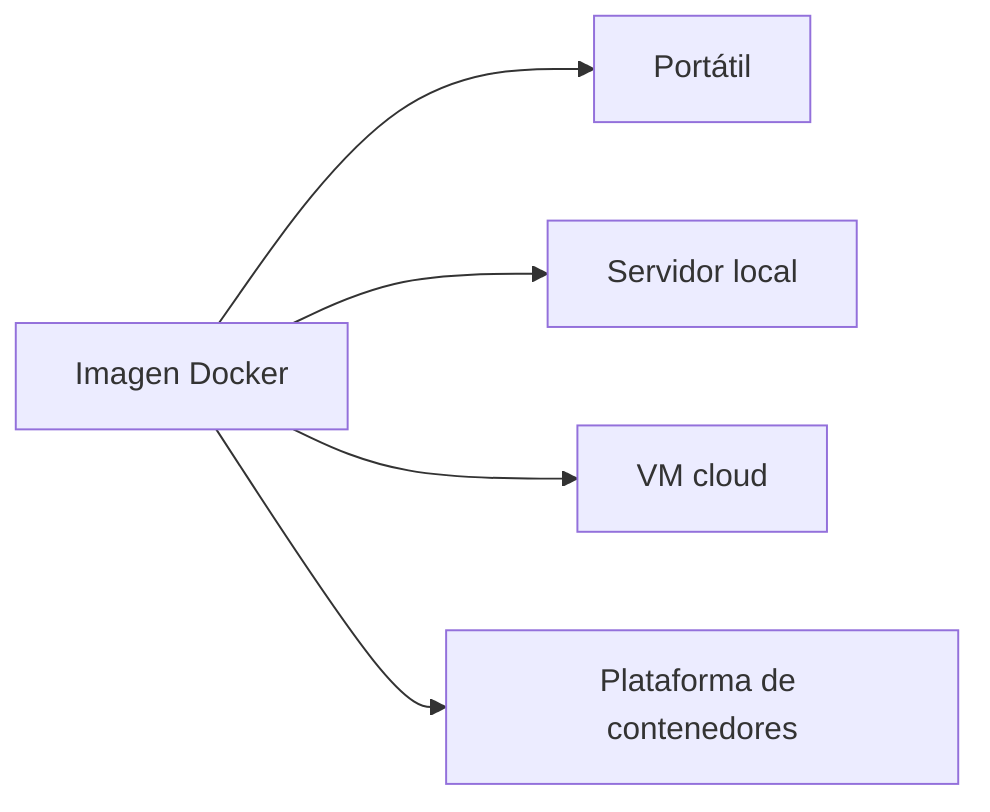

---

# 22. Escalado

Si una aplicación es *stateless* en la medida de lo posible, resulta más fácil ejecutar varias instancias.

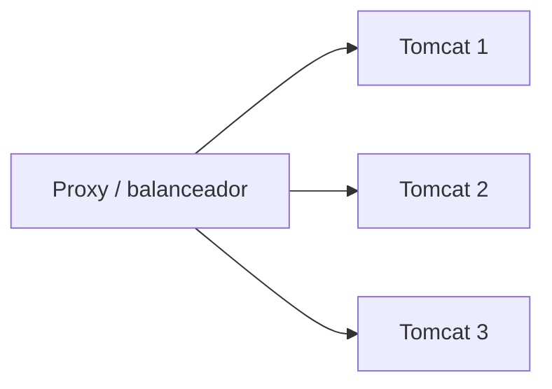

Pero las sesiones, archivos locales y datos persistentes pueden complicar el escalado.

Por ello conviene separar:

```text
aplicación
estado
datos persistentes
```

---

# 23. De una VM de laboratorio a contenedores

La evolución conceptual de la unidad puede entenderse así:

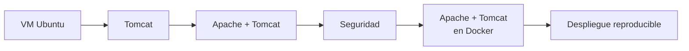

El objetivo no es aprender comandos aislados de Docker, sino entender que estamos desplegando la **misma arquitectura** utilizando otra tecnología de ejecución.

---

# 24. Arquitectura final de referencia

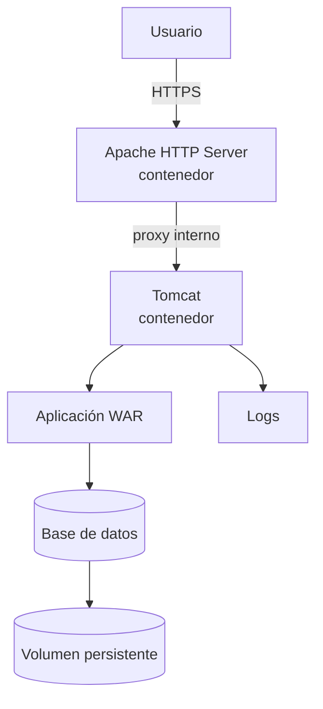

En una arquitectura de este tipo:

- Apache es la entrada;
- Tomcat no necesita publicarse directamente;
- la aplicación se despliega en Tomcat;
- la base de datos mantiene persistencia;
- la configuración debe externalizarse;
- los servicios se comunican mediante una red interna.

---

# 25. Qué debes retener

!!! summary "Resumen"
    - Una VM virtualiza una máquina completa.
    - Un contenedor aísla procesos compartiendo el kernel del host.
    - Docker utiliza Dockerfiles, imágenes y contenedores.
    - Docker Compose permite definir arquitecturas con varios servicios.
    - Los contenedores pueden comunicarse por nombre dentro de una red.
    - No es necesario publicar al exterior todos los puertos internos.
    - Los datos persistentes deben separarse de la vida del contenedor.
    - Las mismas imágenes pueden utilizarse en local y en infraestructuras cloud.
    - La contenerización no sustituye las medidas de seguridad.

---

# 26. Glosario

**Hipervisor**  
Software que permite ejecutar máquinas virtuales.

**Imagen**  
Plantilla utilizada para crear contenedores.

**Contenedor**  
Proceso aislado creado a partir de una imagen.

**Volumen**  
Mecanismo de persistencia independiente del ciclo de vida de un contenedor.

**Docker Compose**  
Herramienta para definir y ejecutar aplicaciones formadas por varios contenedores.

**IaaS**  
Infraestructura ofrecida como servicio.

**PaaS**  
Plataforma de ejecución ofrecida como servicio.

---

# Cierre de la UP3

Al finalizar estos nueve bloques, el alumnado debería disponer de una visión completa del recorrido:

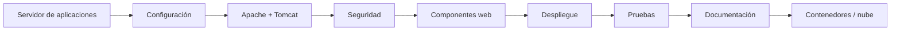

La idea central de toda la unidad es que una aplicación web no termina cuando se escribe el código.

Para convertirla en un servicio utilizable hay que saber:

1. **dónde se ejecuta**;
2. **cómo se configura**;
3. **cómo se publica**;
4. **cómo se protege**;
5. **cómo se comprueba**;
6. **cómo se mantiene**;
7. **cómo se documenta**;
8. **cómo se reproduce el despliegue en otros entornos**.

Esto conecta directamente el desarrollo de aplicaciones con las tareas reales de despliegue, administración y operación de servicios web.
