---
hide:
  - navigation
title: "UP3.9. Virtualització, contenidors i núvol"
description: "Màquines virtuals, Docker, Compose, contenidors i serveis de núvol aplicats al desplegament."
---

# UP3.9. Virtualització, contenidors i núvol

> **RA3.i:** S'han utilitzat tecnologies de virtualització en el desplegament de servidors d'aplicacions en el núvol i en contenidors.

## Què aprendràs

en aquest bloc estudiaràs:

- Virtualització;
- màquines virtuals;
- Contenidors;
- Docker;
- imatges;
- xarxes;
- volums;
- Docker compose;
- integració Apache + Tomcat en Contenidors;
- conceptes bàsics de desplegament en el núvol.

---

# 1. El problema dels entorns

Una aplicació Pot funcionar en el equip del desarrollador i fallar en un altre sistema perquè cambian:

```text
sistema operativo
versión de Java
bibliotecas
configuració
puertos
dependencias
```

Les tecnologies de Virtualització i Contenidors ajudan a crear entorns més reproducibles.

---

# 2. màquina física

en un servidor tradicional:

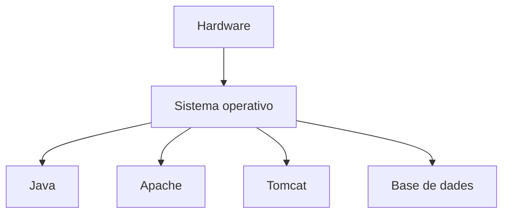

tots els serveis comparten el mateix sistema operativo.

---

# 3. Virtualització

Un hipervisor permet Executar diverses màquines virtuals.

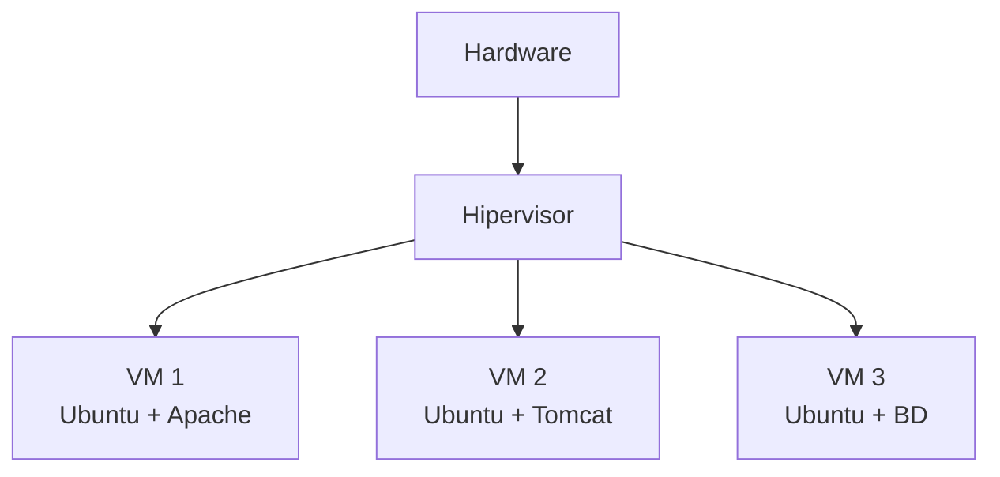

Cada VM inclou:

- sistema operativo;
- processos;
- disco virtual;
- memòria asignada;
- xarxa virtual.

---

# 4. avantatges de les màquines virtuals

- aislamiento fuerte;
- sistemes operatius diferents;
- snapshots;
- laboratorios reproducibles;
- separació entre Serveis.

Inconvenients:

- mayor consumo de RAM;
- més espacio;
- arrancada més lent;
- Administració de diversos sistemes operatius.

---

# 5. Contenidors

Un Contenidor aísla processos sense incluir necessàriament un sistema operativo complet independiente.

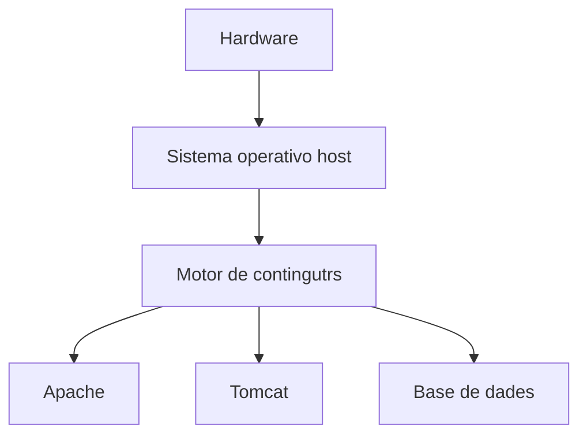

els Contenidors comparten el kernel del host.

---

# 6. VM davant de Contenidor

| Característica | VM | Contenidor |
|---|---|---|
| SO complet | Sí | No |
| Aislamiento | Alto | A nivell de procés |
| mida | Mayor | Menor |
| arrancada | més lent | ràpid |
| Portabilidad | Buena | molt buena |
| Densidad | Menor | Mayor |

!!! info "No són tecnologies enemigas"
    és habitual Executar Docker **dins d'una màquina virtual**.

    per exemple, una VM en un proveedor cloud pot executar diversos Contenidors.

---

# 7. Docker

Docker Utilitza diversos conceptes fonamentals.

```text
Dockerfile → imagen → contenedor
```

### Dockerfile

Describe com construir una imatge.

### imatge

Plantilla inmutable Utilitzada per a crear Contenidors.

### Contenidor

Instaència en execució d'una imatge.

---

# 8. exemple de Dockerfile

exemple conceptual per a desplegar un WAR:

```dockerfile
FROM tomcat:10.1-jdk21

COPY tienda.war /usr/local/tomcat/webapps/tienda.war
```

Construcción:

```bash
docker build -t tienda-tomcat .
```

execució:

```bash
docker run -p 8080:8080 tienda-tomcat
```

---

# 9. publicació de Ports

Si Tomcat escucha dins del contenidor en:

```text
8080
```

podem publicar:

```bash
-p 8080:8080
```

Formato:

```text
puerto_host:puerto_contenedor
```

exemple:

```bash
-p 9090:8080
```

significa:

```text
host:9090 → contenedor:8080
```

---

# 10. xarxa entre Contenidors

els Contenidors d'una mateixa xarxa poden comunicarse utilitzant noms de Servei.

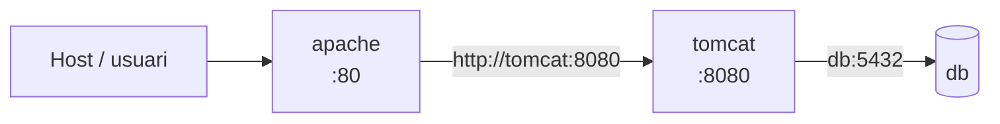

açò evita depender de adreces IP que poden cambiar.

---

# 11. Docker compose

Docker compose permet descriure diversos Serveis.

exemple conceptual:

```yaml
services:

  apache:
    image: httpd:2.4
    ports:
      - "80:80"
    depends_on:
      - tomcat

  tomcat:
    image: tomcat:10.1-jdk21
```

dins de la xarxa de compose, Apache podria Utilitzar:

```text
http://tomcat:8080
```

com destinació del proxy.

---

# 12. Proxy invers entre Contenidors

Configuració conceptual de Apache:

```apache
ProxyPass        /app/ http://tomcat:8080/miapp/
ProxyPassReverse /app/ http://tomcat:8080/miapp/
```

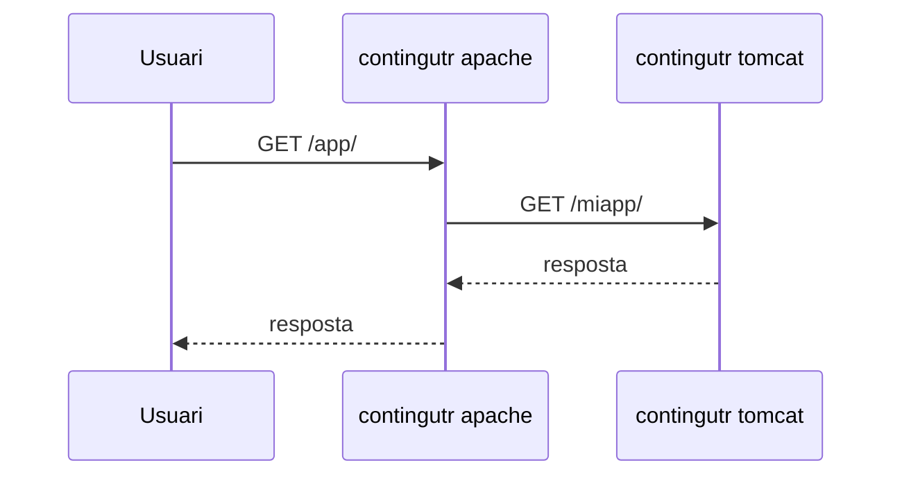

---

# 13. No publicar tots els Ports

Si únicament Apache ha de rebre trànsit públic, no sempre és necessari publicar Tomcat.

en compose:

```yaml
tomcat:
  expose:
    - "8080"
```

conceptualmente permet que altres Serveis de la xarxa ho utilitzen sense exposar necessàriament eixe Port al exterior.

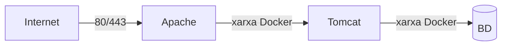

aquesta arquitectura reduce superfície expuesta.

---

# 14. volums

els Contenidors són desechables.

les dades que han de sobrevivir necessiten persisteència.

exemples:

```text
base de datos
archivos subidos
certificados
configuració externa
```

Un volum permet emmagatzemar Dades fora de la capa efímera del contenidor.

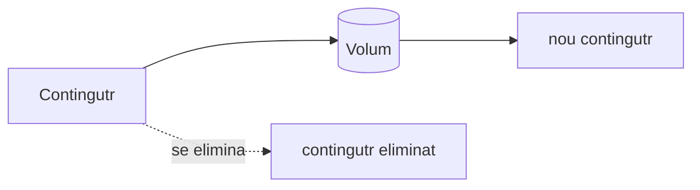

---

# 15. Configuració

en Contenidors debemos evitar construir una imatge diferent per a cada xicotet Canvi de configuració si Pot externalitzar-se.

opcions:

- variables de entorn;
- volums;
- Fitxers montados;
- secrets.

---

# 16. Seguretat en Docker

Buenas pràctiques:

- Utilitzar imatges mantenidas;
- evitar etiquetas ambiguas quan es necesite reproducibilidad;
- Executar amb mínims privilegis;
- no introducir Contrasenyes en el Dockerfile;
- publicar només els Ports necessaris;
- actualitzar imatges;
- Reduir components;
- separar xarxes quan corresponda.

!!! danger "imatge no equival a entorn segur"
    Un Contenidor no elimina la necessitat de aplicar actualitzacions, restringir permisos o protegir credeèncials.

---

# 17. `latest`

Utilitzar:

```yaml
image: tomcat:latest
```

Pot provocar que dos desplegaments realitzats en moments diferents utilitzen versions diferents.

per a entorns reproducibles sol ser preferible fixar una versió prou concreta:

```yaml
image: tomcat:10.1-jdk21
```

La estratègia exacta dependerá del proyecto i del seu política de actualització.

---

# 18. Logs de Contenidors

Docker permet consultar la eixida d'un contenidor:

```bash
docker logs nombre_contenedor
```

seguimiento:

```bash
docker logs -f nombre_contenedor
```

amb compose:

```bash
docker compose logs
```

---

# 19. estat dels Contenidors

ordres habituals:

```bash
docker ps
```

```bash
docker compose ps
```

```bash
docker inspect nombre
```

El diagnòstic segueix el mateix principi estudiado anteriormente:

```text
estado
  ↓
red
  ↓
puerto
  ↓
logs
  ↓
aplicació
```

---

# 20. ¿Què significa “núvol”?

La núvol no és simplement “el ordenador d'una altra persona”.

fa referèència a un model en què recursos de infraestructura i plataforma poden aprovisionarse mitjançant Serveis i automatización.

models habituals:

### IaaS

Infraestructura com Servei.

exemple conceptual:

```text
máquina virtual
red
disco
IP
```

El Usuari administra buena part del sistema.

### PaaS

Plataforma com Servei.

El proveedor gestiona més elements de infraestructura i el Usuari es centra principalment en desplegar l'aplicació.

### SaaS

programari complet ofrecido com Servei al Usuari final.

---

# 21. Contenidors en el núvol

Un Contenidor Pot ejecutarse:

```text
en portátil
en servidor local
en VM
en proveedor cloud
en plataforma gestionada
```

La imatge ajuda a mantindre un entorn coherent.

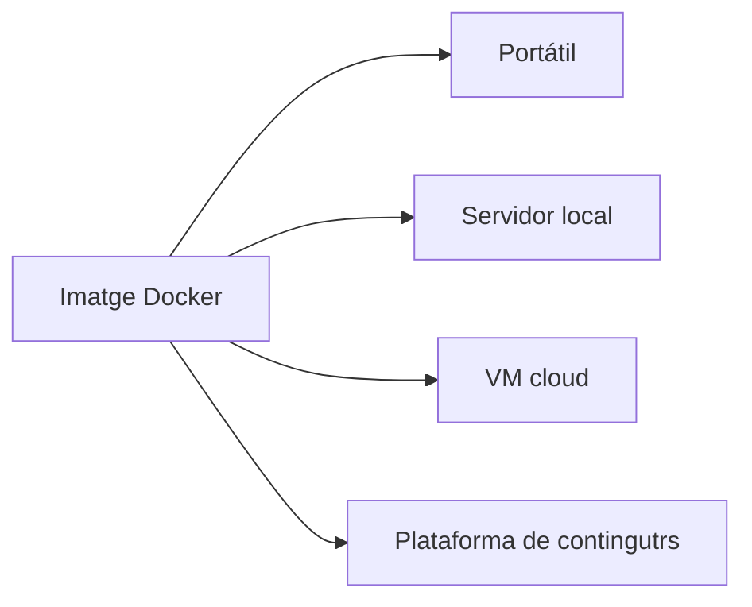

---

# 22. Escalado

Si una aplicació és *stateless* en la mesura de ho posible, resulta més fàcil Executar diverses instancies.

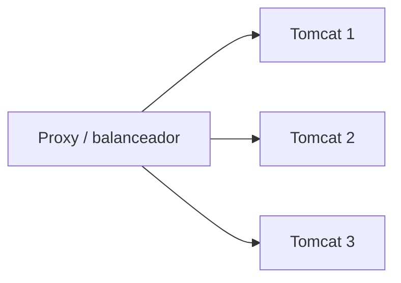

però Les Sessions, Fitxers locales i Dades persistents poden complicar el escalado.

per això convé separar:

```text
aplicació
estado
datos persistentes
```

---

# 23. d'una VM de laboratorio a Contenidors

La evolució conceptual de la unitat Pot entendrese així:

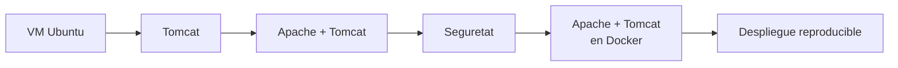

El objectiu no és aprendre ordres aïllats de Docker, sinó entendre que estem desplegant la **mateixa arquitectura** utilitzant una altra tecnologia de execució.

---

# 24. Arquitectura final de referèència

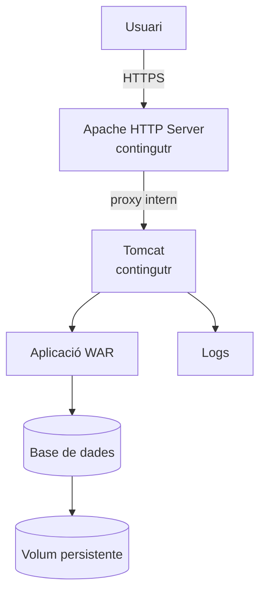

en una arquitectura de aquest tipus:

- Apache és la entrada;
- Tomcat no necessita publicarse directament;
- l'aplicació es despliega en Tomcat;
- la base de dades manté persisteència;
- la configuració ha de externalitzar-se;
- els serveis es comunican mitjançant una xarxa interna.

---

# 25. Què has de retenir

!!! summary "resum"
    - Una VM virtualiza una màquina completa.
    - Un Contenidor aísla processos compartiendo el kernel del host.
    - Docker Utilitza Dockerfiles, imatges i Contenidors.
    - Docker compose permet definir arquitecturas amb diversos Serveis.
    - els Contenidors poden comunicarse per nom dins d'una xarxa.
    - No és necessari publicar al exterior tots els Ports interns.
    - les dades persistents han de separar-se de la vida del contenidor.
    - Les mateixes imatges poden utilizarse en local i en infraestructuras cloud.
    - La contenidorització no substitueix Les mesures de Seguretat.

---

# 26. glossari

**Hipervisor**  
programari que permet Executar màquines virtuals.

**imatge**  
Plantilla Utilitzada per a crear Contenidors.

**Contenidor**  
procés aïllat creado a partir d'una imatge.

**volum**  
mecanisme de persisteència independiente del cicle de vida d'un contenidor.

**Docker compose**  
Herramienta per a definir i Executar aplicacions formadas per diversos Contenidors.

**IaaS**  
Infraestructura ofrecida com Servei.

**PaaS**  
Plataforma de execució ofrecida com Servei.

---

# tancament de la UP3

en finalitzar aquests nueve blocs, el alumnado hauria de disponer d'una visión completa del recorregut:

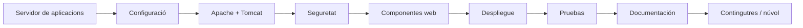

La idea central de tota la unitat és que una aplicació web no termina quan es escribe el codi.

per a convertir-la en un servei utilizable hi ha que saber:

1. **on es executa**;
2. **com és configura**;
3. **com és publica**;
4. **com és protegeix**;
5. **com és comprova**;
6. **com és manté**;
7. **com és documenta**;
8. **com és reproduce el desplegament en altres entorns**.

açò conecta directament el desenvolupament d'aplicacions amb Les tasques reals de desplegament, Administració i operació de Serveis web.
