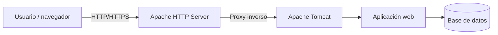

---
hide:
  - navigation
title: "UP3. Despliegue de aplicaciones web"
description: "Material autosuficiente del RA3 sobre servidores de aplicaciones, Tomcat, seguridad, despliegue, rendimiento, documentación y contenedores."
---

# UP3. Despliegue de aplicaciones web

Esta unidad desarrolla el **RA3: Implantación de aplicaciones web en servidores de aplicaciones**. Trabajaremos con **Ubuntu Server, Apache HTTP Server y Apache Tomcat**, siguiendo el recorrido completo desde la configuración del servidor hasta las pruebas y la documentación.

> **Enfoque semipresencial**
>
> La teoría está redactada para poder estudiarse de forma autónoma. Cada bloque incluye explicaciones, ejemplos de configuración, esquemas, comandos de comprobación y un resumen de las ideas que debes retener.

## Correspondencia con el RA3

| Bloque | Criterio de evaluación |
|---|---|
| UP3.1 | RA3.a — Componentes y funcionamiento de los servicios del servidor de aplicaciones |
| UP3.2 | RA3.b — Ficheros de configuración y bibliotecas compartidas |
| UP3.3 | RA3.c — Cooperación entre servidor de aplicaciones y servidor web |
| UP3.4 | RA3.d — Mecanismos de seguridad |
| UP3.5 | RA3.e — Componentes web |
| UP3.6 | RA3.f — Ajustes necesarios para el despliegue |
| UP3.7 | RA3.g — Pruebas de funcionamiento y rendimiento |
| UP3.8 | RA3.h — Documentación de administración y recomendaciones de uso |
| UP3.9 | RA3.i — Virtualización, nube y contenedores |

## Itinerario de la unidad

1. [El servidor de aplicaciones](01-servidor-aplicaciones.md)
2. [Archivos de configuración y bibliotecas compartidas](02-configuracion-bibliotecas.md)
3. [Cooperación entre Apache HTTP Server y Tomcat](03-cooperacion-apache-tomcat.md)
4. [Seguridad del servidor de aplicaciones](04-seguridad-servidor-aplicaciones.md)
5. [Componentes web del servidor de aplicaciones](05-componentes-web.md)
6. [Ajustes necesarios para el despliegue](06-ajustes-despliegue.md)
7. [Pruebas de funcionamiento y rendimiento](07-pruebas-rendimiento.md)
8. [Administración y documentación](08-administracion-documentacion.md)
9. [Virtualización, contenedores y nube](09-virtualizacion-contenedores-nube.md)

## Arquitectura de referencia

La idea central de la unidad es separar responsabilidades: Apache gestiona la frontera pública y el tráfico web; Tomcat ejecuta la aplicación; y la aplicación utiliza los servicios y datos que necesita. En todos los bloques se prestará atención a la **seguridad, la observabilidad, el rendimiento y la recuperación**.

!!! success "Objetivo final"
    En acabar deberías poder describir, configurar, desplegar y verificar una aplicación web en Tomcat, integrarla con Apache, protegerla, medir su funcionamiento y documentar su administración.

[Presentación de la UP3](../up3-servidors-aplicacions.md)
