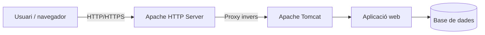

---
hide:
  - navigation
title: "UP3. Desplegament d'aplicacions web"
description: "Material autosuficient del RA3 sobre servidors d'aplicacions, Tomcat, seguretat, desplegament, rendiment, documentació i contenidors."
---

# UP3. Desplegament d'aplicacions web

Aquesta unitat desenvolupa el **RA3: Implantació d'aplicacions web en servidors d'aplicacions**. Treballarem amb **Ubuntu Server, Apache HTTP Server i Apache Tomcat**, seguint el recorregut complet des de la configuració del servidor fins a les proves i la documentació.

> **Enfocament semipresencial**
>
> La teoria està redactada perquè es puga estudiar de manera autònoma. Cada bloc inclou explicacions, exemples de configuració, esquemes, ordres de comprovació i un resum de les idees que has de retenir.

## Correspondència amb el RA3

| Bloc | Criteri d'avaluació |
|---|---|
| UP3.1 | RA3.a — components i funcionament dels serveis del servidor d'aplicacions |
| UP3.2 | RA3.b — Fitxers de configuració i biblioteques compartides |
| UP3.3 | RA3.c — Cooperació entre el servidor d'aplicacions i el servidor web |
| UP3.4 | RA3.d — Mecanismes de seguretat |
| UP3.5 | RA3.e — components web |
| UP3.6 | RA3.f — Ajustos necessaris per al desplegament |
| UP3.7 | RA3.g — Proves de funcionament i rendiment |
| UP3.8 | RA3.h — Documentació d'administració i recomanacions d'ús |
| UP3.9 | RA3.i — Virtualització, núvol i contenidors |

## Itinerari de la unitat

1. [El servidor d'aplicacions](01-servidor-aplicaciones.md)
2. [Fitxers de configuració i biblioteques compartides](02-configuracion-bibliotecas.md)
3. [Cooperació entre Apache HTTP Server i Tomcat](03-cooperacion-apache-tomcat.md)
4. [Seguretat del servidor d'aplicacions](04-seguridad-servidor-aplicaciones.md)
5. [Components web del servidor d'aplicacions](05-componentes-web.md)
6. [Ajustos necessaris per al desplegament](06-ajustes-despliegue.md)
7. [Proves de funcionament i rendiment](07-pruebas-rendimiento.md)
8. [Administració i documentació](08-administracion-documentacion.md)
9. [Virtualització, contenidors i núvol](09-virtualizacion-contenedores-nube.md)

## Arquitectura de referència

La idea central de la unitat és separar responsabilitats: Apache gestiona la frontera pública i el trànsit web; Tomcat executa l'aplicació; i l'aplicació utilitza els serveis i les dades que necessita. En tots els blocs prestarem atenció a la **seguretat, l'observabilitat, el rendiment i la recuperació**.

!!! success "Objectiu final"
    En acabar hauries de poder descriure, configurar, desplegar i verificar una aplicació web en Tomcat, integrar-la amb Apache, protegir-la, mesurar-ne el funcionament i documentar-ne l'administració.

[Presentació de la UP3](../up3-servidors-aplicacions.md)
