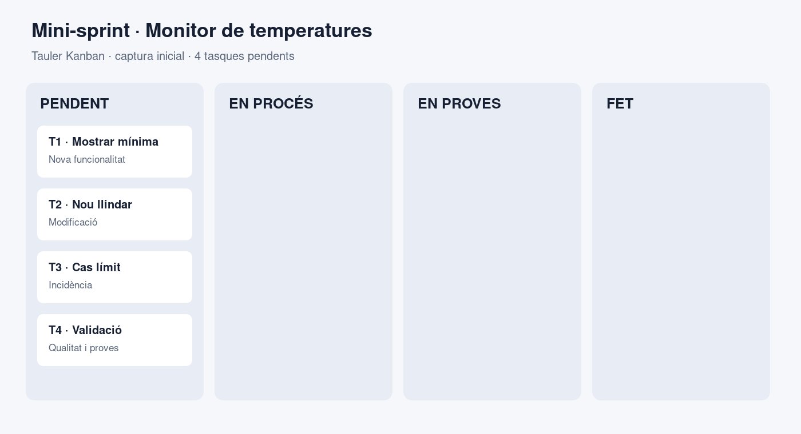
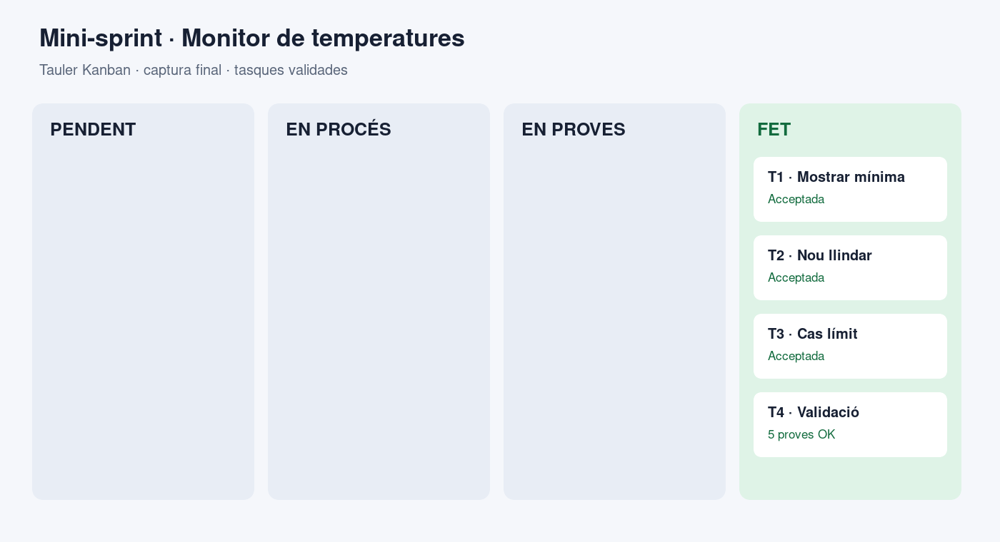
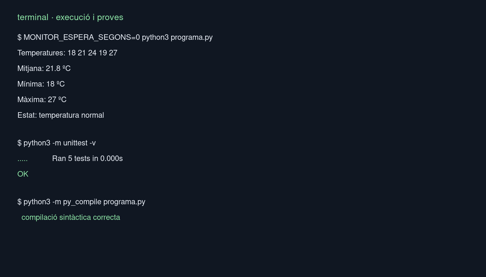
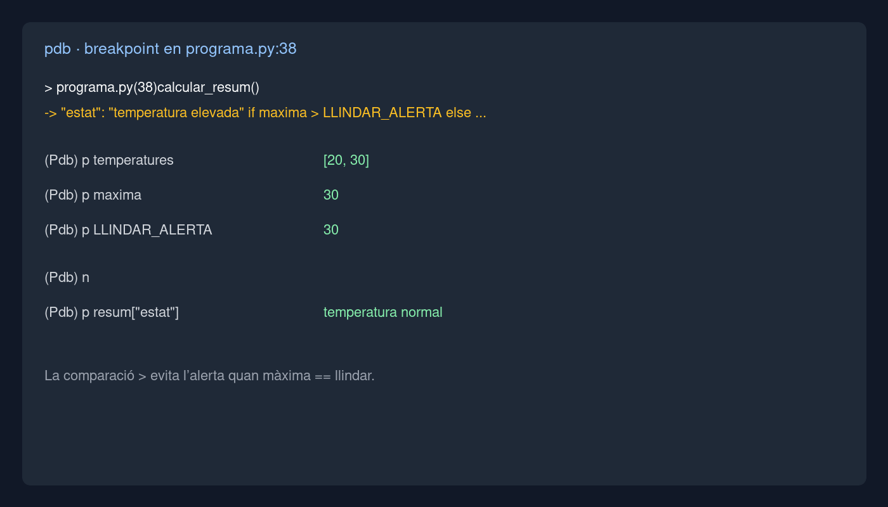

# Activitat 2. De la idea al lliurament

> **Projecte base:** monitor senzill de temperatures de l’activitat 1 de la UP2.  
> **Versió lliurada:** 1.1.0. Les dades són de prova i no contenen informació personal.

## 1. Anàlisi de l’encàrrec

El client vol una versió xicoteta però més fiable del monitor de temperatures. He convertit la petició en aquestes tasques:

| Tasca | Necessitat | Tipus | Criteri d’acceptació |
| --- | --- | --- | --- |
| T1. Mostrar la mínima | Afegir la temperatura mínima al resum | Funcionalitat | El resum mostra mínima, mitjana i màxima amb les dades rebudes |
| T2. Actualitzar el llindar | El nou llindar d’alerta és 30 ºC i no ha d’estar repetit en el codi | Modificació | Amb màxima 30 ºC l’estat és normal; amb 31 ºC és elevat |
| T3. Corregir el cas límit | La versió anterior usava \`>=\` i marcava com a elevada una temperatura exactament igual al llindar | Incidència | La comparació usa \`>\` i queda coberta per una prova |
| T4. Validar lectures | Evitar llistes buides i valors fora de -100 ºC…60 ºC | Qualitat / proves | Es llança \`ValueError\` i el programa no calcula un resum invàlid |

## 2. Fases del desenvolupament

| Fase | Què significa | Què he fet en aquest projecte |
| --- | --- | --- |
| Requisits | Entendre la necessitat i convertir-la en condicions verificables | He separat funcionalitat, modificació, incidència i validació en T1–T4. |
| Anàlisi i disseny | Decidir la solució abans d’escriure-la | He mantingut l’aplicació de consola, he centralitzat \`LLINDAR_ALERTA\` i he separat validació, càlcul i presentació. |
| Implementació | Escriure o modificar el codi font | He creat \`programa.py\` amb funcions petites i una entrada \`main()\`. |
| Proves | Comprovar comportament normal, límits i errors | He creat cinc proves amb \`unittest\`: resum, mínima, cas exacte, superació del llindar, rang i llista buida. |
| Desplegament | Preparar una versió que es puga executar | La versió es pot executar amb Python i permet desactivar l’espera amb \`MONITOR_ESPERA_SEGONS=0\`. |
| Manteniment | Corregir, adaptar i evolucionar el producte | La incidència queda documentada i la constant permet canviar el llindar sense buscar literals dispersos. |

## 3. Organització del treball

He utilitzat un flux Kanban amb les columnes \`Pendent → En procés → En proves → Fet\`. Al principi totes les tasques estaven pendents; al final les quatre han passat per implementació i validació.

*Figura 1. Estat inicial: les quatre tasques entren al backlog pendent.*

*Figura 2. Estat final: les quatre tasques han superat les proves.*

El límit de treball en curs ha sigut una tasca principal. Això m’ha obligat a acabar i comprovar una tasca abans d’obrir-ne una altra.

## 4. Ferramentes utilitzades

| Ferramenta | Funció principal | Funcionalitat utilitzada | Fase útil |
| --- | --- | --- | --- |
| VS Code | Editar i navegar pel projecte | Edició de Python, cerca de símbols i terminal integrada | Anàlisi i implementació |
| Terminal + Python | Executar el programa i les comprovacions | \`python3 programa.py\`, \`unittest\` i \`py_compile\` | Implementació i proves |
| Git | Conservar l’historial local | Canvis separats per codi, proves i documentació; \`git diff\` per revisar-los | Tot el cicle |
| \`pdb\` / debugger | Pausar l’execució i observar l’estat intern | Breakpoint en el càlcul de l’estat i inspecció de \`maxima\` i \`LLINDAR_ALERTA\` | Diagnòstic de la incidència |
| Tauler Kanban | Fer visible l’estat del treball | Columnes i moviment de T1–T4 | Planificació i seguiment |

## 5. Desenvolupament

### 5.1. Canvis realitzats

El fitxer \`programa.py\` conté ara quatre responsabilitats separades:

- \`validar_temperatures()\` rebutja dades buides o impossibles.
- \`calcular_resum()\` calcula mitjana, mínima i màxima.
- \`imprimir_resum()\` presenta el resultat.
- \`main()\` connecta les parts i conserva l’espera de 30 segons del monitor original.

El llindar viu en una única constant: \`LLINDAR_ALERTA = 30\`. També he canviat la comparació de la incidència de \`>=\` a \`>\`.

### 5.2. Execució de la versió lliurada

Amb \`MONITOR_ESPERA_SEGONS=0 python3 programa.py\` l’eixida és:

\`\`\`text
Temperatures: 18 21 24 19 27

Mitjana: 21.8 ºC
Mínima: 18 ºC
Màxima: 27 ºC

Estat: temperatura normal
\`\`\`

La suite retorna cinc proves correctes (\`Ran 5 tests ... OK\`). La compilació sintàctica amb \`python3 -m py_compile programa.py\` també acaba sense errors.

*Figura 3. Evidència de l’execució funcional i de les cinc proves automàtiques.*

## 6. Ús del debugger

He posat un breakpoint en la línia que decideix l’estat dins de \`calcular_resum()\`, just abans d’avaluar la comparació amb \`LLINDAR_ALERTA\`.

Amb una lectura de prova de 30 ºC he observat:

\`\`\`text
> programa.py(38)calcular_resum()
-> "estat": "temperatura elevada" if maxima > LLINDAR_ALERTA else ...
(Pdb) p temperatures
[20, 30]
(Pdb) p maxima
30
(Pdb) p LLINDAR_ALERTA
30
(Pdb) n
(Pdb) p resum["estat"]
'temperatura normal'
\`\`\`

*Figura 4. Breakpoint contextualitzat en la decisió de l’estat.*

El debugger permet veure els valors intermedis abans que la funció retorne. Executar el programa només mostra l’eixida final i no permet confirmar tan directament si el problema és la dada, el llindar o l’operador de comparació.

## 7. Valoració de ferramentes

| Ferramenta | Què m’ha permés fer | Avantatge | Limitació o inconvenient |
| --- | --- | --- | --- |
| VS Code | Editar, buscar i revisar el canvi | Concentra codi, terminal i extensions | Cal configurar extensions i pot consumir recursos |
| Python + \`unittest\` | Repetir cinc comprovacions en segons | Detecta regressions i deixa un resultat objectiu | Les proves no substitueixen una revisió de l’experiència d’ús |
| Git | Comparar l’estat anterior amb el nou | Permet revisar i recuperar canvis concrets | L’historial només és útil si els canvis tenen missatges clars |
| \`pdb\` | Inspeccionar variables en un punt concret | Mostra la causa del cas límit | Interromp el flux i és menys còmode en processos grans |
| Kanban | Saber què està pendent i què està validat | Fa visible el flux i limita el treball obert | No descriu per si mateix el disseny tècnic ni les prioritats de negoci |

Si haguera de prescindir d’una ferramenta, eliminaria el tauler Kanban en aquest exercici individual: encara podria completar el codi amb una llista escrita, tot i que perdria visibilitat. Considero imprescindible Python amb una ferramenta de proves, perquè permet repetir la validació i demostrar que la correcció del cas límit no és només una suposició.

## 8. Scrum o Kanban

| Equip | Elecció | Justificació |
| --- | --- | --- |
| A. Cinc persones, plataforma nova i versió cada dues setmanes | **Scrum** | Un sprint de dues setmanes encaixa amb el ritme de lliurament. El backlog es pot ordenar abans de cada iteració, l’equip selecciona un increment assumible i la revisió amb el client aporta feedback al sprint següent. |
| B. Tres persones, aplicació en producció i incidències setmanals | **Kanban** | El treball arriba de manera contínua i té prioritats canviants. Un flux amb límit de treball en curs permet atendre una incidència urgent sense esperar al següent sprint i mesurar què bloqueja el lliurament. |

Scrum aporta iteracions, rols i esdeveniments previsibles; Kanban aporta flux continu, priorització dinàmica i control del treball en curs. Tots dos poden incorporar feedback i lliuraments freqüents.

## 9. Retrospectiva

### Què ha funcionat bé?

Separar el càlcul de la presentació ha fet fàcil provar els valors i comprovar la incidència sense dependre de l’eixida de consola. El tauler també ha deixat clar quina tasca estava en proves.

### Què podria millorar?

Les dades encara estan escrites en una constant i no arriben des d’un sensor ni des d’una entrada de l’usuari. Per tant, la validació existeix però l’aplicació encara no gestiona un flux de dades real.

### Què canviaria en una segona iteració?

Afegiria una entrada de lectures des d’un fitxer CSV o una API, mantindria les proves amb dades de prova i afegiria una prova d’integració que verificara el recorregut complet.

### Checklist final

- [x] Necessitats convertides en tasques.
- [x] Fases del desenvolupament relacionades amb el projecte.
- [x] Tauler Kanban inicial i final.
- [x] Canvis implementats i executats.
- [x] Proves automàtiques i validació sintàctica.
- [x] Breakpoint i inspecció de variables.
- [x] Funció, avantatge i limitació de cinc ferramentes.
- [x] Comparació Scrum/Kanban per als dos equips.
- [x] Retrospectiva completada.
- [x] Quatre evidències contextualitzades.
