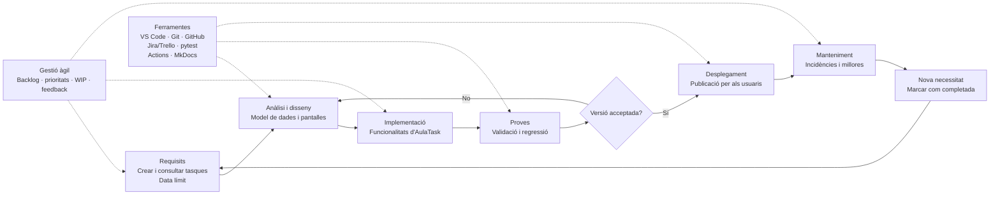

---
hide:
  - navigation
---

# Activitat 2. Del requisit al lliurament

## 1. Fases del desenvolupament

### Tasca 1. Classificació de les situacions d’AulaTask

| Situació | Fase del desenvolupament | Justificació |
| --- | --- | --- |
| 1. El client explica que l’alumnat ha de consultar tasques pendents | Requisits | Es concreta una necessitat del client i es transforma en un requisit funcional d’AulaTask. |
| 2. L’equip decideix com s’organitzaran les dades | Anàlisi i disseny | Abans de programar, l’equip defineix el model de dades: tasques, usuaris, estat i data límit. |
| 3. Es prepara l’estructura de pantalles | Anàlisi i disseny | Es dissenya la interfície i el recorregut que seguiran professorat i alumnat. |
| 4. L’equip crea les funcionalitats previstes | Implementació | Es transforma el disseny en una aplicació que permet crear i consultar tasques. |
| 5. Es comprova que una tasca sense data límit no es puga guardar | Proves | Es verifica una regla del requisit i es comprova el comportament davant d’una dada no vàlida. |
| 6. Es publica una nova versió | Desplegament | La versió validada es posa a disposició dels usuaris en l’entorn corresponent. |
| 7. Un usuari comunica que les tasques no apareixen ordenades | Manteniment | És una incidència detectada després del desplegament que cal registrar i analitzar. |
| 8. L’equip corregeix el problema i prepara una nova versió | Manteniment | Es corregeix una incidència d’una versió ja publicada; la preparació de la versió tornarà després al desplegament. |
| 9. El client demana marcar tasques com a completades | Requisits | És una nova necessitat que s’ha d’analitzar, prioritzar i convertir en una futura tasca del backlog. |

### Tasca 2. El cicle no acaba amb el desplegament

1. **Per què el manteniment forma part del desenvolupament?**
   Perquè una aplicació continua necessitant correccions, adaptacions, millores i noves funcionalitats després d’arribar als usuaris. El programari viu en un entorn que canvia i també rep feedback real.

2. **En quina fase situaria una petició nova del client?**
   Inicialment en requisits. Després s’hauria de valorar, prioritzar i convertir en una tasca del backlog abans de passar a anàlisi i disseny.

3. **Una aplicació pot tornar a fases anteriors després d’haver sigut desplegada?**
   Sí. Una incidència pot obligar a tornar a anàlisi, disseny, implementació i proves abans de desplegar una correcció. Una nova funcionalitat també inicia un nou cicle de requisits.

4. **Per què és incorrecte pensar que desenvolupar és només escriure codi?**
   Perquè el desenvolupament també inclou entendre les necessitats, dissenyar la solució, provar-la, documentar-la, controlar els canvis, desplegar-la i mantindre-la.

## 2. Ferramentes del procés

### Tasca 3. Quina ferramenta necessitem?

| Necessitat | Tipus de ferramenta | Exemple | Per què? |
| --- | --- | --- | --- |
| Escriure i organitzar els fitxers del projecte | IDE o editor de codi | Visual Studio Code | Permet editar fitxers, buscar referències, organitzar carpetes i treballar amb extensions. |
| Saber qui ha modificat un fitxer i recuperar una versió anterior | Control de versions | Git | Guarda l’historial, identifica els canvis i permet comparar o recuperar versions. |
| Compartir el projecte entre diversos membres | Repositori remot | GitHub | Centralitza el repositori, facilita la col·laboració i permet revisar canvis mitjançant pull requests. |
| Saber quines tasques estan pendents, en procés o finalitzades | Gestor de tasques | Trello o Jira | Visualitza el backlog, les prioritats i l’estat del treball. |
| Comprovar automàticament que una funcionalitat continua funcionant | Ferramenta de proves | pytest | Executa proves repetibles i detecta regressions després dels canvis. |
| Executar comprovacions quan es publica un canvi | Automatització / CI | GitHub Actions | Pot executar proves, comprovacions de qualitat i construccions sense fer-les manualment. |
| Mantindre una guia tècnica del projecte | Documentació | Markdown i MkDocs | Permet escriure documentació versionada i publicar-la com un lloc web navegable. |

### Tasca 4. Avaluació de ferramentes

| Ferramenta | Quina necessitat resol? | Avantatge principal | Possible limitació |
| --- | --- | --- | --- |
| Git | Controlar l’historial i els canvis d’AulaTask | Permet treballar amb branques, revisar diferències i recuperar versions | Requereix aprendre conceptes com commits, branques i conflictes |
| GitHub | Compartir el repositori i coordinar l’equip | Facilita les revisions de codi, les incidències i la col·laboració remota | Depén d’un servei extern i una configuració incorrecta de permisos pot exposar informació |
| Jira | Organitzar requisits, tasques i incidències | Ofereix fluxos, prioritats, responsables i informes | Pot resultar massa complex per a un equip menut o un projecte senzill |
| GitHub Actions | Automatitzar proves i construccions | Dona feedback ràpid i repetible quan arriba un canvi | Les configuracions YAML poden ser difícils de mantindre i consumeixen minuts d’execució |

### Es podria desenvolupar només amb un editor?

Per a una prova molt xicoteta, sí, però no seria una solució adequada quan el projecte creix o hi treballen diverses persones. A més d’escriure fitxers, caldria controlar versions, compartir el repositori, gestionar tasques, revisar canvis, executar proves, automatitzar comprovacions i mantindre la documentació. Un editor és una peça útil, però no resol per si mateix l’organització ni la qualitat del projecte.

## 3. Scrum o Kanban

### Tasca 5. Elecció per escenaris

| Escenari | Metodologia preferent | Per què encaixa? | Problema amb l’altra metodologia |
| --- | --- | --- | --- |
| A. Nova plataforma educativa, sis persones i una versió cada dues setmanes | **Scrum** | Els sprints de dues setmanes donen un ritme clar. L’equip pot seleccionar un objectiu de sprint, preparar un increment i revisar-lo amb el client al final de cada període. | Amb Kanban podria faltar una cadència fixa per a la revisió i seria més difícil comprometre un increment concret per a cada període. |
| B. Aplicació en producció amb incidències i peticions diàries | **Kanban** | El flux continu permet ordenar prioritats, limitar el treball en curs i introduir incidències urgents sense esperar al següent sprint. | Amb Scrum, les incidències imprevistes podrien interrompre sovint l’objectiu del sprint i provocar compromisos difícils de complir. |
| C. Projecte de classe de sis setmanes amb períodes curts | **Scrum** | Els alumnes poden dividir les sis setmanes en sprints, decidir al principi què intentaran acabar i revisar regularment el progrés. | Amb Kanban hi hauria visibilitat del flux, però podria faltar una planificació temporal comuna i un moment formal de revisió per a tot l’equip. |

Scrum és especialment útil quan convé treballar amb iteracions i objectius temporals. Kanban encaixa millor quan les peticions arriben de manera contínua i les prioritats canvien sovint. Tots dos poden utilitzar un backlog, limitar el treball obert i incorporar feedback.

## 4. Interpretació del tauler

El tauler de l’enunciat és:

```text
PENDENT              EN PROCÉS             FET

T4 Documentació      T2 Pantalla inicial   T1 Requisits
T5 Proves             T3 Base de dades
T6 Desplegament
T7 Nova funcionalitat
```

1. Hi ha **dues tasques en procés**: T2, Pantalla inicial, i T3, Base de dades.
2. Limitar el treball en curs ajuda a concentrar l’esforç, detectar bloquejos i acabar tasques abans d’obrir-ne massa. També redueix el canvi constant de context.
3. Si cada membre començara moltes tasques però no n’acabara cap, augmentaria el treball obert, hi hauria més tasques bloquejades i el lliurament real s’endarreriria.
4. D’una ullada, el tauler mostra què està pendent, què s’està treballant i què ja està acabat. També permet veure que hi ha dues tasques en curs i quatre pendents.
5. Kanban representa un flux continu: les tasques avancen quan hi ha capacitat. Scrum agrupa el treball en sprints amb una duració definida, un objectiu i una revisió al final.

## 5. Mapa del projecte

El projecte AulaTask podria organitzar-se així:



En aquest mapa, la gestió àgil acompanya tot el procés: ordena el backlog, fa visibles les tasques, controla el treball en curs i incorpora el feedback. El retorn des de manteniment cap a requisits mostra que el desenvolupament és iteratiu i no acaba definitivament en el primer desplegament.

## 6. Conclusions

1. **Fase més important:** considere especialment importants els requisits, perquè una interpretació incorrecta pot fer que l’equip construïsca una aplicació que no resol la necessitat real. Tot i això, totes les fases depenen les unes de les altres.
2. **Ferramenta amb més valor per a un equip:** Git aporta molt valor perquè conserva l’historial, permet treballar en paral·lel i facilita revisar o recuperar canvis.
3. **Quan utilitzaria Kanban:** en manteniment, suport i projectes on les tasques arriben de manera contínua i les prioritats poden canviar.
4. **Quan utilitzaria Scrum:** en un producte nou o un projecte amb objectius temporals, sprints definits i necessitat de revisar increments periòdics amb el client.
5. **Què significa desenvolupar programari:** transformar una necessitat en una solució usable i mantinguda. Inclou analitzar, dissenyar, construir, provar, desplegar, documentar i millorar el producte amb el feedback dels usuaris.

### Checklist final

- [x] Situacions classificades segons les fases del desenvolupament.
- [x] Decisions justificades.
- [x] Necessitats relacionades amb ferramentes adequades.
- [x] Quatre ferramentes valorades.
- [x] Tres escenaris de Scrum/Kanban resolts.
- [x] Tauler Kanban interpretat.
- [x] Mapa del projecte creat amb Mermaid.
- [x] Conclusions respostes.
- [x] No s’ha inclòs codi ni s’ha desenvolupat cap funcionalitat.
