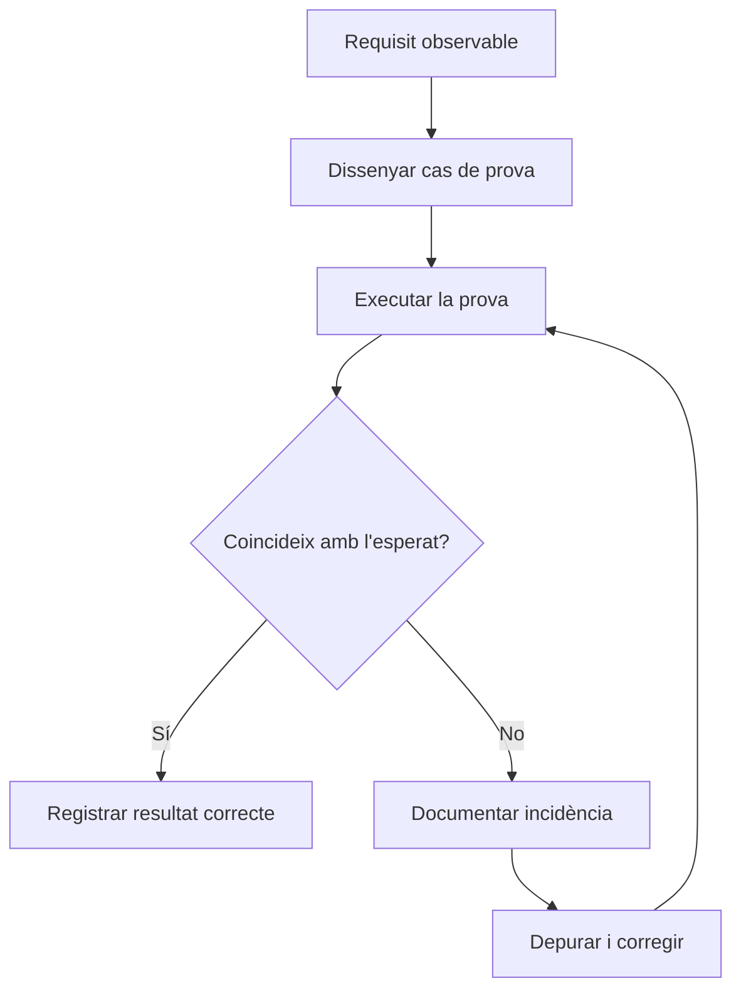

# UP4. Proves i verificació

## Presentació

Una aplicació pot compilar i, tanmateix, donar un resultat incorrecte. Compilar comprova que el codi compleix unes regles sintàctiques i que es pot transformar en classes executables; no comprova que totes les decisions siguen les que necessita la persona usuària. En aquesta unitat aprendràs a convertir requisits en proves, observar l’execució amb VS Code, automatitzar comprovacions amb Java i JUnit Jupiter i deixar una incidència prou clara perquè una altra persona la puga reproduir.

> **Abast de la unitat**
>
> Aquest material és teoria, demostracions i comprovacions de comprensió. No inclou activitats avaluables, enunciats de lliurament, exàmens ni rúbriques. Cada exemple és menut i independent: no hi ha cap projecte transversal.

## Dades de la unitat

| Element | Referència |
| --- | --- |
| Duració didàctica | **12 sessions d’una hora** |
| Resultat d’aprenentatge | **RA3** |
| Pes de referència | **15 %** |
| Entorn principal | **VS Code, Java 17 o 21, Maven i JUnit Jupiter** |
| Producte teòric | Casos de prova, proves automatitzades i informes d’incidències |

## Què aprendràs

- Identificar nivells i finalitats de proves sense confondre les classificacions.
- Transformar requisits en casos de prova amb particions i valors límit.
- Utilitzar el depurador de Java de VS Code amb breakpoints, variables, Watch i Call Stack.
- Escriure proves unitàries amb JUnit Jupiter i el patró Arrange–Act–Assert.
- Automatitzar bateries amb Maven i interpretar els estats `pass`, `fail` i `error`.
- Aïllar dependències amb dobles de prova i injecció pel constructor.
- Documentar incidències reproduïbles, separant gravetat i prioritat.

## Resultat d’aprenentatge i criteris d’avaluació

**RA3.** Verifica el funcionament de programes, dissenyant i realitzant proves.

| Codi | Criteri d’avaluació | Bloc principal |
| --- | --- | --- |
| [RA3.a](up4/01-fonaments-proves.md) | Identificar els diferents tipus de proves. | 01 |
| [RA3.b](up4/02-disseny-casos-prova.md) | Definir casos de prova. | 02 |
| [RA3.c](up4/03-depuracio-vscode.md) | Identificar les ferramentes de depuració i prova de l’entorn. | 03 |
| [RA3.d](up4/03-depuracio-vscode.md) | Utilitzar punts de ruptura i seguiment. | 03 |
| [RA3.e](up4/03-depuracio-vscode.md) | Examinar i modificar el comportament en temps d’execució. | 03 |
| [RA3.f](up4/04-proves-unitaries-junit.md) | Efectuar proves unitàries de classes i funcions. | 04 |
| [RA3.g](up4/05-automatitzacio-proves.md) | Implementar proves automàtiques. | 05 |
| [RA3.h](up4/07-documentacio-incidencies.md) | Documentar les incidències detectades. | 07 |
| [RA3.i](up4/06-dobles-prova.md) | Utilitzar dobles de prova per aïllar components. | 06 |

## Mapa de la verificació

El flux següent mostra una situació habitual: un requisit es fa observable, es comprova i, si hi ha una diferència, es combina depuració, correcció i una nova verificació.

## Sessions i seqüència

| Sessions | Contingut | Resultat de la sessió |
| ---: | --- | --- |
| 1 | Fonaments i tipus de proves | Distingir nivells, finalitats i límits. |
| 2 | Disseny de casos | Convertir regles en entrades informatives. |
| 3 | VS Code: preparació i primera pausa | Obrir, executar i detindre un programa Java. |
| 4 | VS Code: inspecció i seguiment | Llegir variables, pila i expressions. |
| 5 | VS Code: estratègia de depuració | Triar breakpoints i confirmar una hipòtesi. |
| 6 | JUnit Jupiter: anatomia | Escriure el primer test AAA. |
| 7 | JUnit Jupiter: classes i excepcions | Provar estat, errors i tests independents. |
| 8 | Automatització | Executar una bateria i interpretar reports. |
| 9 | Dobles de prova | Aïllar una dependència amb una interfície. |
| 10 | Incidències | Redactar un informe reproduïble. |
| 11 | Consolidació | Repàs guiat dels conceptes. |
| 12 | Consolidació i avaluació | Tancament de la unitat; l’enunciat es publicarà a banda. |

## Preparació de l’entorn

Instal·la un JDK 17 o 21 i comprova’l amb `java --version`. En VS Code, obri la **carpeta del projecte**, no només un fitxer solt, i instal·la **Extension Pack for Java**. El paquet incorpora suport de llenguatge, depurador, gestor Maven i Test Runner. Els exemples amb Maven tenen un `pom.xml`; la carpeta que conté aquest fitxer és la carpeta que s’ha d’obrir i des de la qual s’ha d’executar `mvn test`.

En els blocs 03 i 04 trobaràs exemples que es poden copiar en una carpeta pròpia. En el bloc 05 es mostra una bateria parametritzada. Les versions de Maven i JUnit estan fixades en els `pom.xml` d’exemple per tal que el resultat no depenga d’una actualització accidental.

## Continguts de la unitat

1. [Fonaments i tipus de proves](up4/01-fonaments-proves.md)
2. [Disseny de casos de prova](up4/02-disseny-casos-prova.md)
3. [Depuració de Java amb VS Code](up4/03-depuracio-vscode.md)
4. [Proves unitàries amb JUnit Jupiter](up4/04-proves-unitaries-junit.md)
5. [Automatització i execució de bateries](up4/05-automatitzacio-proves.md)
6. [Dobles de prova i aïllament](up4/06-dobles-prova.md)
7. [Documentació d’incidències](up4/07-documentacio-incidencies.md)

Les sessions 11 i 12 es reserven per a consolidació i avaluació; no es generen ací activitats avaluables, rúbriques ni exàmens.

## Idea clau abans de començar

Un resultat verd només diu que els casos executats han coincidit amb l’esperat. Un resultat roig aporta una diferència que cal investigar. Cap dels dos, per si sol, descriu tot l’espai de comportaments possibles. La qualitat depén de seleccionar casos informatius, observar l’execució, aïllar les causes i deixar evidències comprensibles.

[Tornar a Entorns de desenvolupament](index.md) · [Consultar l’avaluació](avaluacio.md)
