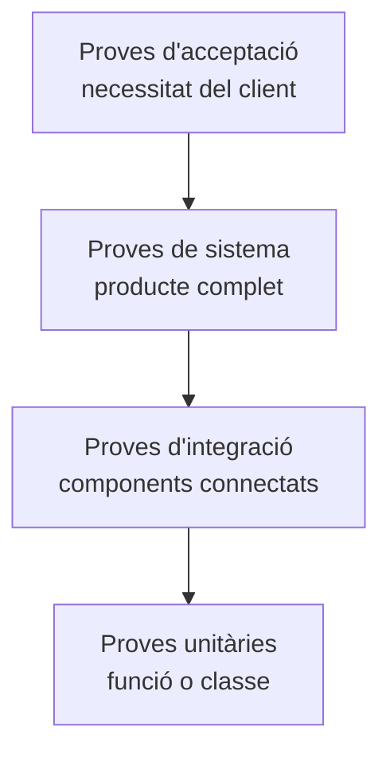
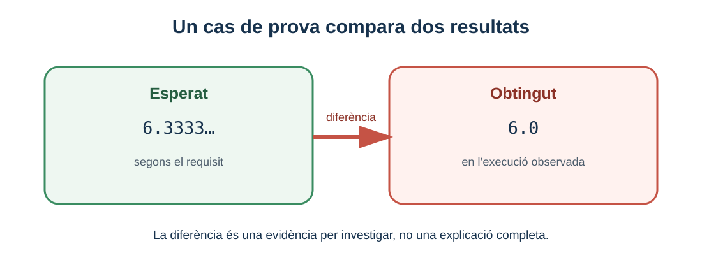

# 1. Fonaments i tipus de proves

> **CA:** RA3.a · **Sessió:** 1

## Què aprendràs

Aprendràs per què es prova el programari, distingiràs defecte, fallada i resultat, i classificaràs una prova segons el nivell, la finalitat i la manera d’executar-la. També entendràs què pot afirmar un resultat verd i què no pot afirmar.

## Per què cal provar

El programari és una construcció humana i, per tant, pot contindre decisions incompletes, fórmules mal transcrites, condicions invertides o suposicions que només funcionen amb unes dades. A més, l’entrada no sempre la tria qui ha escrit el programa: pot arribar des d’un formulari, un fitxer o una altra aplicació. Un canvi aparentment innocent pot trencar un comportament que ja funcionava. Les proves aporten una manera sistemàtica d’obtenir informació abans que l’error arribe a una persona usuària.

Considera un registre d’usuaris. El requisit diu que un correu ha de tindre un format mínim: un text abans de `@`, un domini després i un punt dins del domini. `ana@example.com` podria ser acceptat i `anaexample.com` rebutjat. Aquesta és una comprovació funcional: pregunta si el sistema fa el que s’ha especificat. Una comprovació de rendiment seria una altra pregunta: quant tarda en revisar 10.000 registres? Les dues proves poden parlar del mateix registre, però mesuren propietats diferents.

### Defecte, error humà i fallada

Un **error humà** és una equivocació en el raonament o en l’escriptura. El **defecte** és la part incorrecta que queda en el producte, com ara usar `total / 100` quan es volia aplicar un percentatge. Una **fallada** és el comportament observable que apareix quan una entrada activa el defecte: el programa torna `9` quan el resultat esperat era `90`.

| Element | Exemple en una calculadora de descompte |
| --- | --- |
| Resultat esperat | Un preu de 100 € amb 10 % de descompte dona 90 €. |
| Defecte | El codi resta `descompte / 100` en lloc de `preu * descompte / 100`. |
| Fallada | La pantalla mostra 99,90 €. |
| Evidència | Entrada, resultat esperat, resultat obtingut i versió provada. |

La terminologia ajuda a parlar amb precisió. No és el mateix dir “no funciona” que dir “amb `preu=100` i `percentatge=10`, `aplicarDescompte` retorna `99.9` i s’esperava `90.0`”.

### Verificació i validació

La **verificació** pregunta: “hem construït correctament el producte segons les especificacions?”. Una prova unitària que confirma que `esParell(4)` torna `true` verifica una regla concreta. La **validació** pregunta: “hem construït el producte que realment necessita la persona usuària?”. Una aplicació pot calcular molt bé una data i, tanmateix, no oferir el format que necessita el personal administratiu. En la pràctica les dues activitats es complementen: una revisa la conformitat tècnica i l’altra la utilitat.

## Nivells o abast de les proves

Els nivells descriuen quant de sistema s’observa. La piràmide següent és una relació d’abast, no una ordre obligatòria d’execució.



- **Unitària:** comprova una unitat menuda i controlable, com `esParell(int)`. És ràpida i ajuda a localitzar la causa, però no diu si les pantalles i serveis col·laboren.
- **D’integració:** comprova la comunicació entre peces, per exemple un servei que transforma una comanda i l’envia a un repositori. Pot detectar noms de camps incompatibles o errors de conversió.
- **De sistema:** observa l’aplicació com un conjunt, des de l’entrada fins a l’eixida. S’acosta al comportament real però sol ser més lenta i difícil de diagnosticar.
- **D’acceptació:** confirma amb criteris acordats que el producte és acceptable per al seu ús. Pot participar-hi el client, el professorat o una persona representant de l’usuari.

Una prova manual d’una aplicació menuda no és automàticament una prova unitària. “Unitària” indica l’abast de la unitat, no si una persona ha premut un botó o si hi ha una ferramenta.

## Finalitats i maneres d’executar

Les classificacions següents són dimensions diferents i es poden combinar:

| Dimensió | Pregunta | Exemple |
| --- | --- | --- |
| Funcional | Fa la funció prevista? | Rebutjar un correu sense `@`. |
| No funcional | Amb quina qualitat o restricció ho fa? | Resoldre 1.000 validacions en un temps límit. |
| Regressió | Un canvi ha trencat una conducta anterior? | Tornar a provar la calculadora després d’afegir impostos. |
| Smoke | La versió és prou operativa per continuar provant? | Iniciar l’aplicació i obrir el menú principal. |
| Manual | Una persona executa i observa els passos. | Revisar visualment un formulari. |
| Automatitzada | Una ferramenta repeteix passos i compara resultats. | JUnit executa `esParell(4)`. |

Per exemple, una prova de regressió funcional automatitzada pot comprovar que el descompte continua aplicant-se després d’una refactorització. Una prova smoke manual pot comprovar que el programa arranca abans d’invertir temps en una bateria extensa. Automatitzar proves no equival a tindre integració contínua: la primera pot executar-se localment amb `mvn test`; la segona és un procés més ampli que s’executa en una plataforma de construcció.

## Caixa negra i caixa blanca

En una prova de **caixa negra** només usem el contracte observable: entrades, eixides i efectes. No cal saber com està escrit el mètode. En una prova de **caixa blanca** també considerem l’estructura interna, com les branques d’un `if` o el recorregut d’un bucle. La caixa blanca pot ajudar a detectar un camí que no s’ha exercitat, però conéixer totes les línies no garanteix que el requisit siga correcte.

La funció següent té un objectiu clar i independent:

```java
public class Parell {
    public boolean esParell(int valor) {
        return valor % 2 == 0;
    }
}
```

Una prova de la unitat pot usar `4`, `-3` i `0`. Provar només el mètode no comprova una aplicació completa: no revisa cap entrada de teclat ni cap pantalla. Però és una comprovació barata i precisa d’una regla.

## Pla, cas i evidència

Un **pla de proves** explica l’abast, els riscos, els tipus de prova, l’ordre aproximat i les evidències que es recolliran. Un **cas de prova** concreta una verificació: què es prepara, quines dades s’usen, quins passos es fan i quin resultat s’espera. Una **evidència** és el rastre del resultat: un report de JUnit, una eixida de consola o una captura contextualitzada.

No confongues “resultat verd” amb “programa correcte”. Una prova superada diu que, per a eixa entrada i eixes condicions, el comportament ha coincidit amb l’esperat. Pot existir un defecte en una classe d’entrada que encara no has provat. Un resultat roig és una pista: pot indicar un defecte, una expectativa mal escrita, dades preparades incorrectament o un problema de l’entorn.



*Figura 1. Un cas de prova és informatiu quan fa visible la diferència entre el que havia de passar i el que ha passat.*

## Tres exemples de classificació

1. **Correu sense domini:** una prova funcional i probablement de caixa negra. Si s’executa amb JUnit, també és automatitzada i pot formar part de regressió.
2. **Temps de resposta de 1.000 validacions:** una prova no funcional de rendiment. No substitueix les comprovacions de format.
3. **`esParell(6)`:** prova unitària; si es torna a executar després d’un canvi, també pot ser de regressió.
4. **Iniciar l’aplicació i obrir una pantalla:** prova smoke de sistema, encara que siga manual.

### Comprovació de comprensió

Classifica mentalment aquests casos: (a) comprovar que un saldo insuficient no permet una retirada, (b) mesurar el nombre de peticions per segon, (c) repetir els casos després d’actualitzar una fórmula. Una resposta raonada seria: (a) funcional i pot ser unitària o d’integració segons l’abast; (b) no funcional de rendiment; (c) regressió. Les etiquetes no són excloents perquè descriuen dimensions distintes.

## Resum

Provar és observar comportaments amb casos definits. Els nivells indiquen l’abast; funcional, no funcional, regressió i smoke indiquen finalitats; manual i automatitzada indiquen com s’executa. Un defecte intern es manifesta com una fallada observable, i tota conclusió ha d’estar limitada a les dades realment provades.

[Inici de la UP4](../up4-proves.md) · [Bloc següent: disseny de casos](02-disseny-casos-prova.md)
