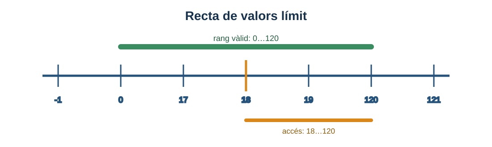
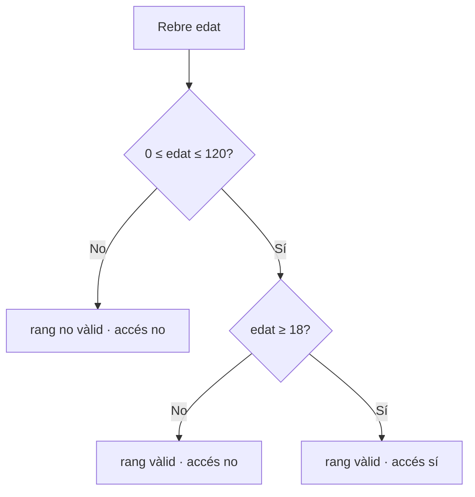
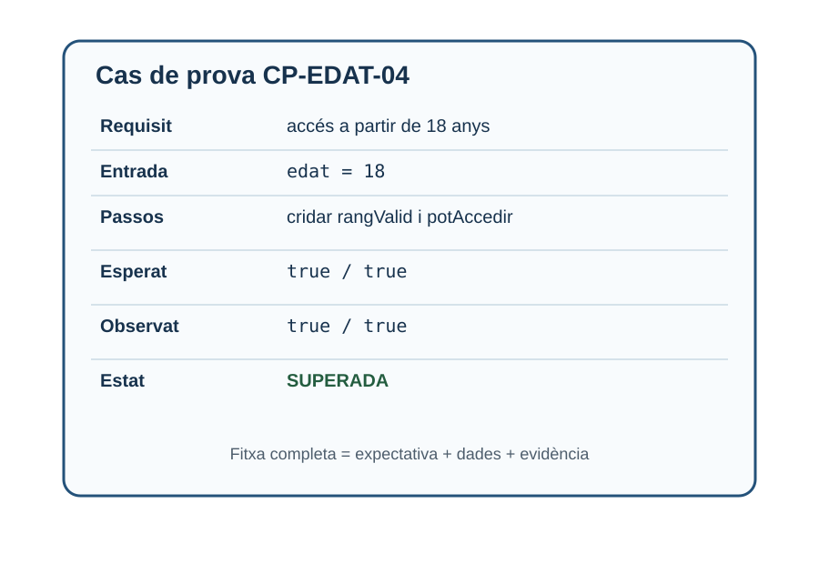

# 2. Disseny de casos de prova

> **CA:** RA3.b · **Sessió:** 2

## Què aprendràs

Aprendràs a transformar un requisit en casos observables, a seleccionar classes d’equivalència i valors límit i a registrar una traçabilitat bàsica entre requisits i proves. L’objectiu no és provar totes les combinacions imaginables, sinó triar entrades que aporten informació.

## De la frase ambigua al requisit verificable

“El sistema ha de controlar l’edat” no és prou concret: no diu quin rang és vàlid ni què vol dir controlar. Un requisit verificable pot ser: “L’edat és vàlida si és un enter entre 0 i 120, ambdós inclosos. L’accés a l’activitat és possible només quan l’edat és com a mínim 18 i és vàlida”. Hem separat dues decisions: validar el rang i autoritzar l’accés.

Un cas de prova conté, com a mínim:

| Camp | Funció |
| --- | --- |
| ID | Permet referir-se al cas sense confusions. |
| Propòsit | Explica quin requisit o risc comprova. |
| Precondicions | Estat que ha d’existir abans d’executar-lo. |
| Dades | Entrades concretes, no només “una edat”. |
| Passos | Accions en un ordre reproduïble. |
| Resultat esperat | Comportament que es considera correcte. |
| Resultat real | El que ha ocorregut en una execució. |
| Estat | Pendent, superat o fallat, per exemple. |

La precondició “l’aplicació està oberta” és diferent de la dada `18`. Si falta una precondició, una altra persona pot no poder repetir el cas.

## Classes d’equivalència

Una **classe d’equivalència** agrupa entrades que, segons la regla, haurien de seguir el mateix comportament. Si una edat entre 0 i 120 és vàlida, podem seleccionar una entrada representativa de la classe vàlida (`45`), una de la classe no vàlida inferior (`-4`) i una de la superior (`130`). No és una garantia matemàtica que una sola dada descobrisca tots els errors; és una estratègia per reduir redundància.

Les classes poden ser vàlides o no vàlides. En un formulari de correu, “text amb `@` i domini” i “text sense `@`” són classes diferents. Cal incloure valors buits, formats incomplets i tipus inesperats quan el contracte ho permeta. Si el mètode només rep un `int`, la cadena buida no és una dada del mètode, sinó una prova de la capa d’entrada.

## Anàlisi de valors límit

Els errors apareixen sovint en els operadors `>` i `>=`, o `<` i `<=`. Per això, al voltant d’un límit convé provar el valor just inferior, el límit i el valor just superior. Per al rang 0–120, són informatius `-1`, `0`, `1`, `119`, `120` i `121`. Per a l’accés a partir de 18, `17`, `18` i `19` confirmen el canvi de decisió.



*Figura 1. La recta separa el límit de validesa del límit d’autorització; no són la mateixa pregunta.*

## Exemple principal: `ValidadorEdat`

El contracte és deliberadament explícit:

```java
public class ValidadorEdat {
    public boolean rangValid(int edat) {
        return edat >= 0 && edat <= 120;
    }

    public boolean potAccedir(int edat) {
        return rangValid(edat) && edat >= 18;
    }
}
```

La primera funció respon “la dada és acceptable?”. La segona respon “aquesta persona pot accedir?”. Fer-les separades evita que una edat impossible com `121` es considere autoritzada només perquè és major que 18.



El flux fa visible que l’autorització només s’avalua després de validar el rang. Això evita acceptar `121` com una edat autoritzada i ajuda a triar casos que cobrisquen cada branca.

| ID | Edat | `rangValid` | `potAccedir` | Justificació |
| --- | ---: | --- | --- | --- |
| CP-EDAT-01 | -1 | false | false | Just per baix del mínim. |
| CP-EDAT-02 | 0 | true | false | Mínim vàlid; encara menor de 18. |
| CP-EDAT-03 | 17 | true | false | Just per baix del límit d’accés. |
| CP-EDAT-04 | 18 | true | true | Límit d’accés inclòs. |
| CP-EDAT-05 | 19 | true | true | Just per damunt del límit d’accés. |
| CP-EDAT-06 | 120 | true | true | Màxim vàlid. |
| CP-EDAT-07 | 121 | false | false | Just per damunt del màxim. |

`17`, `18` i `19` són especialment informatius per a l’accés perquè mostren el canvi de resultat en la frontera. `-1`, `0`, `120` i `121` cobreixen les fronteres del rang, incloent els extrems vàlids i els dos valors immediatament externs. Observa que `0` és vàlid com a edat segons aquest contracte, encara que no permeta l’accés; validar i autoritzar són decisions diferents.

### Plantilla emplenada



| Camp | Exemple |
| --- | --- |
| ID | `CP-EDAT-04` |
| Requisit | L’accés està permés a partir de 18 anys dins del rang vàlid. |
| Precondicions | El validador està creat; no cal xarxa ni estat previ. |
| Entrada | `edat = 18`. |
| Passos | Cridar `rangValid(18)` i després `potAccedir(18)`. |
| Resultat esperat | `true` en les dues crides. |
| Resultat real | `true` en les dues crides. |
| Estat | Superada. |

## Exemple independent: preu d’enviament

Definim dues condicions: una compra **supera o iguala 50 €** i el client té un cupó vàlid. Les regles són: sense cupó, l’enviament costa 5 €; amb cupó i compra inferior a 50 €, costa 2 €; amb cupó i compra igual o superior a 50 €, és gratuït. La taula de decisió evita oblidar una combinació.

| Regla | Compra ≥ 50? | Cupó vàlid? | Preu d’enviament |
| --- | --- | --- | ---: |
| R1 | No | No | 5 € |
| R2 | No | Sí | 2 € |
| R3 | Sí | No | 5 € |
| R4 | Sí | Sí | 0 € |

Una prova concreta de R4 pot usar compra `50.00` i cupó `ESTALVI`. El límit `50.00` és més informatiu que provar només `80.00`, perquè descobreix si el programa ha escrit `>` en lloc de `>=`. També convé provar `49.99` amb i sense cupó. Una taula de decisió no obliga a generar totes les combinacions de deu condicions: primer es trien les condicions que canvien el resultat i s’elimina allò que no aporta informació.

## Positius, negatius i excepcionals

El camí feliç és necessari però insuficient. Un cas **positiu** usa una entrada prevista i espera acceptació. Un cas **negatiu** usa una entrada que ha de ser rebutjada, com un preu negatiu. Un cas **excepcional** comprova què passa davant un estat especial: una excepció, una dada absent o una dependència que no respon. El resultat correcte d’un cas negatiu no és que la prova “falle”; és que el programa rebutge la dada de la manera especificada.

## Reduir redundància i mantindre traçabilitat

Dos casos són redundants quan comproven la mateixa classe, el mateix límit i el mateix resultat sense afegir cap risc nou. No cal provar vint edats ordinàries si el contracte no diferencia comportaments dins d’eixa classe. En canvi, no elimines `17`, `18` i `19`: cobreixen el canvi de decisió.

La **traçabilitat** relaciona un requisit amb els casos que el verifiquen. Una identificació senzilla pot ser `REQ-EDAT-01 → CP-EDAT-01...07`. Si un cas falla, sabem quin requisit queda afectat; si canvia el requisit, sabem quins casos revisar.

### Comprovació de comprensió

1. Per a una nota vàlida entre 0 i 10, quins valors cobreixen el límit? Una selecció mínima és `-1`, `0`, `0.01`, `9.99`, `10` i `10.01`, segons la precisió acceptada.
2. Per a una contrasenya de 8 caràcters mínim, `7`, `8` i `9` comproven la frontera; però encara cal decidir si s’exigeix una xifra, perquè això crea una altra classe d’equivalència.

## Errors habituals

- Escriure “provar que funciona” sense dades ni resultat esperat.
- Confondre el límit de validesa (`0..120`) amb el límit d’autorització (`18..120`).
- Provar només valors còmodes i oblidar el just abans i el just després.
- Posar el resultat real abans d’executar el cas; això converteix una expectativa en una dada inventada.
- Crear una matriu enorme que no es pot mantindre i no cobreix riscos rellevants.

## Resum

Un bon cas de prova és concret, reproduïble i vinculat a un requisit. Les classes d’equivalència redueixen casos repetits; els valors límit concentren l’atenció en fronteres; les taules de decisió fan visibles combinacions de condicions. Separar validació i decisió permet que cada resultat tinga una explicació precisa.

[Bloc anterior: fonaments](01-fonaments-proves.md) · [Inici](../up4-proves.md) · [Bloc següent: depuració amb VS Code](03-depuracio-vscode.md)
