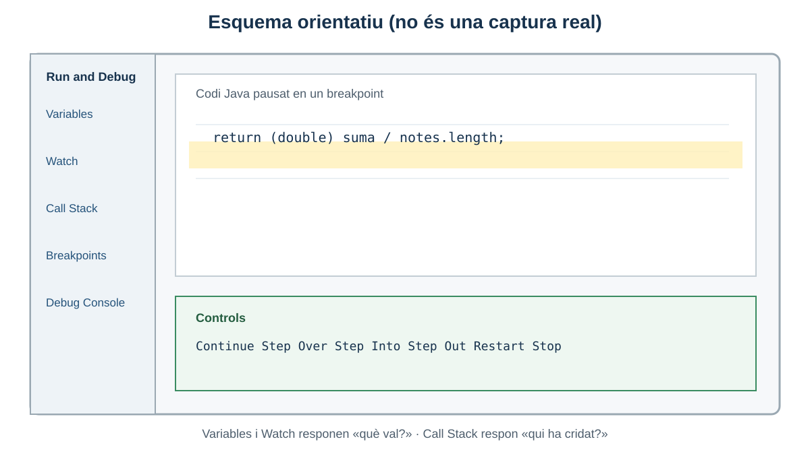
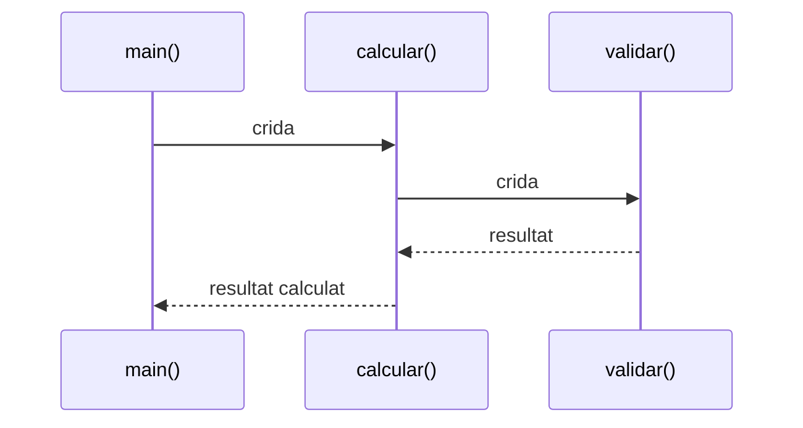
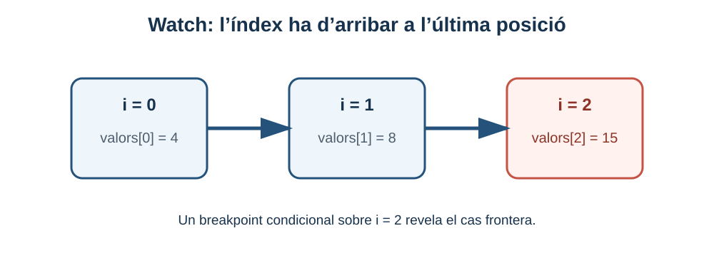
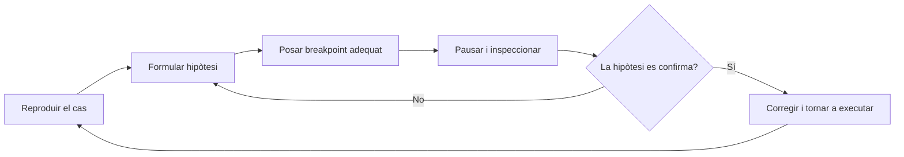

# 3. Depuració de Java amb VS Code

> **CA:** RA3.c, RA3.d i RA3.e · **Sessions:** 3, 4 i 5

## Què aprendràs

Aprendràs a iniciar una sessió de depuració Java en VS Code, posar breakpoints, llegir variables i la pila de crides, observar expressions i avançar per una execució amb `Continue`, `Step Over`, `Step Into` i `Step Out`. També aprendràs a triar un breakpoint a partir d’una hipòtesi. Les figures d’aquest bloc són esquemes originals: no són captures de cap versió concreta de VS Code.

## Depurar no és imprimir més missatges

`System.out.println` és útil per fer visible una dada, però cal modificar el codi, tornar a executar-lo i decidir on imprimir. Un depurador pot aturar la JVM en una línia executable, conservar el context de la pausa i permetre inspeccionar variables, pila de crides i expressions sense omplir el programa de missatges temporals. Imprimir no és incorrecte; és una ferramenta simple amb un cost diferent.

Llegir l’error també és una habilitat. Una excepció conté tipus, missatge i sovint una pila de crides. El primer marc pot ser on la fallada es manifesta, però l’origen pot estar en una dada calculada diversos mètodes abans. Un error lògic pot no llançar cap excepció: el programa acaba “correctament” amb un valor incorrecte. En eixe cas, la pausa i l’observació són especialment importants.



*Figura 1. Esquema orientatiu del panell de depuració: Variables, Watch, Call Stack, Breakpoints i Debug Console.*

## Sessió 3 — Preparar i iniciar una pausa

### 1. Comprovar la carpeta i el JDK

1. Instal·la el JDK 17 o 21 i comprova en una terminal integrada `java --version`.
2. Instal·la **Extension Pack for Java** des de la vista Extensions de VS Code. El paquet inclou el suport de llenguatge, el depurador Java i el Test Runner.
3. Usa **File → Open Folder...** i selecciona la carpeta que conté el fitxer `.java` o, si és Maven, la carpeta que conté `pom.xml`. Obrir només el fitxer pot impedir que VS Code detecte correctament el projecte.
4. Espera que finalitze la càrrega del llenguatge Java. Si el fitxer té un error de sintaxi, resol-lo abans de deduir que el depurador falla.

### 2. Primer exemple: `CalculadoraMitjana.java`

La regla és: la mitjana de les notes és la suma dividida pel nombre de notes, i el resultat ha de conservar decimals. En aquest exemple l’error lògic és intencionat: `suma / notes.length` es calcula com a divisió entera abans d’assignar-se a `double`.

```java
public class CalculadoraMitjana {
    public static double mitjana(int[] notes) {
        int suma = 0;
        for (int nota : notes) {
            suma += nota;
        }
        return suma / notes.length; // ERROR INTENCIONAT: divisió entera
    }

    public static void main(String[] args) {
        int[] notes = {5, 6, 8};
        System.out.println(mitjana(notes)); // Esperat: 6.333..., obtingut: 6.0
    }
}
```

Posa un breakpoint en la línia `return` fent clic en el marge esquerre o amb `F9`. Inicia amb **Run and Debug** o amb `F5`. Quan la línia es marque, el programa està pausat abans d’executar-la. En **Variables** observa `suma=19`, `notes.length=3` i el tipus de cada valor. En **Watch** afegeix `((double) suma) / notes.length`; veuràs `6.333...`, mentre que `suma / notes.length` és `6`. La correcció és convertir abans de dividir: `return (double) suma / notes.length;`.

Després d’editar el codi, atura o reinicia la sessió i repeteix el cas. Una possible funció Hot Code Replace pot aplicar alguns canvis mentre la JVM està pausada, però no és universal: depén de l’extensió, del tipus de canvi i de la configuració. Per a una explicació didàctica fiable, torna a executar i confirma que la classe carregada és l’actual.

### 3. Què esperes veure

- Un breakpoint ple indica que s’ha establit en una línia que el depurador pot associar a codi executable.
- La fletxa groga indica la pròxima línia que s’executarà, no necessàriament la línia que ha provocat l’error.
- Les variables locals només tenen sentit dins del seu abast; una variable fora de la funció pot no aparéixer.
- Si no s’atura, revisa que has premut `F5` i no només el triangle de **Run**, que la línia és executable i que el fitxer o classe oberta és la que s’està executant.

## Sessió 4 — Inspeccionar el flux

### Variables i Watch

**Variables** mostra paràmetres, locals i camps accessibles en la línia pausada. **Watch** conserva expressions que vols comparar en diverses pauses, per exemple `index`, `suma`, `notes.length` o `suma / (double) notes.length`. Una expressió Watch no és una prova automàtica: és una observació temporal durant una sessió.

### Call Stack

La **Call Stack** o pila de crides mostra qui ha cridat el mètode actual. En `main() → mitjana()`, el marc `mitjana` és el context actual i `main` és el seu invocador. Seleccionar un marc anterior pot mostrar els seus paràmetres i la línia des d’on s’ha fet la crida. Això ajuda a respondre “qui ha proporcionat aquesta dada?” i no només “on l’he vista malament?”.

### Debug Console

La **Debug Console** permet avaluar expressions en el context pausat. Usa-la per consultar `suma`, `notes.length` o una comparació. No assumes que qualsevol expressió amb efectes secundaris és segura: cridar un mètode pot modificar l’estat i fer menys fiable la investigació.

### Exemple B: `CercaNumero.java`

La regla és cercar un valor en qualsevol posició de l’array. L’error intencionat fa que el bucle s’ature abans de l’últim índex.

```java
public class CercaNumero {
    public static int posicioDe(int[] valors, int buscat) {
        for (int i = 0; i < valors.length - 1; i++) { // ERROR: exclou l'últim
            if (valors[i] == buscat) {
                return i;
            }
        }
        return -1;
    }

    public static void main(String[] args) {
        int[] valors = {4, 8, 15};
        System.out.println(posicioDe(valors, 15)); // Esperat: 2; obtingut: -1
    }
}
```

Posa el breakpoint dins del `for`, afegeix `i` i `valors[i]` a Watch i usa **Step Over**. Veuràs `i=0` i `i=1`; després la condició `2 < 2` és falsa i mai es consulta `valors[2]`. La solució és `i < valors.length`. El cas que activa la fallada és buscar l’últim element; cercar el primer no és suficient.

### Step Over, Step Into i Step Out

Suposa `main() → calcular() → validar()`:



- **Step Over (F10):** executa la línia actual sense entrar en la implementació de la funció cridada; és ideal quan la funció ja és coneguda.
- **Step Into (F11):** entra en la funció cridada; usa’l quan la hipòtesi apunta a la transformació interna.
- **Step Out (Shift+F11):** acaba la funció actual i torna al seu invocador; serveix per eixir d’una crida que has inspeccionat prou.
- **Continue (F5):** avança fins al següent breakpoint, excepció o final.
- **Restart:** reinicia la sessió amb el codi/configuració actual segons el suport disponible.
- **Stop (Shift+F5):** finalitza la sessió de depuració.



*Figura 2. Un Watch sobre l’índex permet comprovar que també s’examina la darrera posició.*

## Sessió 5 — Triar el breakpoint i confirmar una hipòtesi

### Exemple C: `Comissions.java`

Regla: fins a 1.000 € de venda, la comissió és del 5 %; per damunt de 1.000 €, és del 8 %. El límit `1.000` pertany a la primera branca. L’error intencionat usa `>=` i aplica la comissió alta també al límit.

```java
public class Comissions {
    public static double calcular(double venda) {
        if (venda >= 1000) { // ERROR: el límit hauria de ser venda > 1000
            return venda * 0.08;
        }
        return venda * 0.05;
    }

    public static void main(String[] args) {
        System.out.println(calcular(1000)); // Esperat: 50.0; obtingut: 80.0
        System.out.println(calcular(1200)); // Esperat: 96.0
    }
}
```

Posa un breakpoint condicional en la línia de l’`if` amb `venda == 1000`. Així no t’atures en totes les crides. Observa `venda` i quina branca s’executa. El breakpoint condicional no arregla el programa: només redueix el soroll i comprova una hipòtesi sobre la frontera. Després corregeix `>=` per `>` i torna a executar tant el cas `1000` com el `1200`.

### Tipus de breakpoint

- **Normal:** pausa sempre que arriba a la línia.
- **Condicional:** pausa quan una expressió és certa, com `i == valors.length - 1`.
- **Per excepció:** pot aturar-se quan es llança una excepció, fins i tot abans que la captura la gestione.
- **Logpoint:** escriu informació en Debug Console sense interrompre el flux; és una alternativa temporal a afegir `println`.

El depurador Java també pot oferir data breakpoints per a alguns camps i Hot Code Replace. Presenta’ls com ampliacions perquè depenen del context de la sessió i de la versió de les extensions.

### Canviar valors en temps d’execució

En una pausa, el depurador permet avaluar expressions. En alguns contextos també permet editar un valor en **Variables** o aplicar un canvi de codi amb Hot Code Replace. No totes les variables, tipus o marcs són editables; una variable local optimitzada pot no ser modificable. I encara que canviem `venda` de `1000` a `1200` en la sessió, no hem corregit el codi font: només hem fet un experiment temporal. La correcció real s’ha d’escriure, guardar i tornar a verificar.

## Una estratègia repetible



1. Reprodueix amb dades mínimes i escriu el resultat esperat.
2. Localitza el primer punt on el valor podria canviar.
3. Posa el breakpoint més proper a eixa hipòtesi, no deu punts aleatoris.
4. Observa entrada, estat abans i estat després de la línia.
5. Avança amb Step Over o entra amb Step Into segons la pregunta.
6. Corregeix, repeteix el cas que fallava i conserva els casos de frontera.

## Errors freqüents del depurador

| Símptoma | Comprovació |
| --- | --- |
| El breakpoint no s’activa | Has iniciat `Run and Debug`? La línia és executable? |
| No apareixen variables | Estàs en una pausa i en el marc de crida correcte? |
| El codi sembla antic | Guarda el fitxer, reinicia i comprova la carpeta/classe executada. |
| Entres en massa codi | Usa Step Over o configura filtres de pas. |
| El programa acaba de seguida | Posa un breakpoint abans de la línia final o inicia amb F5. |
| Una expressió no es pot editar | Depén del tipus, l’abast i el suport de la sessió; avalua-la o reinicia. |

## Resum

La depuració és una investigació guiada per hipòtesis. Variables, Watch, Call Stack i Debug Console aporten context; els controls de pas canvien la granularitat; els breakpoints condicionals concentren l’atenció. La modificació temporal d’un valor és una observació, no una correcció. La figura real de la interfície pot canviar amb la versió, però les preguntes —on estic, què val, qui m’ha cridat i quina branca s’executa— es mantenen.

Per ampliar, consulta la [guia oficial de depuració Java de VS Code](https://code.visualstudio.com/docs/java/java-debugging).

[Bloc anterior: disseny de casos](02-disseny-casos-prova.md) · [Inici](../up4-proves.md) · [Bloc següent: JUnit Jupiter](04-proves-unitaries-junit.md)
