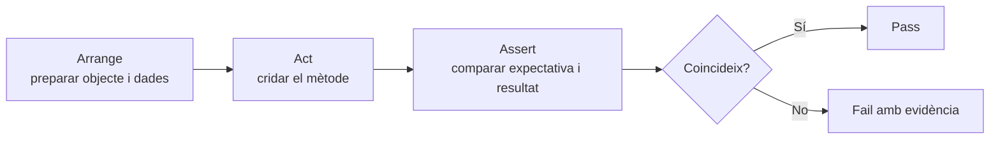
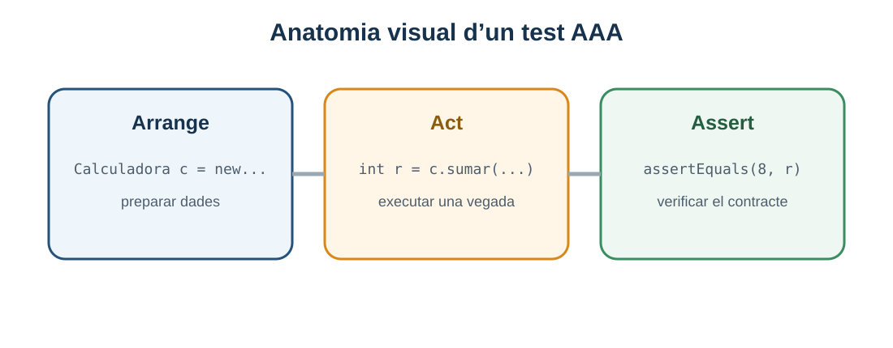

# 4. Proves unitàries amb JUnit Jupiter

> **CA:** RA3.f · **Sessions:** 6 i 7

## Què aprendràs

Una prova unitària comprova una unitat menuda —habitualment un mètode o una classe— en unes condicions controlades. Aprendràs l’anatomia d’un test amb JUnit Jupiter, el patró Arrange–Act–Assert, les assercions més habituals i la configuració mínima d’un projecte Maven en VS Code.

## Què vol dir unitària

En una prova unitària volem que la causa d’una fallada siga fàcil de localitzar. Per això reduïm l’abast, evitem xarxa i dades aleatòries i usem entrades conegudes. “Unitària” no vol dir “programa curt” ni “prova manual”: indica la unitat que s’observa i l’aïllament que procurem.

El cicle és: preparar l’estat, executar el mètode i comparar amb una expectativa.





*Figura 1. L’estructura AAA separa preparació, acció i verificació; si es barregen, costa saber què ha provocat la fallada.*

## Projecte Maven i JUnit Jupiter

Obri en VS Code la carpeta que conté `pom.xml`. L’exemple complet està en [`exemples/04-junit/pom.xml`](exemples/04-junit/pom.xml). La seua estructura és:

```text
04-junit/
├── pom.xml
└── src/
    ├── main/java/edu/up4/teoria/Calculadora.java
    └── test/java/edu/up4/teoria/CalculadoraTest.java
```

El [`pom.xml` de l’exemple](exemples/04-junit/pom.xml) usa Java 17, `junit-jupiter` 5.10.2 i Maven Surefire 3.2.5. JUnit Jupiter és la API de JUnit 5; per això els imports són `org.junit.jupiter.api.Test` i `org.junit.jupiter.api.Assertions.*`, no els imports de JUnit 4.

```xml
<properties>
  <maven.compiler.release>17</maven.compiler.release>
  <project.build.sourceEncoding>UTF-8</project.build.sourceEncoding>
</properties>
<dependencies>
  <dependency>
    <groupId>org.junit.jupiter</groupId>
    <artifactId>junit-jupiter</artifactId>
    <version>5.10.2</version>
    <scope>test</scope>
  </dependency>
</dependencies>
```

La dependència amb `scope=test` no s’inclou en el programa final. Surefire connecta Maven amb la plataforma de tests durant la fase `test`.

## Exemple A: `Calculadora`

Primer definim el comportament: sumar i restar tornen el resultat matemàtic; dividir usa decimals i llança `IllegalArgumentException` si el divisor és zero.

```java
package edu.up4.teoria;

public class Calculadora {
    public int sumar(int a, int b) {
        return a + b;
    }

    public int restar(int a, int b) {
        return a - b;
    }

    public double dividir(double dividend, double divisor) {
        if (divisor == 0) {
            throw new IllegalArgumentException("El divisor no pot ser zero");
        }
        return dividend / divisor;
    }
}
```

El test complet és:

```java
package edu.up4.teoria;

import org.junit.jupiter.api.Test;

import static org.junit.jupiter.api.Assertions.assertEquals;
import static org.junit.jupiter.api.Assertions.assertThrows;

class CalculadoraTest {
    private final Calculadora calculadora = new Calculadora();

    @Test
    void sumarDosEnters() {
        // Arrange
        int primer = 3;
        int segon = 5;

        // Act
        int resultat = calculadora.sumar(primer, segon);

        // Assert
        assertEquals(8, resultat);
    }

    @Test
    void dividirAdmetDecimals() {
        double resultat = calculadora.dividir(7, 2);

        assertEquals(3.5, resultat);
    }

    @Test
    void dividirEntreZeroLlançaExcepcio() {
        assertThrows(IllegalArgumentException.class,
                () -> calculadora.dividir(7, 0));
    }
}
```

`assertEquals(8, resultat)` no comprova que el mètode “sembla correcte”: comprova exactament que `resultat` és 8. `assertThrows` comprova el tipus d’excepció; no convé usar una expectativa massa ampla com `Exception.class` si el contracte defineix una excepció més concreta.

Per als decimals, una comparació amb tolerància pot ser apropiada quan la representació de coma flotant ho requereix. En aquest exemple `3.5` és representable exactament, però en altres operacions pot caldre `assertEquals(esperat, real, delta)`.

## Les assercions essencials

| Assertion | Què comprova | Exemple |
| --- | --- | --- |
| `assertEquals(esperat, real)` | Igualtat segons el tipus. | `assertEquals(8, suma)`. |
| `assertTrue(condició)` | Que una condició siga certa. | `assertTrue(correu.esValid())`. |
| `assertFalse(condició)` | Que una condició siga falsa. | `assertFalse(validador.accepta(""))`. |
| `assertNotNull(valor)` | Que no siga `null`. | `assertNotNull(usuari)`. |
| `assertThrows(Tipus.class, executable)` | Que una acció llance el tipus indicat. | Dividir entre zero. |

No uses `assertTrue(resultat == 8)` quan `assertEquals(8, resultat)` explica millor què esperaves. Un missatge opcional pot indicar el context: `assertEquals(8, resultat, "suma de 3 i 5")`.

## Provar retorns, estat i excepcions

No totes les unitats es comporten igual. Un mètode pur rep dades i torna un valor, com `sumar`. Un mètode amb estat modifica un objecte, com `ingressar` en un compte. En aquest segon cas, el test ha de descriure l’estat inicial i l’estat final: abans de retirar hi ha 100 €, després n’hi ha 65 €. Si només comproves que no hi ha excepció, podries deixar passar una implementació que no modifica res.

Les excepcions també formen part del contracte. Cal decidir abans d’escriure la prova si un import invàlid retorna `false`, torna `null` o llança una excepció. No escrigues el test a partir del que “casualment” fa la primera implementació: el test ha de protegir el comportament que s’ha decidit. Per això l’exemple de `CompteBancari` separa `IllegalArgumentException` per a l’import i `IllegalStateException` per al saldo.

Quan una asserció falla, llegeix-la com una comparació: quin valor esperava JUnit, quin valor ha rebut i en quina línia. Una fallada en `assertEquals` pot ser un defecte del programa, una expectativa incorrecta o una dada preparada amb un tipus diferent. En una prova unitària no intentes solucionar-ho canviant l’assertion fins que passe; primer confirma el contracte i després decideix quin dels dos costats està malament.

## Exemple B: `CompteBancari`

Decisions del model: l’ingrés exigeix un import estrictament positiu; la retirada exigeix un import positiu i saldo suficient; si no es compleix, llança `IllegalArgumentException` per a imports incorrectes o `IllegalStateException` per a saldo insuficient. No hi ha persistència ni moneda real.

```java
public class CompteBancari {
    private double saldo;

    public CompteBancari(double saldoInicial) {
        if (saldoInicial < 0) {
            throw new IllegalArgumentException("Saldo inicial no vàlid");
        }
        saldo = saldoInicial;
    }

    public void ingressar(double importOperacio) {
        validarImport(importOperacio);
        saldo += importOperacio;
    }

    public void retirar(double importOperacio) {
        validarImport(importOperacio);
        if (importOperacio > saldo) {
            throw new IllegalStateException("Saldo insuficient");
        }
        saldo -= importOperacio;
    }

    public double saldo() {
        return saldo;
    }

    private void validarImport(double importOperacio) {
        if (importOperacio <= 0) {
            throw new IllegalArgumentException("L'import ha de ser positiu");
        }
    }
}
```

Una prova ha d’observar l’estat abans i després, i també les regles de rebuig:

```java
@Test
void retirarActualitzaElSaldo() {
    CompteBancari compte = new CompteBancari(100);

    compte.retirar(35);

    assertEquals(65, compte.saldo());
}

@Test
void noPermetRetiradaSuperiorAlSaldo() {
    CompteBancari compte = new CompteBancari(20);

    assertThrows(IllegalStateException.class, () -> compte.retirar(21));
    assertEquals(20, compte.saldo());
}
```

El segon test comprova també que el rebuig no modifica l’estat. Això evita una implementació que llance l’excepció però reste abans d’adonar-se del problema.

## Exemple C: `ValidadorCorreu`

Aquest validador és **simplificat i educatiu**. Només exigeix un text no buit, una única `@`, text abans i després, i un punt després de `@`. No és una validació completa de RFC ni substitueix una política real de confirmació de correu.

```java
public class ValidadorCorreu {
    public boolean esValid(String correu) {
        if (correu == null || correu.isBlank()) {
            return false;
        }
        int arrova = correu.indexOf('@');
        return arrova > 0
                && arrova == correu.lastIndexOf('@')
                && arrova < correu.length() - 1
                && correu.indexOf('.', arrova) > arrova + 1;
    }
}
```

Podem provar un cas vàlid (`ana@example.com`), un sense arrova i un amb domini incomplet. La frontera és útil perquè `a@b.c` és acceptat per aquesta política, mentre que `a@b` no ho és. Explicitar el contracte evita presentar una expressió regular didàctica com si cobrira tots els correus existents.

## Tests independents i `@BeforeEach`

Cada test ha de poder executar-se sol. No depengues que un test anterior haja creat dades, ni uses l’hora del sistema, fitxers temporals compartits o ordre d’execució. `@BeforeEach` pot reduir duplicació quan prepara un objecte senzill:

```java
private Calculadora calculadora;

@BeforeEach
void preparar() {
    calculadora = new Calculadora();
}
```

No amagues una preparació important en un mètode immens. El nom del test ha d’explicar la conducta: `noPermetRetiradaSuperiorAlSaldo` és millor que `test3`.

## Executar en VS Code

Amb el projecte obert, el Test Runner mostra CodeLens sobre la classe i cada mètode: **Run Test** i **Debug Test**. La vista **Testing** permet executar un test individual, una classe o tots els tests. El triangle verd no substitueix la lectura del resultat: obri el detall de la asserció i compara esperat i obtingut.

Des de la terminal integrada, en la carpeta de l’exemple:

```bash
mvn test
```

Maven compila `src/main/java`, compila `src/test/java` i executa Surefire. Si el terminal diu que no troba `pom.xml`, el directori de treball és incorrecte. Si no troba `org.junit.jupiter`, revisa la dependència i que l’IDE haja acabat de descarregar dependències.

## Errors habituals

- Importar `org.junit.Test`, que és JUnit 4, en un projecte configurat per a Jupiter.
- Posar la classe de test en `src/main/java` o la classe productiva en `src/test/java`.
- Fer que un test depenga d’un altre.
- Comprovar només que no hi ha excepció i oblidar el valor o estat resultant.
- Confondre `assertThrows` amb “el programa ha fallat”: l’excepció és el resultat esperat del cas.

## Resum

JUnit Jupiter dona una estructura executable a un cas de prova. AAA fa visible el propòsit, les assercions comparen comportaments concrets i Maven permet repetir la bateria amb una configuració fixada. Una prova unitària ben escrita és curta, determinista, independent i expressa una decisió del contracte.

Per ampliar, consulta la [guia oficial de JUnit 5](https://junit.org/junit5/docs/current/user-guide/) i la [guia oficial de proves Java en VS Code](https://code.visualstudio.com/docs/java/java-testing).

[Bloc anterior: depuració](03-depuracio-vscode.md) · [Inici](index.md) · [Bloc següent: automatització](05-automatitzacio-proves.md)
