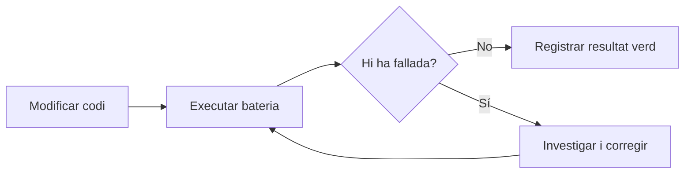
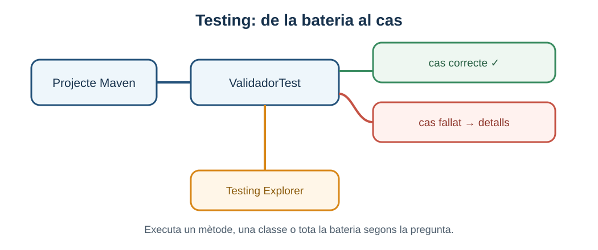

# 5. Automatització i execució de bateries

> **CA:** RA3.g · **Sessió:** 8

## Què aprendràs

Automatitzar una prova és deixar descrita una comprovació que una ferramenta pot executar i comparar de manera repetible. Aprendràs a organitzar una bateria, executar-la des de Testing i des del terminal amb Maven, llegir `pass`, `fail` i `error` i introduir tests parametritzats sense confondre automatització local amb integració contínua.

## Definir i executar automàticament

Una taula de casos de prova és una definició; encara que estiga ben escrita, algú ha d’executar-la. Un test JUnit converteix la definició en codi i el Test Runner o Maven la pot repetir. La repetició és valuosa després d’un canvi: una prova que abans estava verda pot detectar una regressió.



Automatitzar no arregla un cas mal dissenyat. Una prova que comprova una expectativa incorrecta pot quedar verda i donar una falsa sensació de qualitat. També pot haver-hi comportaments sense cap cas. La qualitat de la bateria depén de la qualitat dels contractes i de les dades seleccionades en el bloc 02.

## Organitzar una bateria

Una bateria pot contenir classes centrades en una responsabilitat i diversos casos amb noms expressius. En VS Code, la vista **Testing** pot mostrar una jerarquia semblant a aquesta:



*Figura 1. Esquema orientatiu de Testing: projecte, classe, mètode i resultat.*

Executa el nivell més menut que respon a la pregunta: un mètode mentre investigues, una classe després d’un canvi local i tota la bateria abans de donar per acabada una correcció. En tots els casos, l’eixida ha de deixar clar quins tests s’han descobert i quins s’han executat.

## Exemple independent: `ValidadorContrasenya`

Política educativa: una contrasenya és vàlida si té almenys 8 caràcters i conté almenys una xifra. No es comprova si és segura en el món real, si apareix en llistes filtrades o si compleix una política corporativa.

```java
package edu.up4.automatitzacio;

public class ValidadorContrasenya {
    public boolean esValida(String contrasenya) {
        if (contrasenya == null || contrasenya.length() < 8) {
            return false;
        }
        return contrasenya.chars().anyMatch(Character::isDigit);
    }
}
```

En [`exemples/05-automatitzacio/pom.xml`](exemples/05-automatitzacio/pom.xml) i els fitxers adjacents hi ha la classe, el projecte i el test. `@ParameterizedTest` permet executar el mateix esquema amb dades diferents:

```java
@ParameterizedTest(name = "{0} → {1}")
@CsvSource({
        "abc12345, true",
        "abcdefgh, false",
        "abc1234, false",
        "12345678, true"
})
void comprovaLaPolitica(String entrada, boolean esperat) {
    ValidadorContrasenya validador = new ValidadorContrasenya();

    boolean resultat = validador.esValida(entrada);

    assertEquals(esperat, resultat);
}
```

Cada fila és un cas, no una variació invisible. El primer cas prova una entrada vàlida; el segon té longitud suficient però no té xifra; el tercer és just per baix de 8; el quart comprova el límit de longitud amb xifres. El nom `name` ajuda a identificar quina fila ha fallat.

### Execució deliberadament fallida

Per entendre el report, canvia temporalment la política a `contrasenya.length() <= 8`. El cas `abc12345` deixarà d’acceptar-se i Maven indicarà una asserció fallida amb l’entrada i els valors esperat/obtingut. També pots canviar una expectativa de la taula, però cal marcar sempre que és una fallada intencionada de demostració. Torna a la condició correcta `length() < 8` i executa de nou: la bateria ha de quedar verda.

## Maven, Testing i reports

En el projecte de mostra, la carpeta de treball és `docs/daw-ed/up4/exemples/05-automatitzacio`. Des de la terminal integrada:

```bash
mvn test
```

Maven executa la fase `test` i Surefire escriu els reports en `target/surefire-reports`. Els fitxers XML són útils per a ferramentes; els `.txt` permeten una lectura ràpida. Si no hi ha tests descoberts, revisa el nom de la classe (`*Test.java`), els imports, les anotacions i la configuració del projecte.

| Estat | Significat | Primera pregunta |
| --- | --- | --- |
| `pass` | L’expectativa ha coincidit. | Quin comportament cobreix el cas? |
| `fail` | El test s’ha executat però una asserció no coincideix. | Quin era l’esperat i quin l’obtingut? |
| `error` | L’execució no ha arribat a una asserció normal. | Hi ha una excepció, configuració o dependència trencada? |

En la vista **Testing**, el panell permet executar una classe o un mètode i, segons la configuració, depurar-lo. Després de `mvn test`, no digues només “ha anat bé”: registra quants tests s’han executat i si el report conté errors o fallades.

## Repetibilitat

Una prova repetible usa valors coneguts, no depén de la xarxa, no llig l’hora real i no comparteix estat mutable amb una altra. Si la contrasenya es valida segons la política fixa, la bateria ha de donar el mateix resultat hui i demà. Si un test necessita una API externa, ja no és una unitat completament aïllada; pots provar la integració en un nivell diferent o injectar un doble.

Evita aleatorietat sense una llavor controlada. Si el programa usa fitxers, crea dades temporals aïllades i neteja-les. Si el sistema depén de l’hora, injecta un rellotge o passa la data com a dada. Una prova inestable que de vegades passa i de vegades falla és difícil d’interpretar i fa que l’equip ignore alertes.

## Automatització local i integració contínua

`mvn test` executat des de VS Code és **automatització local**: la persona desenvolupadora decideix quan llançar-lo i en el seu equip. La **integració contínua** és un procés posterior que pot executar la bateria en una plataforma remota quan hi ha canvis. La integració contínua és RA4 en el mapa general del mòdul; aquesta UP només necessita entendre la diferència. No desenvoluparem GitHub Actions ni cap pipeline remot ací.

## Errors habituals

- Creure que tindre moltes files implica cobrir totes les regles.
- Executar només el test modificat i oblidar la regressió de la resta.
- Llançar `mvn test` des d’una carpeta que no conté el `pom.xml`.
- Interpretar `error` com si fora exactament igual que `fail`.
- Deixar en la bateria un cas que depén de la xarxa o d’un fitxer creat per un altre test.
- Canviar el codi per fer passar una expectativa que no correspon al contracte.

## Comprovació de comprensió

Si una bateria mostra `Tests run: 4, Failures: 1, Errors: 0`, hi ha quatre casos executats, un comportament que no coincideix amb la seua expectativa i cap error d’infraestructura identificat per eixe report. Si mostra `Errors: 1`, primer cal revisar l’excepció o la configuració abans d’interpretar la regla de negoci.

## Resum

Automatitzar permet repetir i comparar, especialment després d’un canvi. Maven organitza la construcció i Surefire deixa evidències; Testing facilita executar mètodes, classes i bateries. Els tests parametritzats redueixen codi repetit mantenint visibles les dades. Una bateria local no és encara integració contínua, i un resultat verd només és tan útil com els casos que s’han triat.

Per ampliar, consulta la [documentació oficial de proves Java en VS Code](https://code.visualstudio.com/docs/java/java-testing) i la [documentació de Maven Surefire](https://maven.apache.org/components/surefire/maven-surefire-plugin/).

[Bloc anterior: JUnit Jupiter](04-proves-unitaries-junit.md) · [Inici](index.md) · [Bloc següent: dobles de prova](06-dobles-prova.md)
