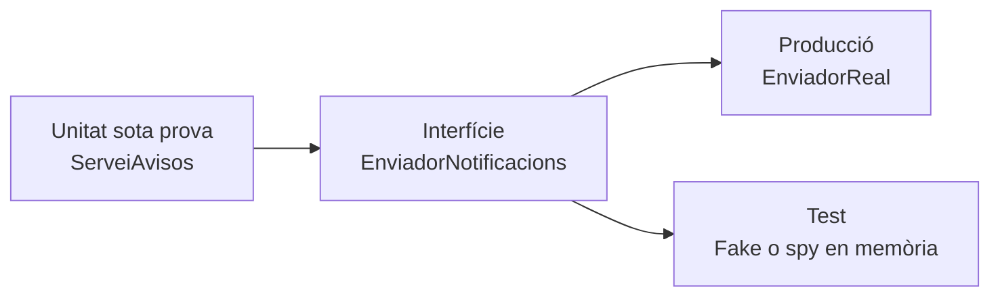

# 6. Dobles de prova i aïllament de components

> **CA:** RA3.i · **Sessió:** 9

## Què aprendràs

Quan una classe depén d’una API, una base de dades, un disc o un servei de correu, una prova pot ser lenta, fràgil o impossible de repetir. Aprendràs a separar la unitat de la dependència amb una interfície i una injecció pel constructor, i distingiràs dummy, stub, fake, spy i mock.

## Dependència i aïllament

Una dependència és un component que una unitat necessita per completar una operació. Si `ServeiAvisos` crea dins del mètode una connexió real, el test queda lligat a xarxa, credencials i disponibilitat. Una solució senzilla és dependre d’una interfície i rebre la implementació des de fora:



En producció s’injecta `EnviadorReal`; en el test, un doble que no envia cap missatge. La unitat continua prenent la decisió de negoci —si la dada és vàlida o no— i el doble només representa la frontera.

## Cinc tipus de dobles

Els noms es poden usar amb matisos diferents segons la bibliografia. La distinció pedagògica important és què proporciona el doble i què verifica.

| Tipus | Funció principal | Exemple |
| --- | --- | --- |
| Dummy | Ocupa un paràmetre que no s’utilitzarà. | Un objecte buit per completar un constructor. |
| Stub | Dona respostes preparades. | Un repositori que sempre torna `true`. |
| Fake | Implementació simplificada però funcional. | Un repositori en memòria. |
| Spy | Registra què se li ha demanat. | Llista d’avisos enviats. |
| Mock | Doble configurat per verificar interaccions esperades. | Comprovar una crida amb arguments concrets. |

Un fake i un spy manual poden conviure: el fake pot implementar la funció i el spy registrar les crides. Mockito és una ampliació possible per crear mocks, però no és necessari per entendre el principi ni per executar l’exemple troncal.

## Exemple independent: `ServeiAvisos`

Regla de negoci: si el destinatari és buit o el missatge és buit, no s’envia res i el mètode torna `false`. Si les dues dades són vàlides, demana un enviament i torna `true`. La implementació de producció és conceptual: no obri una xarxa real.

```java
package edu.up4.dobles;

public interface EnviadorNotificacions {
    void enviar(String destinatari, String missatge);
}
```

```java
package edu.up4.dobles;

public class EnviadorProduccio implements EnviadorNotificacions {
    @Override
    public void enviar(String destinatari, String missatge) {
        // En una aplicació real, ací s'integraria un proveïdor.
        System.out.println("Enviament conceptual a " + destinatari);
    }
}
```

```java
package edu.up4.dobles;

public class ServeiAvisos {
    private final EnviadorNotificacions enviador;

    public ServeiAvisos(EnviadorNotificacions enviador) {
        this.enviador = enviador;
    }

    public boolean avisar(String destinatari, String missatge) {
        if (destinatari == null || destinatari.isBlank()
                || missatge == null || missatge.isBlank()) {
            return false;
        }
        enviador.enviar(destinatari, missatge);
        return true;
    }
}
```

El fake/spy manual és una implementació en memòria:

```java
package edu.up4.dobles;

import java.util.ArrayList;
import java.util.List;

public class EnviadorMemoria implements EnviadorNotificacions {
    public record Notificacio(String destinatari, String missatge) {}

    private final List<Notificacio> enviades = new ArrayList<>();

    @Override
    public void enviar(String destinatari, String missatge) {
        enviades.add(new Notificacio(destinatari, missatge));
    }

    public List<Notificacio> enviades() {
        return List.copyOf(enviades);
    }
}
```

El test comprova resultat i interacció:

```java
package edu.up4.dobles;

import org.junit.jupiter.api.Test;

import static org.junit.jupiter.api.Assertions.assertEquals;
import static org.junit.jupiter.api.Assertions.assertFalse;
import static org.junit.jupiter.api.Assertions.assertTrue;

class ServeiAvisosTest {
    @Test
    void dadaValidaRegistraUnEnviament() {
        EnviadorMemoria enviador = new EnviadorMemoria();
        ServeiAvisos servei = new ServeiAvisos(enviador);

        boolean resultat = servei.avisar("ana@example.com", "Recordatori");

        assertTrue(resultat);
        assertEquals(1, enviador.enviades().size());
        assertEquals("ana@example.com",
                enviador.enviades().get(0).destinatari());
    }

    @Test
    void dadaInvalidaNoInvocaLEnviament() {
        EnviadorMemoria enviador = new EnviadorMemoria();
        ServeiAvisos servei = new ServeiAvisos(enviador);

        boolean resultat = servei.avisar("", "Recordatori");

        assertFalse(resultat);
        assertTrue(enviador.enviades().isEmpty());
    }
}
```

El test no comprova SMTP ni una API externa. Comprova que la unitat decideix bé i que sol·licita exactament un enviament vàlid. Si la unitat envia dues vegades, el `size()` ho faria visible; si rebutja una entrada buida però encara crida el doble, la llista no estaria buida.

## Resultat i interacció

Una prova basada en **resultat** pregunta “què ha tornat la unitat?” (`true` o `false`). Una prova basada en **interacció** pregunta “què ha demanat a la dependència?” (una notificació amb un destinatari concret). Les dues són útils, però una interacció massa específica pot lligar el test a la implementació i dificultar una refactorització que mantinga el mateix comportament.

## Riscos dels dobles

- **Fals positiu:** el fake sempre accepta dades però la dependència real les rebutja.
- **Configuració fictícia:** simular una resposta que el servei real mai produiria.
- **Acoblament excessiu:** verificar cada crida interna en lloc del contracte observable.
- **Doble que no s’assembla al real:** un fake en memòria pot no reflectir concurrència, latència o errors reals.

Per reduir riscos, mantén la interfície petita, documenta el comportament simulat i reserva proves d’integració per confirmar que l’adaptador real compleix el contracte. Un doble aïlla; no certifica automàticament la dependència.

## Mockito com a ampliació opcional

Un framework com Mockito pot crear un mock i verificar una interacció, però afegeix una dependència i una sintaxi que no són necessàries per a la idea principal. Conceptualment, seria semblant a:

```java
EnviadorNotificacions mock = mock(EnviadorNotificacions.class);
ServeiAvisos servei = new ServeiAvisos(mock);

assertTrue(servei.avisar("ana@example.com", "Recordatori"));
verify(mock).enviar("ana@example.com", "Recordatori");
```

Aquest fragment no forma part del projecte executable troncal perquè requeriria afegir Mockito al `pom.xml`. Primer cal entendre la interfície i el fake manual; el framework és una ferramenta, no el concepte.

## Comprovació de comprensió

Si una classe només necessita que un repositori torne “usuari existent”, un stub és suficient. Si vols guardar registres en memòria i consultar-los després, un fake és més adequat. Si només t’importa saber quantes vegades s’ha enviat un avís, un spy és la descripció més directa. Un dummy seria útil només per omplir una dependència que el camí provat no consulta.

## Resum

La injecció de dependències separa la unitat de la frontera externa. Dummy, stub, fake, spy i mock descriuen rols diferents; no són sinònims. Un doble permet proves ràpides i deterministes, però cal vigilar que la simulació no cree una confiança falsa ni lligue cada test a detalls interns.

[Bloc anterior: automatització](05-automatitzacio-proves.md) · [Inici](../up4-proves.md) · [Bloc següent: incidències](07-documentacio-incidencies.md)
