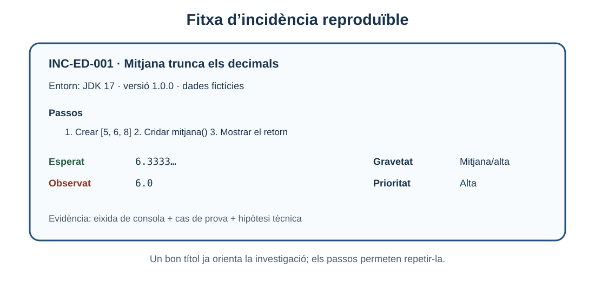
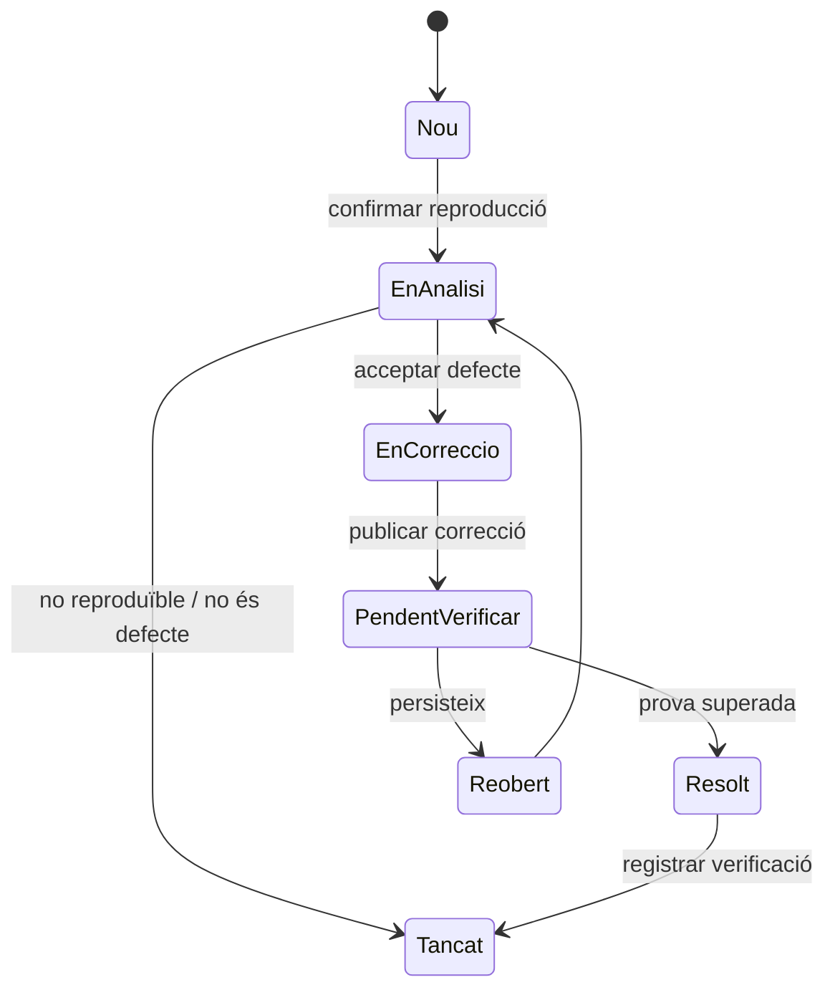

# 7. Documentació d’incidències

> **CA:** RA3.h · **Sessió:** 10

## Què aprendràs

Una incidència és una desviació que cal investigar o corregir. Aprendràs a diferenciar-la d’un cas de prova, redactar un informe reproduïble, separar gravetat de prioritat i relacionar una fallada amb depuració, correcció i regressió.

## Cas de prova i incidència

El cas de prova és una previsió: “amb aquestes dades, espere aquest resultat”. La incidència naix quan una execució real no coincideix amb l’esperat i la diferència és prou rellevant per registrar-la. Un cas pot quedar superat i no generar cap incidència; un cas fallat és una evidència que pot donar lloc a una incidència, però primer cal confirmar que l’esperança i l’entorn eren correctes.

Un bon informe és reproduïble, concret, verificable i útil per a qui corregirà. Ha de permetre respondre quatre preguntes: què s’ha fet, amb quines dades, què s’esperava i què ha passat realment.

## Camps recomanats

| Camp | Contingut |
| --- | --- |
| ID i títol | Identificador únic i resum informatiu. |
| Versió i entorn | Versió del programa, JDK, sistema i configuració rellevant. |
| Precondicions | Estat inicial necessari. |
| Passos | Accions numerades i reproduïbles. |
| Dades | Entrades exactes, fictícies i segures. |
| Resultat esperat | Regla o valor correcte. |
| Resultat observat | Eixida real, excepció o captura contextualitzada. |
| Logs/evidències | Consola, report del test o captura sense secrets. |
| Gravetat | Impacte tècnic o funcional. |
| Prioritat | Urgència de resoldre-ho. |
| Estat | Nou, en anàlisi, en correcció, pendent de verificar o resolt. |



*Figura 1. Una fitxa completa dona context i evita haver de reconstruir la situació a partir d’un missatge ambigu.*

## Exemple exclusiu: gestió de notes

La xicoteta aplicació calcula la mitjana d’una llista de notes. La regla és sumar totes les notes i dividir pel nombre d’elements. Amb `5, 6, 8`, la mitjana correcta és `6.333333...`. La versió `1.0.0` conté aquest defecte intencionat:

```java
public class GestorNotes {
    public double mitjana(int[] notes) {
        int suma = 0;
        for (int nota : notes) {
            suma += nota;
        }
        return suma / notes.length; // divisió entera abans de convertir a double
    }
}
```

### Informe mal redactat

> La mitjana està malament. Arregleu-ho perquè no funciona.

Aquest text no diu amb quines dades, quina versió, quin resultat s’esperava ni com reproduir-lo. No és útil per confirmar si la correcció ha funcionat.

### Informe ben redactat

**ID:** INC-ED-001  
**Títol:** `GestorNotes.mitjana` trunca els decimals amb tres notes enteres  
**Versió:** `1.0.0` (commit fictici `a1b2c3d`)  
**Entorn:** VS Code, JDK 17.0.x, Linux; execució local sense xarxa  
**Gravetat:** Mitjana/alta  
**Prioritat:** Alta per a la pantalla de qualificacions, però no bloqueja l’arrancada  
**Estat:** Nou

**Precondicions:** disposar de la classe `GestorNotes` i d’un array d’enters no buit.

**Passos per reproduir:**

1. Crear `notes = {5, 6, 8}`.
2. Crear `GestorNotes`.
3. Cridar `mitjana(notes)`.
4. Mostrar el valor retornat amb `System.out.println`.

**Resultat esperat:** `6.333333333333333` aproximadament, perquè `(5 + 6 + 8) / 3 = 19 / 3`.

**Resultat observat:** `6.0`.

**Eixida de consola:**

```text
Entrada: [5, 6, 8]
Esperat aproximat: 6.333333333333333
Obtingut: 6.0
```

**Hipòtesi tècnica:** l’expressió `suma / notes.length` es calcula amb dos operands `int`; la conversió a `double` arriba massa tard. No s’han inclòs credencials, tokens ni dades personals.

## Gravetat i prioritat no són el mateix

La **gravetat** descriu l’impacte si l’error es produeix. La **prioritat** descriu quan convé corregir-lo tenint en compte urgència, calendari, risc i recursos. Un error de gravetat alta pot tindre prioritat baixa si només apareix en una funció experimental; un error visual de gravetat baixa pot tindre prioritat alta si bloqueja una demostració imminent.

| Situació | Gravetat | Prioritat possible | Raó |
| --- | --- | --- | --- |
| El programa no arranca | Alta | Alta | Bloqueja qualsevol ús. |
| Decimal truncat en notes | Mitjana/alta | Alta en període de notes | Afecta una decisió visible. |
| Icona desplaçada en una pantalla informativa | Baixa | Mitjana abans d’una presentació | Impacte limitat però data pròxima. |
| Millora interna sense fallada | Cap incidència urgent | Baixa | És una millora, no un defecte funcional. |

No uses “urgent” com a sinònim de “greu”. Escriu els dos camps perquè el lector puga entendre la decisió.

## Estats i cicle de vida



Els noms poden variar entre equips, però la idea és que “corregit” no equival a “verificat”. Quan el codi canvia, cal repetir el cas original i afegir-lo a una prova de regressió quan siga possible.

## De la fallada a la regressió

1. Un test o una observació mostra una diferència.
2. Es confirma la reproducció amb dades mínimes.
3. Es depura fins a trobar el defecte, sense confondre símptoma i causa.
4. Es corregeix el codi.
5. Es repeteix el cas que fallava.
6. Es comprova la bateria relacionada per detectar regressions.
7. Es documenta el resultat i es tanca només quan la verificació és evidència suficient.

En `GestorNotes`, la correcció és convertir abans de dividir:

```java
return (double) suma / notes.length;
```

La verificació no hauria de quedar en “ara sembla bé”: s’executa el mateix cas `5,6,8`, s’afegeixen casos com una sola nota i un total divisible, i es comprova que el comportament anterior no s’ha trencat. Si es documenta un test JUnit, el report ofereix una evidència més repetible que una captura solta.

## Evidències segures i útils

Una captura ha de mostrar prou context: títol de la finestra, versió si és rellevant i el missatge complet. Un log ha de conservar l’hora només quan aporte informació. Elimina contrasenyes, tokens, adreces privades i dades personals reals. Si la incidència es pot reproduir amb tres línies, una reproducció mínima és millor que un projecte complet impossible de revisar.

### Comprovació de comprensió

- Un informe diu “fallada en producció” però no inclou versió ni passos. És reproduïble? No.
- Un error bloqueja la lectura de totes les notes, però la correcció es reserva per al mes que ve per una migració. La gravetat pot ser alta i la prioritat, segons el risc i les alternatives, també alta o planificada; cal justificar-ho, no deduir-ho del nom.
- Un test falla perquè la dependència externa està caiguda. Abans de crear una incidència de negoci, separa un error d’entorn d’un defecte de la unitat.

## Resum

Una incidència comunica una desviació amb evidències, no una impressió. El títol i els passos han de ser concrets; esperat i observat han d’estar separats; gravetat i prioritat descriuen decisions diferents. Després de corregir, cal tornar a executar el cas i convertir el coneixement en una prova de regressió quan siga viable.

[Bloc anterior: dobles de prova](06-dobles-prova.md) · [Inici](../up4-proves.md) · [Tornar a Entorns de desenvolupament](../index.md)
