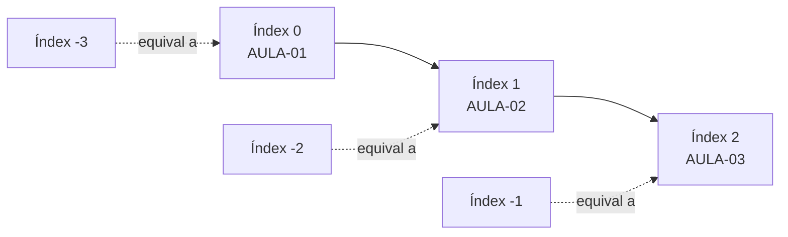

---
hide:
  - navigation
---
# 1. Llistes

## Per què necessitem una col·lecció?

Una variable individual guarda un valor. Si volem controlar vint ordinadors, crear vint variables (`ordinador1`, `ordinador2`, …) fa el programa llarg i difícil de recórrer. Una **llista** agrupa diversos valors en una única variable i conserva l’ordre en què els afegim.

```python
ordinadors = ["AULA-01", "AULA-02", "AULA-03"]
print(ordinadors)
print(len(ordinadors))
```

```text
['AULA-01', 'AULA-02', 'AULA-03']
3
```

Una llista pot estar buida, pot contindre duplicats i és **mutable**: després de crear-la podem canviar-ne el contingut.

```python
lectures = []
lectures.append(42.5)
lectures.append(43.0)
lectures.append(42.5)  # Els duplicats són possibles.
print(lectures)
```

```text
[42.5, 43.0, 42.5]
```

## Índexs: la posició d’un element

Python comença a comptar les posicions des de **0**. Una llista de tres elements té els índexs 0, 1 i 2.



```python
ordinadors = ["AULA-01", "AULA-02", "AULA-03"]
print(ordinadors[0])   # Primer element
print(ordinadors[-1])  # Últim element
```

Un índex que no existeix provoca `IndexError`. Abans d’accedir a una posició concreta, comprova que està dins dels límits.

```python
ordinadors = ["AULA-01", "AULA-02"]
print(ordinadors[2])  # IndexError: la posició 2 no existeix
```

> **Error habitual:** confondre l’índex amb el nombre d’elements. Si `len(ordinadors)` és 2, l’últim índex és `1`, no `2`.

## Fragments amb slicing

El *slicing* extreu una part de la llista amb la forma `llista[inici:final]`. La posició `final` no s’inclou.

```python
ordinadors = ["AULA-01", "AULA-02", "AULA-03", "AULA-04"]
print(ordinadors[1:3])  # Índexs 1 i 2
print(ordinadors[:2])   # Des del principi fins a l’índex 1
print(ordinadors[2:])   # Des de l’índex 2 fins al final
print(ordinadors[::-1]) # Còpia en ordre invers
```

```text
['AULA-02', 'AULA-03']
['AULA-01', 'AULA-02']
['AULA-03', 'AULA-04']
['AULA-04', 'AULA-03', 'AULA-02', 'AULA-01']
```

## Modificar una llista

Podem substituir un element per índex. Aquesta operació modifica la llista original.

```python
ordinadors = ["AULA-01", "AULA-02", "AULA-03"]
ordinadors[1] = "AULA-02-REVISAT"
print(ordinadors)
```

### Afegir i eliminar elements

| Operació | Què fa | Exemple |
| --- | --- | --- |
| `append(valor)` | Afig un element al final | `equips.append("AULA-04")` |
| `extend(altres)` | Afig tots els elements d’una altra col·lecció | `equips.extend(["AULA-04", "AULA-05"])` |
| `insert(posició, valor)` | Insereix en una posició | `equips.insert(0, "SERVIDOR")` |
| `remove(valor)` | Elimina la primera coincidència | `equips.remove("AULA-02")` |
| `pop()` | Elimina i retorna l’últim | `equip = equips.pop()` |
| `pop(posició)` | Elimina i retorna una posició | `equip = equips.pop(0)` |
| `clear()` | Buida la llista | `equips.clear()` |

```python
equips = ["AULA-01", "AULA-02"]
equips.append("AULA-03")
equips.extend(["AULA-04", "AULA-05"])
equips.insert(0, "SERVIDOR")
equips.remove("AULA-02")
retirat = equips.pop()
print(equips)
print(retirat)
```

```text
['SERVIDOR', 'AULA-01', 'AULA-03', 'AULA-04']
AULA-05
```

`remove()` provoca `ValueError` si el valor no hi és. Per això, abans podem usar `in`.

```python
if "AULA-02" in equips:
    equips.remove("AULA-02")
```

## Buscar i comptar

L’operador `in` respon si un element apareix. `index()` dona la primera posició i `count()` compta les aparicions.

```python
lectures = [41.2, 42.0, 43.5, 42.0]
print(43.5 in lectures)
print(lectures.index(42.0))
print(lectures.count(42.0))
```

```text
True
1
2
```

## Ordenar: `sort()` i `sorted()`

`sort()` modifica la llista. `sorted()` crea i retorna una llista nova, de manera que conserva l’original.

```python
temperatures = [43.1, 39.8, 45.2, 41.0]
ordenada = sorted(temperatures)
print(temperatures)
print(ordenada)

temperatures.sort(reverse=True)
print(temperatures)
```

```text
[43.1, 39.8, 45.2, 41.0]
[39.8, 41.0, 43.1, 45.2]
[45.2, 43.1, 41.0, 39.8]
```

## Referències i còpies

Una assignació no crea una llista nova: dos noms poden referir-se a la mateixa llista.

```python
original = ["AULA-01", "AULA-02"]
alias = original
alias.append("AULA-03")
print(original)  # També ha canviat.
```

Amb `copy()` obtenim una còpia independent de primer nivell.

```python
original = ["AULA-01", "AULA-02"]
copia = original.copy()
copia.append("AULA-03")
print(original)
print(copia)
```

> **Idea clau:** si només vols un altre nom per a la mateixa informació, l’assignació és suficient. Si vols modificar una llista sense tocar l’altra, utilitza `copy()`.

## Recórrer una llista

El bucle `for` visita els elements un a un. És la forma més clara quan no necessitem la posició.

```python
equips = ["AULA-01", "AULA-02", "AULA-03"]
for equip in equips:
    print("Revisant", equip)
```

Quan necessitem l’índex, podem utilitzar `range(len(...))`, però `enumerate()` és més llegible.

```python
for i in range(len(equips)):
    print(i, equips[i])

for i, equip in enumerate(equips, start=1):
    print(f"{i}. {equip}")
```

## Iterable i iterador

Una llista és **iterable**: es pot recórrer. `iter()` crea un **iterador**, que recorda en quin element està. `next()` demana el següent element.

```python
equips = ["AULA-01", "AULA-02"]
iterador = iter(equips)
print(next(iterador))
print(next(iterador))

try:
    print(next(iterador))
except StopIteration:
    print("No queden elements")
```

```text
AULA-01
AULA-02
No queden elements
```

El bucle `for` fa internament una tasca semblant: demana elements a l’iterador fins que arriba `StopIteration`. Normalment preferirem `for`; `iter()` i `next()` ens ajuden a entendre el mecanisme.

## Buscar, filtrar i construir llistes

Podem recórrer una llista i construir-ne una altra quan una dada compleix una condició.

```python
temperatures = [39.5, 42.1, 45.0, 41.8, 47.2]
alertes = []

for temperatura in temperatures:
    if temperatura > 44:
        alertes.append(temperatura)

print(alertes)
```

```text
[45.0, 47.2]
```

Una comprensió de llista expressa el mateix de manera compacta. Utilitza-la només quan el recorregut siga senzill.

```python
alertes = [temperatura for temperatura in temperatures if temperatura > 44]
print(alertes)
```

## Recompte i estadístiques

Les operacions agregades transformen molts valors en un resum. Primer és útil entendre el procés amb un bucle.

```python
temperatures = [39.5, 42.1, 45.0]
total = 0
for temperatura in temperatures:
    total += temperatura

mitjana = total / len(temperatures)
print("Total:", total)
print("Mitjana:", mitjana)
```

Després podem utilitzar les funcions incorporades:

```python
temperatures = [39.5, 42.1, 45.0]
print("Total:", sum(temperatures))
print("Mínima:", min(temperatures))
print("Màxima:", max(temperatures))
print("Mitjana:", sum(temperatures) / len(temperatures))
```

Cal tractar la llista buida abans de cridar `min()` o `max()`, perquè aquestes funcions no tenen cap valor per comparar.

```python
temperatures = []
if temperatures:
    print(min(temperatures), max(temperatures))
    print(sum(temperatures) / len(temperatures))
else:
    print("No hi ha lectures")
```

### Exemple guiat: lectures d’un servidor

```python
lectures = [38.4, 41.2, 44.8, 43.1, 46.0]
llindar = 44.0
alertes = []

for posicio, lectura in enumerate(lectures, start=1):
    if lectura > llindar:
        alertes.append(lectura)
        print(f"Alerta en la lectura {posicio}: {lectura} °C")

if lectures:
    print("Lectures:", len(lectures))
    print("Mínima:", min(lectures))
    print("Màxima:", max(lectures))
    print("Mitjana:", round(sum(lectures) / len(lectures), 2))
print("Alertes:", len(alertes))
```

## Exercicis de consolidació

1. Crea una llista amb els noms de sis ordinadors. Mostra el primer, l’últim i els tres primers.
2. Afig un equip nou, elimina’n un i comprova amb `in` si queda un nom concret.
3. Donada la llista `[12, 15, 9, 20, 15]`, mostra la suma, la mínima, la màxima i quantes vegades apareix `15`.
4. Separa en una nova llista les lectures superiors a `70`.
5. Recorre una llista amb `enumerate()` i mostra cada element amb una numeració que comence en 1.
6. Explica amb un exemple per què `copia = original` no és el mateix que `copia = original.copy()`.
7. Usa `iter()` i `next()` per llegir una llista de dos elements i explica què ocorre en la tercera crida.

## Comprova que ho entens

- Quin índex té el segon element d’una llista?
- Quina diferència hi ha entre `sort()` i `sorted()`?
- Per què cal comprovar una llista buida abans de calcular-ne la mitjana?
- Quan preferiries `enumerate()` a `range(len(...))`?

[Següent: diccionaris](02-diccionaris.md) · [Índex de la UP6](index.md)
