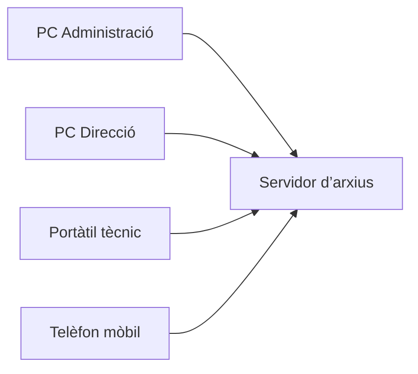
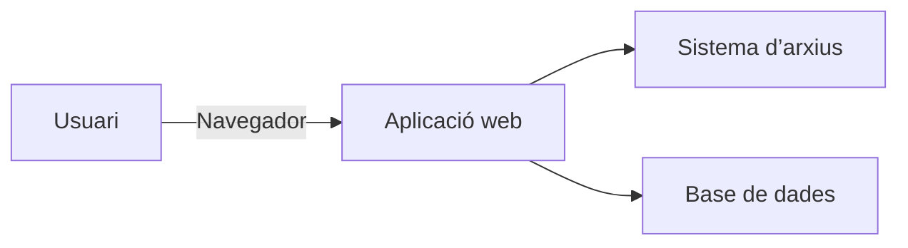
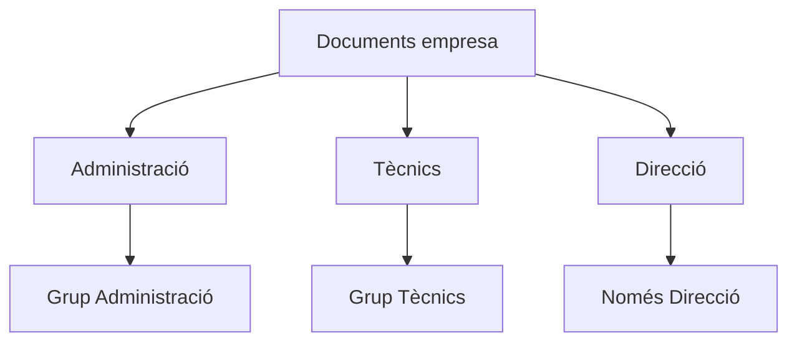

---
hide:
  - navigation
title: "UP3.1. Gestió d’arxius a través del web"
description: "Utilitat, avantatges i aplicacions dels gestors d’arxius web."
---

# UP3.1. Gestió d’arxius a través del web

**Criteris relacionats:** RA3.a i RA3.b

## 1.1. El problema de gestionar arxius

En un ordinador personal és habitual guardar els documents en carpetes:

```text
Documents/
├── Factures/
├── Projectes/
├── Fotos/
└── Treball/
```

Aquest sistema és suficient quan els arxius només han de ser utilitzats per una persona en un únic ordinador.

El problema apareix quan diferents persones necessiten accedir a la mateixa informació. En una empresa, per exemple:

- diferents persones necessiten accedir als mateixos documents;
- alguns arxius només poden ser consultats per determinats departaments;
- els treballadors poden estar físicament en llocs diferents;
- alguns documents s’han de compartir amb clients;
- cal controlar qui pot modificar o eliminar informació;
- és necessari recuperar documents eliminats accidentalment.

Guardar els documents únicament en els ordinadors dels treballadors deixa de ser una solució adequada. Una alternativa consisteix a **centralitzar els arxius en un servidor**.



D’aquesta manera, la informació es troba en un únic sistema i els usuaris accedeixen a ella segons els permisos que tinguen assignats.

## 1.2. Què és un gestor d’arxius web?

Un **gestor d’arxius web** és una aplicació que permet emmagatzemar, organitzar i administrar arxius utilitzant una interfície accessible mitjançant un navegador web.

L’usuari no necessita navegar directament pel sistema de fitxers del servidor. En lloc d’això utilitza una aplicació web:



El gestor actua com una **capa intermèdia** entre l’usuari i els arxius físics. Aquesta capa permet afegir:

- autenticació d’usuaris;
- grups i permisos;
- compartició;
- control de versions;
- paperera;
- etiquetes i comentaris;
- cerca;
- registre d’activitat;
- accés des de diferents dispositius.

!!! info "Aplicació web"
    El navegador no accedeix directament als arxius del disc dur del servidor. És l’aplicació web qui comprova els permisos de l’usuari i decideix quines operacions pot realitzar.

## 1.3. Avantatges d’un gestor d’arxius web

### Accés des de diferents dispositius

Un usuari pot accedir als documents des d’ordinadors, portàtils, tauletes i telèfons mòbils. Només necessita un navegador o, en alguns casos, una aplicació de sincronització.

### Centralització

La informació de l’organització es troba en un sistema centralitzat. Això facilita l’administració, les còpies de seguretat, el control d’accés i la recuperació d’informació.

### Col·laboració

Els mateixos documents poden ser utilitzats per diferents persones:

```text
ProjecteWeb/
├── pressupost.pdf
├── requisits.docx
├── captures/
└── documentacio/
```

La carpeta `ProjecteWeb` podria estar compartida amb tot l’equip encarregat del projecte.

### Control d’accés

No tots els usuaris han de poder accedir a tota la informació.



### Compartició externa

Alguns sistemes permeten generar un enllaç perquè una persona externa puga accedir a un document sense disposar d’un compte intern. Aquestes comparticions poden incorporar contrasenya, data de caducitat, permisos de lectura o permisos d’escriptura.

!!! warning "Comparticions externes"
    Compartir un arxiu mitjançant un enllaç públic facilita el treball amb persones externes, però també augmenta el risc d’accés no autoritzat. Cal limitar els permisos i la durada de la compartició.

## 1.4. Gestor d’arxius web, FTP, SMB i núvol públic

| Tecnologia | Característica principal |
|---|---|
| Carpetes compartides SMB | Compartició d’arxius principalment dins d’una xarxa |
| FTP/SFTP | Transferència d’arxius entre client i servidor |
| Gestor d’arxius web | Gestió completa mitjançant una aplicació web |
| Google Drive / OneDrive | Servei de núvol proporcionat per un tercer |
| Nextcloud | Plataforma que podem instal·lar i administrar nosaltres mateixos |

Un gestor com Nextcloud no es limita a **transferir arxius**. També proporciona una capa de gestió:

```text
                 GESTOR D’ARXIUS WEB
                         │
        ┌────────────────┼─────────────────┐
        │                │                 │
      Usuaris         Arxius          Compartició
        │                │                 │
      Grups           Versions          Enllaços
        │                │                 │
     Permisos          Cerca            Permisos
```

## 1.5. Principals gestors d’arxius web

### Nextcloud

Plataforma de codi obert orientada a crear un servei privat d’emmagatzematge i col·laboració. Permet gestionar arxius, crear usuaris i grups, definir quotes, compartir informació, sincronitzar dispositius i instal·lar aplicacions addicionals.

### ownCloud

Plataforma amb un origen i una filosofia semblants a Nextcloud. Proporciona funcionalitats d’emmagatzematge, compartició i sincronització.

### File Browser

Solució més senzilla centrada principalment en proporcionar una interfície web per gestionar arxius. Pot ser interessant quan no necessitem totes les funcions d’una plataforma col·laborativa completa.

!!! tip "No existeix una ferramenta perfecta"
    L’elecció d’un gestor depén de les necessitats de l’organització: quantitat d’usuaris, funcionalitats, recursos del servidor, manteniment, seguretat i integració amb altres servicis.

