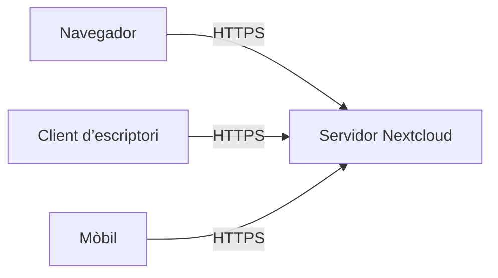
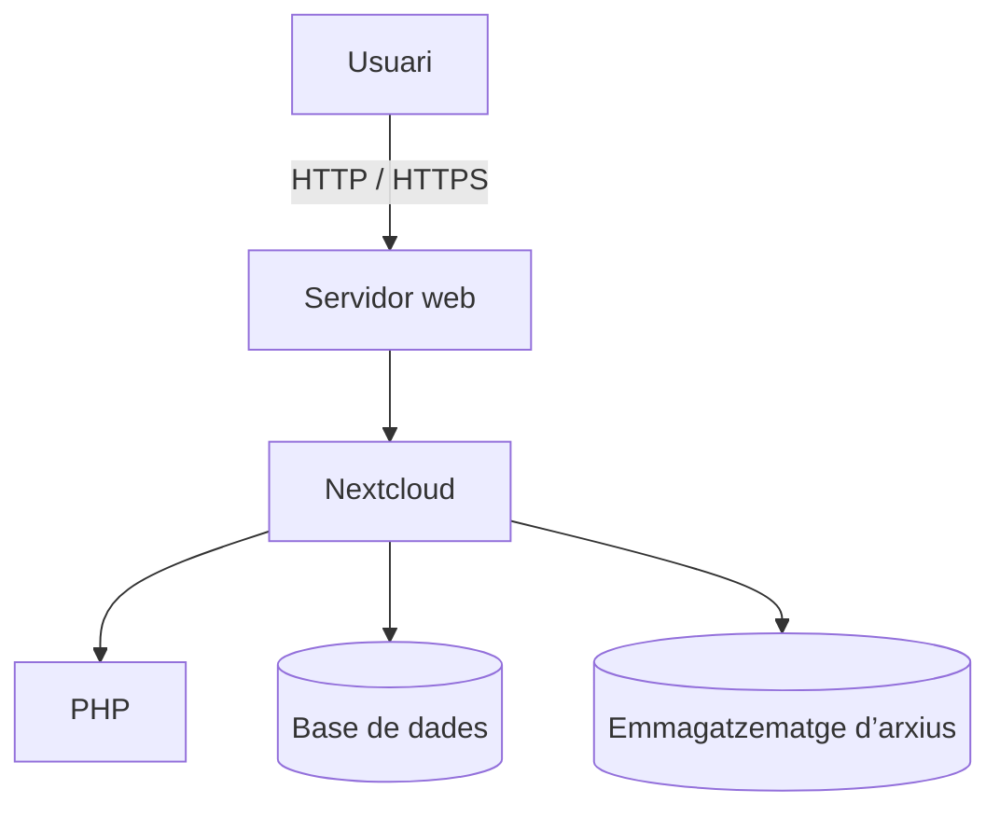
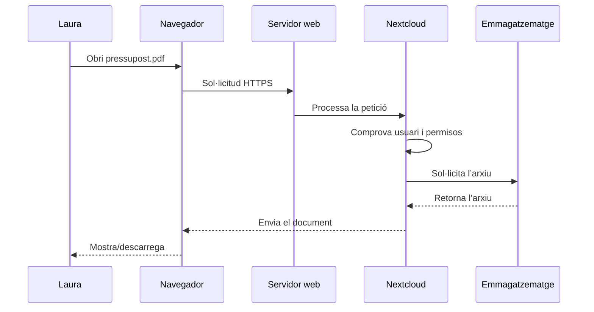
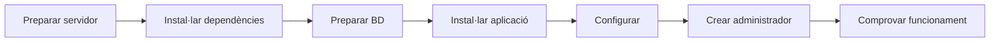
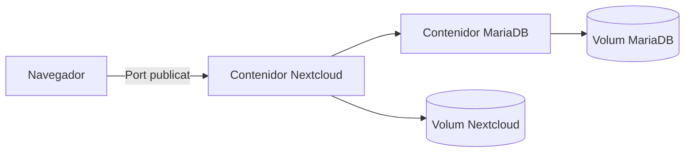
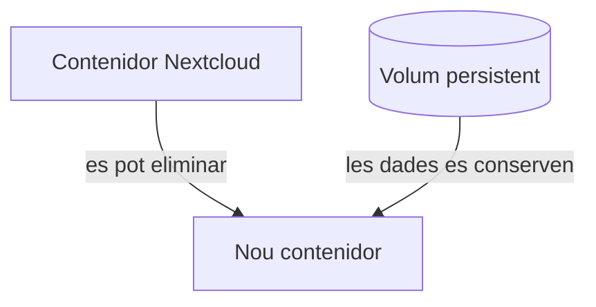
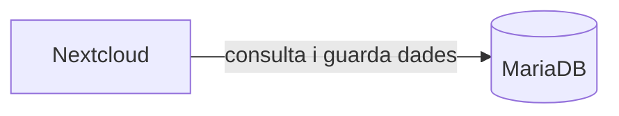

---
hide:
  - navigation
title: "UP3.2. Arquitectura i instal·lació d’un gestor d’arxius web"
description: "Arquitectura client-servidor, components i procés d’instal·lació de Nextcloud."
---

# UP3.2. Arquitectura i instal·lació d’un gestor d’arxius web

**Criteri relacionat:** RA3.c

## 2.1. Un gestor d’arxius és una aplicació client-servidor

Quan utilitzem Nextcloud existeixen dos elements principals.

### Client

És el dispositiu utilitzat per l’usuari:

- navegador;
- aplicació mòbil;
- client de sincronització.

### Servidor

És l’equip que executa Nextcloud i emmagatzema la informació.



Aquesta arquitectura permet que molts usuaris utilitzen el mateix servei simultàniament.

## 2.2. Components del servidor

Nextcloud no funciona de manera aïllada. Necessita diferents components:



### Servidor web

Rep les peticions procedents dels navegadors. Alguns exemples són Apache i Nginx.

### PHP

Nextcloud està desenvolupat principalment amb PHP, per la qual cosa el servidor necessita un entorn capaç d’executar-lo.

### Base de dades

La base de dades emmagatzema informació relacionada amb el funcionament del sistema, com ara usuaris, configuració, comparticions, aplicacions i metadades.

!!! warning "Base de dades ≠ arxius"
    Els documents pujats pels usuaris no es guarden normalment com un gran conjunt de documents dins de la base de dades. La base de dades guarda principalment informació sobre el sistema i els seus recursos, mentre que els fitxers s’emmagatzemen en l’espai configurat.

### Emmagatzematge

És l’espai físic on s’emmagatzemen els arxius dels usuaris. Pot estar format per discos locals, volums dedicats, sistemes d’emmagatzematge externs o recursos de xarxa.

## 2.3. Què passa quan obrim un arxiu?

Suposem que Laura inicia sessió i intenta descarregar:

```text
/Projectes/client-a/pressupost.pdf
```

Simplificant molt el procés:



La comprovació de permisos és una diferència fonamental respecte a accedir directament al sistema de fitxers.

## 2.4. Procés general d’instal·lació

Independentment de la ferramenta concreta, una instal·lació sol seguir una seqüència semblant:



### 1. Preparar el servidor

Cal disposar d’un sistema operatiu funcional i connexió de xarxa.

### 2. Instal·lar els components necessaris

Servidor web, llenguatge de servidor, base de dades i altres dependències.

### 3. Preparar la base de dades

És recomanable utilitzar un usuari específic de base de dades amb els permisos necessaris sobre la base de dades de Nextcloud.

### 4. Instal·lar l’aplicació

S’instal·len els fitxers de Nextcloud en el servidor.

### 5. Configurar el servei

S’indiquen, entre altres elements, les dades de connexió a la base de dades, el directori de dades, l’administrador inicial i la URL o domini utilitzat.

### 6. Comprovar el funcionament

Una instal·lació no està acabada fins que hem comprovat que podem accedir des del navegador, iniciar sessió, pujar i descarregar arxius i que no apareixen errors importants de configuració.

!!! important "Instal·lar no és només copiar fitxers"
    Una aplicació web depén de diversos servicis. Quan alguna cosa falla hem d’identificar en quina capa es troba el problema: xarxa, servidor web, PHP, base de dades, permisos o configuració de l’aplicació.

## 2.5. Desplegament mitjançant contenidors

Nextcloud es pot instal·lar de manera tradicional sobre un servidor o es pot desplegar mitjançant contenidors. Les dues opcions necessiten els mateixos components, però els organitzen i els executen de manera diferent.

### Instal·lació tradicional i desplegament amb contenidors

En una instal·lació tradicional, els components s’instal·len directament en el sistema operatiu del servidor:

```text
Servidor
├── Apache
├── PHP
├── MariaDB
└── Nextcloud
```

En un desplegament amb contenidors, cada servei s’executa en un entorn separat:



!!! info "Docker no elimina l’arquitectura"
    Encara que utilitzem contenidors, Nextcloud continua necessitant els components necessaris per executar l’aplicació i una base de dades.

    Docker simplement canvia la forma en què aquests servicis es despleguen i s’aïllen.

Docker no és el gestor d’arxius. És el mitjà que utilitzem per empaquetar, desplegar i aïllar els servicis que formen Nextcloud.

### Conceptes mínims de Docker

Per entendre la pràctica només necessitem aquests conceptes:

| Concepte | Explicació |
|---|---|
| **Imatge** | Plantilla a partir de la qual es crea un contenidor. |
| **Contenidor** | Instància en execució creada a partir d’una imatge. |
| **Port** | Permet accedir des de l’exterior a un servei que funciona dins del contenidor. |
| **Volum** | Espai d’emmagatzematge que permet conservar dades de manera persistent. |
| **Variable d’entorn** | Valor de configuració que es proporciona al servei, com ara un usuari o una contrasenya. |
| **Docker Compose** | Ferramenta que permet definir i executar diversos contenidors relacionats. |

### Persistència de les dades

Un contenidor es pot aturar, eliminar i tornar a crear. Per això, les dades importants no haurien de dependre únicament del sistema de fitxers intern del contenidor.



!!! important "Persistència"
    Un contenidor es pot eliminar i tornar a crear.

    Les dades que han de conservar-se s’han d’emmagatzemar en volums persistents.

En el cas de Nextcloud, cal conservar com a mínim els arxius dels usuaris i la informació de la base de dades. En la pràctica comprovarem que aquestes dades continuen disponibles encara que recreem els contenidors.

### Docker Compose

Docker Compose permet descriure en un únic fitxer els servicis necessaris per executar una aplicació formada per diversos contenidors. En el nostre cas, el desplegament tindrà, com a mínim, un servei per a Nextcloud i un altre per a MariaDB:

```yaml
services:
  nextcloud:
    ...

  db:
    ...
```

En aquest fitxer es poden definir els servicis, les imatges, els ports, els volums, les variables d’entorn i les relacions entre contenidors. El fitxer funcional formarà part de l’activitat pràctica.

### Comunicació entre contenidors

Els contenidors d’un mateix desplegament poden comunicar-se entre ells. Nextcloud utilitza MariaDB per consultar i guardar la informació del sistema:



Nextcloud necessita accedir a MariaDB, però l’usuari no necessita accedir directament a la base de dades. Per això, normalment només es publica el port necessari per accedir a la interfície web de Nextcloud; la comunicació amb MariaDB es realitza internament entre els contenidors.
