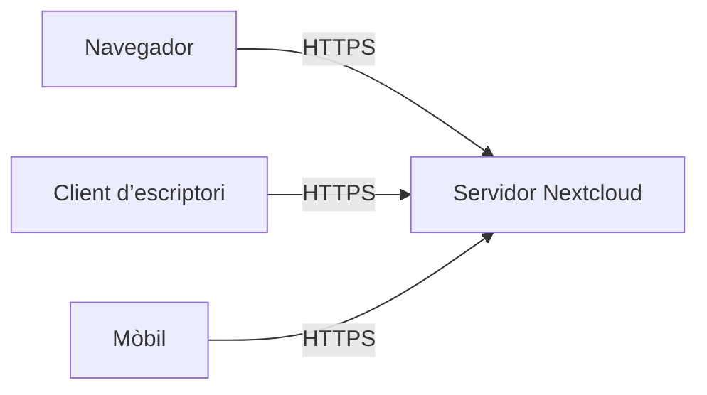
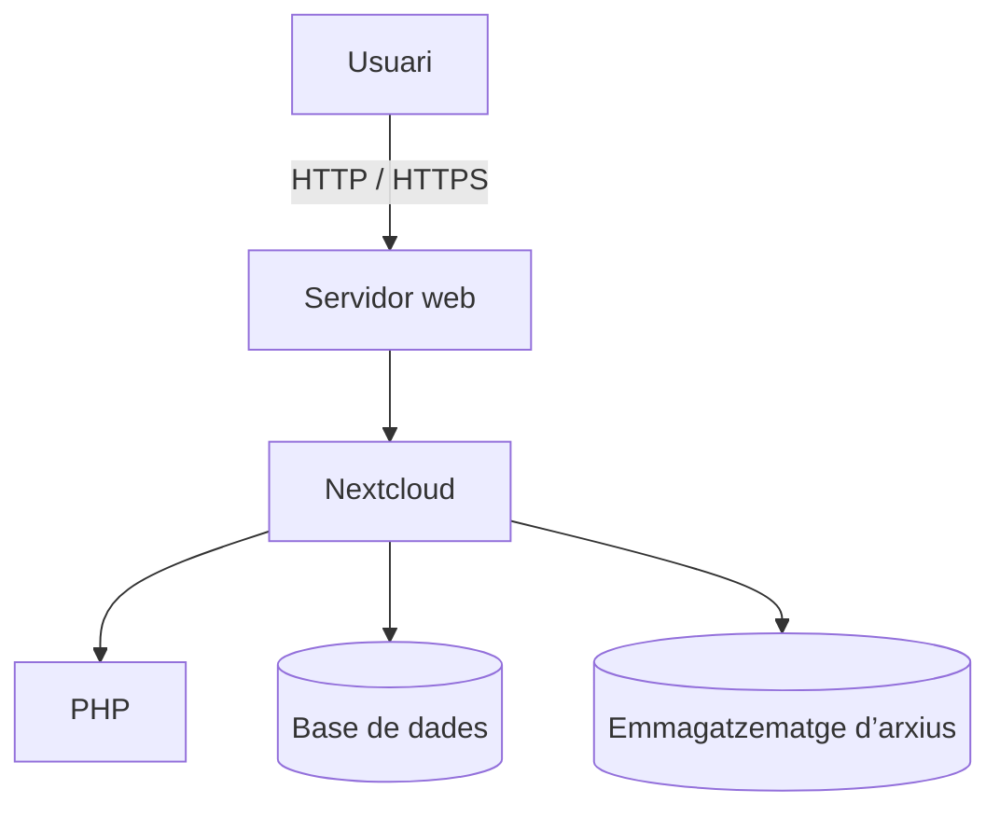
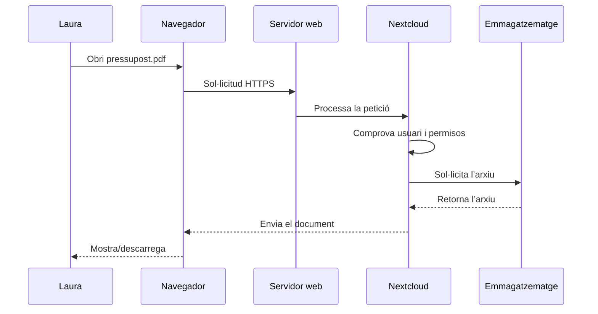
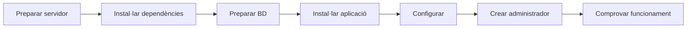

---
hide:
  - navigation
title: "UP3.2. Arquitectura i instal·lació d’un gestor d’arxius web"
description: "Arquitectura client-servidor, components i procés d’instal·lació de Nextcloud."
---

# UP3.2. Arquitectura i instal·lació d’un gestor d’arxius web

**Criteri relacionat:** RA3.c

## 2.1. Un gestor d’arxius és una aplicació client-servidor

Quan utilitzem Nextcloud existeixen dos elements principals.

### Client

És el dispositiu utilitzat per l’usuari:

- navegador;
- aplicació mòbil;
- client de sincronització.

### Servidor

És l’equip que executa Nextcloud i emmagatzema la informació.



Aquesta arquitectura permet que molts usuaris utilitzen el mateix servei simultàniament.

## 2.2. Components del servidor

Nextcloud no funciona de manera aïllada. Necessita diferents components:



### Servidor web

Rep les peticions procedents dels navegadors. Alguns exemples són Apache i Nginx.

### PHP

Nextcloud està desenvolupat principalment amb PHP, per la qual cosa el servidor necessita un entorn capaç d’executar-lo.

### Base de dades

La base de dades emmagatzema informació relacionada amb el funcionament del sistema, com ara usuaris, configuració, comparticions, aplicacions i metadades.

!!! warning "Base de dades ≠ arxius"
    Els documents pujats pels usuaris no es guarden normalment com un gran conjunt de documents dins de la base de dades. La base de dades guarda principalment informació sobre el sistema i els seus recursos, mentre que els fitxers s’emmagatzemen en l’espai configurat.

### Emmagatzematge

És l’espai físic on s’emmagatzemen els arxius dels usuaris. Pot estar format per discos locals, volums dedicats, sistemes d’emmagatzematge externs o recursos de xarxa.

## 2.3. Què passa quan obrim un arxiu?

Suposem que Laura inicia sessió i intenta descarregar:

```text
/Projectes/client-a/pressupost.pdf
```

Simplificant molt el procés:



La comprovació de permisos és una diferència fonamental respecte a accedir directament al sistema de fitxers.

## 2.4. Procés general d’instal·lació

Independentment de la ferramenta concreta, una instal·lació sol seguir una seqüència semblant:



### 1. Preparar el servidor

Cal disposar d’un sistema operatiu funcional i connexió de xarxa.

### 2. Instal·lar els components necessaris

Servidor web, llenguatge de servidor, base de dades i altres dependències.

### 3. Preparar la base de dades

És recomanable utilitzar un usuari específic de base de dades amb els permisos necessaris sobre la base de dades de Nextcloud.

### 4. Instal·lar l’aplicació

S’instal·len els fitxers de Nextcloud en el servidor.

### 5. Configurar el servei

S’indiquen, entre altres elements, les dades de connexió a la base de dades, el directori de dades, l’administrador inicial i la URL o domini utilitzat.

### 6. Comprovar el funcionament

Una instal·lació no està acabada fins que hem comprovat que podem accedir des del navegador, iniciar sessió, pujar i descarregar arxius i que no apareixen errors importants de configuració.

!!! important "Instal·lar no és només copiar fitxers"
    Una aplicació web depén de diversos servicis. Quan alguna cosa falla hem d’identificar en quina capa es troba el problema: xarxa, servidor web, PHP, base de dades, permisos o configuració de l’aplicació.

