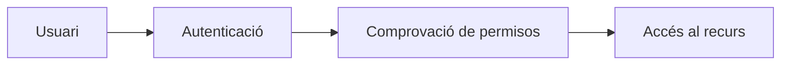
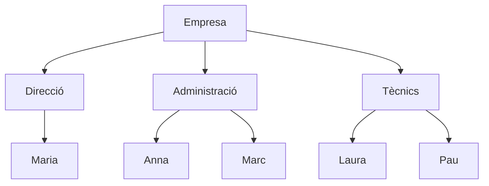

---
hide:
  - navigation
title: "UP3.3. Usuaris, permisos i gestió d’arxius"
description: "Autenticació, autorització, comptes, grups, quotes, permisos i compartició."
---

# UP3.3. Usuaris, permisos i gestió d’arxius

**Criteris relacionats:** RA3.d i RA3.e

## 3.1. Autenticació i autorització

Són dos conceptes diferents.

### Autenticació

Respon a la pregunta:

> **Qui eres?**

Normalment es realitza mitjançant:

```text
usuari + contrasenya
```

### Autorització

Respon a:

> **Què pots fer?**

Una vegada identificat l’usuari, el sistema determina a quins recursos pot accedir i quines operacions pot realitzar.



!!! example "Exemple"
    Laura pot iniciar sessió correctament. Això significa que està **autenticada**. Però si intenta obrir una carpeta de Direcció i el sistema ho impedeix, està actuant el mecanisme d’**autorització**.

## 3.2. Comptes d’usuari

Cada persona que utilitza el servei hauria de disposar del seu propi compte. Un compte pot tindre associats identificador, nom, contrasenya, correu electrònic, grups, quota i permisos.

Evitar comptes compartits facilita saber qui ha realitzat cada acció.

## 3.3. Grups

Els grups permeten administrar permisos de manera més eficient. Imaginem 30 treballadors: seria poc pràctic configurar manualment els permisos de cadascun. En lloc d’això podem crear:

```text
Direccio
Administracio
Tecnics
Comercial
```

I assignar els usuaris:



Després podem compartir una carpeta directament amb el grup `Tecnics`. Si demà entra un treballador nou, només hem d’afegir-lo al grup.

## 3.4. Quotes d’emmagatzematge

Una **quota** limita la quantitat d’espai que pot utilitzar un usuari.

| Usuari | Quota |
|---|---:|
| Maria | 20 GB |
| Anna | 10 GB |
| Pau | 5 GB |

Les quotes eviten que un únic usuari consumisca accidentalment tot l’espai del servidor.

!!! example
    Si el servidor disposa de 500 GB i un usuari puja 450 GB de vídeos, podria deixar sense espai la resta de l’organització. Una política de quotes ajuda a evitar aquesta situació.

## 3.5. Principi de mínim privilegi

Un principi fonamental de seguretat és:

> **Cada usuari ha de disposar únicament dels permisos necessaris per realitzar el seu treball.**

No hauríem de donar permisos d’administrador simplement perquè resulte més còmode.

```text
Administrador
      │
      ├── Configuració global
      ├── Usuaris
      ├── Aplicacions
      └── Servidor

Usuari normal
      │
      ├── Els seus arxius
      ├── Recursos compartits
      └── Funcions autoritzades
```

!!! warning
    Donar permisos excessius augmenta les conseqüències d’un error humà, d’una contrasenya robada o d’un compte compromés.

## 3.6. Operacions sobre arxius i directoris

Un gestor d’arxius permet realitzar les operacions habituals:

- crear carpetes;
- pujar arxius;
- descarregar;
- copiar;
- moure;
- reanomenar;
- eliminar;
- restaurar;
- compartir.

A més, un gestor web sol afegir funcionalitats extra, com versions, historial d’activitat o comentaris.

## 3.7. Compartir no significa necessàriament fer públic

### Compartició interna

```text
pressupost.xlsx
      │
      └── Compartit amb: grup Administració
```

Només els usuaris autoritzats del sistema poden accedir-hi.

### Compartició externa

```text
pressupost.pdf
      │
      └── Enllaç públic
             │
             ├── contrasenya
             ├── caducitat
             └── només lectura
```

!!! danger "Enllaç públic"
    Un enllaç públic elimina la necessitat que el receptor tinga un compte intern. Per això s’han d’utilitzar amb cura i aplicar proteccions com contrasenyes, dates de caducitat i permisos restrictius.

## 3.8. Propietat i compartició

La **propietat** d’un arxiu o una carpeta i l’**accés** que té una altra persona mitjançant una compartició són conceptes diferents.

```text
Anna
└── Projectes/
    └── client-a/
```

Anna pot ser la propietària de la carpeta i compartir-la amb el grup `Tecnics`:

```text
Grup: Tecnics

Permisos:
✓ Lectura
✓ Creació
✓ Modificació
✗ Compartició
```

Tindre accés a una carpeta no significa necessàriament ser-ne el propietari. Una compartició pot concedir operacions diferents:

- lectura;
- creació;
- modificació;
- eliminació;
- compartició.

Els permisos s’han d’assignar aplicant el principi de mínim privilegi: cada usuari o grup ha de poder fer només les operacions necessàries per al seu treball.
