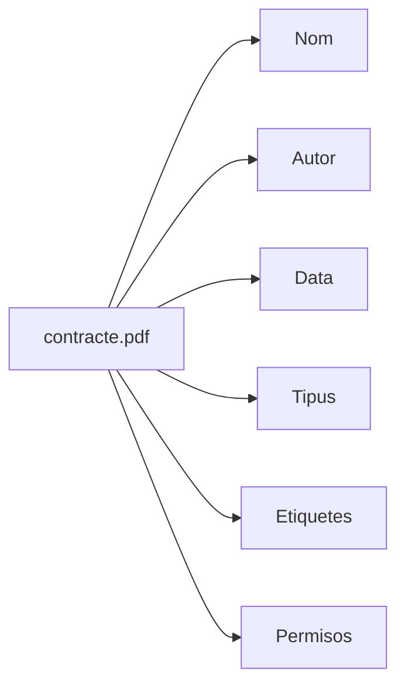
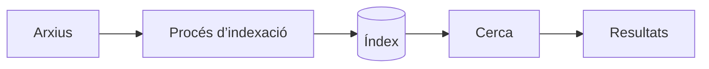

---
hide:
  - navigation
title: "UP3.4. Informació addicional, metadades i indexació"
description: "Metadades, etiquetes, comentaris, historial, organització i indexació d’arxius."
---

# UP3.4. Informació addicional, metadades i indexació

**Criteris relacionats:** RA3.f i RA3.g

## 4.1. Un arxiu és més que el seu contingut

Considerem aquest document:

```text
contracte-client-a.pdf
```

A més del contingut del PDF existeix molta informació relacionada amb ell:

```text
Nom: contracte-client-a.pdf
Tipus: PDF
Mida: 2,4 MB
Propietari: Anna
Data de modificació: 14/11/2026
Etiquetes: client-a, contracte
Compartit amb: Direcció
Comentaris: Revisat
```

Aquesta informació ajuda a **descriure, classificar i localitzar** el document.

## 4.2. Metadades

Les **metadades** són dades que descriuen altres dades. Podem entendre-les com una fitxa associada a un recurs.



Exemples de metadades són autor, data de creació, data de modificació, tipus MIME, mida, etiquetes, descripció i propietari.

## 4.3. Etiquetes

Una etiqueta permet classificar un recurs independentment de la carpeta on estiga guardat:

```text
factura-001.pdf
    #client-a
    #2026
    #pendent
```

I:

```text
pressupost.pdf
    #client-a
    #2026
    #aprovat
```

Podem recuperar després tots els documents relacionats amb `#client-a` sense necessitat que estiguen en la mateixa carpeta.

## 4.4. Comentaris i historial

La informació addicional també pot facilitar la col·laboració:

```text
pressupost-v2.pdf

Anna:
"He actualitzat els preus."

Marc:
"Revisat. Falta modificar l’IVA."
```

El registre d’activitat permet saber que un arxiu ha sigut creat, modificat, compartit o comentat. Aquest tipus d’informació proporciona **context** al document.

## 4.5. El problema de trobar informació

Amb 20 arxius és fàcil trobar un document. Amb 200.000 no.

```text
documents/
├── document1.pdf
├── document2.pdf
├── final.pdf
├── final2.pdf
├── final-definitiu.pdf
├── nou.pdf
├── copia.pdf
└── ...
```

Aquesta estructura funciona malament perquè els documents no segueixen cap criteri.

## 4.6. Criteris d’organització

Una bona gestió documental pot utilitzar diferents criteris.

### Estructura de directoris

```text
Empresa/
├── Administracio/
│   ├── 2025/
│   └── 2026/
├── Clients/
│   ├── Client-A/
│   └── Client-B/
└── Projectes/
```

### Nomenclatura

En lloc de `factura nova final.pdf`, podem utilitzar:

```text
2026-11-001_ClientA_Factura.pdf
```

### Etiquetes i metadades

```text
#client-a
#factura
#2026

Client: Client A
Any: 2026
Tipus: Factura
Estat: Pagada
```

## 4.7. Què és indexar?

Un **índex** és una estructura que permet trobar informació més ràpidament. Podem comparar-lo amb l’índex d’un llibre: sense índex hem de revisar totes les pàgines; amb índex sabem directament on es troba el concepte.

En un gestor d’arxius:



L’índex pot contindre informació com nom, ruta, tipus, propietari, etiquetes i metadades.

!!! info
    Indexar no significa duplicar necessàriament l’arxiu. Normalment s’emmagatzema informació que permet localitzar-lo ràpidament.

## 4.8. Cerca i indexació

Quan un usuari escriu `contracte client A`, el sistema no hauria de revisar manualment tots els fitxers cada vegada. Pot consultar un índex preparat prèviament:

```text
CERCA
  ↓
"client-a"
  ↓
ÍNDEX
  ↓
├── contracte-client-a.pdf
├── pressupost-client-a.xlsx
└── factura-client-a.pdf
```

!!! tip "Organitzar abans d’indexar"
    Un bon motor de cerca no substitueix una bona política d’organització. Utilitzar noms coherents, carpetes adequades i etiquetes útils facilita enormement la recuperació de la informació.

