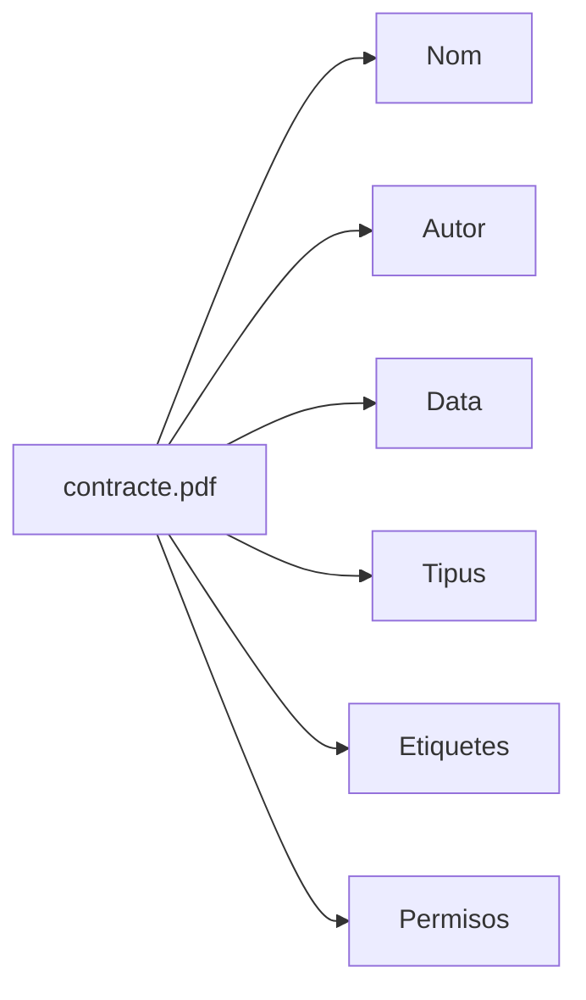
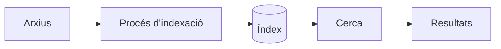

---
hide:
  - navigation
title: "UP3.4. Informació addicional, metadades i indexació"
description: "Metadades, etiquetes, comentaris, historial, organització i indexació d’arxius."
---

# UP3.4. Informació addicional, metadades i indexació

**Criteris relacionats:** RA3.f i RA3.g

## 4.1. Un arxiu és més que el seu contingut

Considerem aquest document:

```text
contracte-client-a.pdf
```

A més del contingut del PDF existeix molta informació relacionada amb ell:

```text
Nom: contracte-client-a.pdf
Tipus: PDF
Mida: 2,4 MB
Propietari: Anna
Data de modificació: 14/11/2026
Etiquetes: client-a, contracte
Compartit amb: Direcció
Comentaris: Revisat
```

Aquesta informació ajuda a **descriure, classificar i localitzar** el document.

## 4.2. Metadades

Les **metadades** són dades que descriuen altres dades. Podem entendre-les com una fitxa associada a un recurs.



Exemples de metadades són autor, data de creació, data de modificació, tipus MIME, mida, etiquetes, descripció i propietari.

## 4.3. Etiquetes

Una etiqueta permet classificar un recurs independentment de la carpeta on estiga guardat:

```text
factura-001.pdf
    #client-a
    #2026
    #pendent
```

I:

```text
pressupost.pdf
    #client-a
    #2026
    #aprovat
```

Podem recuperar després tots els documents relacionats amb `#client-a` sense necessitat que estiguen en la mateixa carpeta.

## 4.4. Comentaris i historial

La informació addicional també pot facilitar la col·laboració:

```text
pressupost-v2.pdf

Anna:
"He actualitzat els preus."

Marc:
"Revisat. Falta modificar l’IVA."
```

El registre d’activitat permet saber que un arxiu ha sigut creat, modificat, compartit o comentat. Aquest tipus d’informació proporciona **context** al document.

### Arxius d’informació addicional: `LLEGIR-ME`

A més de les metadades que mostra el gestor, un equip pot guardar **un arxiu explicatiu dins d’una carpeta**. És útil quan altres persones necessiten saber què conté, quins documents s’hi poden guardar i com s’han d’anomenar.

Un exemple habitual és `LLEGIR-ME.md` o `LLEGIR-ME.txt`. Aquest arxiu pot incloure instruccions breus sobre l’ús de la carpeta.

**Exemple de contingut per a `Compartit/LLEGIR-ME.md`:**

```markdown
# Carpeta Compartit — ByteSolutions

## Finalitat
Espai per als documents que han de consultar diferents departaments.

## Què s’hi pot guardar?
Plantilles, instruccions comunes i documents de treball no confidencials.

## Com anomenar els documents?
ANY-MES_CLIENT_TIPUS.extensió

Exemple: 2026-11_ClientA_Pressupost.pdf

## Qui hi té accés?
Els treballadors autoritzats de ByteSolutions, segons les comparticions.
```

Un `LLEGIR-ME` **no substituïx** els permisos d’accés ni les metadades de Nextcloud: els complementa amb informació comprensible per a les persones que utilitzen la carpeta.

!!! info "Relació amb el CA3.f"
    En la pràctica crearàs un arxiu `LLEGIR-ME` i utilitzaràs informació addicional d’alguns documents, com ara comentaris o etiquetes.

## 4.5. El problema de trobar informació

Amb 20 arxius és fàcil trobar un document. Amb 200.000 no.

```text
documents/
├── document1.pdf
├── document2.pdf
├── final.pdf
├── final2.pdf
├── final-definitiu.pdf
├── nou.pdf
├── copia.pdf
└── ...
```

Aquesta estructura funciona malament perquè els documents no segueixen cap criteri.

## 4.6. Criteris d’organització

Una bona gestió documental pot utilitzar diferents criteris.

### Estructura de directoris

```text
Empresa/
├── Administracio/
│   ├── 2025/
│   └── 2026/
├── Clients/
│   ├── Client-A/
│   └── Client-B/
└── Projectes/
```

### Nomenclatura

En lloc de `factura nova final.pdf`, podem utilitzar:

```text
2026-11-001_ClientA_Factura.pdf
```

### Etiquetes i metadades

```text
#client-a
#factura
#2026

Client: Client A
Any: 2026
Tipus: Factura
Estat: Pagada
```

## 4.7. Què és indexar?

Un **índex** és una estructura que permet trobar informació més ràpidament. Podem comparar-lo amb l’índex d’un llibre: sense índex hem de revisar totes les pàgines; amb índex sabem directament on es troba el concepte.

En un gestor d’arxius:



L’índex pot contindre informació com nom, ruta, tipus, propietari, etiquetes i metadades.

!!! info
    Indexar no significa duplicar necessàriament l’arxiu. Normalment s’emmagatzema informació que permet localitzar-lo ràpidament.

## 4.8. Cerca i indexació

Quan un usuari escriu `contracte client A`, el sistema no hauria de revisar manualment tots els fitxers cada vegada. Pot consultar un índex preparat prèviament:

```text
CERCA
  ↓
"client-a"
  ↓
ÍNDEX
  ↓
├── contracte-client-a.pdf
├── pressupost-client-a.xlsx
└── factura-client-a.pdf
```

!!! tip "Organitzar abans d’indexar"
    Un bon motor de cerca no substitueix una bona política d’organització. Utilitzar noms coherents, carpetes adequades i etiquetes útils facilita enormement la recuperació de la informació.

## 4.9. Cerca bàsica i cerca de text complet

La indexació i la cerca bàsica no són necessàriament el mateix que una cerca de text complet.

Una **cerca bàsica** pot utilitzar la informació que el gestor ja coneix sobre l’arxiu:

```text
Cerca bàsica
    ↓
nom + ruta + metadades + etiquetes
```

Una **cerca de text complet** intenta trobar paraules dins del contingut dels documents:

```text
Cerca de text complet
    ↓
contingut dins de PDF, DOCX, etc.
```

Per tant, una instal·lació bàsica pot permetre buscar per nom, ruta, propietari o etiquetes sense analitzar necessàriament el text intern de tots els documents. Les dues cerques poden requerir configuracions i recursos diferents.

#### De la classificació a la cerca: comprovació real

Organitzar els documents ajuda a trobar-los, però **posar noms correctes als fitxers no és el mateix que instal·lar o configurar un motor d’indexació**.

En l’activitat aplicarem criteris de classificació que faciliten la recuperació de la informació:

- **Nomenclatura coherent:** `2026-11_ClientA_Pressupost.pdf`.
- **Estructura de carpetes:** separar la documentació per departaments i projectes.
- **Etiquetes:** classificar els documents per client o estat, si aquesta funció està disponible i habilitada en la instal·lació.
- **Prova de cerca:** introduir una paraula del nom d’un document i comprovar que es recupera el fitxer esperat.
- **Prova de filtratge:** consultar arxius associats a una etiqueta o utilitzar els filtres que realment oferix la instal·lació.

**Exemple de comprovació:**

1. Crea `2026-11_ClientA_Pressupost.pdf` i `2026-11_ClientB_Informe.pdf`.
2. Comprova que pots localitzar el primer document escrivint `ClientA` o `Pressupost` en una cerca compatible amb la teua versió.
3. Si tens disponible la vista o el filtratge per etiquetes, associa i consulta una etiqueta comuna.
4. Explica **quin camp o característica ha utilitzat realment la cerca** i quins límits has observat.

!!! warning "No confongues les funcionalitats"
    Un resultat de cerca per **nom** no demostra que Nextcloud haja indexat i siga capaç de buscar el **contingut interior** d’un document PDF. La cerca de text complet pot requerir aplicacions o configuració addicionals.

!!! tip "La interfície pot canviar"
    Els noms dels menús i les opcions d’etiquetatge/filtratge poden variar segons la versió i les aplicacions habilitades. Si no apareix una opció, no inventes el resultat: indica què has pogut comprovar amb la instal·lació disponible.

**Important per a l’avaluació:** l’actual A3.2 demana aplicar criteris de nomenclatura i etiquetes, i provar la cerca. Açò proporciona evidències de classificació i recuperació, però **no necessàriament de configuració tècnica d’un índex**. No presentes com a fet una indexació avançada que l’alumnat no fa. Si el docent vol exigir una evidència d’indexació més estricta per al CA3.g, serà necessari revisar **també** l’enunciat i la rúbrica en un encàrrec posterior. **No ho canvies ara.**
