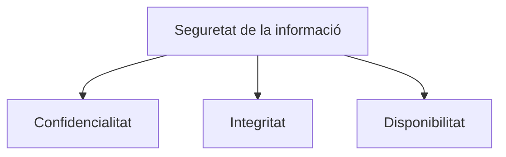
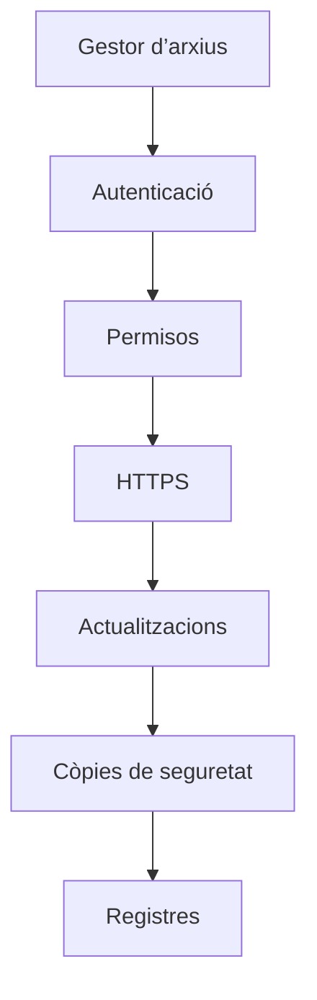
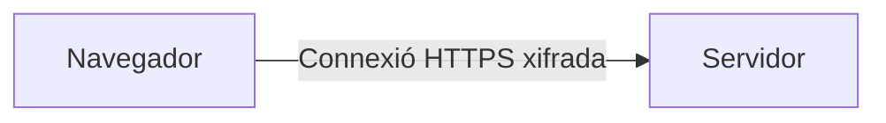
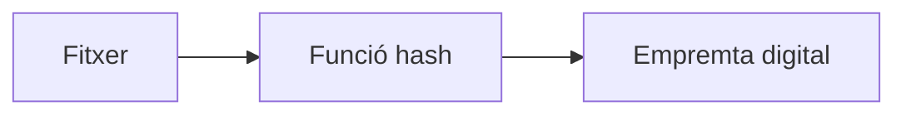
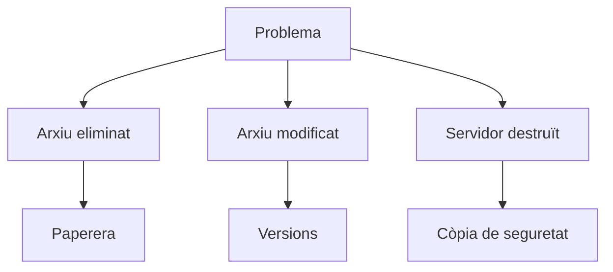
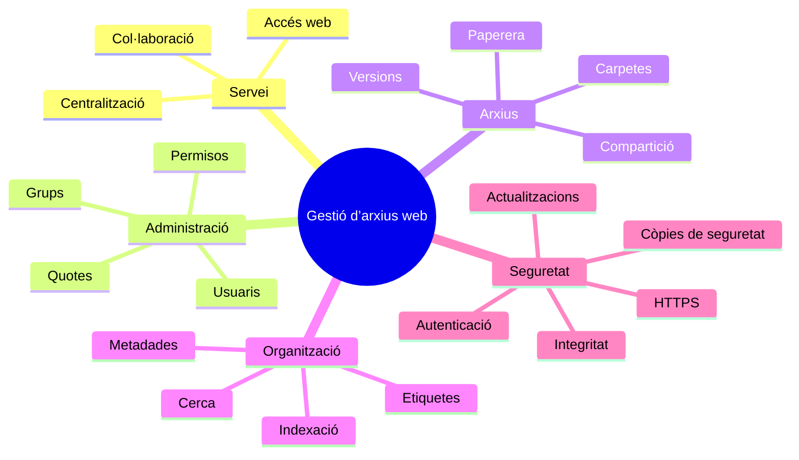

---
hide:
  - navigation
title: "UP3.5. Seguretat i integritat del gestor d’arxius"
description: "Confidencialitat, integritat, disponibilitat, HTTPS, actualitzacions, còpies i registres."
---

# UP3.5. Seguretat i integritat del gestor d’arxius

**Criteri relacionat:** RA3.h

Un gestor d’arxius pot contindre gran part de la informació d’una organització. Per tant, la seua seguretat és especialment important.

## 5.1. Què volem protegir?

En seguretat de la informació solem considerar tres propietats fonamentals:



### Confidencialitat

Només les persones autoritzades poden accedir a la informació.

### Integritat

La informació no ha de ser modificada de manera no autoritzada o accidental.

### Disponibilitat

Els usuaris autoritzats han de poder accedir al servei quan el necessiten.

!!! example
    Si un atacant roba una factura tenim un problema de **confidencialitat**. Si modifica l’import de la factura tenim un problema d’**integritat**. Si provoca que el servidor deixe de funcionar tenim un problema de **disponibilitat**.

## 5.2. Principals riscos

Un gestor d’arxius pot patir robatori de contrasenyes, permisos incorrectes, comparticions públiques accidentals, vulnerabilitats sense corregir, malware, eliminació accidental, modificació d’arxius, fallades del disc o pèrdua del servidor.

Per això la seguretat s’ha d’aplicar en diferents capes:



## 5.3. Contrasenyes i autenticació

Els comptes han d’utilitzar contrasenyes adequades. És especialment important protegir els comptes d’administració.

Una capa addicional és l’**autenticació de dos factors (2FA)**:

```text
Factor 1
Contrasenya

        +

Factor 2
Codi temporal / dispositiu

        ↓

      ACCÉS
```

## 5.4. Protecció contra força bruta

Un atacant podria provar automàticament milers de contrasenyes:

```text
admin / admin
admin / password
admin / 123456
admin / qwerty
...
```

Això es coneix com un atac de **força bruta**. Els gestors moderns poden incorporar mecanismes que retarden o bloquegen temporalment intents sospitosos repetits.

## 5.5. HTTPS

Quan utilitzem HTTP, les comunicacions no disposen de la protecció proporcionada per TLS. Amb HTTPS:



Això protegeix les dades mentre circulen per la xarxa, especialment les credencials, els arxius, les cookies de sessió i la informació privada.

!!! danger
    Un gestor d’arxius amb informació sensible no hauria d’exposar-se a Internet utilitzant únicament HTTP.

## 5.6. Comparticions

Les comparticions són una de les funcionalitats més útils, però també una font habitual de riscos. Abans de crear un enllaç públic hem de preguntar-nos:

- Qui necessita l’arxiu?
- Durant quant de temps?
- Necessita editar-lo?
- Podem exigir contrasenya?
- Podem establir caducitat?

La regla general és:

> **Concedir el mínim accés durant el mínim temps necessari.**

## 5.7. Actualitzacions

Una vulnerabilitat és una debilitat que pot ser aprofitada per comprometre un sistema. Quan els desenvolupadors detecten vulnerabilitats solen publicar actualitzacions.

```text
Versió antiga
     ↓
Vulnerabilitat coneguda
     ↓
Possible atac
```

```text
Actualització
     ↓
Correcció
     ↓
Reducció del risc
```

!!! warning
    No actualitzar un servei exposat a Internet durant llargs períodes pot deixar actives vulnerabilitats ja conegudes públicament.

## 5.8. Integritat de la instal·lació

La integritat permet detectar si els fitxers que formen l’aplicació han sigut modificats inesperadament. Una tècnica habitual consisteix a calcular un **hash**:



Si el fitxer canvia, el resultat també canvia.

!!! info "Hash"
    Un hash funciona com una empremta digital d’un conjunt de dades. No ens indica necessàriament què ha canviat, però permet detectar que el contingut ja no coincideix amb l’esperat.

## 5.9. Versions, paperera i còpies de seguretat

Aquestes tres coses no són equivalents.

### Paperera

Permet recuperar un arxiu eliminat.

### Versions

Permeten recuperar una versió anterior d’un document modificat.

### Còpia de seguretat

Manté una còpia independent de la informació per poder recuperar el sistema després d’una fallada greu.



!!! danger "La paperera no és una còpia de seguretat"
    Si el servidor, el disc o tota la instal·lació es perd, la paperera guardada en el mateix sistema també pot perdre’s.

## 5.10. Registres

Els registres o **logs** guarden informació sobre esdeveniments produïts en el sistema. Poden ajudar-nos a detectar errors, inicis de sessió, comportaments anòmals, problemes d’aplicacions i intents d’accés.

Podem imaginar-los com el **diari tècnic del servidor**:

```text
10:02 Usuari Laura inicia sessió
10:03 Laura accedeix a Projectes
10:15 Error en aplicació X
10:21 Intent d’accés incorrecte
```

Els logs són especialment útils quan hem d’investigar què ha passat després d’un incident.

## Resum de la unitat

Un servei de gestió d’arxius web no consisteix simplement a guardar documents en Internet. Combina diferents mecanismes:



Al llarg de la unitat utilitzarem **Nextcloud** per aplicar aquests conceptes sobre un servei real. L’objectiu no és únicament aprendre a utilitzar Nextcloud, sinó entendre **com funciona i com s’administra un servei web de gestió d’arxius**.

