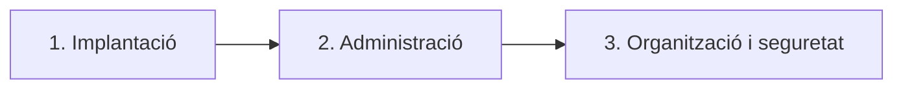

---
hide:
  - navigation
---
# Activitat 3.2 — Implantació i administració d'un gestor d'arxius web

**Mòdul:** Aplicacions Web — 2n d'SMX

**Unitat:** UP3. Gestió d'arxius web
**Modalitat:** Individual

## Criteris d'avaluació

- **RA3.c:** S'ha instal·lat i adaptat una ferramenta de gestió d'arxius web.
- **RA3.d:** S'han creat i classificat comptes d'usuari en funció dels seus permisos.
- **RA3.e:** S'han gestionat arxius i directoris.
- **RA3.f:** S'han utilitzat arxius d'informació addicional.
- **RA3.g:** S'han aplicat criteris d'indexació sobre els arxius i directoris.
- **RA3.h:** S'ha comprovat la seguretat del gestor d'arxius.

---

## Context de l'activitat

L'empresa fictícia **ByteSolutions**, dedicada al desenvolupament i manteniment de sistemes informàtics, necessita un sistema centralitzat per gestionar els seus documents.

Actualment, cada treballador guarda la informació al seu ordinador i comparteix els documents per correu electrònic. Aquesta situació provoca duplicacions, dificultats per localitzar informació i falta de control sobre qui pot accedir als documents.

La direcció ha decidit implantar **Nextcloud**, un gestor d'arxius web que permet centralitzar la documentació, crear comptes d'usuari, compartir arxius i controlar els permisos.

**El teu encàrrec** serà posar en funcionament el servei i adaptar-lo a les necessitats de l'empresa. El treball es divideix en tres fases que es realitzaran sobre **la mateixa instal·lació de Nextcloud**.



!!! info "Material necessari"
    Utilitza **Docker i Docker Compose**, el fitxer `compose.yaml` proporcionat pel professor i un navegador web. La configuració base de Docker ja està preparada: **no has de crear-la des de zero**.

---

## Fase 1. Instal·lació i configuració de Nextcloud

**Criteri: RA3.c**

### 1.1. Desplegament del servei

1. Crea una carpeta de treball per al projecte de ByteSolutions.
2. Guarda-hi el fitxer `compose.yaml` proporcionat pel professor.
3. Obri'l i **identifica** la imatge de Nextcloud, el port publicat i el volum que conserva les dades.
4. Inicia el servei amb Docker Compose.
5. Comprova que el contenidor està en funcionament.
6. Accedeix a Nextcloud des del navegador i completa la configuració inicial.
7. Crea el compte administrador del servei.

!!! tip "Pista"
    Pots consultar la documentació del bloc d'arquitectura i instal·lació. Si el servei no s'obri en el navegador, comprova primer que el contenidor estiga en funcionament i que estigues utilitzant el port correcte.

!!! info "Entorn de pràctiques"
    Utilitzarem una instal·lació senzilla de Nextcloud amb **SQLite**, adequada per a aprendre i fer proves. No estem configurant un servidor de producció.

### 1.2. Comprovacions de funcionament

Una vegada instal·lat el servei:

1. Identifica la versió de Nextcloud instal·lada.
2. Canvia el **nom visible** del compte administrador.
3. Crea una carpeta anomenada `Proves`.
4. Puja un document a aquesta carpeta i descarrega'l.
5. Reinicia el servei i comprova que el document continua disponible.

**Respon aquestes qüestions:**

1. Quina funció té Docker en aquesta instal·lació?
2. Per a què serveix el volum configurat?
3. Quina diferència hi ha entre reiniciar un contenidor i eliminar-ne les dades persistents?

!!! important "Punt de control 1"
    Mostra al professor que pots accedir a Nextcloud, iniciar sessió i consultar el document que has pujat. **No continues amb la fase 2 fins que el servei funcione correctament.**

---

## Fase 2. Administració de ByteSolutions

**Criteris: RA3.d i RA3.e**

### 2.1. Creació d'usuaris i grups

L'empresa té els treballadors següents:

| Treballador | Departament |
| --- | --- |
| Maria | Direcció |
| Anna | Administració |
| Marc | Administració |
| Pau | Tècnics |

1. Crea els quatre comptes d'usuari.
2. Crea els grups `Direccio`, `Administracio` i `Tecnics`.
3. Assigna cada treballador al grup corresponent.
4. Estableix una quota d'emmagatzematge de **500 MB** per a cada treballador.
5. Comprova que cap d'aquests comptes té privilegis d'administrador de Nextcloud.

!!! warning "Comptes d'usuari"
    Utilitza contrasenyes de pràctiques diferents de les teues contrasenyes personals. No inclogues contrasenyes en l'informe ni en captures de pantalla.

### 2.2. Estructura de directoris i permisos

Des del compte administrador, crea l'estructura següent:

```text
ByteSolutions/
├── Direccio/
├── Administracio/
├── Projectes/
└── Compartit/
```

Configura les comparticions perquè es complisquen aquests requisits:

| Carpeta | Usuaris autoritzats |
| --- | --- |
| `Direccio` | Només Maria |
| `Administracio` | Anna i Marc |
| `Projectes` | Pau |
| `Compartit` | Tots els treballadors |

Els treballadors han de poder **consultar i modificar** els documents de les carpetes que tenen assignades i **no han de poder accedir** a les carpetes dels altres departaments.

!!! info "Propietat i compartició"
    Les carpetes les crea el compte administrador i després les comparteix. Els altres treballadors poden accedir als recursos compartits segons els permisos concedits, però això no significa que siguen els propietaris de les carpetes.

### 2.3. Gestió d'arxius

Realitza aquestes operacions amb documents de prova:

1. Puja almenys **dos documents** a `Compartit`.
2. Crea una subcarpeta dins de `Projectes`.
3. Copia un document a aquesta subcarpeta.
4. Reanomena un document.
5. Mou un arxiu entre dues carpetes a les quals tingues accés.
6. Elimina un document i **restaura'l des de la paperera**.

### 2.4. Compartició de documents

1. Comparteix un document concret amb **Anna i Pau** perquè puguen consultar-lo i modificar-lo.
2. Genera un **enllaç públic** per a un document de prova que no continga informació confidencial.
3. Protegeix l'enllaç amb una **contrasenya** i estableix-hi una **data de caducitat**.

!!! warning "Comprovar els permisos"
    No és suficient crear una compartició. Has de comprovar que cada usuari pot accedir als documents autoritzats i que no pot consultar els dels altres departaments.

!!! important "Punt de control 2"
    Inicia sessió amb almenys **dos comptes de departaments diferents** i mostra al professor una comprovació d'accés permés i una d'accés denegat (o una carpeta que no apareix perquè no està compartida).

---

## Fase 3. Organització, informació addicional i seguretat

**Criteris: RA3.f, RA3.g i RA3.h**

### 3.1. Arxius d'informació addicional

L'empresa necessita documentar com s'ha d'utilitzar l'espai compartit.

1. Crea un arxiu anomenat `LLEGIR-ME.md` o `LLEGIR-ME.txt` dins de `Compartit`.
2. Inclou-hi:
    - la finalitat de la carpeta;
    - quins tipus de documents s'hi poden guardar;
    - les normes de nomenclatura que s'han de seguir;
    - qui pot utilitzar-la.
3. Selecciona dos documents i incorpora-hi informació complementària mitjançant les opcions disponibles en Nextcloud, com ara **comentaris** o **etiquetes**.
4. Consulta la informació de propietats i activitat d'almenys un document.

### 3.2. Organització i cerca

ByteSolutions ha decidit aplicar la convenció següent als noms dels documents:

`ANY-MES_CLIENT_TIPUS.extensió`

Exemple: `2026-11_ClientA_Pressupost.pdf`

1. Crea almenys **cinc documents de prova**.
2. Anomena'ls seguint la convenció establida.
3. Organitza'ls en les carpetes adequades.
4. Afig etiquetes per classificar-los segons el client o l'estat del document.
5. Utilitza les opcions disponibles de **cerca i filtratge** de Nextcloud per localitzar documents concrets.
6. Comprova quins camps pots cercar realment amb la instal·lació que tens disponible.

**Respon aquestes qüestions:**

1. Quins avantatges té utilitzar una nomenclatura comuna?
2. Quina diferència hi ha entre organitzar documents en carpetes i classificar-los amb etiquetes?
3. Quines possibilitats i limitacions has observat en el cercador de Nextcloud?

!!! info "Cerca i indexació"
    Cercar per nom o per determinades metadades no implica necessàriament que Nextcloud puga cercar dins del **contingut** de tots els PDF o documents Word. Descriu les funcions que has pogut comprovar en la teua instal·lació, sense donar per fet que estan disponibles totes les opcions de cerca.

### 3.3. Auditoria bàsica de seguretat

Comprova els punts següents i anota **el resultat real** de cadascun.

| Comprovació | Què has de verificar? |
| --- | --- |
| Accés no autoritzat | Un treballador no pot accedir a carpetes privades d'un altre departament. |
| Permisos | Els comptes normals no poden administrar Nextcloud. |
| Compartició pública | L'enllaç públic creat està protegit amb contrasenya. |
| Caducitat | La compartició pública té una data de caducitat. |
| Actualitzacions | Pots consultar la versió instal·lada i si el sistema mostra avisos d'actualització. |
| Recuperació | Pots restaurar un document eliminat. |
| Persistència | Els documents continuen disponibles després de reiniciar el servei. |

**Qüestió final:** identifica **dos possibles riscos de seguretat** de la teua instal·lació i explica quina mesura aplicaries per reduir cadascun.

!!! warning "Seguretat de l'entorn de pràctiques"
    No publiques contrasenyes reals, tokens ni dades personals en captures o documents. Mantín el servei dins de l'entorn de pràctiques indicat pel professor.

!!! important "Punt de control 3"
    Mostra al professor una cerca o filtratge de documents i les comprovacions principals de permisos i compartició segura.

---

## Lliurament

Entrega a **Aules** un **únic document PDF** que continga:

1. Una captura de Nextcloud funcionant i una explicació breu de la instal·lació.
2. Una captura de la gestió d'usuaris i grups.
3. Una captura de l'estructura de carpetes i una explicació dels permisos aplicats.
4. Evidències de l'arxiu `LLEGIR-ME`, les etiquetes i les cerques realitzades.
5. La taula d'auditoria de seguretat amb els resultats obtinguts.
6. Les respostes a totes les qüestions plantejades.

Adjunta també el fitxer **`compose.yaml`** utilitzat, sense contrasenyes ni altres dades sensibles.

!!! tip "Evidències de qualitat"
    **No cal fer una captura de cada clic.** Tria captures que demostren clarament el funcionament i acompanya-les d'explicacions breus. El professor podrà demanar-te una demostració directa del servei.

## Resultat esperat

En finalitzar l'activitat, has de disposar d'un servei **Nextcloud funcional**, amb els treballadors de ByteSolutions configurats, una estructura documental organitzada, permisos adequats, documents classificats i les comprovacions bàsiques de seguretat realitzades.
