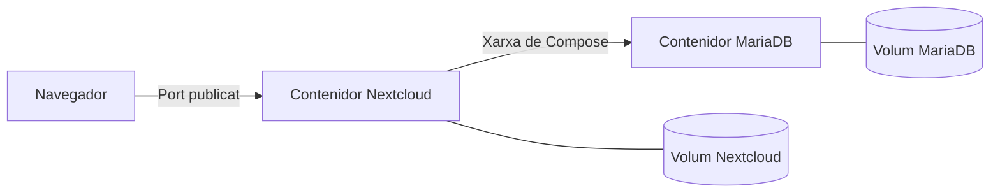

---
hide:
  - navigation
---
# Activitat 3.2 — Desplegament de Nextcloud amb Docker

**Unitat:** UP3 — Serveis de gestió d'arxius web  
**Modalitat:** Individual  
**Criteri d'avaluació:** **RA3.c** — S'ha instal·lat i adaptat una ferramenta de gestió d'arxius web.

## Situació de partida

En la pràctica de calendari web ja vas treballar amb **Nextcloud**. Ara l'empresa fictícia **ByteSolutions** necessita un **nou servei independent** per a emmagatzemar i gestionar els seus arxius.

La teua tasca és **desplegar una nova instància de Nextcloud amb Docker Compose**, adaptar-la als requisits indicats i demostrar que la informació es conserva encara que els contenidors s'eliminen i es tornen a crear.

!!! important "Conserva la pràctica anterior"
    No modifiques ni elimines la instal·lació de Nextcloud que vas utilitzar en la pràctica de calendari web. Aquesta activitat s'ha de fer en una carpeta i un projecte Docker Compose independents.

## 1. Objectius

En acabar l'activitat has de ser capaç de:

- Desplegar Nextcloud utilitzant **Docker Compose**.
- Identificar els serveis de **Nextcloud** i **MariaDB** i configurar la comunicació entre ells.
- Adaptar el **port d'accés** per evitar conflictes amb altres serveis.
- Configurar **volums persistents** per conservar els arxius i les dades de la base de dades.
- Verificar el funcionament del gestor des del navegador.
- Comprovar que la informació continua disponible després de recrear els contenidors.

## 2. Requisits del desplegament

Crea una carpeta nova per al projecte, per exemple `up3-nextcloud-cognom`, i prepara-hi el fitxer `compose.yaml`.

El desplegament ha de complir aquests requisits:

| Element | Requisit |
|---|---|
| **Serveis** | Un contenidor amb **Nextcloud (variant Apache)** i un altre amb **MariaDB**. |
| **Accés web** | Publica un port de l'ordinador que no utilitze la instal·lació anterior; per exemple, `8081:80`. |
| **Comunicació** | Nextcloud s'ha de connectar a MariaDB mitjançant el **nom del servei** definit en Compose. |
| **Base de dades** | MariaDB **no ha de publicar el port** cap a l'ordinador host. |
| **Persistència** | Defineix **un volum anomenat per a Nextcloud** i **un volum anomenat independent per a MariaDB**. |
| **Configuració** | Els paràmetres i les credencials de connexió a la base de dades han de ser coherents en els dos serveis. |
| **Aïllament** | Utilitza una carpeta, un nom de projecte, ports i volums diferenciats dels del calendari web. |

L'arquitectura esperada és aquesta:



!!! warning "Entorn de pràctiques"
    Pots utilitzar HTTP en local o en una xarxa de laboratori controlada. **No publiques aquesta instal·lació a Internet sense HTTPS i les mesures de seguretat adequades.** Si hi accedeixes únicament des del mateix ordinador, pots limitar el port publicat a `127.0.0.1`.

## 3. Fase 1 — Preparació i configuració

1. Revisa el projecte Docker Compose que vas utilitzar en la pràctica de calendari web. Identifica els serveis, els ports i els volums que hi apareixen.
2. Crea la carpeta del nou projecte i el fitxer `compose.yaml`. Pots utilitzar el projecte anterior com a referència, però **l'has d'adaptar** als requisits de l'apartat 2.
3. Configura la comunicació entre Nextcloud i MariaDB. Revisa que el nom del servei de la base de dades i les credencials siguen coherents.
4. Decideix com gestionaràs les credencials. Si utilitzes un fitxer `.env`, prepara també un `.env.example` amb valors ficticis per a entregar-lo.
5. Comprova que Docker Compose pot interpretar la configuració abans d'iniciar-la:

    ```bash
    docker compose config --quiet
    ```

**Respon:**

**3.1.** Quin port has triat per a Nextcloud? Per què no has utilitzat el mateix port que en la pràctica anterior?

**3.2.** Quins dos volums persistents has definit? Quina informació ha de conservar cadascun?

!!! tip "Pista"
    Recorda que **imatge**, **contenidor** i **volum** són conceptes diferents. El contenidor es pot tornar a crear; les dades importants han de continuar disponibles.

## 4. Fase 2 — Posada en funcionament

1. Inicia els serveis:

    ```bash
    docker compose up -d
    ```

2. Comprova que s'han iniciat correctament:

    ```bash
    docker compose ps
    ```

3. Si algun servei no arranca o Nextcloud no es pot connectar a MariaDB, consulta els registres:

    ```bash
    docker compose logs --tail 50
    ```

4. Accedeix a Nextcloud des del navegador utilitzant el port que has configurat.
5. Completa la configuració inicial i crea el compte d'administració si l'assistent ho demana.
6. Inicia sessió, crea una carpeta anomenada **`UP3`** i puja-hi **un arxiu de prova amb un nom identificable**.

**Respon:**

**4.1.** Quina funció té MariaDB dins d'aquest desplegament? Per què Nextcloud necessita comunicar-s'hi, però el navegador no?

## 5. Fase 3 — Comprovació de la persistència

Ara has de demostrar que les dades no depenen de la vida dels contenidors.

1. Comprova que la carpeta `UP3` i l'arxiu de prova són visibles en Nextcloud.
2. Des de **la carpeta d'aquest projecte**, atura i elimina els contenidors, **sense eliminar els volums**:

    ```bash
    docker compose down
    ```

3. Torna a crear-los:

    ```bash
    docker compose up -d
    ```

4. Accedeix de nou a Nextcloud i comprova que pots iniciar sessió amb **el mateix compte**.
5. Verifica que la carpeta `UP3` i l'arxiu de prova **continuen disponibles**.

!!! danger "No elimines els volums"
    **No utilitzes `docker compose down -v`**: l'opció `-v` elimina els volums del projecte. Tampoc executes ordres de neteja global de volums. En aquesta activitat volem comprovar que les dades **es conserven**, no esborrar-les.

**Respon:**

**5.1.** Què s'ha eliminat en executar `docker compose down`? Què s'ha conservat?

**5.2.** Què podria passar amb els arxius i amb les dades de la base de dades si no s'hagueren configurat volums persistents?

## 6. Comprovacions finals i lliurament

Abans d'entregar, comprova que has aconseguit tot això:

- [ ] La nova instància de Nextcloud funciona sense alterar la del calendari web.
- [ ] Els serveis Nextcloud i MariaDB estan actius i es comuniquen correctament.
- [ ] El port publicat és diferent del de la pràctica anterior.
- [ ] MariaDB no té cap port publicat cap a l'ordinador host.
- [ ] Hi ha dos volums persistents independents.
- [ ] Pots iniciar sessió, crear una carpeta i pujar un arxiu.
- [ ] El compte, la carpeta i l'arxiu es conserven després de fer `down` i `up`.

### Què has d'entregar?

Entrega en **Aules un únic fitxer comprimit** que continga:

1. **`compose.yaml`** amb la configuració utilitzada, però **sense contrasenyes reals en clar**.
2. **`.env.example`**, si has utilitzat `.env`, amb els noms de les variables i valors ficticis.
3. Un **document breu** amb les respostes a les preguntes **3.1, 3.2, 4.1, 5.1 i 5.2**.
4. Les evidències següents, incorporades al document o en fitxers separats:

| Evidència | Què ha de demostrar |
|---|---|
| **E1. Configuració** | Els serveis, ports i volums definits en `compose.yaml`. |
| **E2. Contenidors** | El resultat de `docker compose ps` amb els serveis actius. |
| **E3. Funcionament** | Nextcloud accessible amb la carpeta `UP3` i l'arxiu de prova. |
| **E4. Persistència** | La mateixa carpeta i el mateix arxiu després de recrear els contenidors, amb una explicació del resultat. |

!!! warning "Protegeix les teues credencials"
    No entregues el fitxer `.env` real ni contrasenyes, tokens o claus. Si el fitxer `compose.yaml` conté algun secret, substitueix-lo per una variable o un valor fictici en la còpia que entregues. Oculta també qualsevol dada sensible que aparega en les captures.

## 7. Criteris de valoració

Tota l'activitat avalua el **RA3.c**.

| Aspecte que es valorarà | Pes |
|---|---:|
| Configuració correcta dels serveis, ports i volums | **30 %** |
| Instal·lació i funcionament verificat de Nextcloud | **30 %** |
| Comprovació correcta de la persistència | **25 %** |
| Explicacions, evidències i autonomia en la resolució | **15 %** |
| **Total** | **100 %** |

## Recursos de consulta

- [Documentació oficial de la imatge Docker de Nextcloud](https://github.com/nextcloud/docker)
- [Documentació oficial de Docker Compose](https://docs.docker.com/compose/)
- [Teoria de la UP3 — Serveis de gestió d'arxius web](https://jordicido.github.io/jordicina/smx-aw/up3-arxius-web/)
