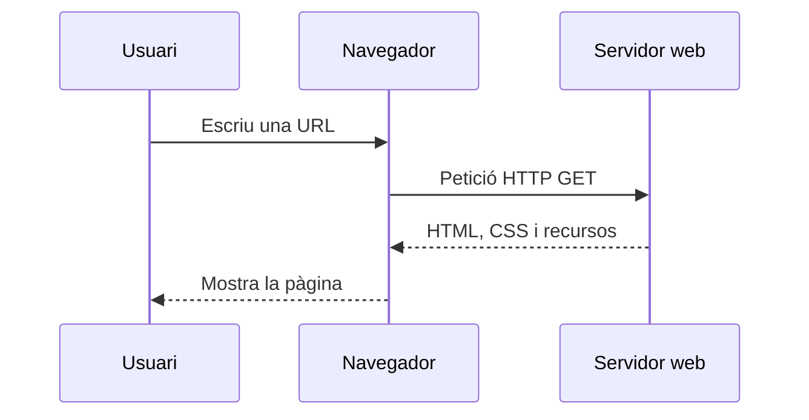
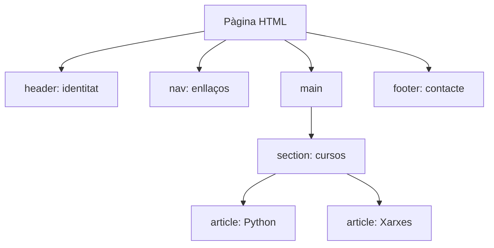

---
hide:
  - navigation
---

# UP4.1. Introducció a HTML: l'estructura d'una pàgina web

**Finalitat:** comprendre què interpreta el navegador i crear una primera pàgina sense un editor visual. Aquest bloc prepara la personalització que després farem en WordPress.

## 1.1. Què ocorre quan obrim una web?

Quan escrivim una adreça en un navegador, aquest sol·licita recursos a un servidor mitjançant HTTP o HTTPS. El servidor respon amb documents i altres recursos. El navegador interpreta el **HTML** i el **CSS** i representa visualment la pàgina. Si hi ha JavaScript, també pot executar-lo.



- **HTML (HyperText Markup Language):** descriu l'estructura i el significat del contingut.
- **CSS (Cascading Style Sheets):** defineix la presentació: colors, espais i distribució.
- **JavaScript:** permet afegir comportament i interactivitat; no el programarem en aquesta UP.

!!! example "Una analogia útil"
    En una casa, HTML seria l'estructura i la distribució de les habitacions; CSS, els colors i l'aspecte de cada espai. No són llenguatges amb la mateixa funció.

## 1.2. Preparació de l'entorn

Per a la primera pàgina necessitem un editor com **Visual Studio Code** i un navegador. Crea una carpeta `byteacademy-html` amb aquesta estructura:

```text
byteacademy-html/
├── index.html
├── css/
│   └── estils.css
└── img/
    └── (les teues imatges)
```

Un document `index.html` pot obrir-se directament amb el navegador. Més avant utilitzarem un servidor perquè les aplicacions web dinàmiques necessiten un entorn d'execució.

## 1.3. Estructura mínima d'un document HTML

```html
<!DOCTYPE html>
<html lang="ca">
<head>
    <meta charset="UTF-8">
    <meta name="viewport" content="width=device-width, initial-scale=1.0">
    <title>ByteAcademy | Formació en informàtica</title>
    <link rel="stylesheet" href="css/estils.css">
</head>
<body>
    <h1>Benvinguts a ByteAcademy</h1>
    <p>Formació tecnològica per a tots els nivells.</p>
</body>
</html>
```

**Què significa cada element?**

| Element | Funció |
|---|---|
| `<!DOCTYPE html>` | Indica que utilitzem HTML modern. |
| `<html lang="ca">` | Element arrel i idioma del document. |
| `<head>` | Metadades i referències, no el contingut principal visible. |
| `<meta charset="UTF-8">` | Codificació de caràcters. |
| `<meta name="viewport" ...>` | Ajuda a mostrar correctament la pàgina en mòbils. |
| `<title>` | Títol de la pestanya del navegador. |
| `<link rel="stylesheet">` | Connecta la fulla d'estils. |
| `<body>` | Contingut que es representa en la pàgina. |

Les etiquetes solen tindre una obertura i un tancament (`<p>...</p>`). Alguns elements, com `` o `<meta>`, no tenen contingut intern. Una pàgina HTML correcta manté una **jerarquia d'elements** coherent.

## 1.4. Etiquetes bàsiques de contingut

### Títols i paràgrafs

```html
<h1>Els nostres cursos</h1>
<h2>Programació</h2>
<p>Aprén a crear les teues primeres aplicacions.</p>
<h2>Sistemes</h2>
<p>Descobreix com funcionen els ordinadors i les xarxes.</p>
```

`h1` identifica el títol principal, i `h2`–`h6` representen nivells inferiors. **No triem un `h3` perquè el text aparega més menut**, sinó per la jerarquia del contingut: la grandària es controla amb CSS.

### Llistes

```html
<ul>
    <li>HTML i CSS</li>
    <li>Python</li>
    <li>Ciberseguretat</li>
</ul>

<ol>
    <li>Inscriure's</li>
    <li>Accedir al curs</li>
    <li>Completar les activitats</li>
</ol>
```

`ul` crea una llista no ordenada; `ol`, una llista ordenada; `li`, cada element.

### Enllaços

```html
<a href="cursos.html">Consulta els cursos</a>
<a href="https://wordpress.org/">Web oficial de WordPress</a>
```

L'atribut `href` indica la destinació. Els enllaços poden ser **relatius** (a una pàgina del mateix projecte) o **absoluts** (amb una URL completa).

### Imatges

```html

```

`src` indica la ruta de la imatge; `alt` proporciona una alternativa textual útil quan la imatge no es pot veure i per a tecnologies d'assistència. Evita textos com «imatge» que no descriuen el contingut. Si la imatge és purament decorativa, `alt=""` pot ser adequat.

## 1.5. HTML semàntic: donar significat a l'estructura

Una pàgina podria estar formada només per `div`, però seria més difícil d'interpretar. HTML proporciona etiquetes que descriuen la funció de les zones:

| Etiqueta | Ús habitual |
|---|---|
| `<header>` | Capçalera de la pàgina o d'una secció. |
| `<nav>` | Navegació principal o secundària. |
| `<main>` | Contingut principal del document. |
| `<section>` | Conjunt temàtic de continguts, habitualment amb títol. |
| `<article>` | Contingut amb sentit propi, com una notícia o targeta de curs. |
| `<footer>` | Peu de pàgina o de secció. |
| `<div>` | Contenidor genèric sense significat semàntic concret. |



### Exemple complet d'una secció de cursos

```html
<header>
  <h1>ByteAcademy</h1>
  <nav aria-label="Navegació principal">
    <a href="index.html">Inici</a>
    <a href="#cursos">Cursos</a>
    <a href="#contacte">Contacte</a>
  </nav>
</header>

<main>
  <section id="cursos" aria-labelledby="titol-cursos">
    <h2 id="titol-cursos">Els nostres cursos</h2>
    <div class="graella-cursos">
      <article class="targeta-curs">
        <h3>Introducció a Python</h3>
        <p>Aprén variables, condicions i bucles.</p>
        <a href="cursos.html">Més informació</a>
      </article>
      <article class="targeta-curs">
        <h3>Fonaments de xarxes</h3>
        <p>Descobreix protocols i dispositius.</p>
        <a href="cursos.html">Més informació</a>
      </article>
    </div>
  </section>
</main>

<footer id="contacte">
  <p>Contacte: info@exemple.invalid</p>
</footer>
```

En aquest exemple, `id="cursos"` crea un punt de destinació per a l'enllaç `href="#cursos"`, mentre que `class="targeta-curs"` permet identificar diferents targetes per aplicar-los el mateix CSS.

## 1.6. Atributs `id` i `class`

- **`id`:** identificador únic dins del document; útil per a enllaços interns o per identificar un element concret.
- **`class`:** nom reutilitzable per classificar diversos elements i aplicar-los el mateix estil.

```html
<h2 id="cursos">Oferta formativa</h2>
<p class="destacat">Matrícula oberta.</p>
<p class="destacat">Places limitades.</p>
```

!!! tip "Bona pràctica"
    Utilitza classes amb noms que indiquen **la funció** (`targeta-curs`, `boto-principal`) i no només el color (`text-blau`), perquè el disseny pot canviar.

## 1.7. Comprovacions i errors freqüents

- Si no apareix una imatge, revisa **la ruta** i el nom del fitxer, incloses les majúscules i minúscules.
- Si un enllaç no va on toca, comprova `href` i si la pàgina de destinació existeix.
- Si l'estructura es comporta de manera estranya, revisa l'obertura i el tancament d'elements.
- Obri les **eines de desenvolupador** (normalment amb F12) per inspeccionar el HTML interpretat.
- No utilitzes `<br>` repetits per fer espais: després ho resoldrem amb CSS.
- Comprova que els enllaços tenen textos descriptius i que les imatges tenen alternatives adequades.

!!! question "Comprova que ho has entés"
    1. Quina part d'una pàgina controla HTML i quina controla CSS?
    2. Per què `header` i `nav` aporten més informació que diversos `div` sense estructura?
    3. Quina diferència hi ha entre `class` i `id`?
    4. Per què una imatge hauria de tindre l'atribut `alt`?

**Relació amb l'activitat:** posa aquests conceptes en pràctica a l'[A4.1](activitats/activitat-4-1-html-css.md).
