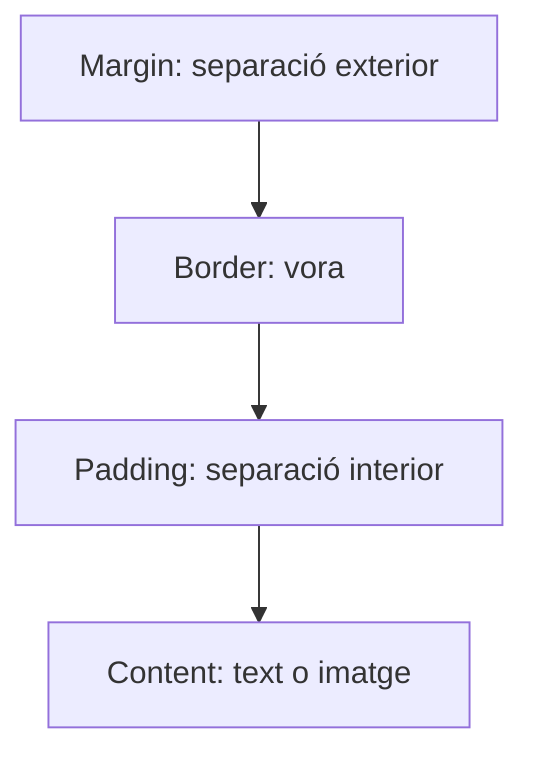

# UP4.2. Introducció a CSS: donar estil i distribuir continguts

**Finalitat:** passar d'una pàgina HTML estructurada a una interfície llegible, coherent i adaptable. Aplicarem els estils a la web de ByteAcademy que vam començar en el bloc anterior.

## 2.1. Què és CSS i per què el separem del HTML?

**CSS** (Cascading Style Sheets) descriu com s'han de representar els elements HTML. Així podem tindre un mateix contingut amb dissenys diferents i reutilitzar els estils en múltiples pàgines.

```html
<!-- Dins del <head> d'index.html -->
<link rel="stylesheet" href="css/estils.css">
```

El fitxer `css/estils.css` conté les regles:

```css
body {
  font-family: Arial, sans-serif;
  color: #243447;
  background-color: #f6f8fb;
}
```

Una regla CSS té tres parts: **selector**, **propietat** i **valor**.

```text
h1           ← selector
{
  color: navy;  ← propietat: valor;
}
```

## 2.2. Selectors: a qui s'aplica cada regla?

```html
<h2 id="oferta">Oferta formativa</h2>
<p class="destacat">Inscripció oberta.</p>
<p class="destacat">Aprén al teu ritme.</p>
```

```css
h2 { color: #1d4e89; }         /* Etiqueta */
.destacat { font-weight: 700; } /* Classe */
#oferta { text-transform: uppercase; } /* ID */
```

| Selector | Exemple | Selecciona... |
|---|---|---|
| Etiqueta | `p` | Tots els paràgrafs. |
| Classe | `.destacat` | Tots els elements d'aquesta classe. |
| Identificador | `#oferta` | L'element amb aquest ID. |
| Descendent | `.targeta-curs a` | Els enllaços dins de targetes. |
| Pseudoclasse | `a:hover` | Enllaços quan hi passem el ratolí. |

### La cascada i l'especificitat

Si dues regles estableixen la mateixa propietat per a un element, el navegador resol el conflicte seguint les regles de la **cascada**: origen, importància, especificitat i ordre. Com a simplificació inicial, un selector d'ID sol ser més específic que un de classe, i un de classe més que un d'etiqueta. Però no convé utilitzar `!important` per resoldre tots els problemes.

!!! tip "Per a començar"
    Prefereix classes reutilitzables. Evita crear selectors complicats només per aconseguir que una regla sobreescriga una altra.

## 2.3. Color, tipografia i fons

```css
body {
  font-family: system-ui, Arial, sans-serif;
  line-height: 1.5;
  color: #243447;
  background-color: #f6f8fb;
}

h1, h2 {
  color: #174a78;
}

.boto-principal {
  background-color: #174a78;
  color: white;
  text-decoration: none;
  font-weight: bold;
}
```

**Recorda:** un bon disseny no és només estètica. El contrast, la mida de lletra i la separació entre elements condicionen la llegibilitat. Evita combinar dos colors que no permeten distingir bé el text.

## 2.4. El model de caixa

Cada element es representa com una caixa. Les quatre parts bàsiques són:



- **`content`:** espai ocupat pel contingut.
- **`padding`:** espai entre contingut i vora.
- **`border`:** límit visual de la caixa.
- **`margin`:** separació respecte d'altres elements.

```css
.targeta-curs {
  padding: 1.5rem;
  margin-bottom: 1rem;
  border: 1px solid #dce3ea;
  border-radius: 12px;
  background-color: white;
}
```

La propietat següent simplifica els càlculs d'amplària perquè el `padding` i la vora queden inclosos en la mida declarada:

```css
*, *::before, *::after {
  box-sizing: border-box;
}
```

## 2.5. Distribució amb Flexbox

Per defecte, molts elements es col·loquen un davall d'un altre. Amb **Flexbox** podem distribuir els elements fills d'un contenidor en una fila o columna.

```html
<div class="graella-cursos">
  <article class="targeta-curs">Curs de Python</article>
  <article class="targeta-curs">Curs de xarxes</article>
  <article class="targeta-curs">Curs de seguretat</article>
</div>
```

```css
.graella-cursos {
  display: flex;
  flex-wrap: wrap;
  gap: 1rem;
}

.targeta-curs {
  flex: 1 1 220px;
}
```

| Propietat | Efecte |
|---|---|
| `display: flex` | Activa el model flexible en el contenidor. |
| `flex-direction` | Determina fila o columna. |
| `justify-content` | Distribueix els elements en l'eix principal. |
| `align-items` | Els alinea en l'eix transversal. |
| `gap` | Separa els elements sense afegir marges individuals. |
| `flex-wrap: wrap` | Permet passar elements a una línia nova. |
| `flex` | Controla creixement, reducció i mida base d'un element. |

!!! example "Tres targetes en una pantalla estreta"
    Amb `flex-wrap: wrap`, les targetes poden passar de tres columnes a dues o una, segons l'espai disponible. No són tres caixes amb amplària fixa que obliguen a desplaçar-se horitzontalment.

## 2.6. Unitats i disseny adaptable

- `px`: píxels CSS, útils per a vores i mesures concretes.
- `%`: percentatge respecte d'una dimensió de referència.
- `rem`: relatiu a la mida de lletra de l'element arrel; útil per a espais i tipografies.
- `max-width`: evita que un contingut ocupe amplàries excessives en pantalles grans.

```css
.contenidor {
  width: min(90%, 1100px);
  margin-inline: auto;
}
```

### Media queries

Una *media query* adapta estils segons les característiques del dispositiu o de la finestra del navegador:

```css
@media (max-width: 600px) {
  .menu-principal {
    display: flex;
    flex-direction: column;
    gap: .5rem;
  }

  h1 {
    font-size: 1.8rem;
  }
}
```

El resultat hauria de mantindre's llegible, amb enllaços accessibles i sense desplaçament horitzontal innecessari.

## 2.7. Exemple complet: donar estil a ByteAcademy

Aquest CSS és un punt de partida. L'alumnat haurà de personalitzar colors, fonts i distribució:

```css
:root {
  --color-principal: #174a78;
  --color-fons: #f6f8fb;
}

*, *::before, *::after { box-sizing: border-box; }

body {
  margin: 0;
  font-family: system-ui, sans-serif;
  line-height: 1.6;
  background: var(--color-fons);
  color: #233042;
}

header, footer {
  background: var(--color-principal);
  color: white;
  padding: 1.5rem;
}

nav { display: flex; gap: 1rem; flex-wrap: wrap; }
nav a { color: white; }

main { width: min(92%, 1100px); margin: 2rem auto; }

.graella-cursos {
  display: flex;
  flex-wrap: wrap;
  gap: 1rem;
}

.targeta-curs {
  flex: 1 1 230px;
  padding: 1.5rem;
  background: white;
  border: 1px solid #dbe2e9;
  border-radius: 12px;
}

.targeta-curs a {
  color: var(--color-principal);
  font-weight: 700;
}

@media (max-width: 600px) {
  header { padding: 1rem; }
  nav { flex-direction: column; }
}
```

## 2.8. Diagnosticar problemes amb DevTools

1. Obri la pàgina en el navegador.
2. Fes clic dret sobre una targeta i tria **Inspecciona**.
3. Localitza l'element HTML i les classes que té.
4. Observa les regles CSS aplicades, heretades i sobreescrites.
5. Prova temporalment una propietat i comprova el resultat abans de modificar el fitxer.
6. Activa el mode de pantalla mòbil i revisa navegació, imatges i targetes.

!!! warning "Un error freqüent"
    Si el CSS no funciona, comprova primer l'enllaç al fitxer, el nom de la classe i la sintaxi (`{}`, `:` i `;`). Afegir `!important` no és la solució habitual.

!!! question "Comprova que ho has entés"
    1. Quina diferència hi ha entre margin i padding?
    2. Per a què serveix `display: flex`?
    3. Què ocorre quan apliquem `flex-wrap: wrap`?
    4. Quina utilitat té `@media (max-width: 600px)`?
    5. Com comprovaries quin selector CSS està afectant un element?

**Relació amb l'activitat:** completa la teua [pàgina HTML/CSS](activitats/activitat-4-1-html-css.md) i conserva el codi: el reutilitzarem en WordPress.
