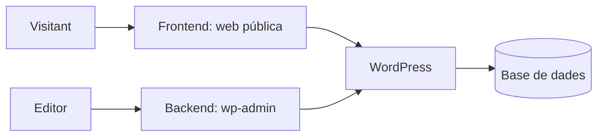
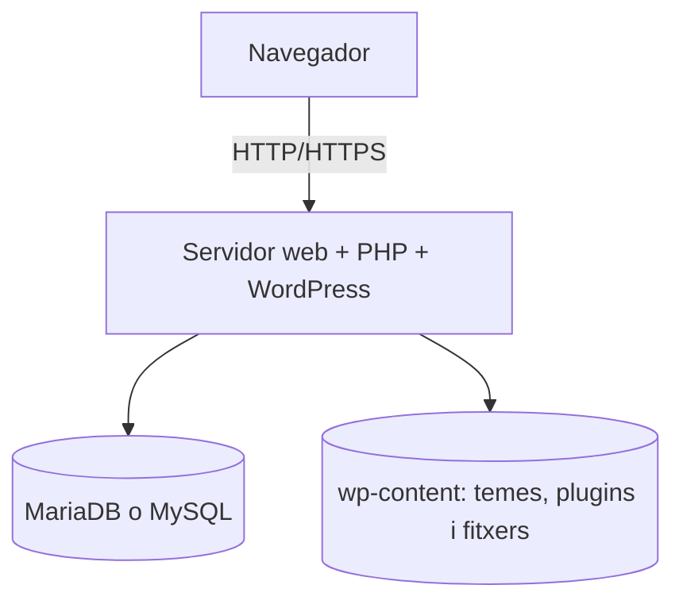
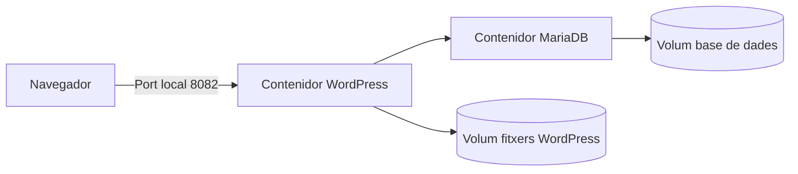

# UP4.3. Què és un CMS? Arquitectura i instal·lació de WordPress

**Criteris relacionats:** RA1.a i RA1.d.

## 3.1. Del web estàtic al gestor de continguts

Una pàgina HTML que hem creat manualment pot funcionar perfectament com a web estàtica. Però imagina que ByteAcademy ha d'afegir cada setmana nous cursos, gestionar cinc editors i publicar notícies: editar fitxers un a un seria poc pràctic.

Un **CMS** (*Content Management System*, sistema de gestió de continguts) és una aplicació que permet crear, organitzar i publicar continguts sense haver d'editar directament tots els documents HTML. També pot gestionar usuaris, plantilles, permisos, extensions i fluxos de publicació.

| Característica | Web HTML estàtica | Web amb CMS |
|---|---|---|
| Continguts | Editar fitxers | Panell de gestió |
| Actualització | Modificar i tornar a publicar | Crear o editar i publicar |
| Usuaris | No inclosos per defecte | Rols i permisos |
| Aspecte | CSS i fitxers propis | Temes, estils i plantilles |
| Funcionalitats | S'han de desenvolupar | Nucli i extensions |
| Manteniment | Centrat en els fitxers i servidor | També nucli, plugins i dades |

!!! info "Un CMS no substitueix els fonaments web"
    WordPress continua enviant HTML i CSS al navegador. El que canvia és com es gestionen i generen els continguts.

## 3.2. Exemples de CMS i aplicacions

- **WordPress:** webs corporatius, revistes, blogs, portals i altres projectes amb extensions.
- **Joomla:** llocs amb gestió de continguts i permisos diversos.
- **Drupal:** projectes amb estructures de contingut i permisos més especialitzats.

La tria depén de les necessitats, la capacitat de manteniment, el pressupost i el tipus de web. En aquesta UP treballarem amb **WordPress.org autoinstal·lat**, no amb un servei allotjat per un tercer.

## 3.3. Frontend i backend

- **Frontend:** part que veu el visitant: portada, cursos, articles i formularis.
- **Backend o panell d'administració:** interfície restringida que permet crear pàgines, modificar l'aparença i administrar el servei.



**No s'han de confondre** frontend i backend amb dos servidors obligatòriament diferents: són funcions o capes del sistema.

## 3.4. Components necessaris per executar WordPress

En una instal·lació típica intervenen:

1. **Servidor web** (per exemple, Apache o Nginx) que rep peticions.
2. **PHP**, llenguatge utilitzat per WordPress al servidor.
3. **MariaDB o MySQL**, base de dades dels continguts, usuaris i configuració.
4. **Fitxers de WordPress i `wp-content`**, que inclou temes, plugins i pujades.
5. **Connexió de xarxa, permisos i configuració** adequats.



La documentació oficial de WordPress recomana versions mantingudes de PHP i MariaDB/MySQL, així com HTTPS. Els requisits concrets evolucionen: consulta [wordpress.org/about/requirements](https://wordpress.org/about/requirements/) abans d'instal·lar una nova versió.

!!! warning "Laboratori i producció"
    En l'activitat treballarem amb una instal·lació **local i de proves**. L'accés per HTTP en `localhost` només és adequat dins d'aquest entorn controlat. Una web pública ha de disposar d'HTTPS i una configuració de seguretat i còpies apropiada.

## 3.5. Com desplegarem WordPress a classe?

En la UP3 vam utilitzar un contenidor de Nextcloud amb SQLite per simplificar la instal·lació. En WordPress treballarem una arquitectura habitual amb **dos servicis** que el professor ja proporcionarà configurats: `wordpress` i `db` (MariaDB). No cal escriure l'arquitectura Docker des de zero.



### Conceptes mínims per comprendre el desplegament

| Concepte | Significat |
|---|---|
| Imatge | Plantilla a partir de la qual es crea un contenidor. |
| Contenidor | Instància que executa un servei. |
| Port publicat | Permet accedir al servei des de l'equip de pràctiques. |
| Volum | Guarda dades que han de sobreviure a la recreació del contenidor. |
| Docker Compose | Fitxer i ferramenta que descriu els servicis de l'aplicació. |
| Base de dades | Guarda entrades, pàgines, usuaris, configuració i metadades. |

### Ordres bàsiques de consulta

```bash
# Des de la carpeta on està compose.yaml
docker compose up -d       # Inicia els servicis
docker compose ps          # Comprova l'estat
docker compose logs --tail=30  # Mostra missatges recents
docker compose down        # Atura i elimina els contenidors del projecte
```

En tornar a executar `docker compose up -d`, els **volums** preservats permeten recuperar el servei. Evita `docker compose down -v`, ja que també elimina els volums del projecte.

!!! note "Les credencials no van en captures"
    Les contrasenyes de la base de dades no han d'aparéixer en documents d'evidències ni en repositoris públics. Si el professor proporciona un fitxer d'exemple, copia'l a `.env`, canvia les contrasenyes i no publiques aquest últim fitxer.

## 3.6. Instal·lació inicial de WordPress

Una vegada iniciat el servei:

1. Obrim el navegador a la URL local indicada pel professor.
2. Triem l'idioma.
3. Creem el **compte administrador** amb una contrasenya adequada.
4. Assignem el nom del lloc: **ByteAcademy**.
5. Comprovem la portada pública i l'accés al panell d'administració.
6. Revisem que es poden crear i guardar pàgines.

El panell sol estar a `/wp-admin/` de la instal·lació. La URL exacta i les pantalles depenen de la configuració i de la versió.

### Verificar que funciona

Una instal·lació no està acabada si només hem vist la portada. Cal comprovar:

- La pàgina pública es carrega sense errors.
- Es pot iniciar sessió com a administrador.
- Es pot crear una pàgina de prova i publicar-la.
- Es pot obrir aquesta pàgina com a visitant.
- Una vegada reiniciats els servicis, el contingut continua disponible.

Això proporciona una primera evidència del **CA1.d**.

## 3.7. Què guarda cada component?

**MariaDB** conté gran part de les dades estructurades: usuaris, configuració, continguts i metadades. **`wp-content`** inclou temes, plugins i arxius pujats. Per tant, per recuperar un web complet sovint calen **la base de dades i els fitxers**. Ho treballarem de manera més detallada en el bloc de còpies.

!!! question "Comprova que ho has entés"
    1. En què es diferencia un CMS d'una web HTML que hem editat manualment?
    2. Per què WordPress necessita una base de dades?
    3. Per què una captura de la portada no és suficient per demostrar una instal·lació correcta?
    4. Què podria ocórrer si eliminem els volums de Docker?
    5. Què guanya ByteAcademy en poder administrar els continguts des d'un panell?
