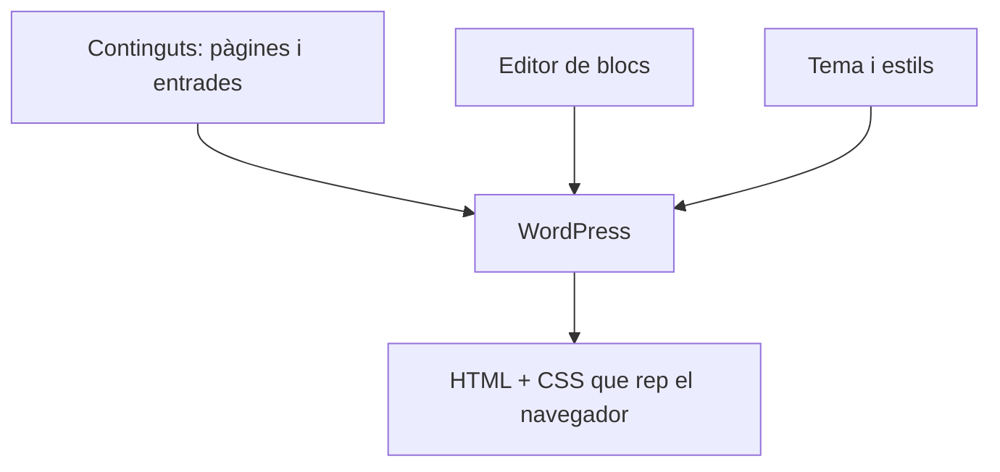

# UP4.4. Creació i personalització de llocs web amb WordPress

**Criteris relacionats:** RA1.c, RA1.d i RA1.f.

## 4.1. Continguts i aspecte visual no són el mateix

En WordPress podem canviar el contingut d'una pàgina sense reprogramar-ne tota l'estructura. Els **continguts** (títols, textos, imatges i enllaços) són diferents de la **presentació** (tipografia, colors, espaiat i distribució).



Un bon disseny facilita que els visitants localitzen cursos, entenguen l'oferta i troben el contacte de ByteAcademy.

## 4.2. Pàgines i entrades

**Pàgines:** informació que sol mantindre's i formar part de la navegació principal. Exemples: *Inici*, *Cursos*, *Sobre nosaltres* i *Contacte*.

**Entrades:** publicacions habitualment cronològiques, com notícies, novetats de cursos o anuncis. Les entrades poden classificar-se amb **categories** i **etiquetes**.

| Necessitat | Element recomanat |
|---|---|
| «Qui som?» | Pàgina |
| «Oferta de cursos» | Pàgina |
| «Obrim matrícula el mes que ve» | Entrada |
| «Novetats de ciberseguretat» | Entrada + categoria |

!!! question "Pensa"
    Si ByteAcademy anuncia cada setmana novetats, crearies una pàgina diferent per a cada anunci o utilitzaries entrades? Justifica-ho.

## 4.3. L'editor de blocs

L'editor modern de WordPress permet construir contingut amb **blocs**: títols, paràgrafs, imatges, columnes, grups, botons i altres elements. Cada bloc té opcions de configuració i estil.

Quan creem una pàgina:

1. Assignem un títol clar.
2. Organitzem el contingut amb títols de diferents nivells.
3. Afegim text i imatges adequats.
4. Creem botons o enllaços que porten a altres pàgines.
5. Utilitzem la previsualització abans de publicar.

No hem de confondre «fer gran un text» amb «definir un encapçalament». La jerarquia de títols també és important per a l'accessibilitat i l'estructura del document.

## 4.4. Temes, plantilles i parts de plantilla

Un **tema** determina una part important de l'aspecte i l'estructura visual del web. En els **temes de blocs**, l'**Editor del lloc** permet modificar plantilles, parts de plantilla, navegació i estils globals. En temes clàssics, algunes pantalles i opcions són diferents.

- **Tema:** conjunt de recursos de presentació del lloc.
- **Plantilla:** definició de l'estructura visual d'una classe de pàgina.
- **Part de plantilla:** element reutilitzable, com la capçalera o el peu de pàgina.
- **Estils globals:** tipografia, colors i altres decisions visuals generals.
- **Patrons:** composicions de blocs reutilitzables.

!!! important "Tema utilitzat a classe"
    El professor seleccionarà un **tema de blocs compatible**. La ruta d'accés a les opcions pot variar segons la versió. Consulta el menú d'**Aparença > Editor**, si està disponible, i identifica la secció d'estils del lloc.

## 4.5. Navegació i arquitectura de la informació

La web necessita un menú que permeta arribar a les pàgines més importants. Exemple:

```text
ByteAcademy
├── Inici
├── Cursos
│   ├── Programació
│   └── Sistemes
├── Sobre nosaltres
├── Notícies
└── Contacte
```

La navegació ha de ser coherent: els noms del menú han de descriure la destinació, els enllaços han de funcionar i una persona hauria de poder tornar a l'inici sense perdre's.

En un tema de blocs és habitual utilitzar el **bloc Navegació** de l'editor del lloc. En altres temes el menú pot gestionar-se des d'una pantalla diferent.

## 4.6. Personalitzar l'aparença: colors, tipus i espais

Abans de començar a editar, definim un criteri visual. Per exemple:

| Element | Decisió per a ByteAcademy |
|---|---|
| Color principal | Blau fosc |
| Accent | Verd o taronja moderat |
| Fons | Clar i amb bon contrast |
| Tipografia | Sans-serif llegible |
| Botons | Text clar, forma consistent |
| Imatges | Relacionades amb formació i tecnologia |

Evita utilitzar massa colors o efectes diferents en una mateixa pàgina. **La coherència visual** és més important que l'acumulació d'efectes.

## 4.7. Reutilitzar HTML i CSS dins de WordPress

Aquesta és la connexió central amb els blocs inicials de la UP. En la web HTML de l'A4.1 vam crear targetes de cursos. Ara podem introduir una secció semblant en WordPress.

### Opció A: bloc d'HTML personalitzat

En una pàgina, inserim un **bloc d'HTML personalitzat** (amb un compte que tinga els permisos necessaris) i escrivim només el fragment corresponent a la secció; **no repetim** `html`, `head` o `body` dins d'un bloc.

```html
<section class="byte-cursos" aria-labelledby="byte-titol">
  <h2 id="byte-titol">Cursos destacats</h2>
  <div class="byte-targetes">
    <article class="byte-targeta">
      <h3>Introducció a Python</h3>
      <p>Primers passos en programació.</p>
      <a href="/cursos/">Consulta els cursos</a>
    </article>
    <article class="byte-targeta">
      <h3>Ciberseguretat bàsica</h3>
      <p>Aprén a protegir els teus dispositius.</p>
      <a href="/cursos/">Consulta els cursos</a>
    </article>
  </div>
</section>
```

!!! warning "Enllaços d'exemple"
    Les rutes del fragment són orientatives. Revisa que `/cursos/` existisca en el teu WordPress; si no, utilitza la URL real de la pàgina creada. No publiques enllaços trencats.

### Opció B: classes CSS en blocs de WordPress

També podem crear les targetes amb els blocs visuals i afegir-hi classes CSS, si l'editor ho permet. Aquesta opció combina la comoditat del CMS amb el control de CSS.

### Afegir CSS personalitzat

En un tema de blocs compatible, habitualment podem utilitzar els **estils globals** i l'opció de **CSS addicional** de l'Editor del lloc. La ubicació exacta pot variar. En un tema clàssic pot aparéixer dins de les opcions de personalització.

```css
.byte-cursos { padding: 1.5rem 0; }
.byte-targetes { display: flex; flex-wrap: wrap; gap: 1rem; }
.byte-targeta {
  flex: 1 1 220px;
  padding: 1.5rem;
  border: 1px solid #d8e2ed;
  border-radius: 12px;
  background: #f6f9fc;
}
.byte-targeta h3 { color: #174a78; }
.byte-targeta a { font-weight: 700; color: #174a78; }
@media (max-width: 600px) {
  .byte-targeta { flex-basis: 100%; }
}
```

Els noms de classe amb el prefix `byte-` redueixen la probabilitat de col·lidir amb estils del tema o dels plugins.

!!! tip "Si no funciona l'estil"
    Inspecciona l'element amb DevTools. Comprova si la classe apareix en l'HTML generat, si hi ha CSS del tema que la sobreescriu o si la regla està mal escrita. La vista de l'editor pot no ser idèntica a la vista pública; valida el resultat en la pàgina publicada.

## 4.8. Disseny responsive i accessibilitat

Comprova la pàgina en una finestra estreta i una d'ampla:

- El text continua sent llegible?
- Les targetes passen a una distribució adequada?
- Les imatges mantenen proporcions correctes?
- El menú és accessible?
- Els botons tenen un text que explica l'acció?
- Hi ha contrast suficient entre text i fons?

Una pàgina visualment atractiva però que no es pot consultar des del mòbil no està acabada.

## 4.9. Comprovacions funcionals de la web

| Prova | Resultat esperat |
|---|---|
| Obrir la portada | Mostra la informació principal. |
| Obrir «Cursos» des del menú | Navega a la pàgina correcta. |
| Seguir el botó d'una targeta | Arriba al contingut anunciat. |
| Actualitzar una entrada | La modificació apareix al web públic. |
| Obrir la web en format mòbil | El contingut es manté usable. |
| Eixir del panell | El visitant continua veient les pàgines públiques. |

Aquestes proves formen part del **CA1.d** abans d'incorporar plugins i funcionalitats addicionals.

!!! question "Comprova que ho has entés"
    1. En què es diferencia una pàgina d'una entrada?
    2. Què aporta un tema de blocs?
    3. Per què no hem d'enganxar un document HTML sencer dins d'un bloc d'HTML personalitzat?
    4. Com comprovaries que el CSS que has escrit s'aplica a una targeta?
    5. Quines tres proves faries abans d'ensenyar el web a un client?
