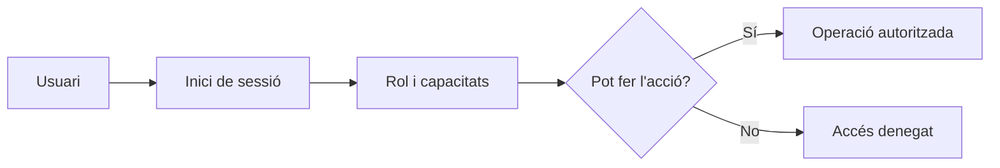

# UP4.5. Usuaris, rols i permisos en WordPress

**Criteri relacionat:** RA1.b.

## 5.1. Autenticació i autorització

Una aplicació multiusuari ha de distingir:

- **Autenticació:** comprovar qui és una persona, habitualment amb usuari i contrasenya.
- **Autorització:** determinar què pot fer una vegada identificada.

Un usuari pot entrar en WordPress i, al mateix temps, **no tindre permís per instal·lar plugins**.

## 5.2. Per què són necessaris els rols?

Imaginem que ByteAcademy disposa de personal tècnic, responsables de continguts i professors que publiquen notícies. No convé que tots tinguen permisos d'administració.

Un **rol** agrupa capacitats. Les capacitats són accions concretes autoritzades, com publicar entrades, editar contingut d'altres usuaris o gestionar opcions del lloc.

### Rols habituals de WordPress

| Rol | Possibilitats típiques |
|---|---|
| **Administrador** | Configurar el lloc, gestionar usuaris, temes i plugins (en instal·lacions estàndard). |
| **Editor** | Gestionar i publicar continguts, també d'altres autors. |
| **Autor** | Crear i publicar les seues pròpies entrades. |
| **Col·laborador** | Redactar les seues entrades, però necessita revisió per publicar-les. |
| **Subscriptor** | Gestionar bàsicament el seu perfil i accedir a contingut autoritzat. |

!!! note "Les capacitats importen més que el nom"
    Els plugins poden afegir rols o capacitats i modificar el comportament. Per això hem de provar les accions reals, no pressuposar que el nom del rol garanteix un comportament determinat.

## 5.3. Principi de mínim privilegi

Cada compte ha de tindre els permisos estrictament necessaris per al seu treball. Aquest principi redueix els errors i el risc si una contrasenya es veu compromesa.

**Exemple ByteAcademy:**

- **Maria (administradora):** instal·la i configura WordPress.
- **Anna (editora):** revisa i publica notícies redactades per altres persones.
- **Pau (autor):** publica les seues entrades de cursos.
- **Marc (col·laborador):** redacta una notícia que ha de revisar Anna.

No han de compartir contrasenyes. En les proves, utilitza comptes de laboratori diferenciats.

## 5.4. Com comprovar permisos de manera correcta

No és suficient mirar una llista d'usuaris. Cal fer una **prova d'autorització**:

1. Crear un compte amb un rol concret.
2. Tancar la sessió d'administrador.
3. Iniciar sessió amb el nou compte (o utilitzar una finestra privada diferent).
4. Intentar una acció que **hauria d'estar permesa**.
5. Intentar una altra que **hauria d'estar prohibida**.
6. Documentar el resultat observat.

| Compte | Acció que provem | Resultat esperat |
|---|---|---|
| Marc · Col·laborador | Crear un esborrany | Permés |
| Marc · Col·laborador | Publicar directament | No permés en una configuració estàndard |
| Pau · Autor | Publicar una entrada pròpia | Permés |
| Pau · Autor | Instal·lar plugins | No permés |
| Anna · Editora | Revisar contingut d'un altre usuari | Permés |

!!! warning "No confundisques visibilitat i permís"
    Que una opció no aparega en el menú no és, per si mateix, una prova completa de seguretat. Intenta realitzar l'operació i comprova que el sistema la permet o la denega.

## 5.5. Contrasenyes i comptes personals

- Cada persona ha de tindre el seu propi compte.
- Les contrasenyes han de ser robustes i no reutilitzar-se en altres servicis.
- Evita publicar captures amb credencials visibles.
- Conserva el compte administrador només per a tasques de configuració i manteniment.
- Revisa els comptes que ja no són necessaris.

## 5.6. Diferència entre rols del lloc i rols del fòrum

Quan instal·lem un plugin de fòrum com bbPress, poden aparéixer **permisos específics del fòrum**. El fet que algú siga autor d'entrades de WordPress no significa que siga moderador del fòrum. Ho aprofundirem en el bloc següent.

!!! question "Comprova que ho has entés"
    1. Explica la diferència entre autenticació i autorització.
    2. Per què no seria adequat donar rol d'administrador a tots els professors de ByteAcademy?
    3. Quin compte hauria de revisar una entrada escrita per un col·laborador?
    4. Quines dues accions provaries amb un usuari per demostrar els seus permisos?
