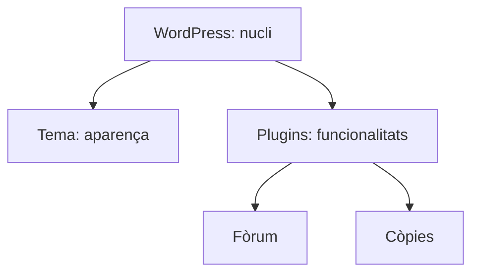
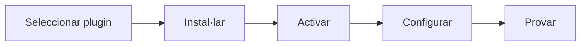

---
hide:
  - navigation
---

# UP4.6. Plugins, menús i fòrums: ampliar WordPress

**Criteris relacionats:** RA1.f i RA1.h.

## 6.1. Què és un plugin?

Un **plugin** és una extensió que incorpora funcionalitats a WordPress. Un CMS és una plataforma modular: no cal que el nucli incloga totes les funcionalitats possibles.

Exemples d'extensions: formularis, galeries, botigues, SEO, còpies de seguretat o fòrums. En ByteAcademy necessitem un **fòrum de dubtes** per als alumnes.



**Tema i plugin no són el mateix:** el tema defineix principalment la presentació; un plugin afegeix o modifica comportaments. Poden existir funcions compartides, però convé mantindre aquesta distinció.

## 6.2. Seleccionar extensions de manera responsable

Abans d'instal·lar qualsevol plugin, cal revisar:

1. Si la funcionalitat és realment necessària.
2. Si el plugin és compatible amb la versió de WordPress utilitzada.
3. Si disposa de manteniment i actualitzacions recents.
4. Si prové d'una font fiable.
5. Si la documentació explica permisos, configuració i manteniment.
6. Si podríem aconseguir el mateix sense instal·lar una extensió innecessària.

!!! warning "Més plugins no significa millor web"
    Cada extensió afegeix dependències, possibles conflictes i superfície d'atac. Instal·la les mínimes necessàries i elimina les que no s'utilitzen.

## 6.3. Instal·lació, activació i comprovació

El procés general és:



Cal diferenciar **instal·lar** de **activar**: un plugin instal·lat pot no estar executant-se. També cal comprovar-ne la configuració i el funcionament en la pàgina pública.

## 6.4. Menús i navegació

Un menú permet accedir a les seccions clau del lloc. A WordPress podem afegir pàgines, categories o enllaços, segons el tema i el tipus de navegació.

**Menú de ByteAcademy:**

```text
Inici | Cursos | Notícies | Fòrum | Sobre nosaltres | Contacte
```

Després de configurar-lo:

- Tots els elements han de portar a una destinació existent.
- L'enllaç al fòrum ha de ser accessible i funcionar.
- La navegació s'ha de revisar des de mòbil.
- No han d'aparéixer elements duplicats o sense destí.

## 6.5. Què és un fòrum?

Un fòrum organitza converses per **temes** i **respostes**, generalment dins de categories o fòrums concrets.

```text
Fòrum: Dubtes dels cursos
├── Tema: Com instal·le Python?
│   ├── Resposta del professor
│   └── Resposta d'un alumne
└── Tema: On trobe els materials?
    └── Resposta de l'administrador
```

Un fòrum permet plantejar dubtes, compartir respostes i mantindre un historial útil. A diferència d'un xat, el contingut està organitzat per fils de conversa.

## 6.6. Fòrum amb bbPress

En aquesta UP utilitzarem **bbPress**, una extensió de fòrums per a WordPress. El professor proporcionarà la configuració de base i la versió compatible o indicarà el plugin que cal instal·lar.

Tasques generals:

1. Instal·lar i activar bbPress.
2. Crear un fòrum anomenat **Dubtes dels cursos**.
3. Afegir-lo al menú de navegació.
4. Crear comptes o assignar rols adequats als participants.
5. Publicar un tema de prova i respondre-hi.
6. Comprovar la moderació i els permisos.

### Participants i moderadors

Els permisos del fòrum poden diferenciar participants, moderadors i administradors. També poden existir opcions de visibilitat del fòrum. **Els noms exactes i les capacitats depenen de la versió i la configuració**.

| Acció | Participant | Moderador |
|---|---|---|
| Llegir converses autoritzades | Habitualment sí | Sí |
| Crear temes on té permís | Segons configuració | Sí |
| Respondre | Segons configuració | Sí |
| Moderar contingut d'altres | No habitualment | Sí |

!!! important "Validar regles d'accés"
    El CA1.h no queda demostrat simplement perquè el fòrum aparega a la web. Cal provar que un participant pot publicar o respondre **quan està autoritzat** i que no pot executar les accions reservades a la moderació.

## 6.7. Proves del fòrum

| Prova | Resultat esperat |
|---|---|
| Obrir el fòrum des del menú | Es mostra el fòrum correcte. |
| Crear un tema amb un participant autoritzat | El tema es crea i es pot consultar. |
| Respondre amb un segon compte | La resposta apareix on correspon. |
| Intentar una acció de moderació amb un participant | L'acció no està autoritzada. |
| Moderar amb el compte adequat | La moderació funciona. |
| Comprovar visibilitat amb un visitant | Coincideix amb la regla d'accés configurada. |

!!! question "Comprova que ho has entés"
    1. Quina diferència hi ha entre instal·lar i activar un plugin?
    2. Per què no convé instal·lar extensions que no utilitzem?
    3. Quin avantatge aporta un fòrum respecte d'una única pàgina de comentaris?
    4. Quina comprovació faria falta per demostrar que les regles d'accés funcionen?
