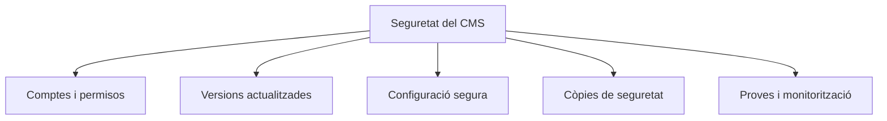
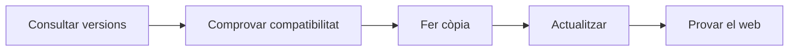
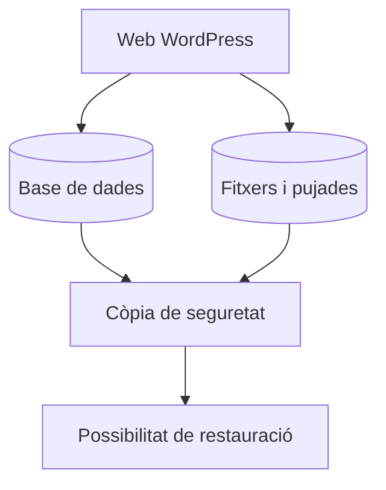

---
hide:
  - navigation
---

# UP4.7. Seguretat, actualitzacions, còpies i proves funcionals

**Criteris relacionats:** RA1.e, RA1.g, RA1.i i RA1.j. També reforça el RA1.d.

## 7.1. Per què cal mantindre un CMS?

Una web no acaba quan la publiquem. WordPress combina nucli, plugins, temes, servidors i dades. Qualsevol component pot tindre errors, incompatibilitats o vulnerabilitats. Per això necessitem un procés de manteniment.

Un atacant podria intentar obtenir credencials, aprofitar permisos massa amplis, explotar un plugin vulnerable o modificar contingut públic.



## 7.2. Confidencialitat, integritat i disponibilitat

- **Confidencialitat:** les dades només són accessibles a les persones autoritzades.
- **Integritat:** el contingut no es modifica de manera no autoritzada.
- **Disponibilitat:** el servei es manté accessible per a les persones autoritzades.

**Exemples:** una contrasenya robada amenaça la confidencialitat; una entrada alterada, la integritat; una fallada del servidor, la disponibilitat.

## 7.3. Mecanismes de seguretat del propi WordPress

Algunes decisions de configuració que podem comprovar des del panell:

- Comptes separats i rols adequats.
- Administradors només quan siguen necessaris.
- Desactivar el registre obert de nous usuaris si ByteAcademy no el necessita.
- Revisar i moderar comentaris, si estan habilitats.
- Mantindre el nucli, temes i plugins actualitzats.
- Eliminar plugins i temes que ja no utilitzem.
- Utilitzar contrasenyes adequades.

!!! note "No totes les funcions són natives"
    Algunes mesures, com determinades formes d'autenticació multifactor o limitació d'intents d'inici de sessió, poden requerir extensions o controls del servidor. No les descrigues com si estigueren sempre disponibles per defecte.

## 7.4. HTTP, HTTPS i entorn de laboratori

**HTTP** transporta peticions i respostes sense el xifrat que proporciona TLS. **HTTPS** utilitza TLS per protegir les comunicacions. En una instal·lació pública, HTTPS és necessari per protegir credencials i sessions.

En aquest mòdul podem treballar amb un servei en `localhost` i HTTP **només perquè és un laboratori de proves**, sense dades personals reals i sense exposar-lo a Internet.

!!! danger "No publicar un WordPress de classe a Internet sense protegir-lo"
    La configuració simplificada amb HTTP i credencials de laboratori no s'ha de desplegar tal qual com a web pública.

## 7.5. Actualitzacions segures

Una actualització pot corregir vulnerabilitats i errors, però també pot introduir incompatibilitats. Per això és preferible seguir un ordre:



### Què hem de revisar?

- Versió i avisos del nucli de WordPress.
- Actualitzacions pendents dels plugins actius.
- Actualitzacions disponibles del tema.
- Compatibilitat amb la instal·lació existent.
- Resultats de les proves després del canvi.

Si no hi ha cap actualització disponible, **no baixes artificialment a una versió vulnerable**. Documenta la consulta realitzada i, si el professor ho indica, efectua una actualització controlada d'un component adequat.

## 7.6. Exportar continguts no és el mateix que fer una còpia completa

WordPress pot exportar continguts en un format de dades que facilita la migració de pàgines i entrades. Però **això no és necessàriament una còpia completa del lloc**: pot no incloure tota la configuració, els plugins, els temes, els arxius i les dades necessàries per restaurar-lo exactament.

Una còpia de recuperació d'una instal·lació habitual ha de contemplar:

1. **Base de dades:** continguts, usuaris i configuració.
2. **Fitxers del lloc:** especialment `wp-content` (temes, plugins, pujades) i altres fitxers de configuració necessaris.
3. **Instruccions de restauració:** com reconstruir la instal·lació de manera segura.



!!! important "La còpia és útil si es pot recuperar"
    No és suficient mostrar una notificació de «còpia completada». Cal verificar que s'han generat els fitxers o paquets esperats i, si l'entorn ho permet, provar una restauració en una instància de laboratori separada.

### Còpia de seguretat en la pràctica

El professor indicarà una ferramenta o un procediment guiats compatibles amb la instal·lació. Pot ser un plugin adequat de backup o una còpia de la base de dades i dels fitxers del lloc. **No s'han de publicar arxius amb contrasenyes o informació confidencial**. L'alumnat ha de descriure què s'ha copiat i quin procediment seguiria per restaurar-ho.

## 7.7. Què és una prova funcional?

Una prova funcional comprova si una característica fa allò que s'espera. Necessitem definir:

- **Acció:** què fa l'usuari.
- **Resultat esperat:** què hauria de passar.
- **Resultat observat:** què ha passat realment.
- **Estat:** superada o pendent de corregir.

| Acció | Resultat esperat | Resultat observat |
|---|---|---|
| Obrir la pàgina de cursos | Carrega correctament | A completar |
| Accedir amb un col·laborador | Pot redactar però no publicar directament | A completar |
| Publicar una resposta al fòrum | Apareix al fil autoritzat | A completar |
| Intentar moderar amb participant | Accés denegat | A completar |
| Reiniciar el servei | La web i les dades continuen disponibles | A completar |

## 7.8. Proves inicials i proves finals

Els criteris **RA1.d i RA1.i** tenen una redacció molt semblant. En la unitat els treballarem en dos moments diferents:

- **RA1.d:** proves inicials després de la instal·lació i de les primeres pàgines.
- **RA1.i:** proves finals o de regressió després de personalitzar, instal·lar plugins, configurar rols i aplicar canvis.

Això ens permet comprovar no sols que WordPress funciona inicialment, sinó que **continua funcionant després dels canvis**.

## 7.9. Auditoria bàsica de ByteAcademy

| Comprovació | Què ens aporta? |
|---|---|
| Contrasenya administrativa robusta | Protecció del compte principal. |
| Rols diferenciats | Menys risc d'edició no autoritzada. |
| Registre obert revisat | Evita altes no desitjades. |
| Comentaris moderats (si s'utilitzen) | Menys contingut inadequat. |
| Plugins i temes revisats | Redueix dependències vulnerables. |
| Còpia verificable | Permet preparar una recuperació. |
| Fòrum amb permisos provats | Control sobre publicació i moderació. |
| Navegació i formularis provats | Fiabilitat per a l'usuari final. |

## 7.10. Extensió opcional: WordPress com a font de dades

WordPress incorpora una **API REST** que pot retornar dades estructurades, habitualment JSON. En una instal·lació de prova es pot observar una petició a:

```text
http://localhost:8082/wp-json/wp/v2/posts
```

La resposta pot contindre un conjunt d'entrades públiques en JSON. Això permet relacionar WordPress amb les API, HTTP i el desenvolupament d'aplicacions que després apareixeran en DAW. **És una demostració, no una tasca obligatòria del RA1.**

!!! question "Comprova que ho has entés"
    1. Per què una actualització requereix una comprovació posterior?
    2. Quina diferència hi ha entre exportar entrades i fer una còpia completa?
    3. Quins dos components principals caldria preservar per recuperar el WordPress de ByteAcademy?
    4. Per què una captura d'un menú d'usuaris no demostra que els permisos funcionen?
    5. Explica una prova funcional amb acció, resultat esperat i resultat observat.
