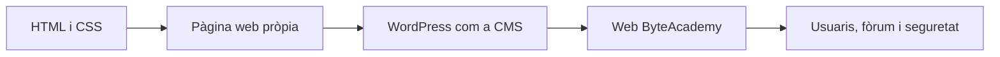

---
hide:
  - navigation
title: "UP4. Gestors de continguts web: WordPress, HTML i CSS"
description: "Unitat sobre HTML, CSS, WordPress, usuaris, plugins, fòrums, seguretat i còpies de seguretat."
---

# UP4. Gestors de continguts web: WordPress, HTML i CSS

**Mòdul:** Aplicacions Web · 2n d'SMX  
**Resultat d'aprenentatge:** **RA1.** Instal·la gestors de continguts, identificant les seues aplicacions i configurant-los segons requeriments.  
**Pes del RA en el mòdul:** 30 %  
**Temporalització de la UP:** 21 hores (set setmanes, amb una sessió d'1 hora i una de 2 hores per setmana).

## Què aprendrem?

En aquesta unitat assumirem el paper d'un equip que crea el web de **ByteAcademy**, una acadèmia fictícia de formació en informàtica. Primer construirem una pàgina amb HTML i CSS per entendre les tecnologies del navegador. Després instal·larem WordPress i utilitzarem els coneixements anteriors per crear, personalitzar i administrar el lloc web de l'acadèmia.

!!! info "Dues maneres de construir un web"
    **HTML i CSS** ens permeten construir i personalitzar directament la interfície. Un **CMS** com WordPress ens ajuda a administrar pàgines, continguts, usuaris i funcionalitats sense haver de programar-ho tot des de zero.

## Objectius

En acabar la UP seràs capaç de:

1. Escriure una pàgina HTML senzilla amb estructura semàntica.
2. Aplicar CSS per millorar-ne l'aparença i adaptar-la a diferents pantalles.
3. Explicar les diferències entre una web estàtica i un CMS dinàmic.
4. Identificar els requisits d'instal·lació de WordPress i posar-lo en marxa amb una configuració guiada.
5. Crear pàgines i entrades, gestionar menús i personalitzar un tema.
6. Gestionar usuaris amb diferents rols i comprovar-ne els permisos.
7. Instal·lar i configurar un plugin de fòrum i les seues regles d'accés.
8. Revisar la seguretat, les actualitzacions i les còpies de seguretat.
9. Fer i documentar proves funcionals del web.

## Continguts teòrics

| Bloc | Què estudiarem? |
|---|---|
| **[UP4.1. Introducció a HTML](01-introduccio-html.md)** | Navegador, estructura HTML, etiquetes, semàntica i enllaços. |
| **[UP4.2. Introducció a CSS](02-introduccio-css.md)** | Selectors, classes, model de caixa, Flexbox i responsive. |
| **[UP4.3. Què és un CMS?](03-cms-arquitectura-wordpress.md)** | WordPress, arquitectura, requisits i desplegament. |
| **[UP4.4. Creació i personalització](04-creacio-personalitzacio.md)** | Pàgines, temes, editor de blocs, HTML i CSS propi. |
| **[UP4.5. Usuaris, rols i permisos](05-usuaris-rols-permisos.md)** | Autenticació, capacitats, flux editorial i proves d'accés. |
| **[UP4.6. Plugins, menús i fòrums](06-plugins-menus-forums.md)** | Extensions, navegació, bbPress i moderació. |
| **[UP4.7. Seguretat i manteniment](07-seguretat-manteniment-copies.md)** | Actualitzacions, mecanismes de protecció, còpies i proves. |

## Activitats

- **[A4.1. La primera pàgina web amb HTML i CSS](activitats/activitat-4-1-html-css.md).** Construcció individual de la portada inicial de ByteAcademy. Activitat preparatòria, amb retroacció formativa.
- **[A4.2. Implantació i administració de WordPress](activitats/activitat-4-2-wordpress.md).** Projecte integrador amb tres fases i tres validacions amb el professor. Les evidències d'avaluació del RA1 s'obtenen principalment ací.

## Criteris d'avaluació del RA1

| Criteri | Què es comprovarà? |
|---|---|
| **RA1.a** | Requisits necessaris per instal·lar un gestor de continguts. |
| **RA1.b** | Gestió d'usuaris amb rols diferents. |
| **RA1.c** | Personalització de la interfície del CMS. |
| **RA1.d** | Proves inicials de funcionament. |
| **RA1.e** | Tasques d'actualització i seguretat. |
| **RA1.f** | Mòduls/plugins i menús instal·lats i configurats. |
| **RA1.g** | Mecanismes de seguretat habilitats i configurats. |
| **RA1.h** | Fòrums habilitats i regles d'accés establides. |
| **RA1.i** | Proves funcionals finals, incloent-hi canvis i extensions. |
| **RA1.j** | Còpies de seguretat dels continguts. |

!!! note "Preparació per a DAW"
    HTML semàntic, CSS, classes, el model de caixa, el disseny responsive, les eines de desenvolupador, les API i els rols d'usuari són coneixements que tornaràs a utilitzar en el desenvolupament d'aplicacions web.

## Organització del treball

La UP es desenvolupa al llarg de set setmanes. Les primeres dues se centren en HTML i CSS, i les altres cinc en WordPress. Es treballarà amb explicacions breus, exemples i pràctiques individuals. En l'A4.2 caldrà validar amb el professor el final de cada fase. No publiques contrasenyes ni dades personals en captures o lliuraments.

### Seqüència docent

| Setmana | Dilluns (1 h) | Dimecres (2 h) | Treball principal |
|---|---|---|---|
| 1 | Web i HTML inicial | HTML semàntic i pàgina base | A4.1 |
| 2 | Selectors CSS | Model de caixa, Flexbox i responsive | A4.1 |
| 3 | CMS i arquitectura | Instal·lació i pàgines WordPress | A4.2 F1 |
| 4 | Temes i editor | Continguts i HTML/CSS propi; validació 1 | A4.2 F1 |
| 5 | Usuaris i permisos | Rols, menús i inici del fòrum | A4.2 F2 |
| 6 | Plugins | Fòrum i validació 2; seguretat inicial | A4.2 F2–F3 |
| 7 | Seguretat i còpies | Proves finals i validació 3 | A4.2 F3 |

### Correspondència CA → material → evidència

| Criteri | Teoria | Evidència |
|---|---|---|
| RA1.a | UP4.3 | A4.2: components/requisits |
| RA1.b | UP4.5 | A4.2: rols i comprovacions |
| RA1.c | UP4.1, UP4.2 i UP4.4 | A4.2: HTML/CSS personalitzat |
| RA1.d | UP4.3 i UP4.4 | A4.2: proves inicials |
| RA1.e | UP4.7 | A4.2: revisió/actualització segura |
| RA1.f | UP4.4 i UP4.6 | A4.2: menú i plugin |
| RA1.g | UP4.5 i UP4.7 | A4.2: mecanismes de seguretat |
| RA1.h | UP4.6 | A4.2: fòrum i accés |
| RA1.i | UP4.7 | A4.2: proves finals |
| RA1.j | UP4.7 | A4.2: còpia verificable |
