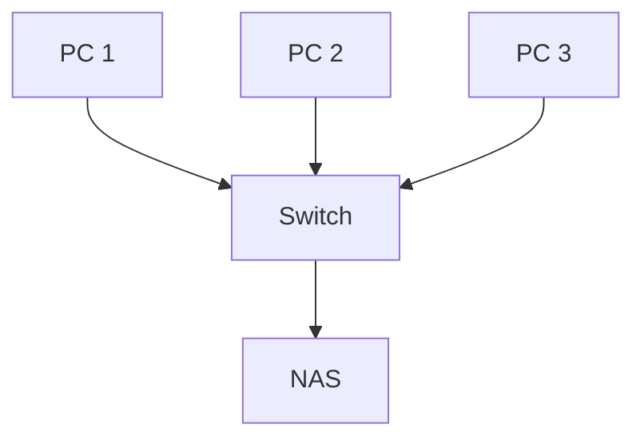

---
hide:
  - navigation
---
# 2. Factors i mètodes d’emmagatzematge

## Factors que cal comparar

No existeix un únic sistema adequat per a totes les situacions. La decisió ha de considerar diversos factors alhora.

| Factor | Pregunta que cal respondre |
| --- | --- |
| Capacitat | Quantes dades caben i quina capacitat queda disponible? |
| Rendiment | Quina velocitat i quina latència necessitem? |
| Disponibilitat | Podem accedir a les dades quan falla un component? |
| Accessibilitat | Des d’on i quants usuaris hi accediran? |
| Cost | Quin és el cost inicial, recurrent i de manteniment? |
| Escalabilitat | Podem créixer sense substituir tota la solució? |
| Seguretat | Hi ha permisos, xifrat, registre i protecció física? |

### Capacitat i rendiment

La capacitat s’expressa habitualment en KB, MB, GB, TB i PB. Cal diferenciar la capacitat instal·lada de la capacitat útil: RAID, formatació, metadades i reserves poden reduir l’espai disponible.

El rendiment depén del dispositiu, la interfície, la latència, les operacions per segon i la xarxa. Un SSD NVMe pot ser molt ràpid, però si l’accés es fa per una xarxa lenta el coll de botella serà la xarxa.

### Disponibilitat i accessibilitat

La disponibilitat mesura si el servei està operatiu quan es necessita. RAID, fonts redundants, replicació i servidors duplicats poden reduir les interrupcions, però no substitueixen el backup.

L’accessibilitat descriu des d’on i com s’accedeix: localment, per xarxa, remotament o per Internet, amb un usuari o amb molts usuaris simultanis.

## Mètodes principals

### Emmagatzematge local

La informació es guarda directament en el mateix equip: HDD, SSD SATA o SSD NVMe.

**Avantatges:** alta velocitat, configuració senzilla, independència de la xarxa i cost relativament baix.

**Inconvenients:** accés limitat a l’equip, dificultat per compartir i risc de pèrdua si falla el dispositiu.

### DAS

**DAS** (*Direct Attached Storage*) és un dispositiu connectat directament a un ordinador mitjançant USB, SATA, USB-C o Thunderbolt.

És senzill, econòmic i pot oferir bon rendiment, però normalment depén d’un únic equip i deixa d’estar disponible quan es desconnecta.

### NAS

**NAS** (*Network Attached Storage*) és un dispositiu connectat a la xarxa per compartir fitxers. Sol incloure diversos discos, sistema propi, usuaris, permisos, RAID i serveis de còpia.

Protocols habituals: **SMB/CIFS**, **NFS**, **SFTP/FTP** i **WebDAV**. És adequat per centralitzar documents en una pime, però depén de la xarxa, necessita administració i no és una còpia per si mateix.

### SAN

**SAN** (*Storage Area Network*) és una xarxa especialitzada que proporciona emmagatzematge a nivell de bloc per a servidors. És habitual en centres de dades i virtualització.

| NAS | SAN |
| --- | --- |
| Compartició de fitxers | Emmagatzematge de blocs |
| SMB o NFS | iSCSI o Fibre Channel |
| Habitual en pimes | Habitual en infraestructures grans |
| Administració més senzilla | Més complexa i costosa |

### Núvol

El núvol ofereix emmagatzematge accessible per Internet, com ara una unitat compartida, un servei de fitxers o emmagatzematge d’objectes.

**Avantatges:** accés des de diverses ubicacions, escalabilitat i disponibilitat del proveïdor.

**Inconvenients:** dependència d’Internet i del proveïdor, cost recurrent i consideracions sobre privacitat, ubicació i sobirania de les dades.

!!! important "Sincronització no és backup"
    Si una carpeta sincronitzada replica una eliminació o un xifrat per ransomware, pot deixar totes les ubicacions amb el mateix problema. Un backup ha de conservar versions recuperables i independents.

## Comparació ràpida

| Solució | Accés | Ús habitual | Risc principal |
| --- | --- | --- | --- |
| Local | Un equip | Sistema operatiu i aplicacions | Fallada del dispositiu |
| DAS | Equip connectat | Projectes grans i còpia puntual | Dependència física d’un equip |
| NAS | Xarxa local | Fitxers compartits i backups | Error de configuració o xarxa |
| SAN | Servidors | Virtualització i centres de dades | Cost i complexitat |
| Núvol | Internet | Accés remot i escalabilitat | Dependència del proveïdor |

## Decidir amb una matriu

Assigna una puntuació de l’1 al 5 a cada alternativa i multiplica-la pel pes del requisit. Un servidor de fitxers per a dotze usuaris podria prioritzar accessibilitat, permisos, disponibilitat i còpies per damunt de la velocitat màxima d’un disc local.

| Criteri | Pes | Local | DAS | NAS | Núvol |
| --- | ---: | ---: | ---: | ---: | ---: |
| Rendiment | 3 | | | | |
| Compartició | 5 | | | | |
| Disponibilitat | 4 | | | | |
| Cost | 3 | | | | |
| Control de les dades | 4 | | | | |

[Següent: redundància i RAID](03-redundancia-raid.md) · [Pàgina principal de la UP2](../ut2-emmagatzematge.md)
