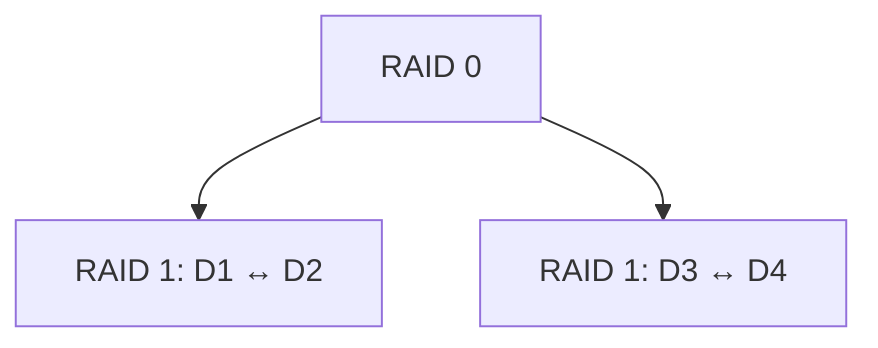
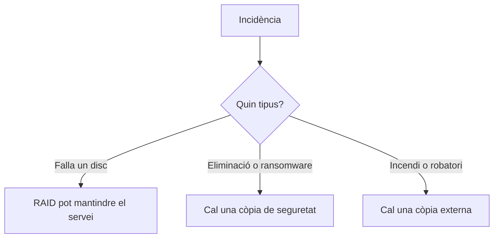

---
hide:
  - navigation
---
# 3. Redundància i RAID

## Què és la redundància?

La **redundància** consisteix a disposar d’informació duplicada o d’informació addicional que permeta continuar funcionant quan falla un component. El seu objectiu principal és augmentar la disponibilitat i la tolerància a fallades. Hola Lucia

## RAID

**RAID** (*Redundant Array of Independent Disks*) combina discos físics en una unitat lògica. Segons el nivell, pot buscar rendiment, redundància o les dues coses.

### RAID 0

Distribueix les dades entre els discos (*striping*).

```text
Fitxer: A B C D E F
Disc 1: A C E
Disc 2: B D F
```

Amb `n` discos de la mateixa mida: `capacitat = n × mida`. Ofereix rendiment i aprofita tot l’espai, però no tolera cap fallada: si falla un disc, es perd l’array complet.

### RAID 1

Manté una còpia idèntica en dos discos (*mirroring*). Amb dos discos de 2 TB la capacitat útil aproximada és 2 TB. És senzill i tolera la fallada d’un disc, però aprofita aproximadament la meitat de la capacitat.

### RAID 5

Distribueix dades i paritat entre almenys tres discos. La paritat permet reconstruir la informació d’un disc que ha fallat.

```text
Disc 1   Disc 2   Disc 3
 A         B        P
 C         P        D
 P         E        F
```

Capacitat aproximada: `(n - 1) × mida del disc més menut`. Quatre discos de 2 TB ofereixen uns 6 TB útils. Tolera una fallada, però la reconstrucció pot ser lenta i durant aquest procés l’array és més vulnerable.

### RAID 6

És semblant a RAID 5 però utilitza doble paritat i necessita almenys quatre discos. Pot suportar dues fallades simultànies. Capacitat aproximada: `(n - 2) × mida del disc`.

### RAID 10

Combina RAID 1 i RAID 0: primer crea parelles en mirall i després distribueix dades entre les parelles.



Ofereix bon rendiment, tolerància i reconstruccions senzilles, però necessita almenys quatre discos i la capacitat útil és aproximadament la meitat. La tolerància concreta depén de quins discos fallen.

## Comparació

| RAID | Mínim | Fallades tolerades | Capacitat aproximada | Ús principal |
| --- | ---: | --- | --- | --- |
| RAID 0 | 2 | Cap | 100 % | Rendiment sense redundància |
| RAID 1 | 2 | 1 disc | 50 % | Redundància senzilla |
| RAID 5 | 3 | 1 disc | `(n-1)` discos | Equilibri |
| RAID 6 | 4 | 2 discos | `(n-2)` discos | Capacitat i tolerància |
| RAID 10 | 4 | Depén de la parella | 50 % | Rendiment i redundància |

## RAID no és una còpia de seguretat

RAID pot mantindre el servei davant la fallada física d’un disc, però no recupera una eliminació accidental, un ransomware, una corrupció lògica, un robatori, un incendi o un error d’administració.



> **RAID millora la disponibilitat. El backup permet recuperar informació i versions anteriors.**

## Activitat de càlcul

Calcula la capacitat útil aproximada i la tolerància:

1. RAID 1 amb dos discos de 4 TB.
2. RAID 5 amb quatre discos de 2 TB.
3. RAID 6 amb sis discos de 4 TB.
4. RAID 10 amb quatre discos de 1 TB.

Després explica quin nivell triaries per a un servidor de màquines virtuals i quin triaries per a un arxiu on predomina la capacitat.

!!! warning "Pràctiques"
    No crees ni modifiques un RAID sobre discos amb dades reals. Utilitza discos virtuals de prova i comprova sempre les rutes amb `lsblk`.

[Següent: emmagatzematge distribuït](04-emmagatzematge-distribuit.md) · [Pàgina principal de la UP2](../ut2-emmagatzematge.md)
